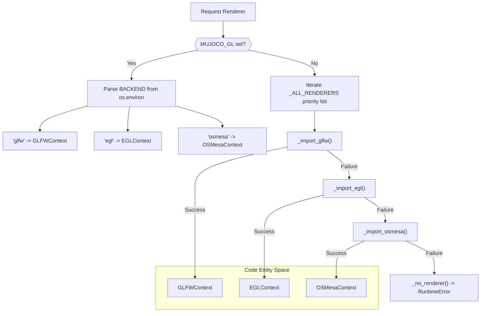
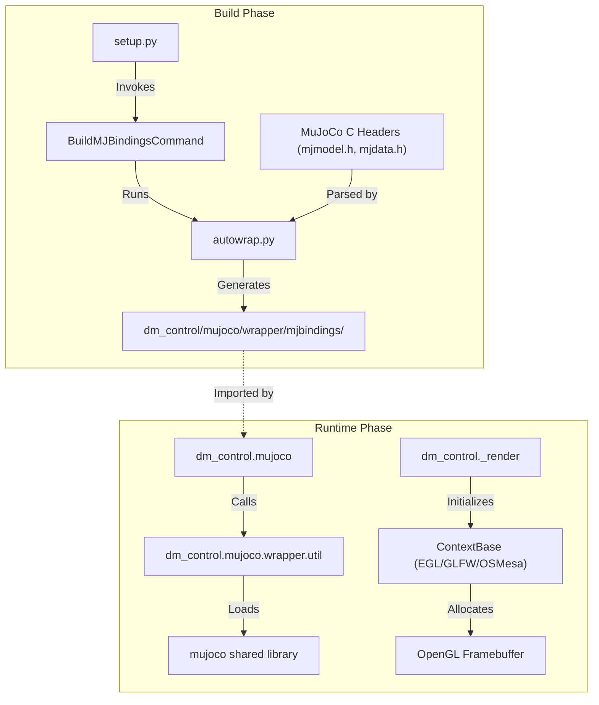

<!-- source: DeepWiki mcp.deepwiki.com · repo google-deepmind/dm_control · page 1.1 Installation and Setup · fetched 2026-10-26 -->

# Installation and Setup

<details>
<summary>Relevant source files</summary>

The following files were used as context for generating this wiki page:

- [README.md](README.md)
- [dm_control/_render/__init__.py](dm_control/_render/__init__.py)
- [dm_control/_render/constants.py](dm_control/_render/constants.py)
- [dm_control/_render/executor/__init__.py](dm_control/_render/executor/__init__.py)
- [dm_control/_render/executor/render_executor_test.py](dm_control/_render/executor/render_executor_test.py)
- [dm_control/_render/glfw_renderer_test.py](dm_control/_render/glfw_renderer_test.py)
- [dm_control/_render/pyopengl/__init__.py](dm_control/_render/pyopengl/__init__.py)
- [dm_control/_render/pyopengl/egl_ext.py](dm_control/_render/pyopengl/egl_ext.py)
- [dm_control/_render/pyopengl/egl_renderer.py](dm_control/_render/pyopengl/egl_renderer.py)
- [dm_control/_render/pyopengl/osmesa_renderer.py](dm_control/_render/pyopengl/osmesa_renderer.py)
- [dm_control/mjcf/schema.xml](dm_control/mjcf/schema.xml)
- [dm_control/mjcf/schema_test.py](dm_control/mjcf/schema_test.py)
- [dm_control/mujoco/tutorial.ipynb](dm_control/mujoco/tutorial.ipynb)
- [pyproject.toml](pyproject.toml)
- [requirements.txt](requirements.txt)
- [setup.py](setup.py)
- [tutorial.ipynb](tutorial.ipynb)

</details>


This page guides users through installing `dm_control` and its dependencies, configuring the appropriate OpenGL rendering backends (`EGLContext`, `GLFWContext`, `OSMesaContext`), and verifying the installation.

## System Requirements

### Python Version
`dm_control` requires Python 3.9 or newer [setup.py:186-186]().

### Operating Systems and Hardware
- **Linux**: Fully supported for windowed (GLFW), headless GPU (EGL), and software (OSMesa) rendering [README.md:97-111]().
- **macOS**: Requires a Homebrew-installed Python interpreter and library path configuration [README.md:118-126]().
- **Windows**: Supported with compatible graphics drivers [README.md:53-59]().
- **GPU Acceleration**: Recommended for optimal simulation and rendering performance. Headless GPU execution requires EGL drivers supporting `EXT_platform_device` [README.md:104-107]().

Sources: [setup.py:186-186](), [README.md:89-126]()

## Basic Installation

### PyPI Installation
To install the stable release of `dm_control` from PyPI, run:

```bash
pip install dm_control
```

This installation triggers the `InstallCommand` class defined in `setup.py`, which executes `BuildMJBindingsCommand` to build low-level Python bindings via `autowrap.py` [setup.py:71-142]().

### Source Installation
To install the latest development version directly from the repository:

```bash
pip install git+https://github.com/google-deepmind/dm_control.git
```

> **Warning**: `dm_control` **cannot** be installed in "editable" mode (`pip install -e`). Attempting an editable install causes import failures because the dynamic binding generator populates `dm_control/mujoco/wrapper/mjbindings` at installation time rather than runtime, which breaks path resolution for low-level constants [README.md:61-75]().

Sources: [setup.py:71-142](), [README.md:55-87]()

## Dependencies

`dm_control` relies on core third-party packages declared in `setup.py` and `requirements.txt`:

| Dependency | Minimum Version | Role in Codebase |
| :--- | :--- | :--- |
| `mujoco` | `>= 3.16.0` | Underlying physics engine and C bindings [setup.py:194-194](), [requirements.txt:9-9]() |
| `numpy` | `>= 1.9.0` | Numerical array representations for `MjModel` and `MjData` [setup.py:195-195](), [requirements.txt:10-12]() |
| `dm-env` | — | Standard reinforcement learning environment interface [setup.py:189-189](), [requirements.txt:2-2]() |
| `dm-tree` | `!= 0.1.2` | Nesting and unnesting observation structures [setup.py:190-190](), [requirements.txt:3-3]() |
| `glfw` | — | Windowing management and input for the interactive viewer [setup.py:191-191](), [requirements.txt:4-4]() |
| `labmaze` | — | Procedural maze generation for locomotion tasks [setup.py:192-192](), [requirements.txt:6-6]() |
| `lxml` | — | XML parsing for the `mjcf` subsystem [setup.py:193-193](), [requirements.txt:7-7]() |
| `pyopengl` | `>= 3.1.4` | OpenGL bindings used by `EGLContext` and `OSMesaContext` [setup.py:197-197](), [requirements.txt:15-15]() |

Sources: [setup.py:187-203](), [requirements.txt:1-25]()

## Rendering Setup and Backends

The rendering subsystem (`dm_control._render`) manages OpenGL contexts by attempting to load backends in a specific priority order or via explicit environment configuration [dm_control/_render/__init__.py:16-108]().

### Title: Rendering Backend Resolution and Class Mapping

Sources: [dm_control/_render/__init__.py:31-108](), [dm_control/_render/constants.py:19-32]()

### Configuring Rendering Backends

- **GLFW (`glfw`)**: Used for interactive visualization via `dm_control.viewer`. Requires windowing libraries like `libglfw3` on Linux or Homebrew `glfw` on macOS [README.md:96-103]().
- **EGL (`egl`)**: Headless hardware-accelerated rendering using `EGLContext` in `dm_control._render.pyopengl.egl_renderer` [dm_control/_render/pyopengl/egl_renderer.py:93-140](). Controlled via environment variables:
  - `MUJOCO_GL=egl`
  - `MUJOCO_EGL_DEVICE_ID=N` to select a specific GPU device index [dm_control/_render/pyopengl/egl_renderer.py:46-55]()
- **OSMesa (`osmesa`)**: Pure software-based rendering via `OSMesaContext` in `dm_control._render.pyopengl.osmesa_renderer` [dm_control/_render/pyopengl/osmesa_renderer.py:44-86](). Selected with `MUJOCO_GL=osmesa` [dm_control/_render/__init__.py:21-22]().

Sources: [README.md:89-126](), [dm_control/_render/pyopengl/egl_renderer.py:43-70](), [dm_control/_render/pyopengl/osmesa_renderer.py:44-86]()

## Installation and Binding Architecture

### Title: Low-Level Binding Generation and Runtime Initialization Pipeline

Sources: [setup.py:33-119](), [dm_control/_render/base.py:48-67](), [dm_control/mujoco/wrapper/util.py:20-50]()

## Verification

Verify the complete installation and rendering stack by executing a python snippet that instantiates a Control Suite environment and renders a frame:

```python
from dm_control import suite

# Load a benchmark environment
env = suite.load(domain_name="cartpole", task_name="swingup")

# Render a frame (initializes the physics session and active OpenGL context)
pixels = env.physics.render(height=240, width=320)

print(f"Installation verified. Rendered frame shape: {pixels.shape}")
```

In Google Colab environments, ensure `MUJOCO_GL=egl` is exported prior to importing `dm_control` to route rendering through the GPU runtime [tutorial.ipynb:96-103]().

Sources: [tutorial.ipynb:93-113](), [dm_control/mujoco/tutorial.ipynb:93-112]()

## Environment Variables Summary

| Environment Variable | Code Reference | Description |
| :--- | :--- | :--- |
| `MUJOCO_GL` | [dm_control/_render/constants.py:19-19]() | Selects the active rendering backend (`glfw`, `egl`, `osmesa`). |
| `MUJOCO_EGL_DEVICE_ID` | [dm_control/_render/pyopengl/egl_renderer.py:46-46]() | Specifies the target GPU integer index when using `EGLContext`. |
| `PYOPENGL_PLATFORM` | [dm_control/_render/constants.py:22-22]() | Internal PyOpenGL platform configuration variable. |
| `MJLIB_PATH` | [dm_control/mujoco/wrapper/util.py:25-25]() | Optional direct override path for the compiled MuJoCo shared library. |

Sources: [dm_control/_render/constants.py:18-32](), [dm_control/_render/pyopengl/egl_renderer.py:43-55](), [dm_control/mujoco/wrapper/util.py:20-30]()

---

