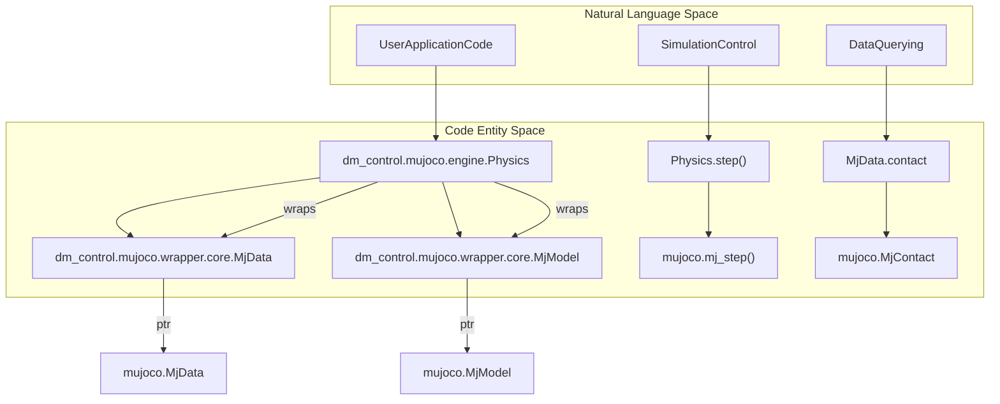
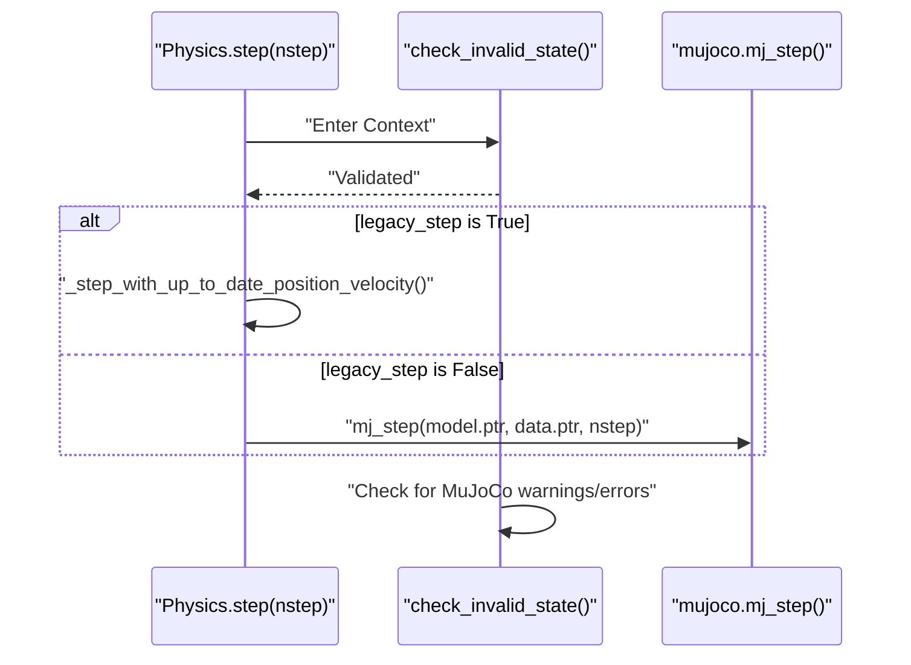

<!-- source: DeepWiki mcp.deepwiki.com · repo google-deepmind/dm_control · page 1.2 Migration Guide (v1.0) · fetched 2026-10-26 -->

# Migration Guide (v1.0)

<details>
<summary>Relevant source files</summary>

The following files were used as context for generating this wiki page:

- [dm_control/mujoco/engine.py](dm_control/mujoco/engine.py)
- [dm_control/mujoco/engine_test.py](dm_control/mujoco/engine_test.py)
- [dm_control/mujoco/wrapper/core.py](dm_control/mujoco/wrapper/core.py)
- [dm_control/mujoco/wrapper/core_test.py](dm_control/mujoco/wrapper/core_test.py)
- [dm_control/mujoco/wrapper/util.py](dm_control/mujoco/wrapper/util.py)
- [migration_guide_1.0.md](migration_guide_1.0.md)

</details>


This section documents the breaking changes and architectural shifts introduced in `dm_control` version 1.0.0. The primary driver for this update is the migration from legacy internal Python bindings to the official upstream MuJoCo Python bindings (`mujoco` package).

Sources: [migration_guide_1.0.md:1-8]()

---

## Overview of Changes

The transition to the native `mujoco` package improves runtime stability, performance, and error handling. However, it introduces breaking changes in how underlying C data structures are accessed, how memory is managed, and how exceptions are thrown.

### Key Architectural Shift

The following diagram illustrates the relationship between the `dm_control` high-level `Physics` API and the underlying `mujoco` library entities.

**Data Access and Execution Flow**

Sources: [dm_control/mujoco/engine.py:83-124](), [dm_control/mujoco/wrapper/core.py:16-30]()

---

## Required Code Changes

### 1. `MjData.contact` Interface
In previous versions, `MjData.contact` behaved like a NumPy structured array, supporting vectorized boolean indexing directly on contact fields. In v1.0, `MjData.contact` is represented as a list-like collection of `MjContact` structs [migration_guide_1.0.md:15-22]().

**Comparison Table: Contact Access**

| Feature | Pre-v1.0 (Legacy) | v1.0 (New Bindings) |
| :--- | :--- | :--- |
| **Data Type** | Structured NumPy Array | List of `MjContact` structs |
| **Filtering** | `contact[contact.geom1 == id]` | List comprehension or loops |
| **Field Access** | `contact.dist` (returns array) | `[c.dist for c in contact]` |

**Example Migration:**
```python
# Legacy code
contact = physics.data.contact
involves_geom = (contact.geom1 == geom_id) | (contact.geom2 == geom_id)
dists = contact[involves_geom].dist

# v1.0 code
contacts = physics.data.contact
dists = [c.dist for c in contacts if c.geom1 == geom_id or c.geom2 == geom_id]
```
Sources: [migration_guide_1.0.md:23-39]()

### 2. Exception Handling and Error Flow
The exception hierarchy has shifted. While `dm_control.mujoco.wrapper.core.Error` remains as a base class [dm_control/mujoco/wrapper/core.py:42-44](), the underlying `mujoco` library now throws native Python exceptions [migration_guide_1.0.md:47-53]().

*   **`ValueError`**: Thrown for invalid input parameters [migration_guide_1.0.md:47-53]().
*   **`mujoco.FatalError`**: Thrown for low-level MuJoCo engine errors (replacing previous process crashes from `mju_error`) [migration_guide_1.0.md:54-59]().

Additionally, Python callables used as user-defined MuJoCo callbacks can now safely raise exceptions that propagate correctly up the call stack [migration_guide_1.0.md:60-64]().

Sources: [dm_control/mujoco/wrapper/core.py:41-44](), [migration_guide_1.0.md:47-64]()

### 3. Pointer Access (`.ptr.contents`)
Code that explicitly accessed `.ptr.contents` on wrapper objects like `MjvScene` or `MjModel` must be updated. In the new bindings, objects can be passed directly without manual dereferencing [migration_guide_1.0.md:41-46]().

Sources: [migration_guide_1.0.md:41-46]()

---

## API Removals and Replacements

### Module Replacements
The module `dm_control.mujoco.wrapper.mjbindings.types` is deprecated. Use the corresponding classes exposed directly in the `mujoco` namespace [migration_guide_1.0.md:11-14]().

| Old Entity | New Entity |
| :--- | :--- |
| `types.MJRRECT` | `mujoco.MjrRect` |
| `mjlib.mj_step` | `mujoco.mj_step` |
| `enums.mjtObj.mjOBJ_SITE` | `mujoco.mjtObj.mjOBJ_SITE` |

Sources: [migration_guide_1.0.md:11-14](), [migration_guide_1.0.md:91-118]()

### Memory Management and Struct Initialization
The new bindings manage memory lifecycle automatically. Functions used to allocate or initialize structs (e.g., `mjv_defaultOption`) are generally unnecessary because Python constructors handle default initialization and memory cleanup [migration_guide_1.0.md:119-134]().

**Comparison: Scene Option Initialization**
```python
# Legacy
scene_option = wrapper.core.MjvOption()
mjlib.mjv_defaultOption(scene_option.ptr)

# v1.0 (Automatic)
scene_option = wrapper.core.MjvOption()
```
Sources: [migration_guide_1.0.md:119-150]()

### Change of Signature for `mj_saveModel`
[`mj_saveModel`](https://mujoco.readthedocs.io/en/latest/APIreference.html#mj-savemodel) now accepts a NumPy `uint8` array instead of a ctypes string buffer, and infers the size directly from the array [migration_guide_1.0.md:65-70]().

Sources: [migration_guide_1.0.md:65-84]()

---

## Implementation Details

The `Physics` class interacts with the `mujoco` library via the `ptr` attribute of `MjModel` and `MjData` [dm_control/mujoco/engine.py:176-176]().

**Simulation Step Logic**

Sources: [dm_control/mujoco/engine.py:164-177](), [dm_control/mujoco/engine.py:147-163]()

### Handling MuJoCo Callbacks
MuJoCo C-level callbacks (such as `mjcb_time`) are managed via `mujoco.set_mjcb_...` functions. `dm_control` provides `set_callback` and the context manager `callback_context` to safely override and restore these handlers in Python [dm_control/mujoco/wrapper/core.py:97-141]().

Sources: [dm_control/mujoco/wrapper/core.py:97-141]()

---

