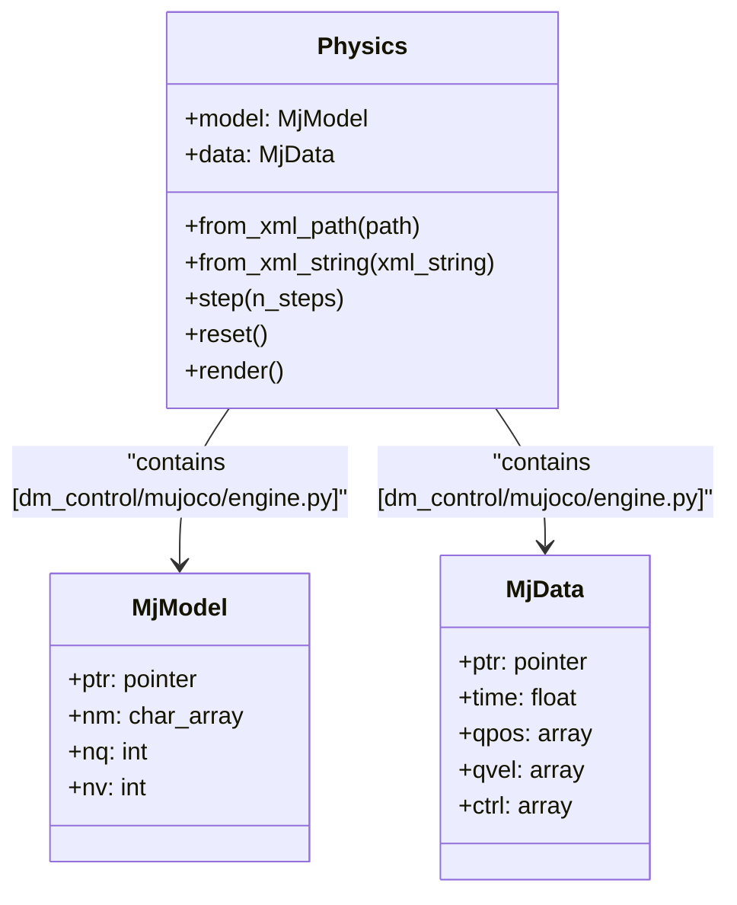
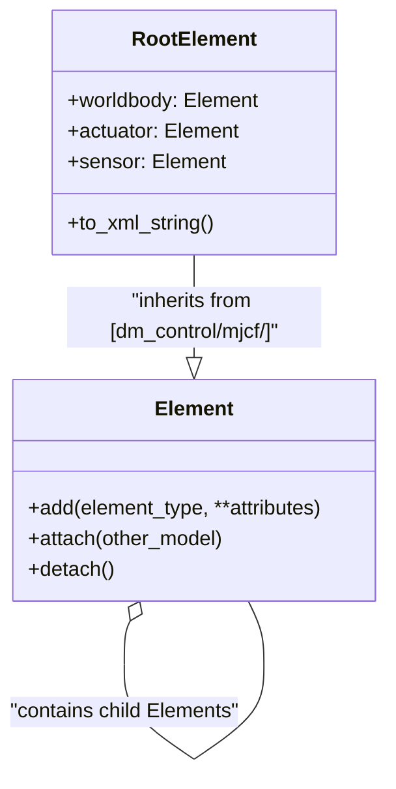
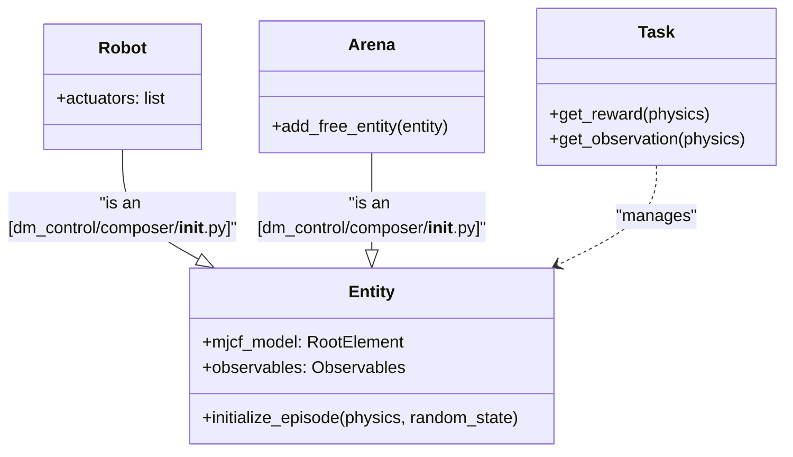
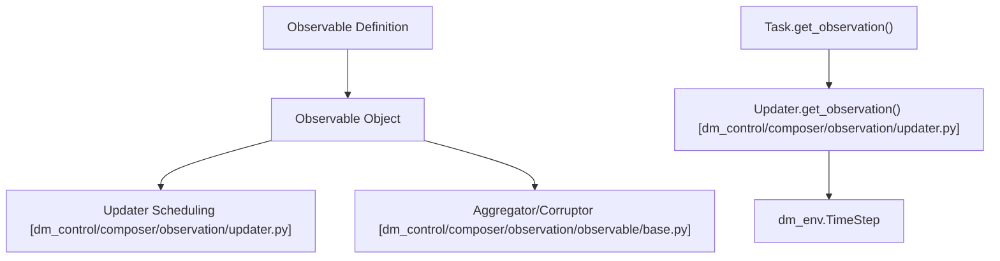
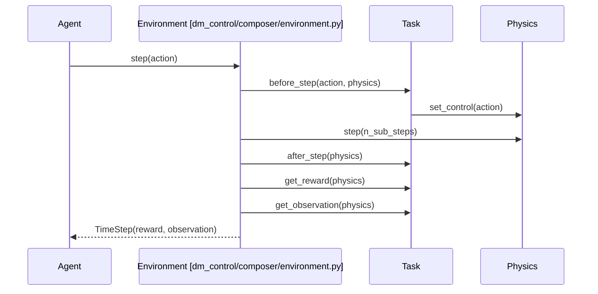

<!-- source: DeepWiki mcp.deepwiki.com · repo google-deepmind/dm_control · page 2 Core Concepts · fetched 2026-10-26 -->

# Core Concepts

Relevant source files

The following files were used as context for generating this wiki page:

- [dm_control/composer/__init__.py](dm_control/composer/__init__.py)
- [dm_control/composer/environment.py](dm_control/composer/environment.py)
- [dm_control/composer/environment_test.py](dm_control/composer/environment_test.py)
- [dm_control/composer/observation/fake_physics.py](dm_control/composer/observation/fake_physics.py)
- [dm_control/composer/observation/obs_buffer.py](dm_control/composer/observation/obs_buffer.py)
- [dm_control/composer/observation/observable/base.py](dm_control/composer/observation/observable/base.py)
- [dm_control/composer/observation/updater.py](dm_control/composer/observation/updater.py)
- [dm_control/composer/observation/updater_test.py](dm_control/composer/observation/updater_test.py)
- [dm_control/composer/variation/__init__.py](dm_control/composer/variation/__init__.py)
- [dm_control/mujoco/engine.py](dm_control/mujoco/engine.py)
- [dm_control/mujoco/engine_test.py](dm_control/mujoco/engine_test.py)
- [dm_control/mujoco/wrapper/core.py](dm_control/mujoco/wrapper/core.py)
- [dm_control/mujoco/wrapper/core_test.py](dm_control/mujoco/wrapper/core_test.py)
- [dm_control/mujoco/wrapper/util.py](dm_control/mujoco/wrapper/util.py)

This page provides an overview of the fundamental concepts and architecture in the `dm_control` framework. The framework offers a Python interface to the MuJoCo physics engine for reinforcement learning and physics-based control. Here we cover the core abstractions and how they fit together to create physically simulated environments.

For specific details on visualization capabilities, see [Visualization and Rendering](#3), and for information about using the locomotion framework, see [Locomotion Framework](#4).

## Physics Engine Integration

At the foundation of `dm_control` is the integration with the MuJoCo physics engine, which provides fast and accurate physics simulation. The framework wraps MuJoCo's C API with a Pythonic interface centered around the `Physics` class [dm_control/mujoco/engine.py:16-33]().

Title: Physics Engine Class Hierarchy

The `Physics` class is the main entry point for interacting with the simulation. It provides methods to load models, step the simulation forward in time, and manage the underlying `mujoco.MjModel` and `mujoco.MjData` structures [dm_control/mujoco/engine.py:83-100]().

For details, see [Physics Engine](#2.1).

Sources: [dm_control/mujoco/engine.py:16-100](), [dm_control/mujoco/wrapper/util.py:45-46]()

## MJCF Model System

MuJoCo models are defined using the MJCF (MuJoCo XML) format. The `mjcf` module provides a Python object model for programmatically creating, modifying, and composing MJCF models.

Title: MJCF Document Object Model (DOM)

MJCF models are structured hierarchically. The `mjcf` module allows you to:
- Create models programmatically.
- Modify existing models using a DOM-like interface.
- Compose multiple models together through attachments, which handles namespacing automatically.

For details, see [MJCF Model System](#2.2).

Sources: [dm_control/mujoco/wrapper/core.py:151-188](), [dm_control/mujoco/wrapper/core_test.py:64-99]()

## Entity-Component Framework

The `composer` module provides an entity-component framework for building complex physically simulated environments. This framework allows for modular, composable, and reusable environment components [dm_control/composer/__init__.py:16-33]().

Title: Composer Framework Entities

The `composer.Environment` orchestrates the interaction between a `Physics` instance and a `Task` [dm_control/composer/environment.py:165-174](). The `Task` defines the reward function, termination conditions, and observation logic.

For details, see [Entity-Component Framework](#2.3).

Sources: [dm_control/composer/__init__.py:16-33](), [dm_control/composer/environment.py:165-184]()

## Observation System

The observation system defines what information can be observed from the environment and how that information is processed. It provides a flexible framework for defining and configuring observations [dm_control/composer/observation/updater.py:16-30]().

Title: Observation Data Flow

Key components include `Observable` types that can wrap MuJoCo features or cameras [dm_control/composer/observation/observable/base.py:54-65](). The system supports:
- **Updating**: Scheduling when observations are refreshed [dm_control/composer/observation/updater.py:32-73]().
- **Processing**: Buffering, delaying, or adding noise (corruptors) [dm_control/composer/observation/observable/base.py:130-136]().
- **Flattening/Structuring**: Returning nested dictionaries of observation arrays matching `dm_env` specs [dm_control/composer/observation/updater.py:167-175]().

For details, see [Observation System](#2.4).

Sources: [dm_control/composer/observation/updater.py:32-175](), [dm_control/composer/observation/observable/base.py:54-140]()

## Variation System

The variation system is used to randomize environment properties to improve agent robustness (Domain Randomization) [dm_control/composer/variation/__init__.py]().

It includes:
- **Distributions**: Uniform, Normal, etc., for parameter sampling.
- **Variators**: Objects that apply sampled values to MJCF attributes or Physics state.
- **Noises**: Temporal noise processes for actuators or sensors.

For details, see [Variation System](#2.5).

Sources: [dm_control/composer/variation/__init__.py]()

## RL Environment Interface

The core of `dm_control` implements the `dm_env.Environment` interface, making it compatible with the DeepMind RL ecosystem.

Title: Environment Step Lifecycle

The `Environment` class handles the control loop, executing hook cycles (`before_step`, `before_substep`, `after_substep`, `after_step`) and updating state across multiple substeps [dm_control/composer/environment.py:132-163]().

Sources: [dm_control/composer/environment.py:110-163](), [dm_control/composer/environment_test.py:107-117]()

---

