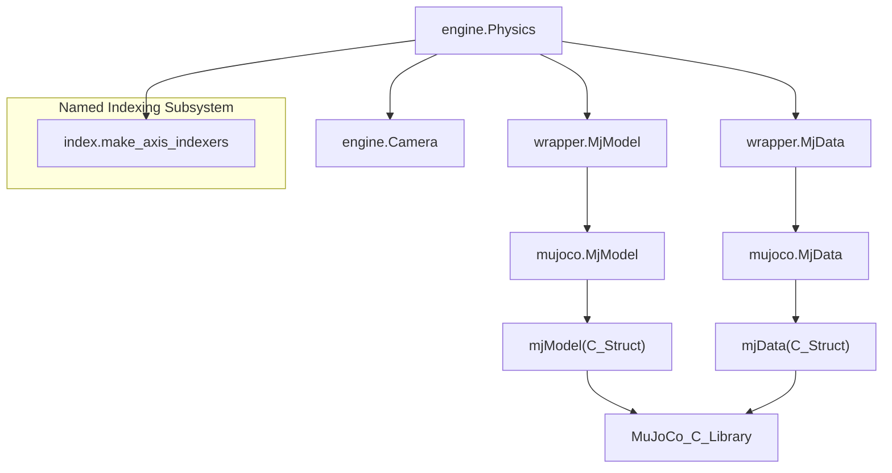
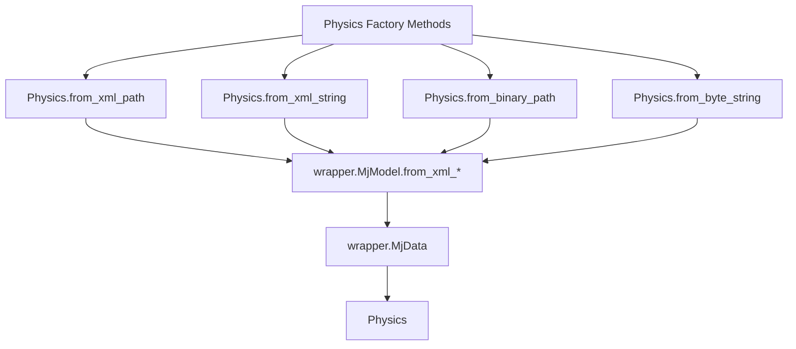

<!-- source: DeepWiki mcp.deepwiki.com · repo google-deepmind/dm_control · page 2.1 Physics Engine · fetched 2026-10-26 -->

# Physics Engine

<details>
<summary>Relevant source files</summary>

The following files were used as context for generating this wiki page:

- [dm_control/mjcf/physics.py](dm_control/mjcf/physics.py)
- [dm_control/mujoco/engine.py](dm_control/mujoco/engine.py)
- [dm_control/mujoco/engine_test.py](dm_control/mujoco/engine_test.py)
- [dm_control/mujoco/index.py](dm_control/mujoco/index.py)
- [dm_control/mujoco/index_test.py](dm_control/mujoco/index_test.py)
- [dm_control/mujoco/testing/assets/arm.xml](dm_control/mujoco/testing/assets/arm.xml)
- [dm_control/mujoco/testing/assets/model_with_ball_joints.xml](dm_control/mujoco/testing/assets/model_with_ball_joints.xml)
- [dm_control/mujoco/testing/assets/model_with_third_order_actuators.xml](dm_control/mujoco/testing/assets/model_with_third_order_actuators.xml)
- [dm_control/mujoco/wrapper/core.py](dm_control/mujoco/wrapper/core.py)
- [dm_control/mujoco/wrapper/core_test.py](dm_control/mujoco/wrapper/core_test.py)
- [dm_control/mujoco/wrapper/mjbindings_test.py](dm_control/mujoco/wrapper/mjbindings_test.py)
- [dm_control/mujoco/wrapper/util.py](dm_control/mujoco/wrapper/util.py)
- [dm_control/rl/control.py](dm_control/rl/control.py)
- [dm_control/rl/control_test.py](dm_control/rl/control_test.py)
- [dm_control/suite/base.py](dm_control/suite/base.py)
- [dm_control/suite/utils/randomizers_test.py](dm_control/suite/utils/randomizers_test.py)
- [dm_control/suite/wrappers/pixels.py](dm_control/suite/wrappers/pixels.py)
- [dm_control/suite/wrappers/pixels_test.py](dm_control/suite/wrappers/pixels_test.py)
- [dm_control/utils/inverse_kinematics.py](dm_control/utils/inverse_kinematics.py)
- [dm_control/utils/inverse_kinematics_test.py](dm_control/utils/inverse_kinematics_test.py)
- [dm_control/utils/xml_tools_test.py](dm_control/utils/xml_tools_test.py)

</details>


The Physics Engine is the foundational component of `dm_control` that provides a Python interface to the MuJoCo physics simulation library. It enables physics-based simulation and control by wrapping the MuJoCo C library in a Pythonic API.

## Overview

The `Physics` class is the central class that encapsulates MuJoCo's simulation capabilities, handling:
- Loading and parsing simulation models.
- Stepping the physics simulation forward in time.
- Managing simulation state (`qpos`, `qvel`, `ctrl`).
- Applying control signals to actuators.
- Rendering the simulation via OpenGL.

For information about how this integrates with the entity-component system, see [Entity-Component Framework]().

Sources: [dm_control/mujoco/engine.py:83-103]()

## Core Architecture

The `Physics` class provides a clean interface around MuJoCo's state and operations, bridging the gap between Python and the underlying C structures.

### Bridge: Natural Language to Code Entities
The following table maps high-level simulation concepts to specific code entities in `dm_control`.

| Concept | Code Entity | Role |
| :--- | :--- | :--- |
| **Simulation Controller** | `engine.Physics` | Main user-facing interface for simulation control. |
| **Static Model** | `wrapper.MjModel` | Contains constant parameters like geometry, mass, and joint types. |
| **Dynamic State** | `wrapper.MjData` | Contains time-varying data like positions, velocities, and forces. |
| **Named Access** | `index.struct_indexer` | Provides `physics.named` for string-based indexing of fields. |
| **Rendering** | `engine.Camera` | Manages OpenGL contexts and pixel extraction. |

Sources: [dm_control/mujoco/engine.py:83-103](), [dm_control/mujoco/wrapper/core.py]()

### System Data Flow
The architecture wraps native MuJoCo pointers into safe Python objects.

Title: "System Data Flow Architecture"

Sources: [dm_control/mujoco/engine.py:83-103](), [dm_control/mujoco/wrapper/core.py](), [dm_control/mujoco/index.py:68-82]()

## Creating Physics Instances

There are multiple named constructors to create a `Physics` instance, typically loading from MJCF XML or MuJoCo's binary MJB format.

Title: "Physics Instance Factory Workflow"

Sources: [dm_control/mujoco/engine.py:424-476](), [dm_control/mujoco/wrapper/core.py:150-186]()

### Loading Examples

```python
# From XML file
physics = Physics.from_xml_path('/path/to/model.xml')

# From XML string with assets
physics = Physics.from_xml_string(xml_string, assets={'mesh.stl': mesh_bytes})

# From MJB binary
physics = Physics.from_binary_path('model.mjb')
```

Sources: [dm_control/mujoco/engine.py:424-476]()

## Simulation Lifecycle

### Stepping and Control
The `step` method advances the simulation. If `legacy_step` is enabled (default in `rl.control.Environment`), `dm_control` ensures that position and velocity dependent fields are updated before returning.

- `set_control(control)`: Copies values into `physics.data.ctrl` [dm_control/mujoco/engine.py:139-146]().
- `step(nstep=1)`: Advances the simulation by `nstep` iterations [dm_control/mujoco/engine.py:164-177]().
- `_step_with_up_to_date_position_velocity(nstep)`: Internal method that calls `mj_step2` then `mj_step1` to synchronize `mjData` with `qpos`/`qvel` [dm_control/mujoco/engine.py:147-162]().

Sources: [dm_control/mujoco/engine.py:139-177](), [dm_control/rl/control.py:31-61]()

### State Management
The `Physics` class allows full serialization and restoration of the simulation state.
- `get_state()`: Returns a concatenated NumPy array of `qpos`, `qvel`, and `act`.
- `set_state(state)`: Restores the state and calls `mj_forward` to update derived fields.
- `reset(keyframe_id=None)`: Resets to initial state or a specific keyframe.

Sources: [dm_control/mujoco/engine.py:235-315]()

## Named Indexing

`dm_control` provides a sophisticated named indexing system that allows accessing MuJoCo fields using strings defined in the MJCF. This is implemented by `index.py` which parses model metadata to determine field dimensions.

```python
# Named access to joint positions
physics.named.data.qpos['hinge_joint']

# Accessing specific columns in 2D fields (e.g., 'x', 'y', 'z' for xpos)
physics.named.data.xpos['body_name', 'z']

# Slicing with names
physics.named.model.geom_rgba[['geom1', 'geom2'], 'r']
```

The system handles "ragged" dimensions (like `qpos` where a joint might have 1, 3, or 7 degrees of freedom) by mapping joint names to the correct underlying indices using address arrays like `jnt_qposadr`.

Sources: [dm_control/mujoco/index.py:16-82](), [dm_control/mujoco/engine.py:404-409]()

## Rendering and Cameras

The rendering pipeline utilizes OpenGL backends (EGL, GLFW, or OSMesa).

### The Camera Class
The `Camera` class manages viewport rendering and object selection.
- `render()`: Returns an RGB or depth array.
- `select(cursor_pos)`: Returns the body/geom under a specific pixel using `mjv_select`.

### Physics.render()
The `Physics` class provides a high-level `render` method that abstracts camera creation.
- `segmentation=True`: Returns an `(H, W, 2)` array where pixels contain `(object_id, object_type)`.
- `scene_callback`: Allows custom drawing (e.g., adding markers) into the `mjvScene` before rendering.

Sources: [dm_control/mujoco/engine.py:178-233](), [dm_control/mujoco/engine.py:620-762]()

## Error Handling

MuJoCo's internal errors and warnings are captured and routed through Python.

- **Warning Callbacks**: `mujoco.set_mju_user_warning` is used to redirect MuJoCo warnings to the Python `logging` module [dm_control/mujoco/wrapper/core.py:62-74]().
- **Exceptions**: By default, invalid physics states (e.g., NaNs in simulation) raise exceptions [dm_control/mujoco/engine.py:122]().
- **Suppression**: `suppress_physics_errors()` context manager allows simulation to continue even if warnings occur, which is useful during domain randomization [dm_control/mujoco/engine.py:125-133]().

Sources: [dm_control/mujoco/engine.py:122-133](), [dm_control/mujoco/wrapper/core.py:62-74]()

## Thread Safety

MuJoCo is thread-safe for separate `MjModel`/`MjData` pairs. `dm_control` ensures that:
- Loading models from strings is thread-safe.
- Multiple `Physics` instances can be stepped in parallel threads.
- **Rendering**: Context creation (especially with GLFW) can have thread-safety limitations depending on the operating system.

Sources: [dm_control/mujoco/thread_safety_test.py:16-100]()

---

