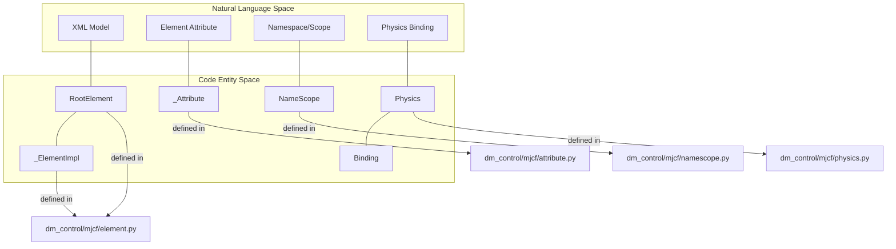
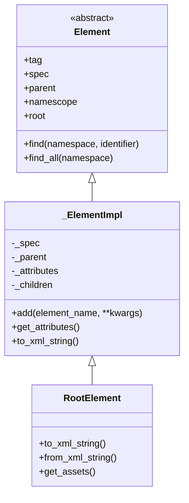
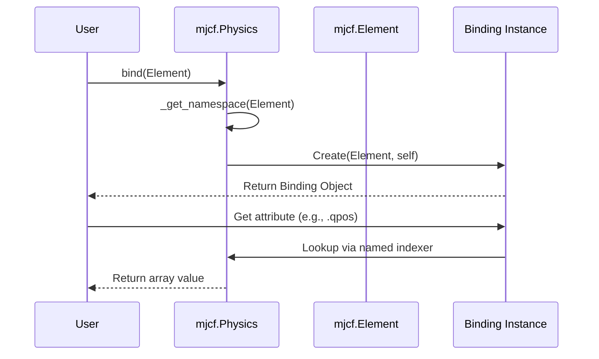

<!-- source: DeepWiki mcp.deepwiki.com · repo google-deepmind/dm_control · page 2.2 MJCF Model System · fetched 2026-10-26 -->

# MJCF Model System

Relevant source files

The following files were used as context for generating this wiki page:

- [dm_control/_render/glfw_renderer.py](dm_control/_render/glfw_renderer.py)
- [dm_control/composer/task.py](dm_control/composer/task.py)
- [dm_control/entities/manipulators/kinova/assets_path.py](dm_control/entities/manipulators/kinova/assets_path.py)
- [dm_control/mjcf/__init__.py](dm_control/mjcf/__init__.py)
- [dm_control/mjcf/attribute.py](dm_control/mjcf/attribute.py)
- [dm_control/mjcf/attribute_test.py](dm_control/mjcf/attribute_test.py)
- [dm_control/mjcf/base.py](dm_control/mjcf/base.py)
- [dm_control/mjcf/constants.py](dm_control/mjcf/constants.py)
- [dm_control/mjcf/debugging.py](dm_control/mjcf/debugging.py)
- [dm_control/mjcf/element.py](dm_control/mjcf/element.py)
- [dm_control/mjcf/element_test.py](dm_control/mjcf/element_test.py)
- [dm_control/mjcf/export_with_assets.py](dm_control/mjcf/export_with_assets.py)
- [dm_control/mjcf/export_with_assets_as_zip.py](dm_control/mjcf/export_with_assets_as_zip.py)
- [dm_control/mjcf/export_with_assets_as_zip_test.py](dm_control/mjcf/export_with_assets_as_zip_test.py)
- [dm_control/mjcf/export_with_assets_test.py](dm_control/mjcf/export_with_assets_test.py)
- [dm_control/mjcf/parser.py](dm_control/mjcf/parser.py)
- [dm_control/mjcf/physics_test.py](dm_control/mjcf/physics_test.py)
- [dm_control/mjcf/schema.py](dm_control/mjcf/schema.py)
- [dm_control/mjcf/skin.py](dm_control/mjcf/skin.py)
- [dm_control/mjcf/skin_test.py](dm_control/mjcf/skin_test.py)
- [dm_control/mjcf/test_assets/attribute_test_schema.xml](dm_control/mjcf/test_assets/attribute_test_schema.xml)
- [dm_control/mjcf/test_assets/model_with_assetdir.xml](dm_control/mjcf/test_assets/model_with_assetdir.xml)
- [dm_control/mjcf/test_assets/model_with_assetdir.zip](dm_control/mjcf/test_assets/model_with_assetdir.zip)
- [dm_control/mjcf/test_assets/model_with_nameless_assets.xml](dm_control/mjcf/test_assets/model_with_nameless_assets.xml)
- [dm_control/mjcf/test_assets/model_with_separators.xml](dm_control/mjcf/test_assets/model_with_separators.xml)
- [dm_control/mjcf/test_assets/skins/test_skin.skn](dm_control/mjcf/test_assets/skins/test_skin.skn)
- [dm_control/mjcf/test_assets/test_model.xml](dm_control/mjcf/test_assets/test_model.xml)
- [dm_control/mjcf/traversal_utils.py](dm_control/mjcf/traversal_utils.py)
- [dm_control/mjcf/traversal_utils_test.py](dm_control/mjcf/traversal_utils_test.py)
- [dm_control/mjcf/xml_validation_test.py](dm_control/mjcf/xml_validation_test.py)
- [dm_control/mujoco/testing/image_utils.py](dm_control/mujoco/testing/image_utils.py)
- [dm_control/mujoco/testing/image_utils_test.py](dm_control/mujoco/testing/image_utils_test.py)

The MJCF (MuJoCo XML Configuration Format) Model System is a Python-based object model for programmatically creating, manipulating, and parsing MuJoCo models. It provides an alternative to directly writing XML files, allowing for more maintainable, reusable, and composable physics model definitions.

## Overview

The MJCF Model System provides a hierarchical representation of MuJoCo models that mirrors the structure of the XML format. Each XML element becomes a Python object, and XML attributes become object attributes. The system handles conversions between Python data structures and XML, manages namescopes, resolves references, and provides a binding mechanism to connect model elements to the underlying physics engine.

### Core Entity Mapping

The following diagram bridges the natural language concepts of the MJCF system to the specific code entities in the `dm_control.mjcf` package.

Sources: [dm_control/mjcf/element.py:134-140](), [dm_control/mjcf/attribute.py:48-52](), [dm_control/mjcf/physics.py:24-34]()

## Element and Attribute System

### The DOM Hierarchy
The MJCF system implements a Document Object Model (DOM) where `RootElement` represents the `<mujoco>` tag. All elements inherit from a base `Element` class.

Sources: [dm_control/mjcf/base.py:16-25](), [dm_control/mjcf/element.py:134-168]()

### Attribute Types and Validation
Attributes are strongly typed and validated against the MJCF schema. The system uses specific classes to handle different data types found in the XML [dm_control/mjcf/attribute.py:16-25]().

| Attribute Type | Class Name | Behavior |
| :--- | :--- | :--- |
| **String** | `String` | Validates standard string input [dm_control/mjcf/attribute.py:123](). |
| **Integer** | `Integer` | Ensures float-to-int conversion is lossless [dm_control/mjcf/attribute.py:135](). |
| **Float** | `Float` | Handles scientific precision during XML export [dm_control/mjcf/attribute.py:150](). |
| **Keyword** | `Keyword` | Restricts values to a valid set (e.g., `type="hinge"`) [dm_control/mjcf/attribute.py:176](). |
| **Array** | `Array` | Validates shape and `dtype` (e.g., `pos="0 0 1"`) [dm_control/mjcf/attribute.py:201](). |

Sources: [dm_control/mjcf/attribute.py:123-222](), [dm_control/mjcf/element.py:23-30]()

## Namescopes and Asset Management

### NameScope System
The `NameScope` class manages the unique identification of elements. It handles the `PREFIX_SEPARATOR` (defaulting to `/`) to prevent name collisions when multiple MJCF models are composed [dm_control/mjcf/constants.py:19-22]().

- **Composition**: When a model is added as a child of another, its `NameScope` is nested.
- **Full Identifier**: The `full_identifier` property of an element returns its name prefixed by all parent namescopes.

### Asset Management
Assets such as meshes (`.stl`, `.obj`), textures, and heightfields are managed through asset attributes.
- **Automatic Naming**: If certain asset elements lack a `name` attribute (such as `mesh`, `hfield`, or `texture`), it is derived from the filename [dm_control/mjcf/element.py:131-154]().
- **Asset Collection**: `RootElement.get_assets()` recursively collects all file contents referenced in the model.

Sources: [dm_control/mjcf/namescope.py:1-50](), [dm_control/mjcf/element.py:131-154](), [dm_control/mjcf/constants.py:19-22]()

## Physics Binding

The `mjcf.Physics` class extends the standard physics wrapper to allow direct interaction between MJCF elements and the MuJoCo simulation state.

### Binding Mechanism
The `bind()` method creates a binding object that maps element names to indices in `mjModel` and `mjData`.

### Dirty State Tracking
Modifying certain attributes through a binding (e.g., `qpos`, `ctrl`, `qfrc_applied`) triggers a "dirty" flag tracking mechanism in the `Physics` object, notifying the system that state updates are required [dm_control/mjcf/constants.py:47-48]().

Sources: [dm_control/mjcf/physics_test.py:36-169](), [dm_control/mjcf/constants.py:47-52]()

## Parsing and Export Utilities

### Parser Functions
The system provides several entry points for loading models:
- `from_xml_string`: Parses a raw XML string [dm_control/mjcf/parser.py:31-55]().
- `from_file`: Parses from a file handle [dm_control/mjcf/parser.py:58-83]().
- `from_path`: Loads from a file path [dm_control/mjcf/parser.py:85-110]().
- `from_zip`: Extracts a model and its assets from a `.zip` archive [dm_control/mjcf/parser.py:112-164]().

### Export Utilities
- `export_with_assets`: Saves the model XML and all collected assets into a directory [dm_control/mjcf/export_with_assets.py:25-40]().
- `export_with_assets_as_zip`: Packages the model and assets into a single zip file [dm_control/mjcf/export_with_assets_as_zip.py:23-49]().

Sources: [dm_control/mjcf/parser.py:31-164](), [dm_control/mjcf/export_with_assets_as_zip.py:23-49]()

## Schema Validation
The MJCF system is strictly governed by schema definitions. 
- **Conflict Resolution**: Attributes can define conflict behavior (such as `min`, `max`, or `max_bytes`) for when multiple definitions are merged [dm_control/mjcf/element.py:66-70]().
- **On-Demand Elements**: Some elements are only created when accessed, reducing the memory footprint of the DOM [dm_control/mjcf/element.py:176-178]().

Sources: [dm_control/mjcf/element.py:66-178]()

---

