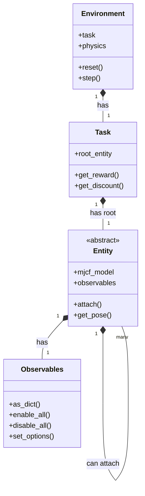
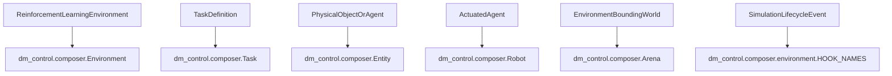
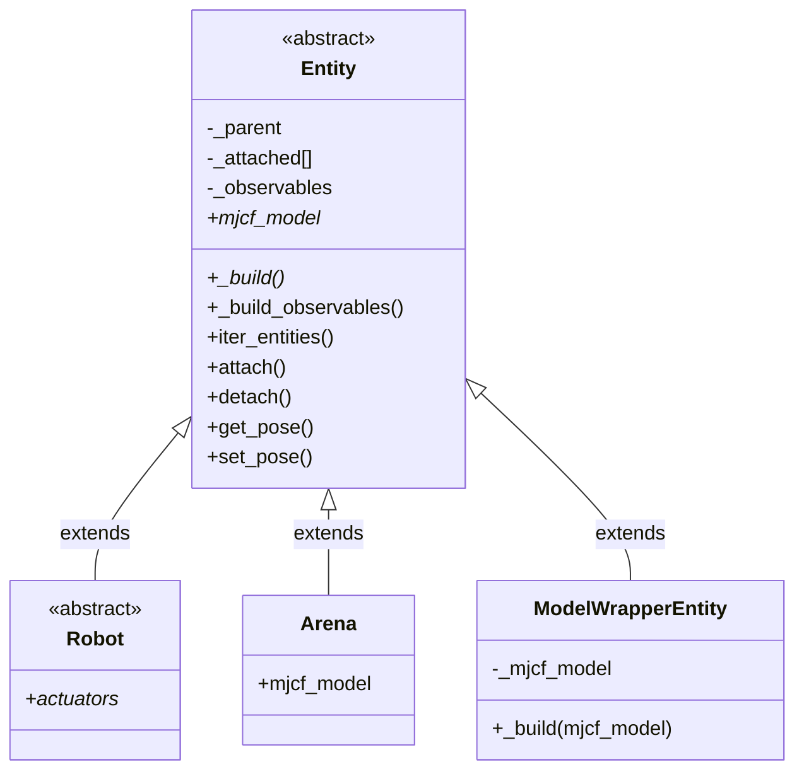
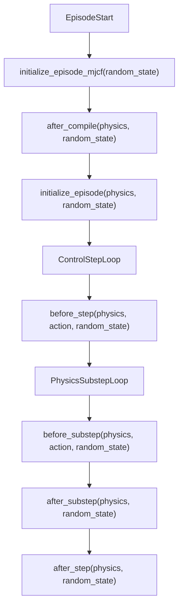
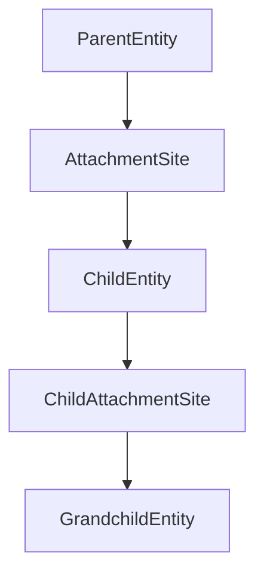

<!-- source: DeepWiki mcp.deepwiki.com · repo google-deepmind/dm_control · page 2.3 Entity-Component Framework · fetched 2026-10-26 -->

# Entity-Component Framework

Relevant source files

The following files were used as context for generating this wiki page:

- [dm_control/composer/__init__.py](dm_control/composer/__init__.py)
- [dm_control/composer/arena.py](dm_control/composer/arena.py)
- [dm_control/composer/arena.xml](dm_control/composer/arena.xml)
- [dm_control/composer/constants.py](dm_control/composer/constants.py)
- [dm_control/composer/entity.py](dm_control/composer/entity.py)
- [dm_control/composer/entity_test.py](dm_control/composer/entity_test.py)
- [dm_control/composer/environment.py](dm_control/composer/environment.py)
- [dm_control/composer/environment_hooks_test.py](dm_control/composer/environment_hooks_test.py)
- [dm_control/composer/environment_test.py](dm_control/composer/environment_test.py)
- [dm_control/composer/hooks_test_utils.py](dm_control/composer/hooks_test_utils.py)
- [dm_control/composer/initializer.py](dm_control/composer/initializer.py)
- [dm_control/composer/initializers/__init__.py](dm_control/composer/initializers/__init__.py)
- [dm_control/composer/initializers/prop_initializer.py](dm_control/composer/initializers/prop_initializer.py)
- [dm_control/composer/initializers/prop_initializer_test.py](dm_control/composer/initializers/prop_initializer_test.py)
- [dm_control/composer/initializers/tcp_initializer.py](dm_control/composer/initializers/tcp_initializer.py)
- [dm_control/composer/initializers/tcp_initializer_test.py](dm_control/composer/initializers/tcp_initializer_test.py)
- [dm_control/composer/observation/__init__.py](dm_control/composer/observation/__init__.py)
- [dm_control/composer/observation/fake_physics.py](dm_control/composer/observation/fake_physics.py)
- [dm_control/composer/observation/obs_buffer.py](dm_control/composer/observation/obs_buffer.py)
- [dm_control/composer/observation/observable/base.py](dm_control/composer/observation/observable/base.py)
- [dm_control/composer/observation/updater.py](dm_control/composer/observation/updater.py)
- [dm_control/composer/observation/updater_test.py](dm_control/composer/observation/updater_test.py)
- [dm_control/composer/variation/__init__.py](dm_control/composer/variation/__init__.py)
- [dm_control/locomotion/mocap/props.py](dm_control/locomotion/mocap/props.py)
- [dm_control/locomotion/tasks/reference_pose/tracking_test.py](dm_control/locomotion/tasks/reference_pose/tracking_test.py)
- [dm_control/locomotion/tasks/reference_pose/utils.py](dm_control/locomotion/tasks/reference_pose/utils.py)
- [dm_control/locomotion/walkers/base.py](dm_control/locomotion/walkers/base.py)
- [dm_control/locomotion/walkers/base_test.py](dm_control/locomotion/walkers/base_test.py)

The purpose of the Entity-Component Framework is to provide the foundation for building composable physics-based environments in `dm_control`. It enables developers to create modular, reusable components that can be combined to build complex environments while managing physics interactions, observations, and lifecycle events.

Sources: [dm_control/composer/entity.py:199-214](), [dm_control/composer/environment.py:294-315]()

## Core Concepts

The Entity-Component Framework revolves around several key abstractions:

- **Entity**: An abstract base class representing physical objects in the simulation (`[dm_control/composer/entity.py:199]`). Entities encapsulate MuJoCo models, define observables, and can be composed hierarchically.
- **Observables**: Properties of entities that can be exposed to the agent, such as positions, velocities, and forces (`[dm_control/composer/entity.py:70]`).
- **Lifecycle Hooks**: Methods called at specific points during simulation to allow entities to respond to events (`[dm_control/composer/environment.py:33-39]`).
- **Composition**: The ability to attach entities to each other to create complex structures (`[dm_control/composer/entity.py:299-327]`).

Sources: [dm_control/composer/entity.py:199-214](), [dm_control/composer/environment.py:294-315](), [dm_control/composer/task.py:28-50]()

## Natural Language to Code Mapping

This diagram maps high-level framework concepts to concrete codebase symbols and classes.

Sources: [dm_control/composer/environment.py:33-40](), [dm_control/composer/entity.py:199-210]()

## Entity Class and Subclasses

The `Entity` class is the foundational class in the framework, designed to represent any physical object in a simulation (`[dm_control/composer/entity.py:199]`). Subclasses implement `_build` (`[dm_control/composer/entity.py:202-233]`) to configure their underlying MJCF representation.

### Key Properties and Methods
- `mjcf_model`: Abstract property returning the entity's MJCF model (`[dm_control/composer/entity.py:394-398]`).
- `observables`: Access to the entity's observable collection (`[dm_control/composer/entity.py:400-405]`).
- `attach(entity, attach_site)`: Attaches a child entity (`[dm_control/composer/entity.py:299-327]`).
- `detach()`: Detaches an entity from its parent (`[dm_control/composer/entity.py:343-353]`).
- `iter_entities(exclude_self)`: Iterates through the entity hierarchy (`[dm_control/composer/entity.py:242-259]`).

Sources: [dm_control/composer/entity.py:199-353](), [dm_control/composer/arena.py]()

## Environment Lifecycle Hooks

The environment execution delegates lifecycle events through `_EnvironmentHooks` (`[dm_control/composer/environment.py:74]`), which scans entity trees for non-trivial hooks defined in `HOOK_NAMES` (`[dm_control/composer/environment.py:33-39]`).

### Lifecycle Hook Functions
- `initialize_episode_mjcf(random_state)`: Called when MJCF model is modified between episodes (`[dm_control/composer/environment.py:110-115]`).
- `after_compile(physics, random_state)`: Called after physics recompilation (`[dm_control/composer/environment.py:117-122]`).
- `initialize_episode(physics, random_state)`: Called at episode initialization (`[dm_control/composer/environment.py:124-130]`).
- `before_step(physics, action, random_state)`: Called before an agent control step (`[dm_control/composer/environment.py:132-141]`).
- `before_substep(physics, action, random_state)`: Called before a physics substep (`[dm_control/composer/environment.py:143-149]`).
- `after_substep(physics, random_state)`: Called after a physics substep (`[dm_control/composer/environment.py:150-155]`).
- `after_step(physics, random_state)`: Called after an agent control step (`[dm_control/composer/environment.py:157-162]`).

Sources: [dm_control/composer/environment.py:33-163]()

## Composing Complex Environments from Reusable Components

Environments are composed hierarchically by combining `Robot`, `Arena`, `Task`, and custom `Entity` instances. When an entity is attached to another via `attach()` (`[dm_control/composer/entity.py:299-327]`), an attachment frame is established, linking their underlying MJCF subtrees.

Sources: [dm_control/composer/entity.py:299-327](), [dm_control/composer/environment.py:294-517]()

---

