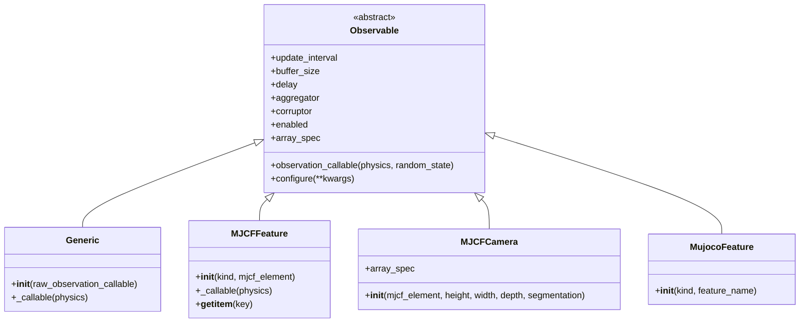
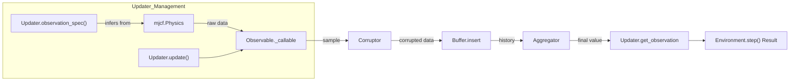

<!-- source: DeepWiki mcp.deepwiki.com · repo google-deepmind/dm_control · page 2.4 Observation System · fetched 2026-10-26 -->

# Observation System

<details>
<summary>Relevant source files</summary>

The following files were used as context for generating this wiki page:

- [dm_control/composer/__init__.py](dm_control/composer/__init__.py)
- [dm_control/composer/environment.py](dm_control/composer/environment.py)
- [dm_control/composer/environment_test.py](dm_control/composer/environment_test.py)
- [dm_control/composer/observation/fake_physics.py](dm_control/composer/observation/fake_physics.py)
- [dm_control/composer/observation/obs_buffer.py](dm_control/composer/observation/obs_buffer.py)
- [dm_control/composer/observation/observable/base.py](dm_control/composer/observation/observable/base.py)
- [dm_control/composer/observation/observable/base_test.py](dm_control/composer/observation/observable/base_test.py)
- [dm_control/composer/observation/observable/mjcf.py](dm_control/composer/observation/observable/mjcf.py)
- [dm_control/composer/observation/observable/mjcf_test.py](dm_control/composer/observation/observable/mjcf_test.py)
- [dm_control/composer/observation/updater.py](dm_control/composer/observation/updater.py)
- [dm_control/composer/observation/updater_test.py](dm_control/composer/observation/updater_test.py)
- [dm_control/composer/variation/__init__.py](dm_control/composer/variation/__init__.py)
- [dm_control/locomotion/tasks/corridors.py](dm_control/locomotion/tasks/corridors.py)
- [dm_control/locomotion/tasks/go_to_target.py](dm_control/locomotion/tasks/go_to_target.py)
- [dm_control/locomotion/tasks/go_to_target_test.py](dm_control/locomotion/tasks/go_to_target_test.py)
- [dm_control/mjcf/copier_test.py](dm_control/mjcf/copier_test.py)

</details>


The Observation System in `dm_control` provides a flexible framework for defining, capturing, buffering, and processing observations in reinforcement learning environments. This system allows for sophisticated observation behaviors such as delayed sensing, historical buffering, and signal aggregation—capabilities essential for realistic simulations and robust agent learning.

This document details how observations are defined by entities, how they're configured, captured during simulation, and processed before being delivered to reinforcement learning agents.

## Observable Definition

Observables are properties of an entity that can be observed by an agent. Each entity in the composer framework defines its own set of observables, forming the foundation of the observation system.

### Base Observable Types

The system provides several built-in observable types defined in `dm_control/composer/observation/observable/base.py` and `dm_control/composer/observation/observable/mjcf.py`:

1. **Generic**: Wraps any callable that takes a physics object and returns an observation value [dm_control/composer/observation/observable/base.py:156-187]().
2. **MJCFFeature**: Observes specific MuJoCo physics quantities (positions, velocities, etc.) by binding to MJCF elements [dm_control/composer/observation/observable/mjcf.py:43-87]().
3. **MJCFCamera**: Provides camera renderings (RGB, depth, or segmentation) as observations [dm_control/composer/observation/observable/mjcf.py:105-155]().
4. **MujocoFeature**: An observable corresponding to a named MuJoCo feature [dm_control/composer/observation/observable/base.py:195-210]().

### Observable Hierarchy and Code Entities


Sources: [dm_control/composer/observation/observable/base.py:54-199](), [dm_control/composer/observation/observable/mjcf.py:43-155]()

## Observation Processing Pipeline

The observation system processes raw observations through several stages before delivering them to agents. This is managed by the `Updater` class [dm_control/composer/observation/updater.py:120-125]().

### Buffering and History
The `Updater` creates an `_EnabledObservable` for each active sensor, which wraps a `Buffer` [dm_control/composer/observation/updater.py:32-72]().
1. **Buffer**: Maintains a history of recent observations based on `buffer_size`.
2. **Delay**: Handles delayed delivery of observations. The buffer insertion tracks arrival times and offsets [dm_control/composer/observation/updater.py:161-165]().

### Observation Corruption
The `corruptor` is a callable applied to the observation before it is added to the buffer. This allows for simulating sensor noise [dm_control/composer/observation/observable/base.py:127-135]().

### Aggregation Functions
Buffered observations can be aggregated using methods defined in `AGGREGATORS` [dm_control/composer/observation/observable/base.py:31-37]().

| Aggregator | Description | Preserves Bounds |
| :--- | :--- | :--- |
| `min` | Minimum value across buffer | Yes |
| `max` | Maximum value across buffer | Yes |
| `mean` | Average across buffer | Yes |
| `median` | Median across buffer | Yes |
| `sum` | Sum across buffer | No |

Sources: [dm_control/composer/observation/updater.py:120-165](), [dm_control/composer/observation/observable/base.py:31-37]()

## Observation Update Lifecycle

The `Updater` manages the schedule and synchronization between MuJoCo physics steps and agent control steps.

```mermaid
flowchart TD
    subgraph "Environment_Reset"
        R1["Environment.reset()"] --> R2["Updater.reset(physics, random_state)"]
        R2 --> R3["_EnabledObservable created per enabled sensor"]
        R3 --> R4["Buffer.insert(0, delay, initial_obs)"]
    end
    
    subgraph "Environment_Step"
        S1["Environment.step(action)"] --> S2["Updater.prepare_for_next_control_step()"]
        S2 --> S3["Physics Substeps Loop"]
        S3 --> S4["Updater.update() after each substep"]
        S4 --> S5["Updater.get_observation()"]
    end

    subgraph "Get_Observation_Detail"
        G1["Iterate _EnabledObservable"] --> G2["Buffer.get()"]
        G2 --> G3["Apply Aggregator (if any)"]
        G3 --> G4["Return observation dict/nest"]
    end
```


Sources: [dm_control/composer/observation/updater.py:135-166](), [dm_control/composer/observation/updater.py:236-292]()

### Scheduling Logic
The `Updater` tracks simulation and control steps. Observations are only sampled according to their configured `update_interval` and `delay` parameters [dm_control/composer/observation/updater.py:32-54]().

Sources: [dm_control/composer/observation/updater.py:32-84]()

## Integration with Environment

The `Environment` class in `dm_control/composer/environment.py` acts as the coordinator between tasks, physics, and observations [dm_control/composer/environment.py:165-173]().

### Padding for Delays
When an observation is delayed, the system must provide values for the initial steps of an episode. This is controlled by `ObservationPadding` [dm_control/composer/environment.py:56-59]():
* `ZERO`: Fills the buffer with zeros [dm_control/composer/environment.py:58]().
* `INITIAL_VALUE`: Fills the buffer with the initial value [dm_control/composer/environment.py:57]().

### Observation Specifications
The environment provides an `observation_spec()` which describes the shapes and types of all enabled observations [dm_control/composer/observation/updater.py:167-172](). If an aggregator like `sum` is used, the `Updater` automatically converts `BoundedArray` specs to standard `Array` specs because sums may exceed original bounds [dm_control/composer/observation/updater.py:173-195]().

### Data Flow Diagram


Sources: [dm_control/composer/environment.py:165-173](), [dm_control/composer/observation/updater.py:167-234](), [dm_control/composer/observation/updater.py:260-292]()

## Practical Configuration

Observables can be configured with `Variation` objects to randomize sensing properties (like delay or noise) per episode [dm_control/composer/observation/updater.py:74-84]().

Example of configuring an MJCF-based feature in a locomotion task:
```python
walker.observables.add_egocentric_vector(
    'target',
    observable.MJCFFeature('pos', self._target),
    origin_callable=lambda physics: physics.bind(walker.root_body).xpos)
```
Sources: [dm_control/locomotion/tasks/go_to_target.py:117-121](), [dm_control/composer/observation/updater.py:74-84]()

---

