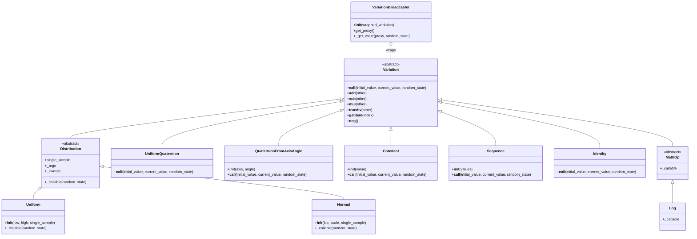
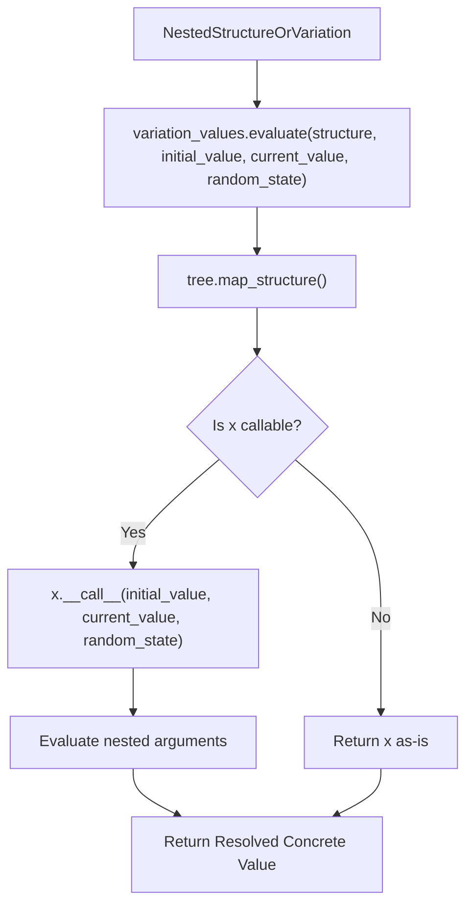
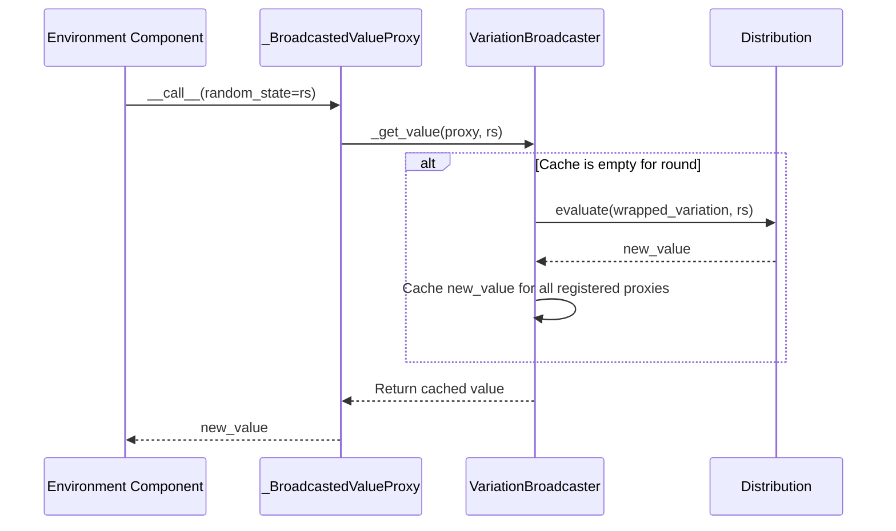

<!-- source: DeepWiki mcp.deepwiki.com · repo google-deepmind/dm_control · page 2.5 Variation System · fetched 2026-10-26 -->

# Variation System

Relevant source files

The following files were used as context for generating this wiki page:

- [dm_control/composer/define.py](dm_control/composer/define.py)
- [dm_control/composer/variation/base.py](dm_control/composer/variation/base.py)
- [dm_control/composer/variation/colors.py](dm_control/composer/variation/colors.py)
- [dm_control/composer/variation/deterministic.py](dm_control/composer/variation/deterministic.py)
- [dm_control/composer/variation/distributions.py](dm_control/composer/variation/distributions.py)
- [dm_control/composer/variation/distributions_test.py](dm_control/composer/variation/distributions_test.py)
- [dm_control/composer/variation/math.py](dm_control/composer/variation/math.py)
- [dm_control/composer/variation/noises.py](dm_control/composer/variation/noises.py)
- [dm_control/composer/variation/rotations.py](dm_control/composer/variation/rotations.py)
- [dm_control/composer/variation/variation_broadcaster.py](dm_control/composer/variation/variation_broadcaster.py)
- [dm_control/composer/variation/variation_broadcaster_test.py](dm_control/composer/variation/variation_broadcaster_test.py)
- [dm_control/composer/variation/variation_test.py](dm_control/composer/variation/variation_test.py)
- [dm_control/composer/variation/variation_values.py](dm_control/composer/variation/variation_values.py)
- [dm_control/utils/transformations.py](dm_control/utils/transformations.py)
- [dm_control/utils/transformations_test.py](dm_control/utils/transformations_test.py)

## Purpose and Scope

The Variation System provides a robust framework for introducing parameterized variability and randomness into simulation environments. It serves as the primary engine for domain randomization within `dm_control`, allowing properties such as physical parameters, initial positions, 3D rotations, colors, noise profiles, and other environment attributes to be systematically randomized across episodes or environment instances to promote robust reinforcement learning policies.

Sources: [dm_control/composer/variation/base.py:16-16](), [dm_control/composer/variation/distributions.py:15-15]()

---

## Core Architecture

The Variation System revolves around a unified `Variation` interface, enabling different types of variations to be composed, nested, and evaluated uniformly. The evaluation pipeline relies on the `evaluate` utility, which traverses nested structures (lists, dictionaries, tuples, and namedtuples) containing callables or constant values [dm_control/composer/variation/variation_values.py:16-35]().

### Class Hierarchy and Code Entities

Sources: [dm_control/composer/variation/base.py:25-85](), [dm_control/composer/variation/distributions.py:25-157](), [dm_control/composer/variation/deterministic.py:23-70](), [dm_control/composer/variation/rotations.py:27-59](), [dm_control/composer/variation/math.py:26-78](), [dm_control/composer/variation/variation_broadcaster.py:24-55]()

### Evaluation Workflow

When an attribute is configured with a variation, the simulation runtime invokes `variation_values.evaluate()` to resolve its concrete value [dm_control/composer/variation/variation_values.py:21-35]().

Sources: [dm_control/composer/variation/variation_values.py:21-35](), [dm_control/composer/variation/distributions.py:43-60]()

---

## Statistical Distributions

Statistical distributions inherit from the abstract `Distribution` base class [dm_control/composer/variation/distributions.py:25-25](). They wrap NumPy random states and evaluate constructor arguments dynamically, allowing distribution parameters (such as `loc` or `scale`) to themselves be nested variations [dm_control/composer/variation/distributions.py:28-31]().

| Distribution Class | Underlying NumPy Call | Parameters | Description |
|-------------------|----------------------|------------|-------------|
| `Uniform` | `random_state.uniform` [dm_control/composer/variation/distributions.py:97-98]() | `low`, `high`, `single_sample` | Continuous uniform distribution |
| `UniformInteger` | `random_state.randint` [dm_control/composer/variation/distributions.py:101-108]() | `low`, `high`, `single_sample` | Uniform discrete integer distribution |
| `UniformChoice` | `random_state.choice` [dm_control/composer/variation/distributions.py:111-118]() | `choices`, `single_sample` | Random sampling from a collection |
| `Normal` | `random_state.normal` [dm_control/composer/variation/distributions.py:149-156]() | `loc`, `scale`, `single_sample` | Gaussian normal distribution |
| `LogNormal` | `random_state.lognormal` [dm_control/composer/variation/distributions.py:159-166]() | `mean`, `sigma`, `single_sample` | Log-normal distribution |
| `Exponential` | `random_state.exponential` [dm_control/composer/variation/distributions.py:169-176]() | `scale`, `single_sample` | Exponential distribution |
| `Poisson` | `random_state.poisson` [dm_control/composer/variation/distributions.py:179-186]() | `lam`, `single_sample` | Poisson point process distribution |
| `Bernoulli` | `random_state.binomial(1, ...)` [dm_control/composer/variation/distributions.py:189-196]() | `prob`, `single_sample` | Binary Bernoulli trials |

Specialized stochastic variators include:
- `UniformPointOnSphere`: Samples a uniform 3D vector lying strictly on the unit sphere (norm equal to `1.0`) [dm_control/composer/variation/distributions.py:121-135]().
- `BiasedRandomWalk`: Generates time-correlated noise modeled via a zero-mean Ornstein-Uhlenbeck process parameterized by `stdev` and `timescale` [dm_control/composer/variation/distributions.py:203-213]().

Sources: [dm_control/composer/variation/distributions.py:25-213]()

---

## Deterministic Variations

Deterministic variations return predictable or structured values without consuming randomness from `random_state`.

| Class Name | Behavior & Implementation | Sources |
|---|---|---|
| `Constant` | Always returns the static `value` provided at construction, useful for unit testing or fixing specific attributes. | [dm_control/composer/variation/deterministic.py:23-34]() |
| `Sequence` | Iterates through a fixed Python iterable of variations or values cyclically. | [dm_control/composer/variation/deterministic.py:48-63]() |
| `Identity` | Evaluates to the `current_value` passed into the call method, preserving existing states. | [dm_control/composer/variation/deterministic.py:65-67]() |

Sources: [dm_control/composer/variation/deterministic.py:23-70]()

---

## Rotation Variations

Variations governing 3D orientations handle unit quaternions and axis-angle conversions, integrating tightly with `dm_control.utils.transformations` [dm_control/composer/variation/rotations.py:16-21]().

| Class Name | Constructor Arguments | Behavior |
|---|---|---|
| `UniformQuaternion` | None [dm_control/composer/variation/rotations.py:27-37]() | Uniformly samples valid unit quaternions representing 3D rotations. |
| `QuaternionFromAxisAngle` | `axis`, `angle` [dm_control/composer/variation/rotations.py:45-58]() | Constructs a quaternion from independently varied rotation axes and scalar angles. |
| `QuaternionPreMultiply` | `quat`, `cumulative=False` [dm_control/composer/variation/rotations.py:74-92]() | Pre-multiplies a newly sampled quaternion with either the initial or current quaternion value. |
| `QuaternionRotate` | `quat`, `vec=None`, `cumulative=False` [dm_control/composer/variation/rotations.py:106-131]() | Rotates a 3D vector (either static or dynamic) by a sampled quaternion. |

Sources: [dm_control/composer/variation/rotations.py:27-146]()

---

## Noise, Color, and Math Operations

### Noise Variations
Noise meta-variations wrap other variations or base attributes to inject perturbations:
- `Additive`: Adds generated noise values to either `initial_value` or `current_value` depending on the `cumulative` flag [dm_control/composer/variation/noises.py:23-40]().
- `Multiplicative`: Scales base values by generated noise factors [dm_control/composer/variation/noises.py:56-73]().

### Color Variations
Color generators output RGBA or HSV structures:
- `RgbVariation`: Directly samples red, green, blue, and alpha channels [dm_control/composer/variation/colors.py:29-44]().
- `HsvVariation`: Samples in hue-saturation-value space and converts to RGBA [dm_control/composer/variation/colors.py:57-73]().
- `GrayVariation`: Specialization of HSV for grayscale color generation [dm_control/composer/variation/colors.py:92-101]().

### Math Operations
Math wrapper classes (`MathOp`) subclass `Variation` and apply NumPy mathematical functions (e.g., `Log`, `Max`, `Min`, `Norm`) across structured variations automatically [dm_control/composer/variation/math.py:26-98]().

Sources: [dm_control/composer/variation/noises.py:23-87](), [dm_control/composer/variation/colors.py:29-101](), [dm_control/composer/variation/math.py:26-98]()

---

## Advanced Features: Broadcasters and Composition

### Variation Broadcaster

When multiple components in an environment need to share the exact same randomized value during an episode reset or update step (e.g., synchronizing wind speed across multiple entities), `VariationBroadcaster` is utilized [dm_control/composer/variation/variation_broadcaster.py:24-35]().

Sources: [dm_control/composer/variation/variation_broadcaster.py:24-65]()

### Arithmetic Composition

`Variation` base classes overload standard Python operators (`__add__`, `__mul__`, `__getitem__`, etc.) [dm_control/composer/variation/base.py:44-84](). This allows expressions such as `Uniform(0, 1) * 2.0 + Constant(5.0)` to construct complex composite variations (`_BinaryOperation`, `_UnaryOperation`, `_GetItemOperation`) without writing custom subclass boilerplate [dm_control/composer/variation/base.py:87-172]().

Sources: [dm_control/composer/variation/base.py:44-172](), [dm_control/composer/variation/variation_test.py:36-93]()

---

