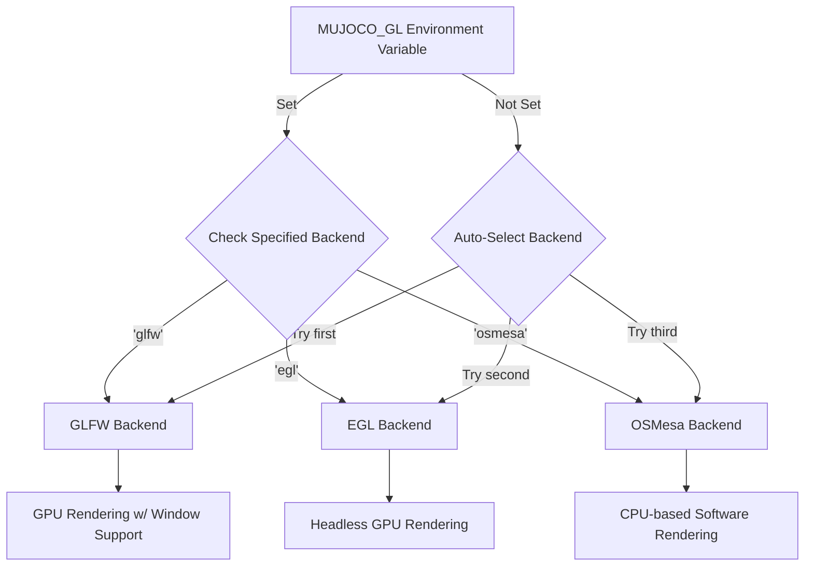
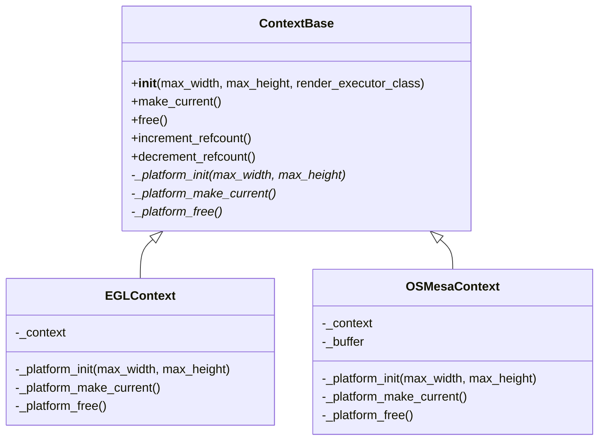
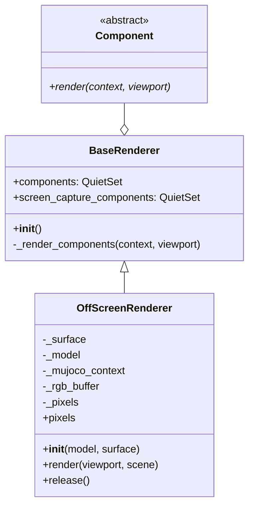
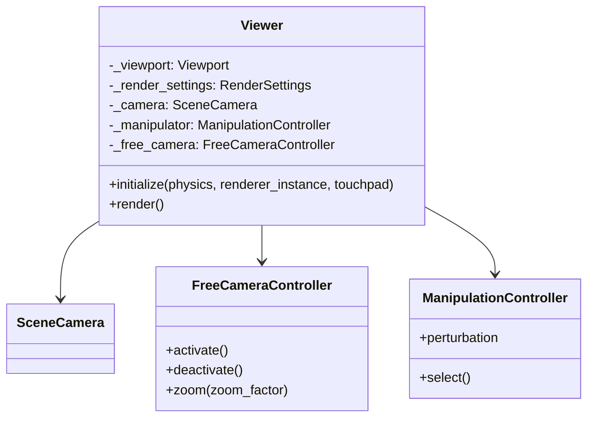
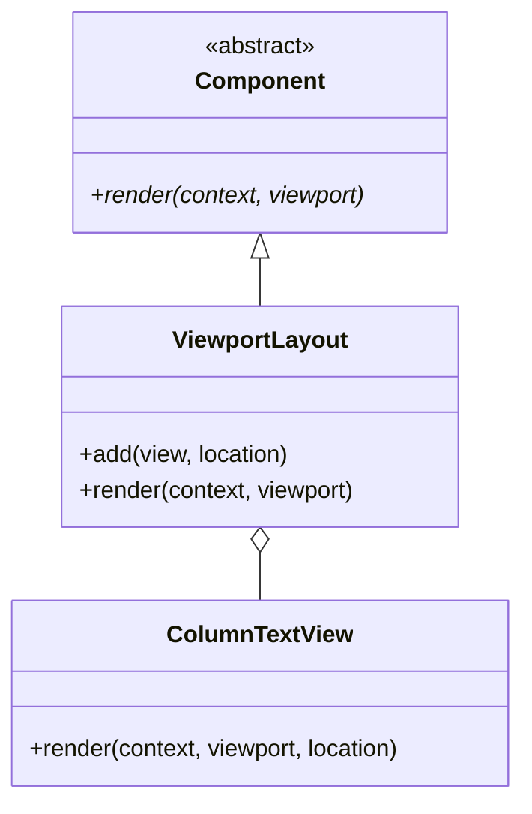

<!-- source: DeepWiki mcp.deepwiki.com · repo google-deepmind/dm_control · page 3 Visualization and Rendering · fetched 2026-10-26 -->

# Visualization and Rendering

<details>
<summary>Relevant source files</summary>

The following files were used as context for generating this wiki page:

- [dm_control/_render/base.py](dm_control/_render/base.py)
- [dm_control/_render/base_test.py](dm_control/_render/base_test.py)
- [dm_control/_render/executor/render_executor.py](dm_control/_render/executor/render_executor.py)
- [dm_control/composer/observation/obs_buffer_test.py](dm_control/composer/observation/obs_buffer_test.py)
- [dm_control/composer/robot.py](dm_control/composer/robot.py)
- [dm_control/entities/manipulators/base.py](dm_control/entities/manipulators/base.py)
- [dm_control/mjcf/README.md](dm_control/mjcf/README.md)
- [dm_control/viewer/renderer.py](dm_control/viewer/renderer.py)
- [dm_control/viewer/runtime.py](dm_control/viewer/runtime.py)
- [dm_control/viewer/runtime_test.py](dm_control/viewer/runtime_test.py)
- [dm_control/viewer/util.py](dm_control/viewer/util.py)
- [dm_control/viewer/util_test.py](dm_control/viewer/util_test.py)
- [dm_control/viewer/viewer.py](dm_control/viewer/viewer.py)
- [dm_control/viewer/views.py](dm_control/viewer/views.py)

</details>


This page documents the visualization and rendering capabilities in `dm_control`, explaining how simulations can be visually rendered and interacted with. The system provides both programmatic rendering for generating images off-screen and an interactive viewer for real-time visualization and manipulation of simulations.

## Overview

The `dm_control` rendering system is built around MuJoCo's OpenGL-based visualization, providing abstractions for context management, viewport handling, camera controls, and component-based scene rendering. The architecture is designed to handle multiple rendering backends while maintaining thread safety across different components of the application.

```mermaid
flowchart TD
    A[""MuJoCo Physics State""] --> B[""OpenGL Rendering""]
    B --> C1[""Off-screen Rendering""]
    B --> C2[""Interactive Viewer""]
    
    B --> D[""Renderer Selection""]
    D --> E1[""GLFW (GPU)""]
    D --> E2[""EGL (Headless GPU)""]
    D --> E3[""OSMesa (CPU)""]
    
    C1 --> F1[""Image Output""]
    C2 --> F2[""User Interaction""]
    
    G[""Render Settings""] --> B
    H[""Camera Controls""] --> B
    I[""Components & Overlays""] --> B
```

Sources:
- [dm_control/_render/__init__.py:1-109]()
- [dm_control/_render/constants.py:1-33]()
- [dm_control/viewer/renderer.py:1-30]()

## Rendering Architecture

### Backend Selection

The rendering system automatically selects an appropriate OpenGL backend based on system capabilities and environment variables. The backends are attempted in this priority order:

1. **GLFW**: GPU-accelerated rendering with window support. [dm_control/_render/constants.py:29-29]()
2. **EGL**: Headless GPU-accelerated rendering. [dm_control/_render/constants.py:30-30]()
3. **OSMesa**: Software rendering (CPU-based). [dm_control/_render/constants.py:28-28]()

You can explicitly select a backend by setting the `MUJOCO_GL` environment variable to one of: `'glfw'`, `'egl'`, or `'osmesa'`. [dm_control/_render/__init__.py:31-31]()



Sources:
- [dm_control/_render/__init__.py:15-109]()
- [dm_control/_render/constants.py:18-33]()

### OpenGL Context Management

The rendering system uses a context management system to handle thread-safe access to OpenGL resources. The `ContextBase` class [dm_control/_render/base.py:45-45]() provides a common interface for different backends, while specific implementations handle platform-specific details.

*   `EGLContext`: Headless GPU context using PyOpenGL [dm_control/_render/pyopengl/egl_renderer.py:93-93]().
*   `OSMesaContext`: CPU-based software rendering context [dm_control/_render/pyopengl/osmesa_renderer.py:44-44]().



Sources:
- [dm_control/_render/base.py:16-166]()
- [dm_control/_render/pyopengl/egl_renderer.py:16-140]()
- [dm_control/_render/pyopengl/osmesa_renderer.py:16-86]()

### Threading Model

Rendering in OpenGL requires operations to be performed from the thread where the context is current. The `RenderExecutor` [dm_control/_render/executor/__init__.py:37-37]() ensures thread safety when rendering from multiple threads.

For details, see [Rendering Pipeline](#3.1).

Sources:
- [dm_control/_render/base.py:122-151]()
- [dm_control/_render/executor/__init__.py:16-51]()

## Rendering Components

### Renderer

The `OffScreenRenderer` [dm_control/viewer/renderer.py:132-132]() manages the process of rendering MuJoCo scenes to pixel buffers. It utilizes a `BaseRenderer` architecture that allows for modular `Component` [dm_control/viewer/renderer.py:98-98]() objects to draw additional content like overlays.



Sources:
- [dm_control/viewer/renderer.py:68-207]()

### Camera System

The `SceneCamera` [dm_control/viewer/renderer.py:307-307]() class encapsulates camera functionality, allowing control over viewpoint and managing the rendering of MuJoCo scenes. It supports various modes including `set_freelook_mode`, `set_tracking_mode`, and `set_fixed_mode`. [dm_control/viewer/renderer.py:423-446]()

### Viewport

The `Viewport` class [dm_control/viewer/renderer.py:613-613]() handles screen-to-viewport coordinate conversions and manages the dimensions of the rendering area.

Sources:
- [dm_control/viewer/renderer.py:307-610]()
- [dm_control/viewer/renderer.py:613-686]()

## Viewer Interface

The interactive `Viewer` [dm_control/viewer/viewer.py:94-94]() provides a graphical interface for exploring simulations. It coordinates the `SceneCamera`, `ManipulationController`, and `FreeCameraController` to handle user input and scene updates.

For details, see [Viewer Interface](#3.2).



Sources:
- [dm_control/viewer/viewer.py:94-278]()
- [dm_control/viewer/viewer.py:340-458]()

### User Input Mapping

The viewer uses an `InputMap` [dm_control/viewer/viewer.py:116-116]() to connect mouse and keyboard actions to simulation logic.

| Action | Default Binding | Description |
|--------|----------------|-------------|
| Pan Camera | Right mouse button | Move camera up/down/left/right [dm_control/viewer/viewer.py:28-31]() |
| Rotate Camera | Left mouse button | Rotate camera viewpoint [dm_control/viewer/viewer.py:50-50]() |
| Zoom to Scene | Ctrl + A | Zoom to show entire scene [dm_control/viewer/viewer.py:58-58]() |
| Track Object | Ctrl + Double-click Right | Track selected body [dm_control/viewer/viewer.py:53-54]() |

Sources:
- [dm_control/viewer/viewer.py:28-78]()
- [dm_control/viewer/viewer.py:162-224]()

## Integration with Components and Overlays

The rendering system supports component-based extensions through the `Component` interface, allowing custom visualizations to be added to the scene. The `ViewportLayout` [dm_control/viewer/views.py:125-125]() acts as a manager for these views.



Sources:
- [dm_control/viewer/renderer.py:98-113]()
- [dm_control/viewer/views.py:32-176]()

---

