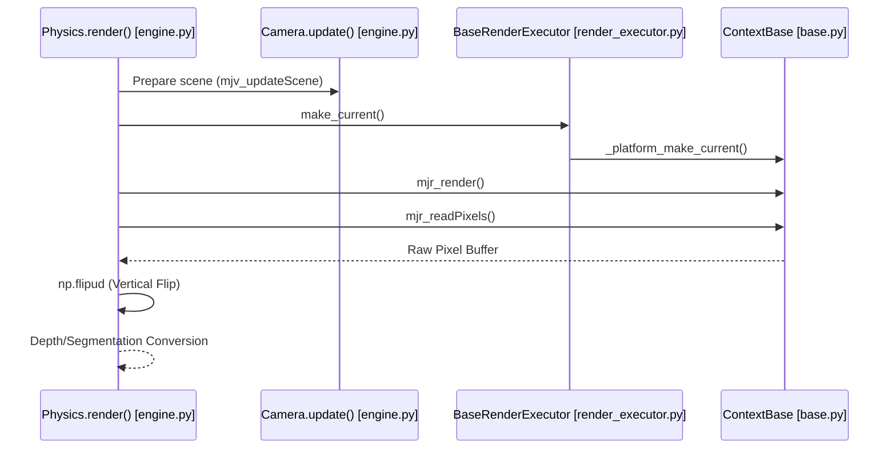

<!-- source: DeepWiki mcp.deepwiki.com · repo google-deepmind/dm_control · page 3.1 Rendering Pipeline · fetched 2026-10-26 -->

# Rendering Pipeline

<details>
<summary>Relevant source files</summary>

The following files were used as context for generating this wiki page:

- [dm_control/_render/__init__.py](dm_control/_render/__init__.py)
- [dm_control/_render/base.py](dm_control/_render/base.py)
- [dm_control/_render/base_test.py](dm_control/_render/base_test.py)
- [dm_control/_render/constants.py](dm_control/_render/constants.py)
- [dm_control/_render/executor/__init__.py](dm_control/_render/executor/__init__.py)
- [dm_control/_render/executor/render_executor.py](dm_control/_render/executor/render_executor.py)
- [dm_control/_render/executor/render_executor_test.py](dm_control/_render/executor/render_executor_test.py)
- [dm_control/_render/glfw_renderer_test.py](dm_control/_render/glfw_renderer_test.py)
- [dm_control/_render/pyopengl/__init__.py](dm_control/_render/pyopengl/__init__.py)
- [dm_control/_render/pyopengl/egl_ext.py](dm_control/_render/pyopengl/egl_ext.py)
- [dm_control/_render/pyopengl/egl_renderer.py](dm_control/_render/pyopengl/egl_renderer.py)
- [dm_control/_render/pyopengl/osmesa_renderer.py](dm_control/_render/pyopengl/osmesa_renderer.py)
- [dm_control/composer/observation/obs_buffer_test.py](dm_control/composer/observation/obs_buffer_test.py)
- [dm_control/composer/robot.py](dm_control/composer/robot.py)
- [dm_control/entities/manipulators/base.py](dm_control/entities/manipulators/base.py)
- [dm_control/mjcf/README.md](dm_control/mjcf/README.md)
- [dm_control/mujoco/engine.py](dm_control/mujoco/engine.py)
- [dm_control/mujoco/engine_test.py](dm_control/mujoco/engine_test.py)
- [dm_control/mujoco/wrapper/core.py](dm_control/mujoco/wrapper/core.py)
- [dm_control/mujoco/wrapper/core_test.py](dm_control/mujoco/wrapper/core_test.py)
- [dm_control/mujoco/wrapper/util.py](dm_control/mujoco/wrapper/util.py)

</details>


The purpose of this page is to detail the rendering pipeline and backends in `dm_control`: EGL (headless GPU), GLFW (windowed), and OSMesa (software). It covers the rendering context lifecycle, depth and segmentation rendering modes, and the render executor threading model that ensures thread safety across OpenGL contexts.

## Overview

The rendering pipeline converts a MuJoCo physics state into visual output using OpenGL. It supports different rendering modes (RGB, depth, segmentation), multiple camera views, and operates on different hardware configurations through pluggable rendering backends.

### System Architecture and Code Entities

The following diagram bridges the high-level rendering concepts to the specific classes and functions in the codebase.

```mermaid
flowchart TD
    subgraph "User API Space"
        A["Physics.render() [dm_control/mujoco/engine.py]"]
        B["Camera.render() [dm_control/mujoco/engine.py]"]
    end
    
    subgraph "MuJoCo Binding Space"
        C["mujoco.MjvScene"]
        D["mujoco.MjvCamera"]
        E["mujoco.MjrContext"]
    end
    
    subgraph "Backend Space"
        G["ContextBase [dm_control/_render/base.py]"]
        H["GLFWContext [dm_control/_render/glfw_renderer.py]"]
        I["EGLContext [dm_control/_render/pyopengl/egl_renderer.py]"]
        J["OSMesaContext [dm_control/_render/pyopengl/osmesa_renderer.py]"]
    end
    
    A -->|calls| B
    B -->|populates| C
    B -->|configures| D
    B -->|executes via| E
    E -->|managed by| G
    G <|-- H
    G <|-- I
    G <|-- J
```

Sources: [dm_control/mujoco/engine.py:178-234](), [dm_control/_render/__init__.py:16-109](), [dm_control/_render/base.py:45-51]()

## Rendering Backends

The pipeline supports three backends to accommodate various environments. Selection is controlled by the `MUJOCO_GL` environment variable [dm_control/_render/__init__.py:31-31]().

| Backend | Implementation Class | Environment Variable | Use Case |
| :--- | :--- | :--- | :--- |
| **GLFW** | `GLFWContext` | `MUJOCO_GL=glfw` | Windowed/Interactive visualization. |
| **EGL** | `EGLContext` | `MUJOCO_GL=egl` | Headless GPU-accelerated rendering. |
| **OSMesa** | `OSMesaContext` | `MUJOCO_GL=osmesa` | Software-based CPU rendering. |

If `MUJOCO_GL` is unset, `dm_control` attempts to load them in the order: GLFW > EGL > OSMesa [dm_control/_render/__init__.py:96-101]().

### EGL (Headless GPU)
The `EGLContext` initializes a headless display directly on a GPU device [dm_control/_render/pyopengl/egl_renderer.py:43-70](). It can be pinned to a specific GPU using the `MUJOCO_EGL_DEVICE_ID` environment variable [dm_control/_render/pyopengl/egl_renderer.py:46-55]().

Sources: [dm_control/_render/__init__.py:61-66](), [dm_control/_render/pyopengl/egl_renderer.py:93-100]()

## Core Components and Lifecycle

### Physics and MjrContext
The `Physics` class manages the lifecycle of rendering contexts (`Contexts` named tuple containing GL and MuJoCo contexts) [dm_control/mujoco/engine.py:62-62](). Contexts are lazily created during the first call to `render()` and thread-safely guarded via `_contexts_lock` [dm_control/mujoco/engine.py:105-114]().

### Camera Lifecycle
The `Camera` class manages the MuJoCo visualization structures:
*   **`MjvScene`**: Holds the geoms and visual objects to be rendered [dm_control/mujoco/engine.py:818-850]().
*   **`MjvCamera`**: Defines the viewpoint, distance, azimuth, and elevation [dm_control/mujoco/engine.py:68-68]().
*   **`MjvOption`**: Controls visualization flags such as frame rendering and wireframes [dm_control/mujoco/engine_test.py:101-105]().

Sources: [dm_control/mujoco/engine.py:83-114](), [dm_control/mujoco/engine.py:818-850]()

## Render Executor Threading Model

Rendering operations require strict adherence to OpenGL thread-affinity rules. `dm_control` solves this via `BaseRenderExecutor` and its subclasses [dm_control/_render/executor/render_executor.py:60-116]().

*   **`PassthroughRenderExecutor`**: Executes rendering calls on the calling thread; used by backends like `EGLContext` [dm_control/_render/pyopengl/egl_renderer.py:100-100](), [dm_control/_render/executor/render_executor.py:118-146]().
*   **`OffloadingRenderExecutor`**: Maintains a dedicated background thread where the OpenGL context is created and made current [dm_control/_render/executor/render_executor.py:170-218]().
*   **`make_current()`**: A context manager in `ContextBase` that verifies thread ownership, binds the context via `_platform_make_current()`, and yields an execution context [dm_control/_render/base.py:123-150]().

Sources: [dm_control/_render/base.py:48-67](), [dm_control/_render/executor/render_executor.py:16-34]()

## Rendering Modes and Data Flow

The pipeline supports three distinct output modes via `physics.render()` [dm_control/mujoco/engine.py:178-190]():

1.  **RGB**: Returns a `uint8` array of shape `(height, width, 3)`.
2.  **Depth**: Returns a `float32` array of shape `(height, width)` containing distances in meters. Non-linear Z-buffer values are converted to linear metric depths [dm_control/mujoco/engine.py:895-902]().
3.  **Segmentation**: Returns an `int32` array of shape `(height, width, 2)`.
    *   `channel 0`: Object ID (e.g., geom ID, site ID) [dm_control/mujoco/engine_test.py:118-127]().
    *   `channel 1`: Object Type (defined by `mjtObj` enum) [dm_control/mujoco/engine_test.py:98-100]().

### Data Flow Diagram



Sources: [dm_control/mujoco/engine.py:818-924](), [dm_control/_render/base.py:123-154](), [dm_control/_render/executor/render_executor.py:60-116]()

## Implementation Details

### Scene Callbacks
Users can inject custom geometry or modify the scene dynamically by passing a `scene_callback` function to `render()`. This callback is invoked immediately after the scene is updated (`mjv_updateScene`) and before it is rasterized [dm_control/mujoco/engine_test.py:142-151]().

### Error Handling
If an invalid OpenGL backend is requested or missing dependencies prevent initialization, `_render` raises a `RuntimeError` or `ImportError` [dm_control/_render/__init__.py:54-87](). Inside `Physics`, the `check_invalid_state` context manager catches simulation warnings during rendering steps [dm_control/mujoco/engine.py:172-176]().

### Thread Safety
To prevent race conditions when sharing rendering contexts across threads, `Physics` uses `_contexts_lock` [dm_control/mujoco/engine.py:113-113](), while `base.py` tracks active contexts per thread via `_CURRENT_CONTEXT_FOR_THREAD` [dm_control/_render/base.py:41-41]().

Sources: [dm_control/mujoco/engine.py:107-114](), [dm_control/_render/__init__.py:54-87](), [dm_control/_render/base.py:41-41]()

---

