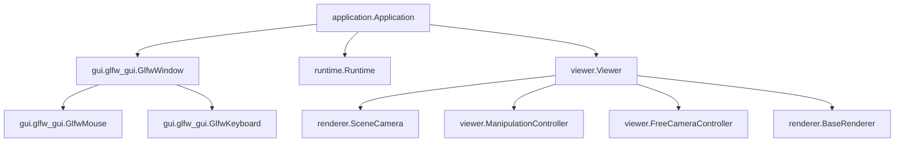
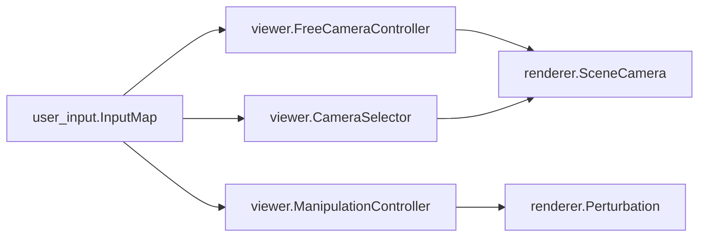

<!-- source: DeepWiki mcp.deepwiki.com · repo google-deepmind/dm_control · page 3.2 Viewer Interface · fetched 2026-10-26 -->

# Viewer Interface

Relevant source files

The following files were used as context for generating this wiki page:

- [dm_control/mjcf/debugging_test.py](dm_control/mjcf/debugging_test.py)
- [dm_control/suite/explore.py](dm_control/suite/explore.py)
- [dm_control/suite/wrappers/action_noise.py](dm_control/suite/wrappers/action_noise.py)
- [dm_control/suite/wrappers/action_noise_test.py](dm_control/suite/wrappers/action_noise_test.py)
- [dm_control/viewer/README.md](dm_control/viewer/README.md)
- [dm_control/viewer/__init__.py](dm_control/viewer/__init__.py)
- [dm_control/viewer/application.py](dm_control/viewer/application.py)
- [dm_control/viewer/application_test.py](dm_control/viewer/application_test.py)
- [dm_control/viewer/gui/__init__.py](dm_control/viewer/gui/__init__.py)
- [dm_control/viewer/gui/base.py](dm_control/viewer/gui/base.py)
- [dm_control/viewer/gui/base_test.py](dm_control/viewer/gui/base_test.py)
- [dm_control/viewer/gui/fullscreen_quad.py](dm_control/viewer/gui/fullscreen_quad.py)
- [dm_control/viewer/gui/glfw_gui.py](dm_control/viewer/gui/glfw_gui.py)
- [dm_control/viewer/gui/glfw_gui_test.py](dm_control/viewer/gui/glfw_gui_test.py)
- [dm_control/viewer/renderer.py](dm_control/viewer/renderer.py)
- [dm_control/viewer/renderer_test.py](dm_control/viewer/renderer_test.py)
- [dm_control/viewer/runtime.py](dm_control/viewer/runtime.py)
- [dm_control/viewer/runtime_test.py](dm_control/viewer/runtime_test.py)
- [dm_control/viewer/user_input.py](dm_control/viewer/user_input.py)
- [dm_control/viewer/user_input_test.py](dm_control/viewer/user_input_test.py)
- [dm_control/viewer/util.py](dm_control/viewer/util.py)
- [dm_control/viewer/util_test.py](dm_control/viewer/util_test.py)
- [dm_control/viewer/viewer.py](dm_control/viewer/viewer.py)
- [dm_control/viewer/viewer_test.py](dm_control/viewer/viewer_test.py)
- [dm_control/viewer/views.py](dm_control/viewer/views.py)
- [dm_control/viewer/views_test.py](dm_control/viewer/views_test.py)

## Purpose and Scope

The Viewer Interface in `dm_control` provides an interactive visualization system for MuJoCo physics simulations. It enables users to inspect, navigate, and manipulate physics environments using the GLFW windowing system, a robust camera control stack, a physics perturbation mechanism, configurable rendering flags, and 2D overlay views. This page details the implementation of the `Viewer` class [dm_control/viewer/viewer.py:94](), runtime execution [dm_control/viewer/runtime.py:85](), windowing integration via `glfw_gui` [dm_control/viewer/gui/glfw_gui.py:164](), and rendering overlays [dm_control/viewer/views.py:61]().

Sources: [dm_control/viewer/viewer.py:94-110](), [dm_control/viewer/runtime.py:85-112](), [dm_control/viewer/gui/glfw_gui.py:164-187](), [dm_control/viewer/views.py:61-91]()

---

## Architecture Overview

The interactive viewer bridges application-level orchestration (`Application`) with window management (`GlfwWindow`), runtime control (`Runtime`), and viewport rendering (`Viewer`).

Sources: [dm_control/viewer/application.py:179-203](), [dm_control/viewer/viewer.py:94-159](), [dm_control/viewer/gui/glfw_gui.py:60-163]()

---

## Viewer Class and Camera Controllers

The `Viewer` class [dm_control/viewer/viewer.py:94]() manages input mappings, viewport sizing, and scene rendering. It instantiates camera controllers that govern how the viewpoint reacts to user interactions.

Sources: [dm_control/viewer/viewer.py:97-159](), [dm_control/viewer/user_input.py:1-50]()

*   **Free Camera**: Permits unconstrained 6-DOF translation and rotation around a focal point.
*   **Tracking Camera**: Follows a specific body index (`mjvCamera.trackbodyid`) [dm_control/viewer/renderer.py:476-484]().
*   **Fixed Camera**: Cycles through camera slots defined directly in the MJCF model (`0` to `model.ncam - 1`).

Sources: [dm_control/viewer/viewer.py:94-160](), [dm_control/viewer/renderer.py:396-410]()

---

## Perturbation System and Object Manipulation

Direct interaction with bodies in the physics simulation is handled via the perturbation subsystem (`Perturbation` and `ManipulationController`). When active, user drag operations inject forces and torques into `mjData` via MuJoCo's native perturbation routines (`mjv_initPerturb`, `mjv_movePerturb`) [dm_control/viewer/renderer_test.py:123-162]().

Sources: [dm_control/viewer/renderer_test.py:110-183]()

---

## Render Settings and Visualization Flags

Rendering behavior is controlled by `RenderSettings` and MuJoCo visual options (`mjvOption`, `mjvScene.flags`) [dm_control/viewer/renderer.py:41-48](). Users can toggle geom group visibility (`_GEOM_GROUPS`) [dm_control/viewer/viewer.py:69](), site group visibility (`_SITE_GROUPS`) [dm_control/viewer/viewer.py:71](), and rendering flags (such as shadow, reflection, and skybox) [dm_control/viewer/renderer.py:44-46]() via mapped hotkeys.

Sources: [dm_control/viewer/viewer.py:65-78](), [dm_control/viewer/renderer.py:41-48]()

---

## 2D Overlay Views and User Interface

The `views` module [dm_control/viewer/views.py:15]() and `application.py` [dm_control/viewer/application.py:15]() supply 2D heads-up display (HUD) panels rendered directly onto the OpenGL framebuffer using `mujoco.mjr_overlay` [dm_control/viewer/views.py:87]().

*   **ColumnTextView**: Renders structured two-column key-value pairs (such as application status, CPU timing, FPS, and active camera name) [dm_control/viewer/views.py:61-90]().
*   **ViewportLayout**: Manages spatial placement of views across corner quadrants via `PanelLocation` [dm_control/viewer/views.py:25-30](), [dm_control/viewer/views.py:125-176]().
*   **MujocoDepthBuffer**: Subsamples and visualizes the scene depth buffer as a picture-in-picture overlay [dm_control/viewer/views.py:92-123]().

Sources: [dm_control/viewer/views.py:25-176](), [dm_control/viewer/application.py:49-172]()

---

