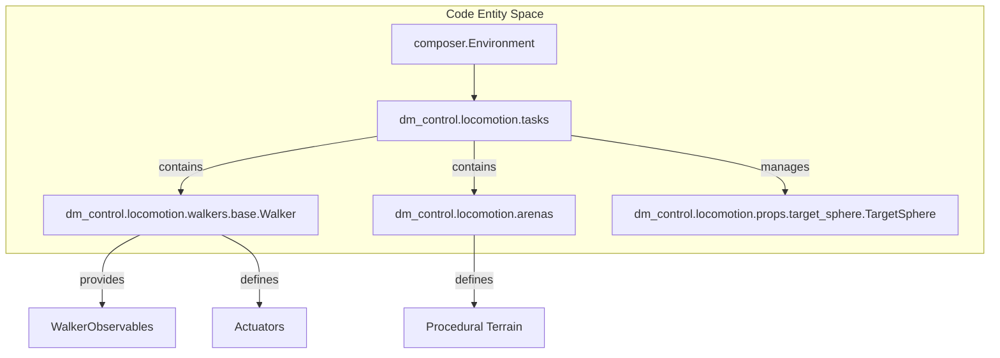

<!-- source: DeepWiki mcp.deepwiki.com · repo google-deepmind/dm_control · page 4 Locomotion Framework · fetched 2026-10-26 -->

# Locomotion Framework

<details>
<summary>Relevant source files</summary>

The following files were used as context for generating this wiki page:

- [dm_control/composer/entity.py](dm_control/composer/entity.py)
- [dm_control/composer/entity_test.py](dm_control/composer/entity_test.py)
- [dm_control/locomotion/README.md](dm_control/locomotion/README.md)
- [dm_control/locomotion/arenas/bowl_test.py](dm_control/locomotion/arenas/bowl_test.py)
- [dm_control/locomotion/examples/basic_rodent_2020.py](dm_control/locomotion/examples/basic_rodent_2020.py)
- [dm_control/locomotion/mocap/props.py](dm_control/locomotion/mocap/props.py)
- [dm_control/locomotion/props/__init__.py](dm_control/locomotion/props/__init__.py)
- [dm_control/locomotion/props/target_sphere.py](dm_control/locomotion/props/target_sphere.py)
- [dm_control/locomotion/props/target_sphere_test.py](dm_control/locomotion/props/target_sphere_test.py)
- [dm_control/locomotion/tasks/escape_test.py](dm_control/locomotion/tasks/escape_test.py)
- [dm_control/locomotion/tasks/reference_pose/tracking_test.py](dm_control/locomotion/tasks/reference_pose/tracking_test.py)
- [dm_control/locomotion/tasks/reference_pose/utils.py](dm_control/locomotion/tasks/reference_pose/utils.py)
- [dm_control/locomotion/walkers/base.py](dm_control/locomotion/walkers/base.py)
- [dm_control/locomotion/walkers/base_test.py](dm_control/locomotion/walkers/base_test.py)

</details>


The Locomotion Framework is a specialized component of `dm_control` that provides tools and abstractions for building embodied agents and environments centered around movement [dm_control/locomotion/README.md:1-8](). It extends the core Composer framework with components specifically designed for simulating walking, running, jumping, and multi-agent behaviors in physics-based environments [dm_control/locomotion/README.md:1-8]().

For information about the core physics engine integration, see [Physics Engine](#2.1). For details on the general entity-component system, see [Entity-Component Framework](#2.3).

## Architecture Overview

The framework facilitates the creation of environments where **walkers** perform a **task** in an **arena** [dm_control/locomotion/README.md:15-28]().

Diagram Title: Locomotion System Architecture

Sources: [dm_control/locomotion/README.md:15-28](), [dm_control/locomotion/examples/basic_rodent_2020.py:19-31]()

## Walker System

Walkers are detached bodies that can move around in the environment [dm_control/locomotion/README.md:20-21](). The system provides a standardized interface (`Walker` base class extending `composer.Robot`) for diverse morphologies, from humanoid robots to virtual rodents [dm_control/locomotion/walkers/base.py:68-75]().

Features include egocentric transforms (`transform_vec_to_egocentric_frame`, `transform_xmat_to_egocentric_frame`) [dm_control/locomotion/walkers/base.py:77-124](), specialized observables covering proprioception and kinematic sensors (`WalkerObservables`) [dm_control/locomotion/walkers/base.py:157-196](), and action specification handling [dm_control/locomotion/walkers/base.py:136-150]().

For details, see [Walker System](#4.1).

Sources: [dm_control/locomotion/walkers/base.py:68-196]()

## Arenas

Arenas refer to the surroundings in which walkers and other objects exist [dm_control/locomotion/README.md:23-24](). They manage the physical floor, walls, and procedural terrain generation.

| Arena Type | Description |
| :--- | :--- |
| **Floor** | A simple flat plane with configurable aesthetics [dm_control/locomotion/examples/basic_rodent_2020.py:148-150](). |
| **Corridors** | Linear environments that can include gaps, walls, or obstacles [dm_control/locomotion/examples/basic_rodent_2020.py:71-76](). |
| **Mazes** | Complex layouts generated using `labmaze`, supporting multiple rooms and targets [dm_control/locomotion/examples/basic_rodent_2020.py:106-117](). |
| **Bowl** | A bowl-shaped terrain used for "escape" tasks [dm_control/locomotion/examples/basic_rodent_2020.py:45-47](). |

For details on procedural generation and covering utilities, see [Arenas](#4.2).

Sources: [dm_control/locomotion/examples/basic_rodent_2020.py:21-31](), [dm_control/locomotion/examples/basic_rodent_2020.py:45-150]()

## Locomotion Tasks

Tasks specify observations, rewards, and environment lifecycle logic (initialization and termination) [dm_control/locomotion/README.md:26-28](). Built-in tasks include `RunThroughCorridor`, `Escape`, `ManyGoalsMaze`, and `TwoTouch` [dm_control/locomotion/examples/basic_rodent_2020.py:50-166]().

Tasks frequently utilize **Props**, such as `TargetSphere`, which is a non-colliding sphere activated through touch that updates its activation state and material appearance [dm_control/locomotion/props/target_sphere.py:22-112]().

For details on reward shaping and task configuration, see [Locomotion Tasks](#4.3).

Sources: [dm_control/locomotion/props/target_sphere.py:22-112](), [dm_control/locomotion/examples/basic_rodent_2020.py:37-171]()

## Specialized Subsystems

The locomotion framework includes advanced modules for multi-agent games and imitation learning:

- **Soccer Environment**: A multi-agent competitive environment featuring `Pitch` arenas, `PositionDetector`, and `SoccerBall` entities [dm_control/locomotion/README.md:36-55](). For details, see [Soccer Environment](#4.4).
- **Motion Capture Tracking**: A system for training walkers to mimic motion capture trajectories using reference pose tracking tasks, dataset collections (`ClipCollection`), and utility initializers [dm_control/locomotion/tasks/reference_pose/utils.py:22-71](), [dm_control/locomotion/tasks/reference_pose/tracking_test.py:63-74](). For details, see [Motion Capture Tracking](#4.5).

Sources: [dm_control/locomotion/tasks/reference_pose/utils.py:22-71](), [dm_control/locomotion/tasks/reference_pose/tracking_test.py:63-74]()

## Quickstart Example

The following example demonstrates loading a pre-configured locomotion environment using the `basic_cmu_2019` example module [dm_control/locomotion/README.md:36-55]().

```python
from dm_control import composer
from dm_control.locomotion.examples import basic_cmu_2019
import numpy as np

# Build an environment where a humanoid runs through walls
env = basic_cmu_2019.cmu_humanoid_run_walls()

# Reset and step
time_step = env.reset()
action_spec = env.action_spec()
while not time_step.last():
  action = np.random.uniform(action_spec.minimum, action_spec.maximum, size=action_spec.shape)
  time_step = env.step(action)
```

Sources: [dm_control/locomotion/README.md:36-55]()

---

