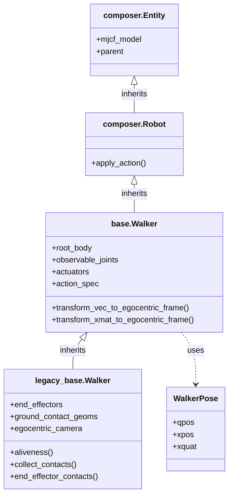
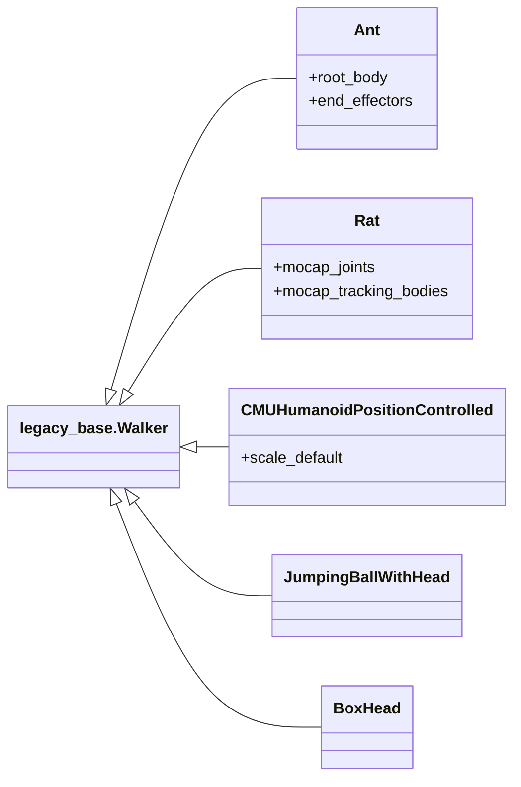

<!-- source: DeepWiki mcp.deepwiki.com · repo google-deepmind/dm_control · page 4.1 Walker System · fetched 2026-10-26 -->

# Walker System

Relevant source files

The following files were used as context for generating this wiki page:

- [dm_control/composer/entity.py](dm_control/composer/entity.py)
- [dm_control/composer/entity_test.py](dm_control/composer/entity_test.py)
- [dm_control/locomotion/examples/__init__.py](dm_control/locomotion/examples/__init__.py)
- [dm_control/locomotion/mocap/props.py](dm_control/locomotion/mocap/props.py)
- [dm_control/locomotion/tasks/__init__.py](dm_control/locomotion/tasks/__init__.py)
- [dm_control/locomotion/tasks/reference_pose/tracking_test.py](dm_control/locomotion/tasks/reference_pose/tracking_test.py)
- [dm_control/locomotion/tasks/reference_pose/utils.py](dm_control/locomotion/tasks/reference_pose/utils.py)
- [dm_control/locomotion/walkers/__init__.py](dm_control/locomotion/walkers/__init__.py)
- [dm_control/locomotion/walkers/ant.py](dm_control/locomotion/walkers/ant.py)
- [dm_control/locomotion/walkers/assets/dog_v2/add_torque_actuators.py](dm_control/locomotion/walkers/assets/dog_v2/add_torque_actuators.py)
- [dm_control/locomotion/walkers/assets/dog_v2/build_back_legs.py](dm_control/locomotion/walkers/assets/dog_v2/build_back_legs.py)
- [dm_control/locomotion/walkers/assets/dog_v2/build_dog.py](dm_control/locomotion/walkers/assets/dog_v2/build_dog.py)
- [dm_control/locomotion/walkers/assets/dog_v2/build_front_legs.py](dm_control/locomotion/walkers/assets/dog_v2/build_front_legs.py)
- [dm_control/locomotion/walkers/assets/dog_v2/build_neck.py](dm_control/locomotion/walkers/assets/dog_v2/build_neck.py)
- [dm_control/locomotion/walkers/assets/dog_v2/build_tail.py](dm_control/locomotion/walkers/assets/dog_v2/build_tail.py)
- [dm_control/locomotion/walkers/assets/dog_v2/build_torso.py](dm_control/locomotion/walkers/assets/dog_v2/build_torso.py)
- [dm_control/locomotion/walkers/assets/dog_v2/create_skin.py](dm_control/locomotion/walkers/assets/dog_v2/create_skin.py)
- [dm_control/locomotion/walkers/assets/dog_v2/dog.xml](dm_control/locomotion/walkers/assets/dog_v2/dog.xml)
- [dm_control/locomotion/walkers/assets/dog_v2/dog_base.xml](dm_control/locomotion/walkers/assets/dog_v2/dog_base.xml)
- [dm_control/locomotion/walkers/assets/dog_v2/dog_skin.skn](dm_control/locomotion/walkers/assets/dog_v2/dog_skin.skn)
- [dm_control/locomotion/walkers/assets/jumping_ball/jumping_ball_body.png](dm_control/locomotion/walkers/assets/jumping_ball/jumping_ball_body.png)
- [dm_control/locomotion/walkers/assets/jumping_ball/jumping_ball_with_head.xml](dm_control/locomotion/walkers/assets/jumping_ball/jumping_ball_with_head.xml)
- [dm_control/locomotion/walkers/assets/rodent_walker_skin.skn](dm_control/locomotion/walkers/assets/rodent_walker_skin.skn)
- [dm_control/locomotion/walkers/base.py](dm_control/locomotion/walkers/base.py)
- [dm_control/locomotion/walkers/base_test.py](dm_control/locomotion/walkers/base_test.py)
- [dm_control/locomotion/walkers/jumping_ball.py](dm_control/locomotion/walkers/jumping_ball.py)
- [dm_control/locomotion/walkers/jumping_ball_test.py](dm_control/locomotion/walkers/jumping_ball_test.py)
- [dm_control/locomotion/walkers/legacy_base.py](dm_control/locomotion/walkers/legacy_base.py)
- [dm_control/locomotion/walkers/rescale.py](dm_control/locomotion/walkers/rescale.py)
- [dm_control/locomotion/walkers/rescale_test.py](dm_control/locomotion/walkers/rescale_test.py)
- [dm_control/locomotion/walkers/rodent_test.py](dm_control/locomotion/walkers/rodent_test.py)
- [dm_control/suite/dog_assets/BONEXiphoid_cartilage.stl](dm_control/suite/dog_assets/BONEXiphoid_cartilage.stl)

The Walker System provides a framework for creating physically embodied locomoting agents. These walkers serve as the agent bodies within simulation environments, defining their physical structure, sensory observations, and action capabilities. This system is primarily located in the `dm_control/locomotion/walkers` directory.

## Core Architecture

The Walker System is built as an extension of the Entity-Component framework from the Composer library. Walkers are specialized entities with standardized interfaces for defining physical agents capable of locomotion. The following diagram bridges natural language descriptions of the agent hierarchy to the concrete code entities in the codebase.

Sources: [dm_control/composer/entity.py:199-209](), [dm_control/locomotion/walkers/base.py:37-155](), [dm_control/locomotion/walkers/legacy_base.py:31-186]()

## Walker Base Classes

### Base Walker Class

The `base.Walker` class is the abstract base class for all locomoting agents. It extends `composer.Robot` and defines core functionality:
- **Root Joints**: Automatically adds a `freejoint` to the walker's attachment frame [dm_control/locomotion/walkers/base.py:71-72]().
- **Action Spec**: Dynamically calculates action bounds based on the walker's actuators and their `ctrlrange` [dm_control/locomotion/walkers/base.py:136-150]().
- **Egocentric Frames**: Provides methods to transform world vectors and matrices into the walker's local coordinate system [dm_control/locomotion/walkers/base.py:77-123]().

### Legacy Walker Class

The `legacy_base.Walker` provides additional infrastructure for common locomotion tasks:
- **Aliveness**: A measure in range `[-1., 0.]` where `-1` means dead and `0` means alive [dm_control/locomotion/walkers/legacy_base.py:53-68]().
- **Contact Tracking**: Identifies `ground_contact_geoms` for failure termination [dm_control/locomotion/walkers/legacy_base.py:70-85]() and provides `collect_contacts` to calculate contact force magnitudes [dm_control/locomotion/walkers/legacy_base.py:142-154]().
- **Substep Updates**: Explicitly calls `mj_subtreeVel` after physics substeps to ensure accurate velocity sensors for torso-related observables [dm_control/locomotion/walkers/legacy_base.py:179-186]().

Sources: [dm_control/locomotion/walkers/base.py:68-155](), [dm_control/locomotion/walkers/legacy_base.py:31-186]()

## Walker Pose and Initialization

### Walker Pose

The `WalkerPose` class is a `namedtuple` representing a specific configuration of a walker [dm_control/locomotion/walkers/base.py:37-39]():
- `qpos`: Joint positions (defaults to `mjModel.qpos0` if `None`) [dm_control/locomotion/walkers/base.py:47-48]().
- `xpos`: Cartesian displacement (e.g., to lift the walker) [dm_control/locomotion/walkers/base.py:49-50]().
- `xquat`: Root body orientation quaternion [dm_control/locomotion/walkers/base.py:51]().

### Initializers

Initializers are used during `reinitialize_pose` to set the walker's state at the start of an episode [dm_control/locomotion/walkers/legacy_base.py:49-51]().
- `UprightInitializer`: Sets the walker to its defined `upright_pose`, configures joints, and zeroes velocities.
- `RandomlySampledInitializer`: Picks one from a list of provided initializers.

Sources: [dm_control/locomotion/walkers/base.py:37-65](), [dm_control/locomotion/walkers/legacy_base.py:49-51]()

## Observable System and Egocentric Transforms

Walkers provide rich observable properties through the `WalkerObservables` class hierarchy:
- **Proprioception**: Includes joint positions, velocities, and body height [dm_control/locomotion/walkers/base.py:187-190]().
- **Kinematic Sensors**: Gyroscopes, accelerometers, and frame quaternions [dm_control/locomotion/walkers/base.py:192-197]().

Walkers also supply egocentric transformation functions (`transform_vec_to_egocentric_frame` and `transform_xmat_to_egocentric_frame`) to express world-frame vectors and rotations relative to the walker's local coordinate frame [dm_control/locomotion/walkers/base.py:77-123]().

Sources: [dm_control/locomotion/walkers/base.py:77-200]()

## Concrete Walker Implementations

The locomotion framework includes several built-in walker implementations. The diagram below maps natural language walker descriptions to their corresponding code symbols in the codebase.

- **Ant**: A quadruped walker with a torso and four legs [dm_control/locomotion/walkers/ant.py:30-31](). Features `appendages_pos` and `bodies_quats` observables [dm_control/locomotion/walkers/ant.py:153-199]().
- **Rat (Rodent)**: A complex model of a position-controlled rat with vertebrae joints, limbs, and tendons [dm_control/locomotion/walkers/rodent.py:60-162]().
- **CMU Humanoid**: Standard humanoid based on CMU motion capture data, available in position-controlled and `V2020` variants [dm_control/locomotion/walkers/cmu_humanoid.py:15-134]().
- **Dog**: A canine anatomical model defined via MJCF assets and generator scripts (`dog.xml`, `build_dog.py`) [dm_control/locomotion/walkers/assets/dog_v2/dog.xml:1-10](), [dm_control/locomotion/walkers/assets/dog_v2/build_dog.py:16-30]().
- **JumpingBall & RollingBall**: Ball-based locomotion agents equipped with an actuated head (`JumpingBallWithHead`, `RollingBallWithHead`) [dm_control/locomotion/walkers/__init__.py:21-22]().
- **BoxHead**: A rollable box-headed agent utilized primarily in multi-agent soccer tasks.

Sources: [dm_control/locomotion/walkers/ant.py:30-199](), [dm_control/locomotion/walkers/cmu_humanoid.py:15-134](), [dm_control/locomotion/walkers/__init__.py:17-23](), [dm_control/locomotion/walkers/assets/dog_v2/dog.xml:1-10]()

## Utilities: Rescale and Scaled Actuators

The walker system provides utility functions for modifying walker geometries, sizes, and masses programmatically:
- **`rescale_subtree`**: Recursively traverses and scales an entire subtree of an MJCF model by specified position and size factors [dm_control/locomotion/walkers/rescale.py:21-36]().
- **`rescale_humanoid`**: Adjusts lengths, sizes, and total mass for humanoid walker variants [dm_control/locomotion/walkers/rescale.py:39-60]().

Sources: [dm_control/locomotion/walkers/rescale.py:21-60]()

---

