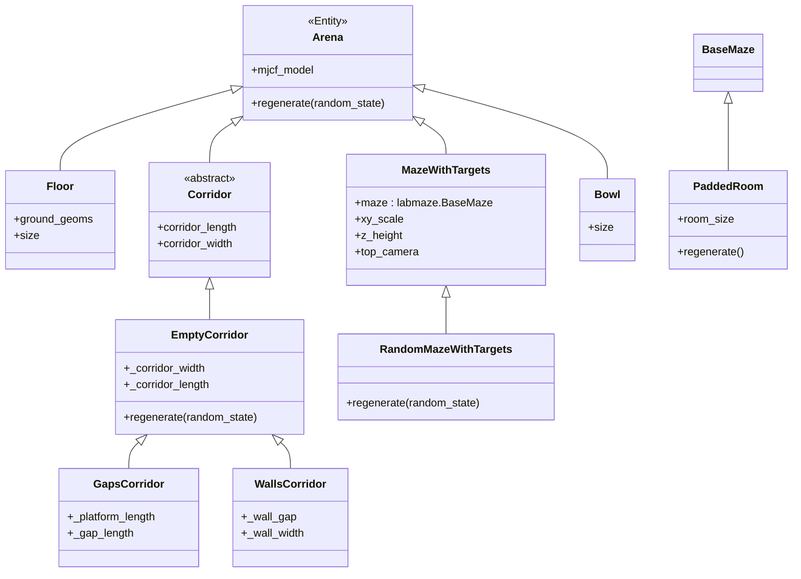
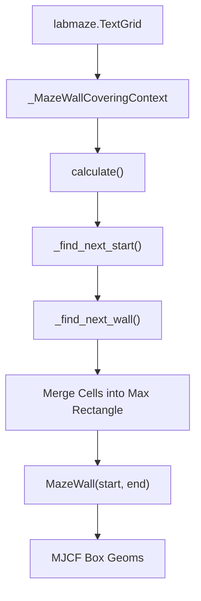

<!-- source: DeepWiki mcp.deepwiki.com · repo google-deepmind/dm_control · page 4.2 Arenas · fetched 2026-10-26 -->

# Arenas

Relevant source files

The following files were used as context for generating this wiki page:

- [dm_control/locomotion/arenas/__init__.py](dm_control/locomotion/arenas/__init__.py)
- [dm_control/locomotion/arenas/assets/__init__.py](dm_control/locomotion/arenas/assets/__init__.py)
- [dm_control/locomotion/arenas/assets/outdoor_natural/OutdoorGrassFloorD.png](dm_control/locomotion/arenas/assets/outdoor_natural/OutdoorGrassFloorD.png)
- [dm_control/locomotion/arenas/assets/outdoor_natural/OutdoorSkybox2048.png](dm_control/locomotion/arenas/assets/outdoor_natural/OutdoorSkybox2048.png)
- [dm_control/locomotion/arenas/corridors.py](dm_control/locomotion/arenas/corridors.py)
- [dm_control/locomotion/arenas/corridors_test.py](dm_control/locomotion/arenas/corridors_test.py)
- [dm_control/locomotion/arenas/covering.py](dm_control/locomotion/arenas/covering.py)
- [dm_control/locomotion/arenas/covering_test.py](dm_control/locomotion/arenas/covering_test.py)
- [dm_control/locomotion/arenas/floors.py](dm_control/locomotion/arenas/floors.py)
- [dm_control/locomotion/arenas/floors_test.py](dm_control/locomotion/arenas/floors_test.py)
- [dm_control/locomotion/arenas/labmaze_textures.py](dm_control/locomotion/arenas/labmaze_textures.py)
- [dm_control/locomotion/arenas/mazes.py](dm_control/locomotion/arenas/mazes.py)
- [dm_control/locomotion/arenas/mazes_test.py](dm_control/locomotion/arenas/mazes_test.py)
- [dm_control/locomotion/arenas/padded_room.py](dm_control/locomotion/arenas/padded_room.py)
- [dm_control/locomotion/arenas/padded_room_test.py](dm_control/locomotion/arenas/padded_room_test.py)
- [dm_control/locomotion/examples/basic_cmu_2019.py](dm_control/locomotion/examples/basic_cmu_2019.py)
- [dm_control/locomotion/examples/examples_test.py](dm_control/locomotion/examples/examples_test.py)
- [dm_control/locomotion/gaps.png](dm_control/locomotion/gaps.png)
- [dm_control/locomotion/walkers/scaled_actuators_test.py](dm_control/locomotion/walkers/scaled_actuators_test.py)

This section documents the arena types available within the `dm_control` locomotion framework (`dm_control.locomotion.arenas`) [dm_control/locomotion/arenas/__init__.py:15](). Arenas define the physical bounds, terrain, obstacles, and aesthetic properties of the simulation environment. They inherit from `composer.Arena` [dm_control/locomotion/arenas/floors.py:26]() and manage `mjcf.RootElement` definitions [dm_control/locomotion/arenas/floors.py:37]() to construct MuJoCo models.

## Overview

Arenas serve as the base container for agents (`walker`) and task-specific entities (`props`). They handle geometry generation, texture and material loading, top-down camera setup, and procedural layout resets across episodes.

### Class Hierarchy and Entity Relationships

The following diagram maps the high-level natural language concepts of terrain and environment layout to their concrete Python class implementations in the codebase.

**Diagram: Arena Code Entity Map**

Sources:
- [dm_control/locomotion/arenas/floors.py:26-104]()
- [dm_control/locomotion/arenas/corridors.py:31-176]()
- [dm_control/locomotion/arenas/mazes.py:38-178]()
- [dm_control/locomotion/arenas/padded_room.py:22-81]()
- [dm_control/locomotion/arenas/__init__.py:17-27]()

---

## Arena Types

### 1. Floor (`Floor`)
The `Floor` class provides a planar ground surface with a customizable checkerboard pattern or procedural textures [dm_control/locomotion/arenas/floors.py:26-75]().

*   **Implementation**: Adds a MuJoCo plane geom (`type='plane'`) to `self._mjcf_root.worldbody` [dm_control/locomotion/arenas/floors.py:77-82]().
*   **Aesthetics**: Supports custom textures via `aesthetic` arguments which resolve paths using `locomotion_arenas_assets.get_ground_texture_info` and `locomotion_arenas_assets.get_sky_texture_info` [dm_control/locomotion/arenas/floors.py:40-44]().
*   **Cameras**: Automatically calculates and attaches a `top_camera` with field-of-view (`fovy`) scaled to encapsulate the floor dimensions [dm_control/locomotion/arenas/floors.py:84-93]().

Sources:
- [dm_control/locomotion/arenas/floors.py:26-104]()

### 2. Corridors (`Corridor`, `EmptyCorridor`, `GapsCorridor`, `WallsCorridor`)
Corridor arenas provide linear paths for locomotion tasks, incorporating boundary planes and obstacles [dm_control/locomotion/arenas/corridors.py:31-176]().

*   **Corridor (Abstract Base)**: Defines interface properties (`corridor_length`, `corridor_width`, `ground_geoms`) and helper functions like `is_at_target_position` [dm_control/locomotion/arenas/corridors.py:31-70]().
*   **EmptyCorridor**: Renders a flat ground strip with bounding side planes (`_left_plane`, `_right_plane`, `_near_plane`, `_far_plane`) [dm_control/locomotion/arenas/corridors.py:72-120]().
*   **GapsCorridor**: Subclass of `EmptyCorridor` that creates alternating platforms and pits where agents must leap across gaps [dm_control/locomotion/arenas/corridors.py:178-185]().
*   **WallsCorridor**: Generates transverse walls obstructing the path, requiring the agent to navigate around lateral barriers.

Sources:
- [dm_control/locomotion/arenas/corridors.py:31-176]()

### 3. Mazes (`MazeWithTargets`, `RandomMazeWithTargets`, `PaddedRoom`)
Maze arenas rely on the `labmaze` package to construct grid-based labyrinths [dm_control/locomotion/arenas/mazes.py:24-43]().

*   **MazeWithTargets**: Parses a `labmaze.BaseMaze` grid instance into MuJoCo geoms, mapping grid walls to box geoms and extracting spawn/target locations [dm_control/locomotion/arenas/mazes.py:38-72]().
*   **RandomMazeWithTargets**: Dynamically generates new maze topologies and randomized target locations upon each reset [dm_control/locomotion/arenas/mazes.py:350-362]().
*   **PaddedRoom**: A specialized `labmaze.BaseMaze` subclass enforcing an empty inner room surrounded by padded outer perimeter cells [dm_control/locomotion/arenas/padded_room.py:22-30]().

Sources:
- [dm_control/locomotion/arenas/mazes.py:38-178]()
- [dm_control/locomotion/arenas/padded_room.py:22-81]()

### 4. Bowl and Natural Arenas (`Bowl`)
The `Bowl` arena provides a concave circular dish surface useful for escape and containment tasks. Additionally, outdoor natural assets (`OutdoorGrassFloorD.png`, `OutdoorSkybox2048.png`) can be loaded via aesthetic configs [dm_control/locomotion/arenas/floors.py:40-44]().

Sources:
- [dm_control/locomotion/arenas/__init__.py:17]()
- [dm_control/locomotion/arenas/floors.py:40-44]()

---

## Procedural Terrain & Utilities

### Regeneration Pipeline
Arenas implement a `regenerate(random_state)` method called during task initialization (`initialize_episode_mjcf`) [dm_control/locomotion/arenas/floors.py:99-100](). This method samples new parameters (e.g., width, length, wall layouts) from `composer.variation` distributions and updates the underlying MJCF elements [dm_control/locomotion/arenas/corridors.py:125-141]().

### Wall Covering Algorithm (`covering.py`)
To minimize the number of MuJoCo collision and visual geoms generated for grid-based mazes, `dm_control.locomotion.arenas.covering` employs a greedy rectangular covering algorithm [dm_control/locomotion/arenas/covering.py:24-31]().

**Diagram: Maze Wall Covering Data Flow**

Sources:
- [dm_control/locomotion/arenas/covering.py:24-137]()

---

## Technical Implementation Detail: Maze Parsing Pipeline

When `MazeWithTargets` processes a maze instance, it translates text-grid characters into physical geometry and metadata [dm_control/locomotion/arenas/mazes.py:38-72]().

1.  **Grid Scale Translation**: Maps 2D indices `(y, x)` to 3D Cartesian coordinates using `xy_scale` and `z_height` [dm_control/locomotion/arenas/mazes.py:41-49]().
2.  **Texture and Asset Binding**: Attaches skybox, wall, and floor texture providers (`labmaze_textures.SkyBox`, `labmaze_textures.WallTextures`, `labmaze_textures.FloorTextures`) to the `mjcf.RootElement` asset pool [dm_control/locomotion/arenas/mazes.py:76-131]().
3.  **Geometry Generation**: Iterates through the `entity_layer` grid to construct optimized box geoms for walls and register spawn/target coordinates [dm_control/locomotion/arenas/mazes.py:138-153]().

Sources:
- [dm_control/locomotion/arenas/mazes.py:38-250]()
- [dm_control/locomotion/arenas/labmaze_textures.py:23-83]()

---

