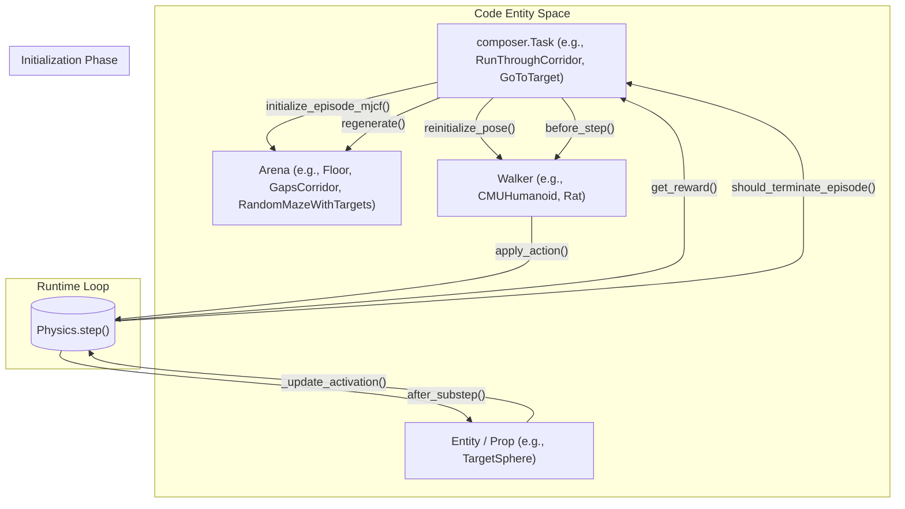
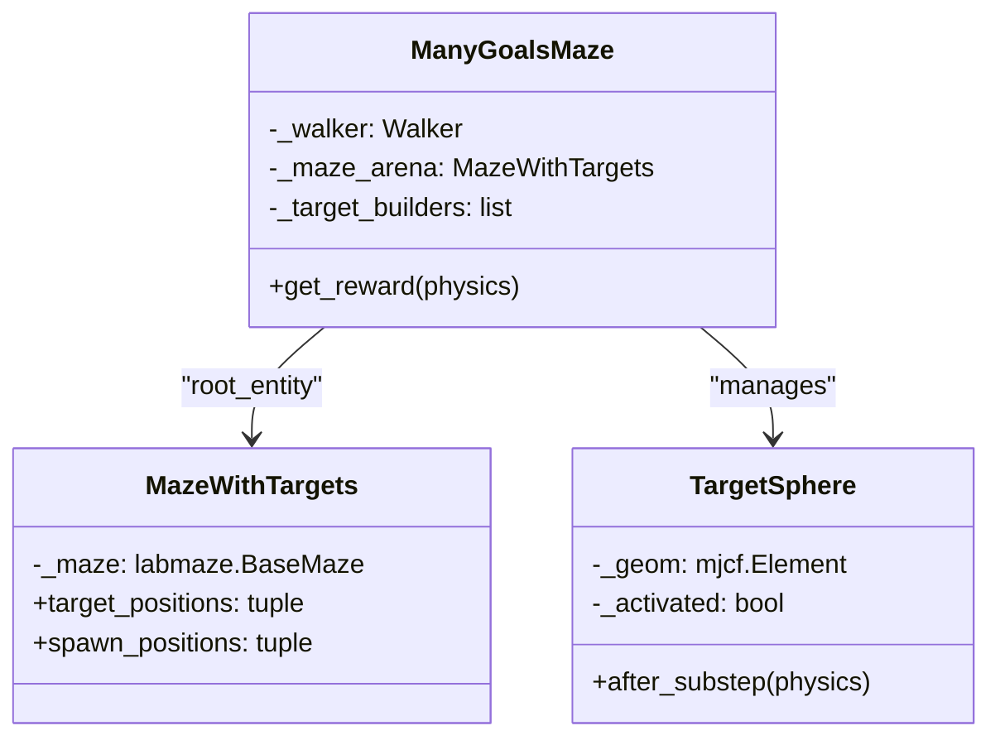

<!-- source: DeepWiki mcp.deepwiki.com · repo google-deepmind/dm_control · page 4.3 Locomotion Tasks · fetched 2026-10-26 -->

# Locomotion Tasks

Relevant source files

The following files were used as context for generating this wiki page:

- [dm_control/composer/observation/observable/base_test.py](dm_control/composer/observation/observable/base_test.py)
- [dm_control/composer/observation/observable/mjcf.py](dm_control/composer/observation/observable/mjcf.py)
- [dm_control/composer/observation/observable/mjcf_test.py](dm_control/composer/observation/observable/mjcf_test.py)
- [dm_control/locomotion/README.md](dm_control/locomotion/README.md)
- [dm_control/locomotion/arenas/bowl.py](dm_control/locomotion/arenas/bowl.py)
- [dm_control/locomotion/arenas/bowl_test.py](dm_control/locomotion/arenas/bowl_test.py)
- [dm_control/locomotion/examples/basic_rodent_2020.py](dm_control/locomotion/examples/basic_rodent_2020.py)
- [dm_control/locomotion/props/__init__.py](dm_control/locomotion/props/__init__.py)
- [dm_control/locomotion/props/target_sphere.py](dm_control/locomotion/props/target_sphere.py)
- [dm_control/locomotion/props/target_sphere_test.py](dm_control/locomotion/props/target_sphere_test.py)
- [dm_control/locomotion/tasks/corridors.py](dm_control/locomotion/tasks/corridors.py)
- [dm_control/locomotion/tasks/escape.py](dm_control/locomotion/tasks/escape.py)
- [dm_control/locomotion/tasks/escape_test.py](dm_control/locomotion/tasks/escape_test.py)
- [dm_control/locomotion/tasks/go_to_target.py](dm_control/locomotion/tasks/go_to_target.py)
- [dm_control/locomotion/tasks/go_to_target_test.py](dm_control/locomotion/tasks/go_to_target_test.py)
- [dm_control/locomotion/tasks/random_goal_maze.py](dm_control/locomotion/tasks/random_goal_maze.py)
- [dm_control/locomotion/tasks/random_goal_maze_test.py](dm_control/locomotion/tasks/random_goal_maze_test.py)
- [dm_control/locomotion/tasks/reach.py](dm_control/locomotion/tasks/reach.py)
- [dm_control/locomotion/walkers/rodent.py](dm_control/locomotion/walkers/rodent.py)
- [dm_control/mjcf/copier_test.py](dm_control/mjcf/copier_test.py)
- [dm_control/utils/rewards.py](dm_control/utils/rewards.py)
- [dm_control/utils/rewards_test.py](dm_control/utils/rewards_test.py)

This page documents the built-in locomotion tasks provided by `dm_control`, including corridor navigation, target-reaching, maze foraging, escape, and reach tasks, alongside the pre-configured example environments (`basic_cmu_2019` and `basic_rodent_2020`). It covers task structures, reward shaping mechanics, and the props system used to build complex reinforcement learning environments.

---

## Task Structure and Lifecycle

Locomotion tasks follow a compositional design pattern implemented via the `composer.Task` class. A task coordinates interactions between a mobile agent (`Walker`), a physical environment (`Arena`), and interactive objects (**props**). 

The following diagram bridges natural language task descriptions to the underlying code entities (`composer.Task`, `composer.Entity`, `Arena`, `Walker`) and outlines the environment initialization and execution flow.

Title: Task Lifecycle and Code Entity Mapping

Sources: [dm_control/locomotion/tasks/random_goal_maze.py:154-158](), [dm_control/locomotion/tasks/go_to_target.py:132-154](), [dm_control/locomotion/tasks/corridors.py:127-152](), [dm_control/locomotion/props/target_sphere.py:88-110]()

---

## Core Task Types

### 1. Corridor Tasks
Corridor tasks require a walker to traverse a constrained linear corridor, often featuring obstacles, walls, or gaps.
*   **`RunThroughCorridor`**: Defined in [dm_control/locomotion/tasks/corridors.py:25-31](), this task rewards the walker for moving at a specified `target_velocity` along the longitudinal axis of the corridor while minimizing control magnitudes. It supports contact termination (`contact_termination=True`) if non-foot geoms touch the ground [dm_control/locomotion/tasks/corridors.py:38-40]().

Sources: [dm_control/locomotion/tasks/corridors.py:25-158]()

### 2. Target and Navigation Tasks
Target-directed navigation tasks test spatial movement and goal acquisition.
*   **`GoToTarget`**: Requires the walker to navigate toward a target represented by a MuJoCo `site` element [dm_control/locomotion/tasks/go_to_target.py:101-107](). Supports fixed or moving targets (`moving_target=True`) and randomized spawn locations [dm_control/locomotion/tasks/go_to_target.py:34-40]().
*   **`Escape`**: Used in environments like `rodent_escape_bowl`, rewarding the agent for moving away from the origin and climbing out of a recessed area.
*   **`TwoTouch` (Reach)**: Implemented in reach tasks where the agent must touch target orbs sequentially with specific temporal constraints (e.g., touch, wait, touch again) [dm_control/locomotion/props/target_sphere.py:113-131]().

Sources: [dm_control/locomotion/tasks/go_to_target.py:28-43](), [dm_control/locomotion/tasks/reach.py:27-27](), [dm_control/locomotion/tasks/escape.py:19-19]()

### 3. Maze Foraging Tasks
Maze tasks integrate with `labmaze` to generate procedural room layouts and multi-target collection tasks.
*   **`ManyGoalsMaze`**: Requires the walker to navigate a random maze layout and collect all distributed `TargetSphere` props [dm_control/locomotion/tasks/random_goal_maze.py:36-50]().

Title: Maze Task Entity Mapping

Sources: [dm_control/locomotion/tasks/random_goal_maze.py:36-50](), [dm_control/locomotion/arenas/mazes.py:38-65](), [dm_control/locomotion/props/target_sphere.py:22-38]()

---

## The Props System

Props are interactive `composer.Entity` objects managed by tasks, distinct from static arena geometries and walker bodies.

| Class Name | File Path | Interaction Logic & State |
| :--- | :--- | :--- |
| `TargetSphere` | `dm_control/locomotion/props/target_sphere.py` [dm_control/locomotion/props/target_sphere.py:22-23]() | Uses `physics.data.contact` to detect collisions [dm_control/locomotion/props/target_sphere.py:92-104](). Sets `activated = True` and changes material transparency. |
| `TargetSphereTwoTouch` | `dm_control/locomotion/props/target_sphere.py` [dm_control/locomotion/props/target_sphere.py:113-114]() | Tracks multi-touch events with a `touch_debounce` threshold [dm_control/locomotion/props/target_sphere.py:129-166](). |

Sources: [dm_control/locomotion/props/target_sphere.py:22-181]()

---

## Observables and Reward Shaping

### Observation Spaces
Tasks expose observables through `task_observables` or augment walker observations:
*   **Egocentric Information**: Tasks such as `GoToTarget` inject an egocentric vector pointing from the walker root body to the target position [dm_control/locomotion/tasks/go_to_target.py:117-121]().
*   **Global Task Observables**: In tasks like `NullGoalMaze`, global features such as `maze_layout`, `absolute_position`, and discrete cell locations can be enabled via `enable_global_task_observables=True` [dm_control/locomotion/tasks/random_goal_maze.py:98-140]().

### Reward Shaping
Rewards are calculated using soft indicator functions from `dm_control.utils.rewards` [dm_control/utils/rewards.py:93-136]() to evaluate velocity matching or distance tolerances:
*   **Velocity Tolerances**: `RunThroughCorridor` uses `rewards.tolerance` with linear or gaussian sigmoids to evaluate root linear velocity against `target_velocity` [dm_control/locomotion/tasks/corridors.py:143-149]() [dm_control/utils/rewards.py:93-135]().
*   **Aliveness Rewards**: Constant bonuses provided per timestep while the agent remains un-terminated [dm_control/locomotion/tasks/random_goal_maze.py:81-82]().

Sources: [dm_control/locomotion/tasks/corridors.py:142-149](), [dm_control/utils/rewards.py:93-135](), [dm_control/locomotion/tasks/random_goal_maze.py:81-82]()

---

## Example Environments

The `dm_control.locomotion.examples` module supplies reference reinforcement learning environments used across various research publications.

| Function Loader | Walker | Arena | Task |
| :--- | :--- | :--- | :--- |
| `basic_cmu_2019.cmu_humanoid_run_walls` | `CMUHumanoid` | `WallsCorridor` | `RunThroughCorridor` |
| `basic_cmu_2019.cmu_humanoid_maze_forage` | `CMUHumanoid` | `RandomMazeWithTargets` | `ManyGoalsMaze` |
| `basic_rodent_2020.rodent_escape_bowl` | `Rat` | `Bowl` | `Escape` |
| `basic_rodent_2020.rodent_two_touch` | `Rat` | `Floor` | `TwoTouch` |

Sources: [dm_control/locomotion/examples/basic_cmu_2019.py:34-63](), [dm_control/locomotion/examples/basic_cmu_2019.py:119-161](), [dm_control/locomotion/examples/basic_rodent_2020.py:37-171]()

---

