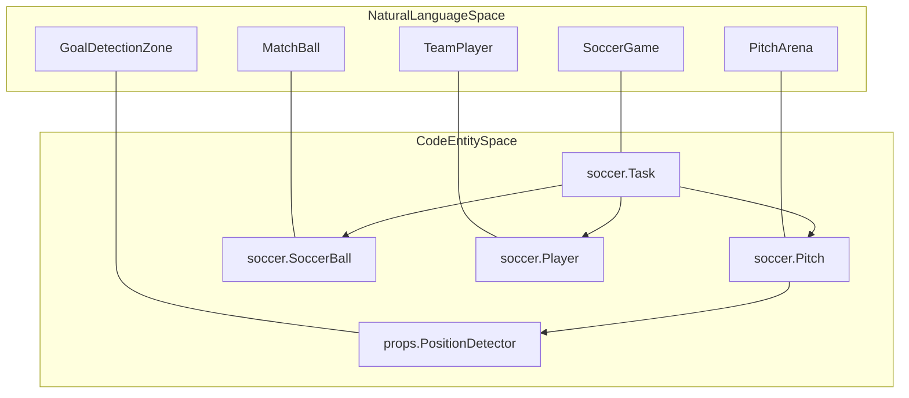
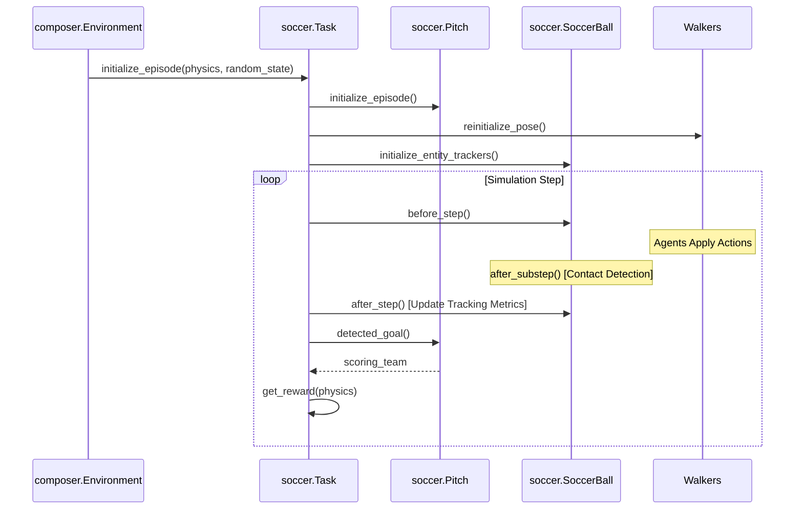

<!-- source: DeepWiki mcp.deepwiki.com · repo google-deepmind/dm_control · page 4.4 Soccer Environment · fetched 2026-10-26 -->

# Soccer Environment

<details>
<summary>Relevant source files</summary>

The following files were used as context for generating this wiki page:

- [dm_control/entities/__init__.py](dm_control/entities/__init__.py)
- [dm_control/entities/props/position_detector.py](dm_control/entities/props/position_detector.py)
- [dm_control/entities/props/position_detector_test.py](dm_control/entities/props/position_detector_test.py)
- [dm_control/entities/props/primitive.py](dm_control/entities/props/primitive.py)
- [dm_control/entities/props/primitive_test.py](dm_control/entities/props/primitive_test.py)
- [dm_control/locomotion/__init__.py](dm_control/locomotion/__init__.py)
- [dm_control/locomotion/soccer/README.md](dm_control/locomotion/soccer/README.md)
- [dm_control/locomotion/soccer/__init__.py](dm_control/locomotion/soccer/__init__.py)
- [dm_control/locomotion/soccer/assets/boxhead/boxhead.xml](dm_control/locomotion/soccer/assets/boxhead/boxhead.xml)
- [dm_control/locomotion/soccer/assets/pitch/pitch_l.png](dm_control/locomotion/soccer/assets/pitch/pitch_l.png)
- [dm_control/locomotion/soccer/assets/pitch/pitch_m.png](dm_control/locomotion/soccer/assets/pitch/pitch_m.png)
- [dm_control/locomotion/soccer/assets/pitch/pitch_nologo_l.png](dm_control/locomotion/soccer/assets/pitch/pitch_nologo_l.png)
- [dm_control/locomotion/soccer/assets/pitch/pitch_nologo_m.png](dm_control/locomotion/soccer/assets/pitch/pitch_nologo_m.png)
- [dm_control/locomotion/soccer/assets/pitch/pitch_nologo_s.png](dm_control/locomotion/soccer/assets/pitch/pitch_nologo_s.png)
- [dm_control/locomotion/soccer/assets/pitch/pitch_nologo_xs.png](dm_control/locomotion/soccer/assets/pitch/pitch_nologo_xs.png)
- [dm_control/locomotion/soccer/assets/pitch/pitch_s.png](dm_control/locomotion/soccer/assets/pitch/pitch_s.png)
- [dm_control/locomotion/soccer/assets/pitch/pitch_xs.png](dm_control/locomotion/soccer/assets/pitch/pitch_xs.png)
- [dm_control/locomotion/soccer/boxhead.py](dm_control/locomotion/soccer/boxhead.py)
- [dm_control/locomotion/soccer/initializers.py](dm_control/locomotion/soccer/initializers.py)
- [dm_control/locomotion/soccer/loader_test.py](dm_control/locomotion/soccer/loader_test.py)
- [dm_control/locomotion/soccer/observables.py](dm_control/locomotion/soccer/observables.py)
- [dm_control/locomotion/soccer/pitch.py](dm_control/locomotion/soccer/pitch.py)
- [dm_control/locomotion/soccer/soccer.png](dm_control/locomotion/soccer/soccer.png)
- [dm_control/locomotion/soccer/soccer_ball.py](dm_control/locomotion/soccer/soccer_ball.py)
- [dm_control/locomotion/soccer/soccer_ball_test.py](dm_control/locomotion/soccer/soccer_ball_test.py)
- [dm_control/locomotion/soccer/task.py](dm_control/locomotion/soccer/task.py)
- [dm_control/locomotion/soccer/task_test.py](dm_control/locomotion/soccer/task_test.py)
- [dm_control/locomotion/tasks/corridors_test.py](dm_control/locomotion/tasks/corridors_test.py)
- [dm_control/locomotion/walkers/initializers/__init__.py](dm_control/locomotion/walkers/initializers/__init__.py)

</details>


The Soccer Environment in `dm_control` provides a multi-agent reinforcement learning simulation framework for competitive team soccer using the MuJoCo physics engine [dm_control/locomotion/soccer/__init__.py:16](). It supports flexible team sizes, distinct agent morphologies, customizable field dimensions, and specialized game task rules [dm_control/locomotion/soccer/__init__.py:92-152]().

## Overview

The soccer environment is structured around the `composer` entity-component framework. It coordinates multiple interacting components:
- **Pitch / RandomizedPitch**: The physical arena encompassing goals, bounding walls, lighting, and goal-scoring position detectors [dm_control/locomotion/soccer/pitch.py]().
- **SoccerBall**: A specialized primitive entity that tracks player contacts, hits, interceptions, and distances traveled [dm_control/locomotion/soccer/soccer_ball.py:50-58]().
- **Players and Teams**: Containers coupling walker agents (such as `BoxHead`, `Ant`, or `Humanoid`) with team assignments (`Team.HOME` or `Team.AWAY`) [dm_control/locomotion/soccer/__init__.py:47-84]().
- **Tasks (`Task` and `MultiturnTask`)**: High-level game state controllers managing episode termination, sparse scoring rewards, and resets [dm_control/locomotion/soccer/task.py]().

## System Entity Architecture

The following diagram bridges the conceptual domain concepts of the soccer environment to their underlying codebase classes.


Sources: [dm_control/locomotion/soccer/task.py:36-110](), [dm_control/locomotion/soccer/soccer_ball.py:50-58](), [dm_control/entities/props/position_detector.py:42-68]()

## Pitch and RandomizedPitch Arena

The arena is defined by the `Pitch` class and its randomized variant `RandomizedPitch` [dm_control/locomotion/soccer/__init__.py:33-34]().
- **Physical Layout**: Configures the ground geometry, lighting corner posts, and bounding walls. Walkers are permitted outside the inner field bounds, while bounding walls and optional field boxes confine the ball [dm_control/locomotion/soccer/pitch.py:81-144]().
- **PositionDetector**: Goal scoring is monitored via `props.PositionDetector` [dm_control/entities/props/position_detector.py:42](), which detects when any part of an entity (such as the soccer ball) enters the axis-aligned cuboidal scoring volume representing home and away goals.
- **RandomizedPitch**: Dynamically samples pitch size between `min_size` and `max_size` at the start of each episode, varying dimensions and lighting parameters [dm_control/locomotion/soccer/__init__.py:143-148]().

Sources: [dm_control/locomotion/soccer/pitch.py](), [dm_control/locomotion/soccer/__init__.py:143-148]()

## SoccerBall and Contact Tracking

The `SoccerBall` class inherits from `props.Primitive` and represents the ball in the simulation [dm_control/locomotion/soccer/soccer_ball.py:50]().
- **Physical Properties**: Configured with specific radius, mass, friction parameters `(slide, spin, roll)`, and soft contact damping (`solref`) [dm_control/locomotion/soccer/soccer_ball.py:53-96](). Regulation properties are provided by `regulation_soccer_ball()` [dm_control/locomotion/soccer/soccer_ball.py:42-47]().
- **Substep Contact Resolution**: In `after_substep`, the ball inspects `physics.data.contact` to identify collisions between its geom and any registered player's geoms [dm_control/locomotion/soccer/soccer_ball.py:152-182](). It tracks attributes such as `_last_hit`, `_hit`, `_repossessed`, and `_intercepted` [dm_control/locomotion/soccer/soccer_ball.py:130-135]().

Sources: [dm_control/locomotion/soccer/soccer_ball.py:50-205]()

## Team Structure and Player Observables

Teams consist of `Player` instances grouping a walker and a `Team` enumeration value (`Team.HOME` or `Team.AWAY`) [dm_control/locomotion/soccer/team.py]().
- **Walker Morphologies**: Supported walkers include `BoxHead` (rollable jumping ball with head and camera controls) [dm_control/locomotion/soccer/boxhead.py:153](), `Ant` [dm_control/locomotion/soccer/__init__.py:61-62](), and `Humanoid` (using CMU mocap initializers) [dm_control/locomotion/soccer/__init__.py:63-70]().
- **Observables Adder**: Observables are added to each player via implementations of `ObservablesAdder` (e.g., `CoreObservablesAdder`, `InterceptionObservablesAdder`) [dm_control/locomotion/soccer/observables.py:24-95](). These inject egocentric measurements of the ball, teammates, opponents, arena properties, and game statistics into the observation spec.

Sources: [dm_control/locomotion/soccer/observables.py:24-95](), [dm_control/locomotion/soccer/boxhead.py:102-151]()

## Task and MultiturnTask Logic

The high-level game rules and step lifecycle are managed by `Task` and its continuous-play variant `MultiturnTask` [dm_control/locomotion/soccer/task.py:36]().

### Execution Data Flow


Sources: [dm_control/locomotion/soccer/task.py:140-189](), [dm_control/locomotion/soccer/soccer_ball.py:152-205]()

- **Rewards**: Returns a per-player reward of `+1` if their team scores, `-1` if they concede, and `0` otherwise [dm_control/locomotion/soccer/task.py:161-189]().
- **Termination vs. Multiturn**: If `terminate_on_goal` is `True`, scoring a goal immediately terminates the episode (`discount = 0`). If `terminate_on_goal` is `False`, `MultiturnTask` is used, which resets player and ball positions upon scoring without ending the episode [dm_control/locomotion/soccer/__init__.py:136-139](), [dm_control/locomotion/soccer/README.md:61-70]().

Sources: [dm_control/locomotion/soccer/task.py:36-267](), [dm_control/locomotion/soccer/__init__.py:136-152]()

## Factory Loading Function

The primary entry point for instantiating the environment is `load()` [dm_control/locomotion/soccer/__init__.py:92]().

```python
env = dm_soccer.load(
    team_size=2,
    time_limit=10.0,
    disable_walker_contacts=False,
    enable_field_box=True,
    terminate_on_goal=False,
    walker_type=dm_soccer.WalkerType.BOXHEAD
)
```
Sources: [dm_control/locomotion/soccer/README.md:24-29]()

| Parameter | Type | Description |
| :--- | :--- | :--- |
| `team_size` | `int` | Number of players per team (must be between 1 and 11) [dm_control/locomotion/soccer/__init__.py:92-104]() |
| `time_limit` | `float` | Maximum duration of each episode in seconds [dm_control/locomotion/soccer/__init__.py:105]() |
| `random_state` | `int` or `RandomState` | Random seed or generator instance [dm_control/locomotion/soccer/__init__.py:106]() |
| `disable_walker_contacts` | `bool` | If `True`, disables physical contact collisions between players [dm_control/locomotion/soccer/__init__.py:107-108]() |
| `enable_field_box` | `bool` | If `True`, enables an invisible physical bounding box trapping the ball on the pitch [dm_control/locomotion/soccer/__init__.py:109-110]() |
| `terminate_on_goal` | `bool` | If `False`, uses `MultiturnTask` for continuous gameplay across goals [dm_control/locomotion/soccer/__init__.py:113-114]() |
| `walker_type` | `WalkerType` | Morphology choice (`BOXHEAD`, `ANT`, or `HUMANOID`) [dm_control/locomotion/soccer/__init__.py:47-51, 115]() |

Sources: [dm_control/locomotion/soccer/__init__.py:92-152](), [dm_control/locomotion/soccer/README.md:20-29]()

---

