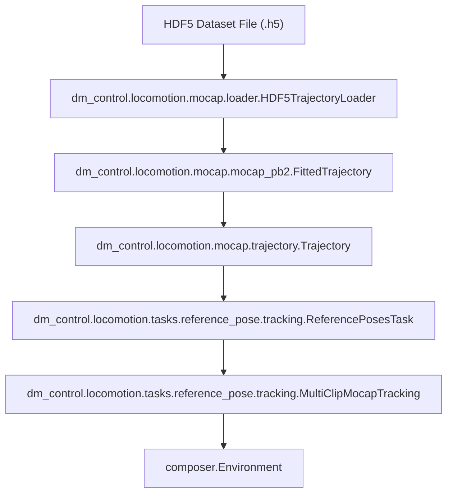
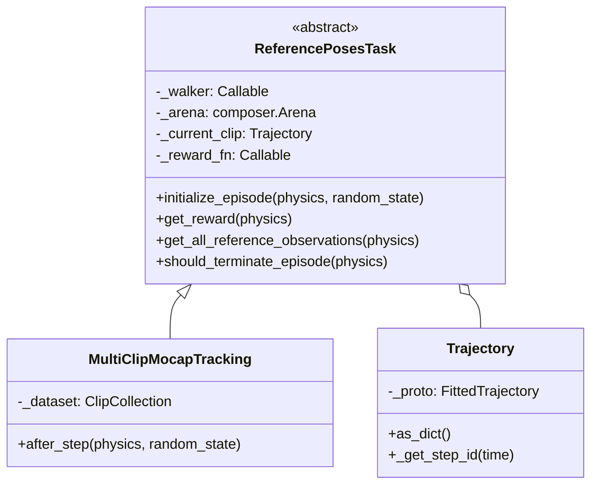

<!-- source: DeepWiki mcp.deepwiki.com · repo google-deepmind/dm_control · page 4.5 Motion Capture Tracking · fetched 2026-10-26 -->

# Motion Capture Tracking

Relevant source files

The following files were used as context for generating this wiki page:

- [dm_control/blender/fake_core/bpy.py](dm_control/blender/fake_core/bpy.py)
- [dm_control/blender/fake_core/mathutils.py](dm_control/blender/fake_core/mathutils.py)
- [dm_control/blender/mujoco_exporter/blender_scene.py](dm_control/blender/mujoco_exporter/blender_scene.py)
- [dm_control/blender/mujoco_exporter/mujoco_assets.py](dm_control/blender/mujoco_exporter/mujoco_assets.py)
- [dm_control/blender/mujoco_exporter/mujoco_scene.py](dm_control/blender/mujoco_exporter/mujoco_scene.py)
- [dm_control/locomotion/examples/cmu_2020_tracking.py](dm_control/locomotion/examples/cmu_2020_tracking.py)
- [dm_control/locomotion/examples/explore.py](dm_control/locomotion/examples/explore.py)
- [dm_control/locomotion/mocap/__init__.py](dm_control/locomotion/mocap/__init__.py)
- [dm_control/locomotion/mocap/cmu_mocap_data.py](dm_control/locomotion/mocap/cmu_mocap_data.py)
- [dm_control/locomotion/mocap/loader.py](dm_control/locomotion/mocap/loader.py)
- [dm_control/locomotion/mocap/loader_test.py](dm_control/locomotion/mocap/loader_test.py)
- [dm_control/locomotion/mocap/mocap.proto](dm_control/locomotion/mocap/mocap.proto)
- [dm_control/locomotion/mocap/mocap_pb2.py](dm_control/locomotion/mocap/mocap_pb2.py)
- [dm_control/locomotion/mocap/test_001.textproto](dm_control/locomotion/mocap/test_001.textproto)
- [dm_control/locomotion/mocap/test_002.textproto](dm_control/locomotion/mocap/test_002.textproto)
- [dm_control/locomotion/mocap/test_trajectories.h5](dm_control/locomotion/mocap/test_trajectories.h5)
- [dm_control/locomotion/mocap/trajectory.py](dm_control/locomotion/mocap/trajectory.py)
- [dm_control/locomotion/mocap/walkers.py](dm_control/locomotion/mocap/walkers.py)
- [dm_control/locomotion/soccer/camera.py](dm_control/locomotion/soccer/camera.py)
- [dm_control/locomotion/soccer/explore.py](dm_control/locomotion/soccer/explore.py)
- [dm_control/locomotion/soccer/humanoid.py](dm_control/locomotion/soccer/humanoid.py)
- [dm_control/locomotion/tasks/reference_pose/__init__.py](dm_control/locomotion/tasks/reference_pose/__init__.py)
- [dm_control/locomotion/tasks/reference_pose/cmu_subsets.py](dm_control/locomotion/tasks/reference_pose/cmu_subsets.py)
- [dm_control/locomotion/tasks/reference_pose/datasets.py](dm_control/locomotion/tasks/reference_pose/datasets.py)
- [dm_control/locomotion/tasks/reference_pose/mocap_playback.py](dm_control/locomotion/tasks/reference_pose/mocap_playback.py)
- [dm_control/locomotion/tasks/reference_pose/rewards.py](dm_control/locomotion/tasks/reference_pose/rewards.py)
- [dm_control/locomotion/tasks/reference_pose/rewards_test.py](dm_control/locomotion/tasks/reference_pose/rewards_test.py)
- [dm_control/locomotion/tasks/reference_pose/tracking.py](dm_control/locomotion/tasks/reference_pose/tracking.py)
- [dm_control/locomotion/tasks/reference_pose/types.py](dm_control/locomotion/tasks/reference_pose/types.py)
- [dm_control/locomotion/walkers/assets/humanoid_CMU_V2019.xml](dm_control/locomotion/walkers/assets/humanoid_CMU_V2019.xml)
- [dm_control/locomotion/walkers/assets/humanoid_CMU_V2020.xml](dm_control/locomotion/walkers/assets/humanoid_CMU_V2020.xml)
- [dm_control/locomotion/walkers/cmu_humanoid.py](dm_control/locomotion/walkers/cmu_humanoid.py)
- [dm_control/locomotion/walkers/initializers/mocap.py](dm_control/locomotion/walkers/initializers/mocap.py)

## Purpose and Scope

This document details the Motion Capture Tracking system within the `dm_control` locomotion framework. The system enables reinforcement learning agents to track reference motion capture data, facilitating the training of humanoid and other walkers to replicate realistic movements from predefined datasets.

Sources: [dm_control/locomotion/tasks/reference_pose/tracking.py:15-17]()

## Overview and Data Flow

The Motion Capture Tracking subsystem establishes environments where reinforcement learning agents mimic reference trajectories. It supports loading HDF5 or protocol buffer datasets, computing rich reward functions based on pose and velocity discrepancies, constructing future reference observations, and rendering reference poses via "ghost" walkers and props.

### System Architecture: Data Flow

Sources: [dm_control/locomotion/tasks/reference_pose/tracking.py:15-17](), [dm_control/locomotion/mocap/loader.py:77-78](), [dm_control/locomotion/mocap/trajectory.py:15-16]()

## Data Representation and Loading

### Trajectory Representation
Reference data is structured using protocol buffers defined in `mocap.proto`. Key message definitions include:
- **`FittedTrajectory`**: Root container holding metadata (`dt`, identifier, date), walker definitions, prop definitions, and a sequence of `TimestepData` entries [dm_control/locomotion/mocap/mocap.proto:172-192]().
- **`WalkerPose`**: Encapsulates Cartesian position, quaternions, joint angles, center of mass, end effectors, velocities, and body positions/quaternions for a single walker frame [dm_control/locomotion/mocap/mocap.proto:105-147]().

The `Trajectory` class [dm_control/locomotion/mocap/trajectory.py:43]() wraps the underlying proto, offering temporal slicing (`start_time`, `end_time`, `start_step`, `end_step`), velocity zeroing options [dm_control/locomotion/mocap/trajectory.py:31-40](), and dictionary conversion via `as_dict()` [dm_control/locomotion/mocap/trajectory.py:82-124]().

### HDF5 and Proto Loading
The `HDF5TrajectoryLoader` class inherits from `TrajectoryLoader` [dm_control/locomotion/mocap/loader.py:29]() and parses HDF5 archives using `h5py` [dm_control/locomotion/mocap/loader.py:77-98](). It populates `FittedTrajectory` protocol buffers by mapping HDF5 attributes and groups to proto fields [dm_control/locomotion/mocap/loader.py:103-172]().

Sources: [dm_control/locomotion/mocap/mocap_pb2.py:1-102](), [dm_control/locomotion/mocap/loader.py:77-173](), [dm_control/locomotion/mocap/trajectory.py:43-124]()

## Core Task Components

### ReferencePosesTask and MultiClipMocapTracking
The abstract base class `ReferencePosesTask` [dm_control/locomotion/tasks/reference_pose/tracking.py:99]() handles episode management, reference tracking state, termination thresholds, and observation generation. `MultiClipMocapTracking` [dm_control/locomotion/tasks/reference_pose/tracking.py:813]() extends this to support multi-clip training datasets.

Sources: [dm_control/locomotion/tasks/reference_pose/tracking.py:99-169](), [dm_control/locomotion/tasks/reference_pose/tracking.py:813-907](), [dm_control/locomotion/mocap/trajectory.py:43-164]()

## Reward Functions

Reward calculations compare the current walker state against reference features. The `rewards.py` module defines available reward functions and their associated observation channels [dm_control/locomotion/tasks/reference_pose/rewards.py:15-187]().

| Reward Type | Key Features Used | Description |
|:---|:---|:---|
| `termination_reward` | `termination_error` | Scalar reward derived from `termination_error` relative to `termination_error_threshold` [dm_control/locomotion/tasks/reference_pose/rewards.py:73-96](). |
| `multi_term_pose_reward` | CoM, Joints, Appendages, Quaternions | Weighted sum of exponential squared differences across feature channels [dm_control/locomotion/tasks/reference_pose/rewards.py:104-121](). |
| `comic` | Mixed | Equal blend of `termination_reward` and `multi_term_pose_reward` [dm_control/locomotion/tasks/reference_pose/rewards.py:123-156](). |

Quaternion distance errors are computed using `bounded_quat_dist` to ensure numerical stability and bound orientation error to $\pi/2$ [dm_control/locomotion/tasks/reference_pose/rewards.py:25-46]().

Sources: [dm_control/locomotion/tasks/reference_pose/rewards.py:25-187](), [dm_control/locomotion/tasks/reference_pose/tracking.py:740-759]()

## Observation System

The tracking task registers specialized observables providing policy inputs relative to the reference trajectory:
- **Reference Relatives**: Observables such as `reference_rel_joints` and `reference_rel_bodies_pos_local` supply relative displacement between the walker and the target frame [dm_control/locomotion/tasks/reference_pose/tracking.py:586-642]().
- **Future Lookahead**: The `ref_steps` parameter configures lookahead observations (e.g., $t+1, t+2$) to provide temporal trajectory context [dm_control/locomotion/tasks/reference_pose/tracking.py:160-161]().

Sources: [dm_control/locomotion/tasks/reference_pose/tracking.py:160-161](), [dm_control/locomotion/tasks/reference_pose/tracking.py:586-642]()

## Initialization and Utilities

### MocapInitializer
The `MocapInitializer` configures walker states to match a specific reference frame at episode initialization.

### Utility Functions
- **`set_walker_from_features`**: Sets physics states (`qpos`, `qvel`) for the walker based on extracted trajectory features [dm_control/locomotion/tasks/reference_pose/utils.py]().
- **`add_walker` (Ghost Mode)**: Instantiates a transparent, non-colliding ghost walker reflecting the reference pose for visualization.
- **`set_props_from_features`**: Synchronizes physical props with reference poses [dm_control/locomotion/tasks/reference_pose/utils.py]().

Sources: [dm_control/locomotion/tasks/reference_pose/utils.py](), [dm_control/locomotion/walkers/initializers/mocap.py]()

## Usage Example: Playback

The `PlaybackTask` provides a simplified environment structure for inspecting and debugging reference clips without reinforcement learning overhead [dm_control/locomotion/tasks/reference_pose/mocap_playback.py:30-51]().

Sources: [dm_control/locomotion/tasks/reference_pose/mocap_playback.py:30-51]()

---

