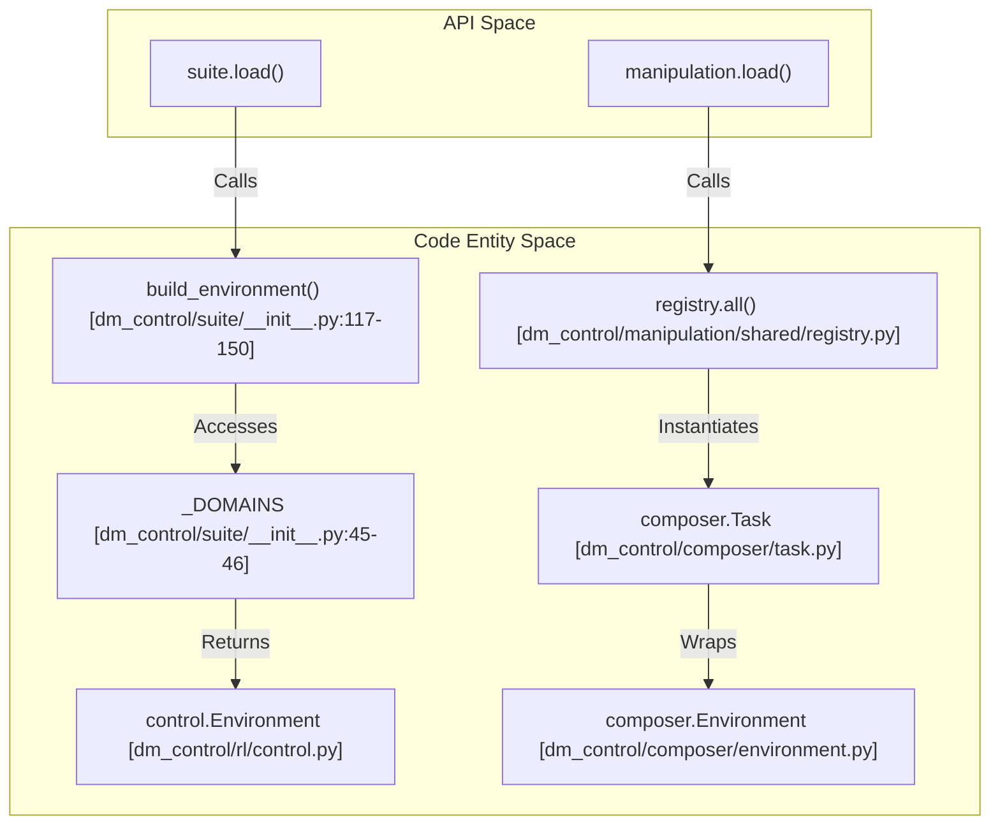
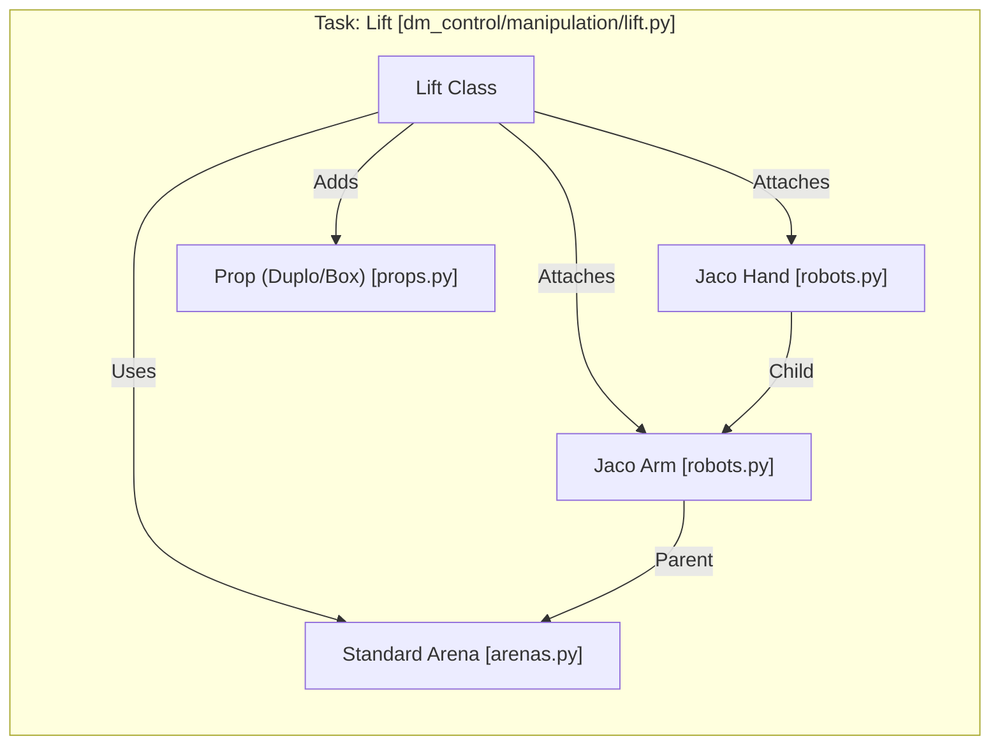

<!-- source: DeepWiki mcp.deepwiki.com · repo google-deepmind/dm_control · page 5 Control Suite and Manipulation · fetched 2026-10-26 -->

# Control Suite and Manipulation

Relevant source files

The following files were used as context for generating this wiki page:

- [dm_control/manipulation/manipulation_test.py](dm_control/manipulation/manipulation_test.py)
- [dm_control/mujoco/README.md](dm_control/mujoco/README.md)
- [dm_control/mujoco/wrapper/README.md](dm_control/mujoco/wrapper/README.md)
- [dm_control/suite/README.md](dm_control/suite/README.md)
- [dm_control/suite/__init__.py](dm_control/suite/__init__.py)
- [dm_control/suite/all_domains.png](dm_control/suite/all_domains.png)
- [dm_control/suite/loader_test.py](dm_control/suite/loader_test.py)
- [dm_control/suite/lqr_test.py](dm_control/suite/lqr_test.py)
- [dm_control/suite/suite_test.py](dm_control/suite/suite_test.py)

The `dm_control` repository provides two primary sets of standardized reinforcement learning environments: the **DeepMind Control Suite** and the **Manipulation** task library. These suites serve as benchmarks for continuous control algorithms, offering a range of complexities from simple classic control problems to high-dimensional robotic manipulation.

### Task Suite Architecture

Both suites are built upon the MuJoCo physics engine but differ in their implementation philosophy. The Control Suite primarily uses a legacy procedural generation approach, while the Manipulation library is built using the modular `composer` entity-component framework.

| Feature | Control Suite (`suite/`) | Manipulation (`manipulation/`) |
| :--- | :--- | :--- |
| **Framework** | Custom Procedural | `composer` Entity-Component |
| **Primary Focus** | Locomotion & Classic Control | Robotic Arm Interaction |
| **Robot Entities** | Built-in (Cartpole, Cheetah, etc.) | Kinova Jaco Arm |
| **Loading API** | `suite.load(domain, task)` | `manipulation.load(task_name)` |
| **Task Variation** | Fixed parameters/XMLs | Dynamic `composer.Variation` |

### System Mapping: API to Code Entities

The following diagram illustrates how the high-level suite loading APIs map to the underlying code structures.

**Suite Loading and Execution Flow**

Sources: [dm_control/suite/__init__.py:45-150](), [dm_control/manipulation/shared/registry.py:1-30]()

---

## DeepMind Control Suite

The **DeepMind Control Suite** is a set of continuous control tasks with a standardized structure and reward interface [dm_control/suite/README.md:1-4](). It includes classic domains such as `cartpole`, `pendulum`, and `acrobot`, alongside more complex locomotion domains like `humanoid`, `cheetah`, and `quadruped` [dm_control/suite/__init__.py:24-42]().

### Key Characteristics
*   **Standardized Rewards:** Most tasks provide a reward signal in the range $[0, 1]$ [dm_control/suite/suite_test.py:89-94]().
*   **Domain-Task Structure:** Environments are organized by "domain" (the physical model) and "task" (the specific objective) [dm_control/suite/__init__.py:93-114]().
*   **Deterministic Execution:** Identical seeds and action sequences produce bit-for-bit identical trajectories [dm_control/suite/suite_test.py:170-186]().
*   **LQR Integration:** Includes a Linear Quadratic Regulator (LQR) solver for domains that can be linearized [dm_control/suite/lqr_test.py:23-25]().

For detailed documentation on available domains, task parameters, and suite wrappers, see **[DeepMind Control Suite](#5.1)**.

Sources: [dm_control/suite/README.md:1-4](), [dm_control/suite/__init__.py:24-42](), [dm_control/suite/__init__.py:93-114](), [dm_control/suite/suite_test.py:89-186](), [dm_control/suite/lqr_test.py:23-25]()

---

## Manipulation Tasks

The **Manipulation** library focuses on robotic arm tasks using the Kinova Jaco arm. Unlike the Control Suite, these tasks are built using the `composer` framework, allowing for highly modular environment construction where robots, props, and arenas are distinct `Entity` objects [dm_control/manipulation/lift.py:101-122]().

### Task Library Overview
The library includes several fundamental manipulation archetypes:
*   **Reach:** Moving the end-effector to a target site or prop [dm_control/manipulation/reach.py:64-68]().
*   **Lift:** Elevating a prop (e.g., a Duplo brick or box) above a target height [dm_control/manipulation/lift.py:101-105]().
*   **Stack/Bricks:** Complex interaction involving the assembly or disassembly of multiple bricks [dm_control/manipulation/bricks.py:181-194]().

### Shared Infrastructure
The manipulation tasks share a common set of infrastructure components located in `dm_control/manipulation/shared/`:
*   **Arenas:** Standardized workspaces with ground planes and lighting [dm_control/manipulation/shared/arenas.py:22-32]().
*   **Cameras:** Pre-defined camera configurations such as `FRONT_CLOSE`, `TOP_DOWN`, and `LEFT_CLOSE` [dm_control/manipulation/shared/cameras.py:25-55]().
*   **Observations:** Shared observation settings for proprioception and visual features [dm_control/manipulation/shared/observations.py:1-30]().

**Manipulation Task Composition**

Sources: [dm_control/manipulation/lift.py:101-141](), [dm_control/manipulation/shared/arenas.py:86-99]()

For details on the Kinova Jaco model, reward shaping for manipulation, and the registry system, see **[Manipulation Tasks](#5.2)**.

Sources: [dm_control/manipulation/lift.py:101-141](), [dm_control/manipulation/reach.py:64-68](), [dm_control/manipulation/bricks.py:181-194](), [dm_control/manipulation/shared/arenas.py:22-99](), [dm_control/manipulation/shared/cameras.py:25-55](), [dm_control/manipulation/shared/observations.py:1-30]()

---

