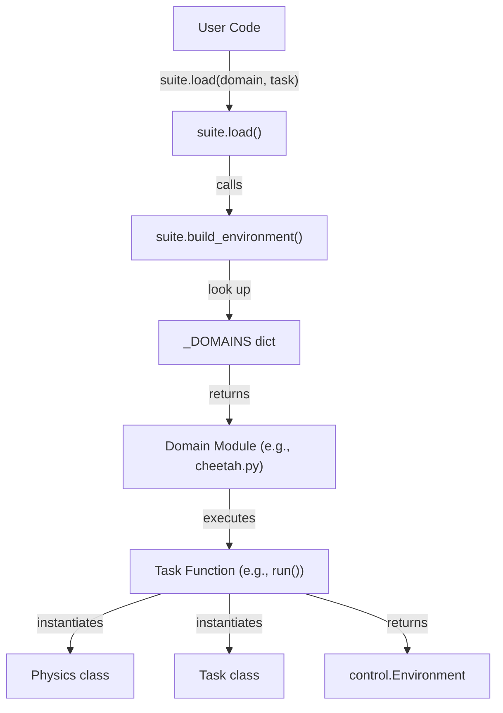
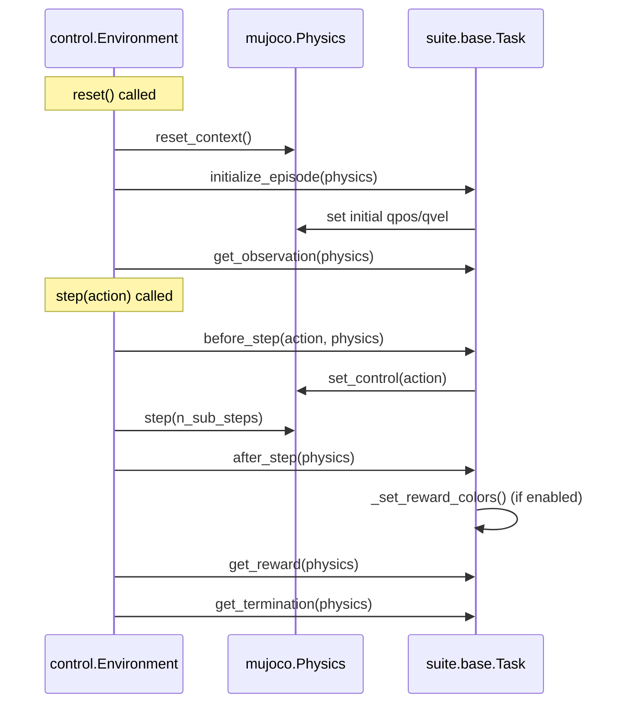

<!-- source: DeepWiki mcp.deepwiki.com · repo google-deepmind/dm_control · page 5.1 DeepMind Control Suite · fetched 2026-10-26 -->

# DeepMind Control Suite

Relevant source files

The following files were used as context for generating this wiki page:

- [dm_control/manipulation/manipulation_test.py](dm_control/manipulation/manipulation_test.py)
- [dm_control/mujoco/math.py](dm_control/mujoco/math.py)
- [dm_control/mujoco/math_test.py](dm_control/mujoco/math_test.py)
- [dm_control/rl/control.py](dm_control/rl/control.py)
- [dm_control/rl/control_test.py](dm_control/rl/control_test.py)
- [dm_control/suite/__init__.py](dm_control/suite/__init__.py)
- [dm_control/suite/acrobot.py](dm_control/suite/acrobot.py)
- [dm_control/suite/ball_in_cup.py](dm_control/suite/ball_in_cup.py)
- [dm_control/suite/base.py](dm_control/suite/base.py)
- [dm_control/suite/cartpole.py](dm_control/suite/cartpole.py)
- [dm_control/suite/cheetah.py](dm_control/suite/cheetah.py)
- [dm_control/suite/common/materials.xml](dm_control/suite/common/materials.xml)
- [dm_control/suite/finger.py](dm_control/suite/finger.py)
- [dm_control/suite/finger.xml](dm_control/suite/finger.xml)
- [dm_control/suite/fish.py](dm_control/suite/fish.py)
- [dm_control/suite/hopper.py](dm_control/suite/hopper.py)
- [dm_control/suite/humanoid.py](dm_control/suite/humanoid.py)
- [dm_control/suite/humanoid_CMU.py](dm_control/suite/humanoid_CMU.py)
- [dm_control/suite/loader_test.py](dm_control/suite/loader_test.py)
- [dm_control/suite/lqr.py](dm_control/suite/lqr.py)
- [dm_control/suite/lqr_solver.py](dm_control/suite/lqr_solver.py)
- [dm_control/suite/lqr_test.py](dm_control/suite/lqr_test.py)
- [dm_control/suite/manipulator.py](dm_control/suite/manipulator.py)
- [dm_control/suite/manipulator.xml](dm_control/suite/manipulator.xml)
- [dm_control/suite/pendulum.py](dm_control/suite/pendulum.py)
- [dm_control/suite/point_mass.py](dm_control/suite/point_mass.py)
- [dm_control/suite/quadruped.py](dm_control/suite/quadruped.py)
- [dm_control/suite/quadruped.xml](dm_control/suite/quadruped.xml)
- [dm_control/suite/reacher.py](dm_control/suite/reacher.py)
- [dm_control/suite/stacker.py](dm_control/suite/stacker.py)
- [dm_control/suite/stacker.xml](dm_control/suite/stacker.xml)
- [dm_control/suite/suite_test.py](dm_control/suite/suite_test.py)
- [dm_control/suite/swimmer.py](dm_control/suite/swimmer.py)
- [dm_control/suite/utils/parse_amc.py](dm_control/suite/utils/parse_amc.py)
- [dm_control/suite/walker.py](dm_control/suite/walker.py)
- [dm_control/suite/wrappers/action_scale.py](dm_control/suite/wrappers/action_scale.py)
- [dm_control/suite/wrappers/action_scale_test.py](dm_control/suite/wrappers/action_scale_test.py)
- [dm_control/suite/wrappers/pixels.py](dm_control/suite/wrappers/pixels.py)
- [dm_control/suite/wrappers/pixels_test.py](dm_control/suite/wrappers/pixels_test.py)

The DeepMind Control Suite is a set of MuJoCo-based reinforcement learning environments with a standardized structure and interpretable rewards. It serves as a performance benchmark for continuous control algorithms, offering a diverse range of physical domains and tasks.

## Architecture and Loading API

The suite is organized into **domains** (physical systems) and **tasks** (specific objectives within those systems). The primary entry point for users is the `suite.load()` function, which handles the instantiation of the environment by looking up the requested domain and task.

### Environment Loading Flow
The `suite.load()` function in `dm_control/suite/__init__.py` calls `build_environment`, which retrieves the domain module and executes the task function registered in that domain's `SUITE` container.

Title: suite.load() Execution Logic

Sources: [dm_control/suite/__init__.py:93-114](), [dm_control/suite/__init__.py:117-150](), [dm_control/suite/cheetah.py:42-49]()

### Standard API
The suite returns an instance of `dm_control.rl.control.Environment`, which implements the `dm_env.Environment` interface.
*   **Action Spec**: Defined by the actuators in the MJCF model [dm_control/suite/base.py:58-60]().
*   **Observation Spec**: Typically an `OrderedDict` of NumPy arrays [dm_control/rl/control.py:137-154]().
*   **Control Timestep**: The interval between agent actions, calculated as `physics.timestep() * n_sub_steps` [dm_control/rl/control.py:163-165]().

Sources: [dm_control/suite/__init__.py:93-150](), [dm_control/rl/control.py:129-166](), [dm_control/suite/base.py:58-60]()

## Core Domains and Tasks

The suite includes several canonical domains, each defining a `Physics` subclass (extending `mujoco.Physics`) and a `Task` subclass (extending `base.Task`).

| Domain | Description | Key Tasks |
| :--- | :--- | :--- |
| **Cartpole** | Classic pole balancing on a cart. | `balance`, `swingup`, `two_poles` [dm_control/suite/cartpole.py:39-102]() |
| **Cheetah** | A 2D running quadruped. | `run` [dm_control/suite/cheetah.py:42-49]() |
| **Humanoid** | Complex 3D bipedal locomotion. | `stand`, `walk`, `run` [dm_control/suite/humanoid_CMU.py:47-77]() |
| **Quadruped** | 3D quadruped with various terrains. | `walk`, `run`, `escape`, `fetch` [dm_control/suite/quadruped.py:96-142]() |
| **Manipulator** | Planar arm for object interaction. | `bring_ball`, `insert_peg` [dm_control/suite/manipulator.py:70-127]() |
| **Stacker** | Stacking boxes with a planar arm. | `stack_2`, `stack_4` [dm_control/suite/stacker.py:55-82]() |

### Reward Visualization
The `base.Task` class provides a `visualize_reward` property. When enabled, it modifies the colors of geoms in the simulation (using materials like `self`, `effector`, and `target`) to reflect the current reward value [dm_control/suite/base.py:79-93]().

Sources: [dm_control/suite/base.py:24-93](), [dm_control/suite/cheetah.py:52-60](), [dm_control/suite/cartpole.py:130-151](), [dm_control/suite/humanoid_CMU.py:80-117](), [dm_control/suite/quadruped.py:145-181](), [dm_control/suite/manipulator.py:130-160]()

## Task Structure and Lifecycle

Every task in the suite inherits from `control.Task` (often via `base.Task`). The `control.Environment` manages the interaction between the `Physics` and the `Task`.

Title: Control Suite Environment Loop

Sources: [dm_control/rl/control.py:82-128](), [dm_control/suite/base.py:62-84]()

## Suite Wrappers

Wrappers are used to modify the observation or action space of a loaded environment.

### Pixel Wrapper
The `pixels.Wrapper` captures frames from MuJoCo cameras and adds them to the observation dictionary.
*   **`pixels_only`**: If `True`, the original state-based observations are removed [dm_control/suite/wrappers/pixels_test.py:72-88]().
*   **`render_kwargs`**: Allows specifying `width`, `height`, and `camera_id` [dm_control/suite/wrappers/pixels_test.py:75]().

### Action Wrappers
*   **`action_scale`**: Rescales actions from a specified range (e.g., `[-1, 1]`) to the actual actuator limits defined in the MJCF.
*   **`action_noise`**: Adds Gaussian or other noise processes to the agent's actions before they are applied to the physics.

Sources: [dm_control/suite/wrappers/pixels.py](), [dm_control/suite/wrappers/pixels_test.py:58-125](), [dm_control/suite/wrappers/action_scale.py](), [dm_control/suite/wrappers/action_scale_test.py]()

## LQR Solver

The suite includes a utility for solving **Linear-Quadratic Regulator** problems for compatible domains (like `lqr` or `cartpole` in linear regimes).

The `lqr_solver.solve(env)` function:
1.  Extracts the mass matrix using `mjlib.mju_sym2dense` over model mass elements [dm_control/suite/lqr_solver.py:48-51]().
2.  Computes the state transition matrix $A$ and control transition matrix $B$ via joint stiffness and damping values defined in the physics model [dm_control/suite/lqr_solver.py:55-66]().
3.  Solves the **Discrete Algebraic Riccati Equation (DARE)** using `scipy.linalg.solve_discrete_are` [dm_control/suite/lqr_solver.py:74-75]().
4.  Returns the Hessian of the optimal cost-to-go $P$, optimal linear policy $K$, and stability metric $\beta$ [dm_control/suite/lqr_solver.py:28-82]().

Sources: [dm_control/suite/lqr_solver.py:28-82]()

---

