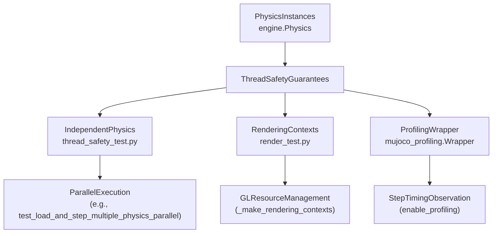
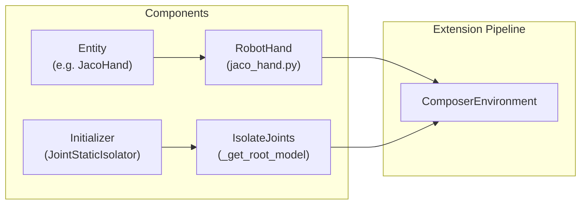

<!-- source: DeepWiki mcp.deepwiki.com · repo google-deepmind/dm_control · page 6 Advanced Topics · fetched 2026-10-26 -->

# Advanced Topics

Relevant source files

The following files were used as context for generating this wiki page:

- [dm_control/composer/initializers/utils.py](dm_control/composer/initializers/utils.py)
- [dm_control/entities/manipulators/kinova/jaco_hand.py](dm_control/entities/manipulators/kinova/jaco_hand.py)
- [dm_control/mujoco/render_test.py](dm_control/mujoco/render_test.py)
- [dm_control/mujoco/testing/decorators.py](dm_control/mujoco/testing/decorators.py)
- [dm_control/mujoco/testing/decorators_test.py](dm_control/mujoco/testing/decorators_test.py)
- [dm_control/mujoco/thread_safety_test.py](dm_control/mujoco/thread_safety_test.py)
- [dm_control/mujoco/wrapper/__init__.py](dm_control/mujoco/wrapper/__init__.py)
- [dm_control/suite/wrappers/mujoco_profiling.py](dm_control/suite/wrappers/mujoco_profiling.py)
- [dm_control/suite/wrappers/mujoco_profiling_test.py](dm_control/suite/wrappers/mujoco_profiling_test.py)
- [dm_control/utils/containers.py](dm_control/utils/containers.py)
- [dm_control/utils/containers_test.py](dm_control/utils/containers_test.py)

This document covers advanced topics in `dm_control` for power users and contributors. It focuses on threading, performance optimization, utility modules (such as environment wrappers and tag containers), and the infrastructure for extending the framework. These topics are intended for users who need to understand the internal architecture or optimize performance for specific use cases.

## Threading and Performance

The `dm_control` framework provides thread safety guarantees that allow environments to be used concurrently in multi-threaded applications. Understanding these guarantees is crucial for developing high-performance applications. Independent `engine.Physics` instances can be safely executed and stepped across multiple threads [dm_control/mujoco/thread_safety_test.py:59-65](). For profiling execution overhead, the `mujoco_profiling.Wrapper` injects MuJoCo step timing statistics into the observation space [dm_control/suite/wrappers/mujoco_profiling.py:25-74]().

Sources: [dm_control/mujoco/thread_safety_test.py:45-65](), [dm_control/mujoco/render_test.py:84-90](), [dm_control/suite/wrappers/mujoco_profiling.py:25-74]()

### Key Thread Safety and Profiling Features
- **Concurrent Execution**: Multiple physics models can be loaded and stepped concurrently using test decorators like `decorators.run_threaded` [dm_control/mujoco/testing/decorators.py:22-61]() and verified in [dm_control/mujoco/thread_safety_test.py:59-65]().
- **Context Lifecycle**: Rendering contexts can be repeatedly allocated and freed without leaking OpenGL resources, tested via `RenderTest.test_repeatedly_create_and_destroy_rendering_contexts` [dm_control/mujoco/render_test.py:84-90]().
- **Profiling**: The `mujoco_profiling.Wrapper` class enables MuJoCo's internal profiling (`physics.enable_profiling()`) and appends step duration and call count metrics to observation structures [dm_control/suite/wrappers/mujoco_profiling.py:69-104]().

For detailed technical specifications on GL context management and MuJoCo thread safety, see **[Threading and Performance](#6.1)**.

Sources: [dm_control/mujoco/thread_safety_test.py:16-101](), [dm_control/mujoco/render_test.py:36-91](), [dm_control/suite/wrappers/mujoco_profiling.py:25-107]()

## Extending the Framework

The `dm_control` framework is designed to be extensible through its Entity-Component system, specialized initializers, and manipulator components. Advanced users can construct custom robotics tasks by combining components like `JacoHand` [dm_control/entities/manipulators/kinova/jaco_hand.py:33-46]() and applying utilities such as `JointStaticIsolator` to freeze non-target joint dynamics during initialization [dm_control/composer/initializers/utils.py:29-35]().

Sources: [dm_control/composer/initializers/utils.py:29-54](), [dm_control/entities/manipulators/kinova/jaco_hand.py:33-46]()

### Component Customization and Initializers
- **Manipulators**: Classes like `JacoHand` extend `RobotHand` to manage tool center points, touch geoms, and velocity actuators [dm_control/entities/manipulators/kinova/jaco_hand.py:33-64]().
- **State Isolation**: The `JointStaticIsolator` context manager caches and restores qpos/qvel states for non-target joints during setup phases [dm_control/composer/initializers/utils.py:29-64]().

For a guide on creating custom components and using the Blender-to-MJCF exporter, see **[Extending the Framework](#6.2)**.

Sources: [dm_control/composer/initializers/utils.py:29-64](), [dm_control/entities/manipulators/kinova/jaco_hand.py:33-138]()

## Utility Modules

Beyond core simulation, `dm_control` provides helper containers and modules for managing task registries and environment factories.

| Module | Purpose | Key Classes / Functions |
| :--- | :--- | :--- |
| `utils.containers` | Task factory grouping & tags | `TaggedTasks` |
| `suite.wrappers.mujoco_profiling` | Step timing observation wrapper | `mujoco_profiling.Wrapper` |
| `composer.initializers.utils` | Joint state isolation helpers | `JointStaticIsolator` |

### Task Containers (`TaggedTasks`)
The `utils.containers` module implements `TaggedTasks`, a mapping container that stores environment factory functions indexed by task names and metadata tags [dm_control/utils/containers.py:25-44](). It supports registering functions via decorators (`@tasks.add(...)`) and querying subsets by intersecting tag sets [dm_control/utils/containers_test.py:25-121]().

Sources: [dm_control/utils/containers.py:25-79](), [dm_control/utils/containers_test.py:25-121]()

## Child Pages
- **[Threading and Performance](#6.1)**: Discusses thread safety, GL context management, and the `mujoco_profiling` wrapper.
- **[Extending the Framework](#6.2)**: Guide on creating custom `Entities`, `Tasks`, and `Variations`, plus the Blender exporter.

---

