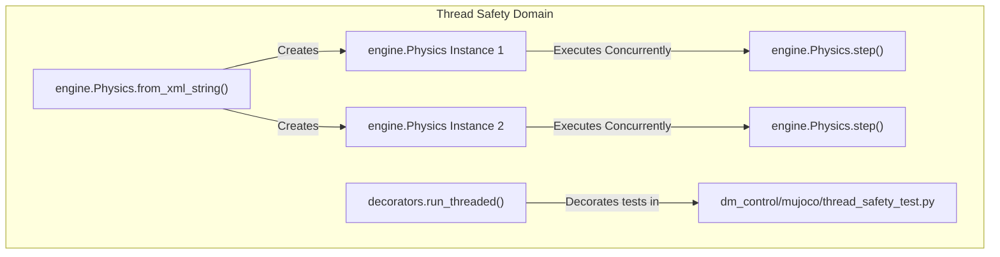
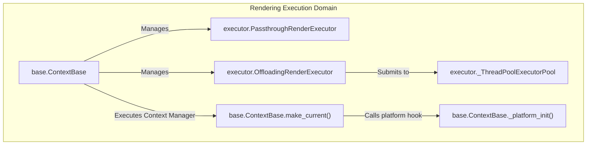

<!-- source: DeepWiki mcp.deepwiki.com · repo google-deepmind/dm_control · page 6.1 Threading and Performance · fetched 2026-10-26 -->

# Threading and Performance

<details>
<summary>Relevant source files</summary>

The following files were used as context for generating this wiki page:

- [dm_control/_render/base.py](dm_control/_render/base.py)
- [dm_control/_render/base_test.py](dm_control/_render/base_test.py)
- [dm_control/_render/executor/render_executor.py](dm_control/_render/executor/render_executor.py)
- [dm_control/composer/initializers/utils.py](dm_control/composer/initializers/utils.py)
- [dm_control/composer/observation/obs_buffer_test.py](dm_control/composer/observation/obs_buffer_test.py)
- [dm_control/composer/robot.py](dm_control/composer/robot.py)
- [dm_control/entities/manipulators/base.py](dm_control/entities/manipulators/base.py)
- [dm_control/entities/manipulators/kinova/jaco_hand.py](dm_control/entities/manipulators/kinova/jaco_hand.py)
- [dm_control/mjcf/README.md](dm_control/mjcf/README.md)
- [dm_control/mujoco/render_test.py](dm_control/mujoco/render_test.py)
- [dm_control/mujoco/testing/decorators.py](dm_control/mujoco/testing/decorators.py)
- [dm_control/mujoco/testing/decorators_test.py](dm_control/mujoco/testing/decorators_test.py)
- [dm_control/mujoco/thread_safety_test.py](dm_control/mujoco/thread_safety_test.py)
- [dm_control/mujoco/wrapper/__init__.py](dm_control/mujoco/wrapper/__init__.py)
- [dm_control/suite/wrappers/mujoco_profiling.py](dm_control/suite/wrappers/mujoco_profiling.py)
- [dm_control/suite/wrappers/mujoco_profiling_test.py](dm_control/suite/wrappers/mujoco_profiling_test.py)
- [dm_control/utils/containers.py](dm_control/utils/containers.py)
- [dm_control/utils/containers_test.py](dm_control/utils/containers_test.py)

</details>


This wiki page covers thread safety and performance considerations in `dm_control`. It details the render executor threading model, OpenGL (GL) context management, MuJoCo thread safety guarantees, and profiling utilities.

Sources: [dm_control/mujoco/thread_safety_test.py:16-38](), [dm_control/_render/base.py:16-27]()

## Thread Safety Overview

`dm_control` is designed to support multi-threaded simulation and rendering, which is critical for parallel reinforcement learning workloads. However, thread safety depends heavily on the component and the rendering backend being utilized.

### Diagram: Thread Safety Architecture and Code Mapping

Sources: [dm_control/mujoco/thread_safety_test.py:41-75](), [dm_control/mujoco/testing/decorators.py:22-61]()

### MuJoCo Physics Thread Safety Guarantees

The underlying MuJoCo physics engine integration provides robust concurrency guarantees across independent simulation objects:
1. **Model Loading**: `engine.Physics.from_xml_string` is fully thread-safe, enabling parallel model parsing across worker threads [dm_control/mujoco/thread_safety_test.py:43-45]().
2. **Independent Stepping**: Multiple threads can execute `physics.step()` simultaneously provided they operate on distinct `engine.Physics` instances [dm_control/mujoco/thread_safety_test.py:58-65]().
3. **State Encapsulation**: Each `engine.Physics` instance encapsulates its own `mjModel` and `mjData` pointer structures, eliminating cross-thread data races during step execution.

Sources: [dm_control/mujoco/thread_safety_test.py:41-75]()

## Render Executor and GL Context Management

Rendering operations require valid OpenGL contexts, which inherently enforce strict thread affinity. `dm_control` abstracts these constraints through the `RenderExecutor` hierarchy and `ContextBase`.

### Diagram: Render Executor and Context Lifecycle Code Mapping

Sources: [dm_control/_render/base.py:45-166](), [dm_control/_render/executor/render_executor.py:60-218]()

### The Render Executor Threading Model

To ensure that OpenGL calls occur on the thread where the context was initialized, `dm_control` implements an executor pattern in `dm_control/_render/executor/render_executor.py`:
* **`BaseRenderExecutor`**: Defines the abstract execution context interface and locking primitives [dm_control/_render/executor/render_executor.py:60-116]().
* **`PassthroughRenderExecutor`**: A no-op executor that runs GL calls directly on the calling thread, minimizing overhead when using headless backends like EGL [dm_control/_render/executor/render_executor.py:118-147]().
* **`OffloadingRenderExecutor`**: Allocates a dedicated worker thread via `_ThreadPoolExecutorPool` to own the GL context and marshal all rendering calls safely [dm_control/_render/executor/render_executor.py:148-218]().

Sources: [dm_control/_render/base.py:45-66](), [dm_control/_render/executor/render_executor.py:118-218]()

### Backend Threading Characteristics

| Backend | Executor Type | Threading Behavior and Limitations |
| :--- | :--- | :--- |
| **EGL** | `PassthroughRenderExecutor` | High concurrency; supports independent GL contexts per thread. Ideal for headless training clusters [dm_control/_render/pyopengl/egl_renderer.py:93-100](). |
| **GLFW** | `OffloadingRenderExecutor` | Restricted on macOS where windowing requires the main application thread; on Linux it can spawn on worker threads [dm_control/mujoco/thread_safety_test.py:30-36](). |
| **OSMesa** | `OffloadingRenderExecutor` | Software rendering backend; avoids GPU affinity bottlenecks entirely [dm_control/mujoco/thread_safety_test.py:37-38](). |

Sources: [dm_control/mujoco/thread_safety_test.py:30-38](), [dm_control/_render/pyopengl/egl_renderer.py:93-100]()

## Performance Optimization

### The mujoco_profiling Wrapper

For performance profiling, `mujoco_profiling.Wrapper` exposes MuJoCo's internal profiling timers directly as environment observations [dm_control/suite/wrappers/mujoco_profiling.py:25-35]().

```python
# Enabling profiling and recording timing metrics
env.physics.enable_profiling()
timing = env.physics.data.timer[0]
```

This wrapper captures the active execution duration and call counts from `mjData.timer`, covering physics stages such as position updates, velocity constraints, and global integration steps [dm_control/suite/wrappers/mujoco_profiling.py:97-104]().

Sources: [dm_control/suite/wrappers/mujoco_profiling.py:25-107]()

### Rendering Efficiency and Context Lifecycle

Frequent allocation and deallocation of rendering contexts introduce significant overhead. Tests confirm that repeated context creation must be managed carefully to avoid resource leakage [dm_control/mujoco/render_test.py:84-90](). Reusing `Physics` instances across multiple rollout steps avoids re-invoking XML parsing and context setup overhead.

Sources: [dm_control/mujoco/render_test.py:84-90]()

## Best Practices

1. **Use EGL for Parallel Training**: Configure `export MUJOCO_GL=egl` for multi-worker reinforcement learning pipelines to bypass GLFW thread restrictions [dm_control/mujoco/thread_safety_test.py:30-38]().
2. **Isolate Physics Instances**: Avoid sharing a single `Physics` instance concurrently across threads without synchronization; instead, instantiate one `engine.Physics` per worker thread [dm_control/mujoco/thread_safety_test.py:58-65]().
3. **Profile Simulation Bottlenecks**: Wrap environments with `mujoco_profiling.Wrapper` to isolate whether performance degradation stems from collision detection, constraint solving, or rendering [dm_control/suite/wrappers/mujoco_profiling.py:25-35]().
4. **Manage GL Refcounts Explicitly**: When interacting with `ContextBase`, utilize `increment_refcount()` and `decrement_refcount()` to ensure proper thread cleanup [dm_control/_render/base.py:78-83]().

Sources: [dm_control/_render/base.py:78-115](), [dm_control/mujoco/thread_safety_test.py:16-99](), [dm_control/suite/wrappers/mujoco_profiling.py:25-35]()

---

