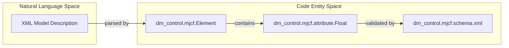
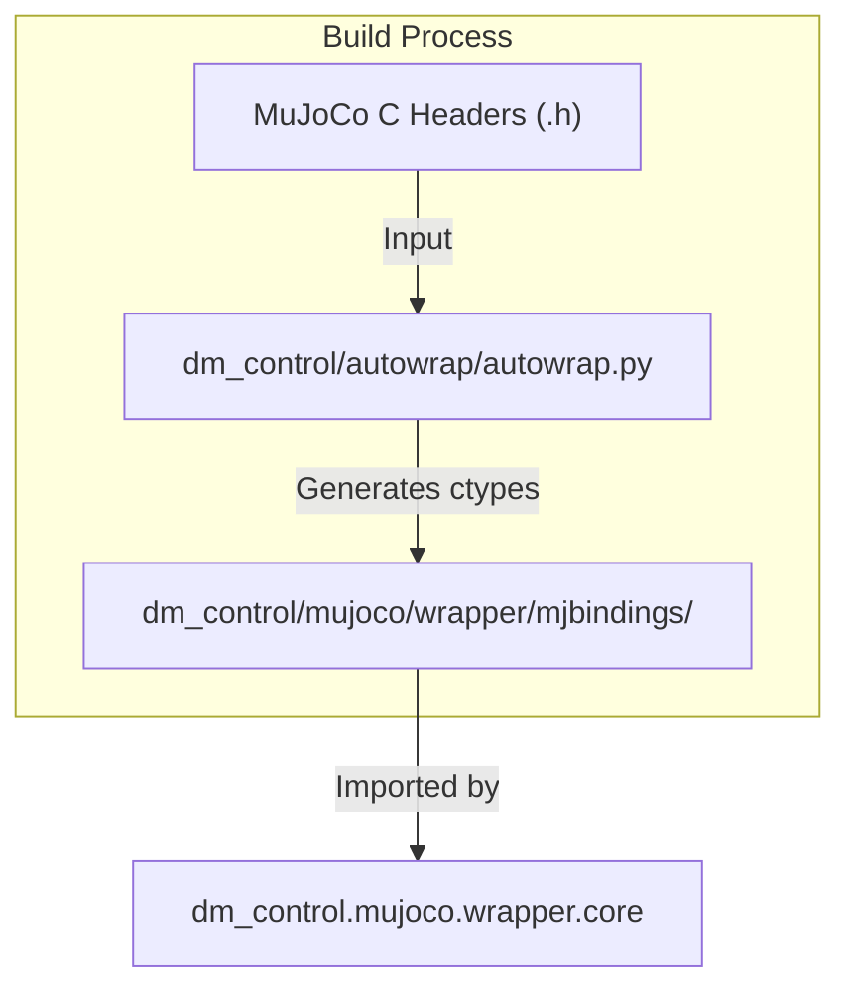

<!-- source: DeepWiki mcp.deepwiki.com · repo google-deepmind/dm_control · page 7 Glossary · fetched 2026-10-26 -->

# Glossary

<details>
<summary>Relevant source files</summary>

The following files were used as context for generating this wiki page:

- [README.md](README.md)
- [dm_control/composer/__init__.py](dm_control/composer/__init__.py)
- [dm_control/composer/environment.py](dm_control/composer/environment.py)
- [dm_control/composer/environment_test.py](dm_control/composer/environment_test.py)
- [dm_control/composer/observation/fake_physics.py](dm_control/composer/observation/fake_physics.py)
- [dm_control/composer/observation/obs_buffer.py](dm_control/composer/observation/obs_buffer.py)
- [dm_control/composer/observation/observable/base.py](dm_control/composer/observation/observable/base.py)
- [dm_control/composer/observation/updater.py](dm_control/composer/observation/updater.py)
- [dm_control/composer/observation/updater_test.py](dm_control/composer/observation/updater_test.py)
- [dm_control/composer/variation/__init__.py](dm_control/composer/variation/__init__.py)
- [dm_control/mjcf/attribute.py](dm_control/mjcf/attribute.py)
- [dm_control/mjcf/attribute_test.py](dm_control/mjcf/attribute_test.py)
- [dm_control/mjcf/base.py](dm_control/mjcf/base.py)
- [dm_control/mjcf/constants.py](dm_control/mjcf/constants.py)
- [dm_control/mjcf/element.py](dm_control/mjcf/element.py)
- [dm_control/mjcf/element_test.py](dm_control/mjcf/element_test.py)
- [dm_control/mjcf/export_with_assets.py](dm_control/mjcf/export_with_assets.py)
- [dm_control/mjcf/export_with_assets_as_zip.py](dm_control/mjcf/export_with_assets_as_zip.py)
- [dm_control/mjcf/schema.py](dm_control/mjcf/schema.py)
- [dm_control/mjcf/schema.xml](dm_control/mjcf/schema.xml)
- [dm_control/mjcf/schema_test.py](dm_control/mjcf/schema_test.py)
- [dm_control/mjcf/test_assets/attribute_test_schema.xml](dm_control/mjcf/test_assets/attribute_test_schema.xml)
- [dm_control/mjcf/test_assets/model_with_nameless_assets.xml](dm_control/mjcf/test_assets/model_with_nameless_assets.xml)
- [dm_control/mjcf/test_assets/test_model.xml](dm_control/mjcf/test_assets/test_model.xml)
- [dm_control/mujoco/engine.py](dm_control/mujoco/engine.py)
- [dm_control/mujoco/engine_test.py](dm_control/mujoco/engine_test.py)
- [dm_control/mujoco/tutorial.ipynb](dm_control/mujoco/tutorial.ipynb)
- [dm_control/mujoco/wrapper/core.py](dm_control/mujoco/wrapper/core.py)
- [dm_control/mujoco/wrapper/core_test.py](dm_control/mujoco/wrapper/core_test.py)
- [dm_control/mujoco/wrapper/util.py](dm_control/mujoco/wrapper/util.py)
- [requirements.txt](requirements.txt)
- [setup.py](setup.py)
- [tutorial.ipynb](tutorial.ipynb)

</details>


This glossary defines technical terms, domain-specific jargon, and abbreviations used throughout the `dm_control` codebase. It serves as a reference for engineers to map conceptual terminology to specific implementation details in the code.

## Core Simulation Terms

### MJCF (MuJoCo Control Format)
The XML-based modeling language used by MuJoCo to describe physical worlds. In `dm_control`, this is handled by the `mjcf` library, which provides a Document Object Model (DOM) for programmatic manipulation and schema validation [dm_control/mjcf/schema.xml:1-45]().
*   **Implementation**: `dm_control.mjcf` [dm_control/mujoco/engine.py:20-21]()
*   **Key Class**: `_Attribute` and subclasses represent attribute nodes [dm_control/mjcf/attribute.py:48-122]().

### Physics
The primary Python interface to the MuJoCo simulation. It encapsulates both the static model (`MjModel`) and the dynamic state (`MjData`), exposing methods to step the simulation and render scenes [dm_control/mujoco/engine.py:83-103]().
*   **Implementation**: `dm_control.mujoco.Physics` [dm_control/mujoco/engine.py:83-103]()
*   **Lifecycle**: Uses `step()` to advance simulation time [dm_control/mujoco/engine.py:164-177]().

### MjModel & MjData
MuJoCo's internal C structures. `MjModel` contains the static description of the scene (geoms, joints, limits), while `MjData` contains the time-varying state (positions, velocities, forces).
*   **Implementation**: `mujoco.MjModel` and `mujoco.MjData` [dm_control/mujoco/wrapper/core.py:47-49]()
*   **Wrapper**: `dm_control` provides robust loading and error checking via `core.py` [dm_control/mujoco/wrapper/core.py:151-187]().

Sources: [dm_control/mujoco/engine.py:83-103](), [dm_control/mujoco/wrapper/core.py:47-49](), [dm_control/mjcf/attribute.py:48-122]()

---

## Entity-Component Terms

### Entity
The fundamental building block in the `composer` framework. An `Entity` is a self-contained MJCF model (like a robot or a prop) that can be composed into larger scenes [README.md:28-29]().

### Arena
A specialized `Entity` that defines the environment's physical layout, such as floors, walls, and lighting [README.md:28-29]().

### Task
Defines the rules of the environment, including reward functions, termination conditions, and observation requirements [README.md:28-29]().

Sources: [README.md:28-29]()

---

## System Architecture Diagrams

### Simulation Data Flow
The following diagram illustrates how the `Physics` class bridges high-level Python commands to the low-level MuJoCo C library (`mujoco`).

**Diagram: Natural Language to Code Entity Space (Physics)**
```mermaid
graph TD
    subgraph "Natural Language Space"
        UserCmd[""Advance Simulation""]
        ControlSignal[""Apply Motor Torque""]
    end

    subgraph "Code Entity Space"
        EnginePhysics["dm_control.mujoco.Physics"]
        MjStep["mujoco.mj_step"]
        MjData["mujoco.MjData"]
        MjModel["mujoco.MjModel"]
    end

    UserCmd -->|calls| EnginePhysics
    ControlSignal -->|set_control()| EnginePhysics
    EnginePhysics -->|invokes| MjStep
    MjStep -->|mutates| MjData
    MjStep -->|reads| MjModel
```
Sources: [dm_control/mujoco/engine.py:83-103](), [dm_control/mujoco/engine.py:164-177](), [dm_control/mujoco/engine.py:139-145]()

### MJCF Modeling Architecture
The MJCF library maps XML attributes and elements to Python objects that enforce MuJoCo's schema [dm_control/mjcf/schema.xml:1-45]().

**Diagram: Natural Language to Code Entity Space (MJCF)**

Sources: [dm_control/mjcf/attribute.py:150-174](), [dm_control/mjcf/schema.xml:1-45]()

---

## Technical Jargon & Abbreviations

| Term | Definition | Code Pointer |
| :--- | :--- | :--- |
| **Autowrap** | The automated pipeline that generates low-level Python bindings from MuJoCo C headers. | [setup.py:34-35]() |
| **EGL** | A headless GPU rendering backend, preferred for cluster training. | [README.md:104-107]() |
| **GLFW** | A windowed rendering backend used for the interactive viewer. | [README.md:96-103]() |
| **OSMesa** | Software-based rendering backend requiring no physical GPU. | [README.md:109-110]() |
| **qpos / qvel** | MuJoCo shorthand for generalized coordinates (positions) and velocities. | [dm_control/mujoco/wrapper/core_test.py:130-132]() |
| **MJB** | Serialized binary format for MuJoCo models. | [dm_control/mujoco/wrapper/core_test.py:123-128]() |

Sources: [setup.py:34-35](), [README.md:96-110](), [dm_control/mujoco/wrapper/core_test.py:123-132]()

---

## Rendering Backends

The codebase supports multiple OpenGL backends, selected via the `MUJOCO_GL` environment variable [README.md:113-114]().

| Backend | Purpose | Library Requirement |
| :--- | :--- | :--- |
| `glfw` | Interactive visualization with windows. | `libglfw3` |
| `egl` | Headless, hardware-accelerated rendering. | NVIDIA Drivers / `libEGL` |
| `osmesa` | Software-based rendering (no GPU required). | `libosmesa6` |

Sources: [README.md:91-117]()

---

## Glossary Logic: MjBindings Generation

The `dm_control` package relies on a build-time step to generate `mjbindings` via `autowrap.py` [setup.py:71-118]().


Sources: [setup.py:34-49](), [setup.py:71-118](), [dm_control/mujoco/wrapper/core.py:28-28]()