# Page: Overview

# Overview

<details>
<summary>Relevant source files</summary>

The following files were used as context for generating this wiki page:

- [README.md](README.md)
- [dm_control/mjcf/schema.xml](dm_control/mjcf/schema.xml)
- [dm_control/mjcf/schema_test.py](dm_control/mjcf/schema_test.py)
- [dm_control/mujoco/README.md](dm_control/mujoco/README.md)
- [dm_control/mujoco/tutorial.ipynb](dm_control/mujoco/tutorial.ipynb)
- [dm_control/mujoco/wrapper/README.md](dm_control/mujoco/wrapper/README.md)
- [dm_control/suite/README.md](dm_control/suite/README.md)
- [dm_control/suite/all_domains.png](dm_control/suite/all_domains.png)
- [requirements.txt](requirements.txt)
- [setup.py](setup.py)
- [tutorial.ipynb](tutorial.ipynb)

</details>


`dm_control` is Google DeepMind's software stack for physics-based simulation and Reinforcement Learning (RL) environments, powered by the MuJoCo physics engine [setup.py:171-175](), [README.md:1-4](). It provides a high-level Pythonic interface for composing complex scenes, defining RL tasks, and rendering high-quality visual data [README.md:1-34]().

The repository is structured to support everything from low-level physics research to high-level multi-agent locomotion and manipulation [README.md:10-34]().

Sources: [setup.py:171-175](), [README.md:1-34]()

## High-Level Architecture

The framework is organized into layers that transition from raw bindings to high-level environment abstractions [README.md:10-34]().

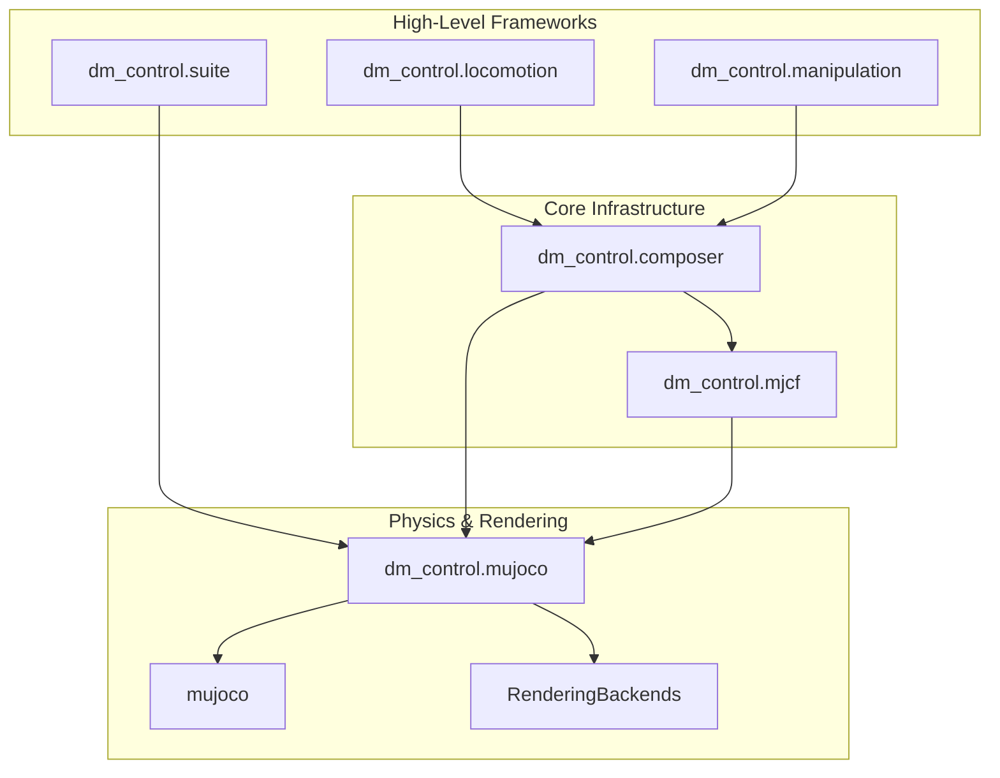
Sources: [README.md:10-34](), [setup.py:187-203]()

## Major Subsystems

### MuJoCo Python Bindings (`dm_control.mujoco`)
This library provides the foundational interface to MuJoCo [README.md:14-15](). It leverages the official `mujoco` Python package [setup.py:194-194]() and adds the `Physics` class which manages the simulation lifecycle, including `step()`, `reset()`, and named indexing for model elements [dm_control/mujoco/README.md:25-46]().
*   **For details on migration to v1.0 bindings, see [Migration Guide (v1.0)](#1.2).**

Sources: [README.md:14-15](), [setup.py:194-194](), [dm_control/mujoco/README.md:25-46]()

### MJCF Model System (`dm_control.mjcf`)
A library for programmatically composing and modifying MuJoCo MJCF models in Python [README.md:25-26](). It provides a DOM-like structure (`RootElement`) for building scenes without manual XML string manipulation [dm_control/mjcf/schema_test.py:60-75]().

Sources: [README.md:25-26](), [dm_control/mjcf/schema_test.py:60-75]()

### Composer Entity-Component Framework (`dm_control.composer`)
The high-level framework for defining rich RL environments from reusable components [README.md:28-29]().
*   **Entities**: Self-contained components that encapsulate MJCF models and simulation logic [tutorial.ipynb:148-150]().
*   **Arenas**: The surroundings where walkers and objects exist [tutorial.ipynb:156]().
*   **Tasks**: Define observations, rewards, and initialization/termination logic [tutorial.ipynb:150]().

Sources: [README.md:28-29](), [tutorial.ipynb:148-156]()

### Locomotion & Manipulation
Specialized libraries for complex tasks:
*   **Locomotion**: Includes a variety of walkers (CMU Humanoid, Rodent, Ant) and procedurally generated environments like mazes and corridors [tutorial.ipynb:156-164]().
*   **Soccer**: A multi-agent soccer environment built on top of the locomotion framework [README.md:33-33](), [tutorial.ipynb:167]().
*   **Manipulation**: Tasks involving robotic arms (e.g., Kinova Jaco) for lifting and reaching [tutorial.ipynb:169-170]().

Sources: [README.md:31-33](), [tutorial.ipynb:156-170]()

### Control Suite (`dm_control.suite`)
A set of standardized benchmark environments (e.g., Cartpole, Cheetah, Humanoid) used extensively in RL literature [README.md:17-18](), [dm_control/suite/README.md:1-15]().

Sources: [README.md:17-18](), [dm_control/suite/README.md:1-15]()

## Code Entity Mapping

This diagram bridges the natural language concepts to the specific classes and files used in the codebase.

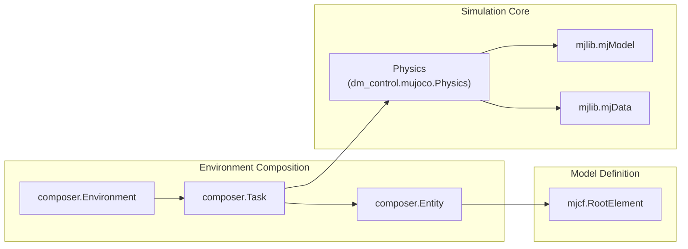
Sources: [tutorial.ipynb:138-170](), [dm_control/mujoco/README.md:25-36](), [dm_control/mjcf/schema_test.py:78-106]()

## Getting Started

To begin using `dm_control`, you must install the package and configure a rendering backend [README.md:53-114]().

*   **Installation**: `pip install dm_control` [README.md:55-59](). Note that editable mode (`-e`) is not supported due to legacy binding generation [README.md:61-75]().
*   **Rendering**: Supports EGL (headless GPU), GLFW (windowed), and OSMesa (software) [README.md:91-94](). Configure via the `MUJOCO_GL` environment variable [README.md:112-114]().

**For detailed setup instructions, rendering backend configurations, and verification steps, see [Installation and Setup](#1.1).**

Sources: [README.md:53-114](), [setup.py:187-203]()

---

# Page: Installation and Setup

# Installation and Setup

<details>
<summary>Relevant source files</summary>

The following files were used as context for generating this wiki page:

- [README.md](README.md)
- [dm_control/_render/__init__.py](dm_control/_render/__init__.py)
- [dm_control/_render/constants.py](dm_control/_render/constants.py)
- [dm_control/_render/executor/__init__.py](dm_control/_render/executor/__init__.py)
- [dm_control/_render/executor/render_executor_test.py](dm_control/_render/executor/render_executor_test.py)
- [dm_control/_render/glfw_renderer_test.py](dm_control/_render/glfw_renderer_test.py)
- [dm_control/_render/pyopengl/__init__.py](dm_control/_render/pyopengl/__init__.py)
- [dm_control/_render/pyopengl/egl_ext.py](dm_control/_render/pyopengl/egl_ext.py)
- [dm_control/_render/pyopengl/egl_renderer.py](dm_control/_render/pyopengl/egl_renderer.py)
- [dm_control/_render/pyopengl/osmesa_renderer.py](dm_control/_render/pyopengl/osmesa_renderer.py)
- [dm_control/mjcf/schema.xml](dm_control/mjcf/schema.xml)
- [dm_control/mjcf/schema_test.py](dm_control/mjcf/schema_test.py)
- [dm_control/mujoco/tutorial.ipynb](dm_control/mujoco/tutorial.ipynb)
- [pyproject.toml](pyproject.toml)
- [requirements.txt](requirements.txt)
- [setup.py](setup.py)
- [tutorial.ipynb](tutorial.ipynb)

</details>


This page guides users through installing `dm_control` and its dependencies, configuring the appropriate OpenGL rendering backends (`EGLContext`, `GLFWContext`, `OSMesaContext`), and verifying the installation.

## System Requirements

### Python Version
`dm_control` requires Python 3.9 or newer [setup.py:186-186]().

### Operating Systems and Hardware
- **Linux**: Fully supported for windowed (GLFW), headless GPU (EGL), and software (OSMesa) rendering [README.md:97-111]().
- **macOS**: Requires a Homebrew-installed Python interpreter and library path configuration [README.md:118-126]().
- **Windows**: Supported with compatible graphics drivers [README.md:53-59]().
- **GPU Acceleration**: Recommended for optimal simulation and rendering performance. Headless GPU execution requires EGL drivers supporting `EXT_platform_device` [README.md:104-107]().

Sources: [setup.py:186-186](), [README.md:89-126]()

## Basic Installation

### PyPI Installation
To install the stable release of `dm_control` from PyPI, run:

```bash
pip install dm_control
```

This installation triggers the `InstallCommand` class defined in `setup.py`, which executes `BuildMJBindingsCommand` to build low-level Python bindings via `autowrap.py` [setup.py:71-142]().

### Source Installation
To install the latest development version directly from the repository:

```bash
pip install git+https://github.com/google-deepmind/dm_control.git
```

> **Warning**: `dm_control` **cannot** be installed in "editable" mode (`pip install -e`). Attempting an editable install causes import failures because the dynamic binding generator populates `dm_control/mujoco/wrapper/mjbindings` at installation time rather than runtime, which breaks path resolution for low-level constants [README.md:61-75]().

Sources: [setup.py:71-142](), [README.md:55-87]()

## Dependencies

`dm_control` relies on core third-party packages declared in `setup.py` and `requirements.txt`:

| Dependency | Minimum Version | Role in Codebase |
| :--- | :--- | :--- |
| `mujoco` | `>= 3.16.0` | Underlying physics engine and C bindings [setup.py:194-194](), [requirements.txt:9-9]() |
| `numpy` | `>= 1.9.0` | Numerical array representations for `MjModel` and `MjData` [setup.py:195-195](), [requirements.txt:10-12]() |
| `dm-env` | — | Standard reinforcement learning environment interface [setup.py:189-189](), [requirements.txt:2-2]() |
| `dm-tree` | `!= 0.1.2` | Nesting and unnesting observation structures [setup.py:190-190](), [requirements.txt:3-3]() |
| `glfw` | — | Windowing management and input for the interactive viewer [setup.py:191-191](), [requirements.txt:4-4]() |
| `labmaze` | — | Procedural maze generation for locomotion tasks [setup.py:192-192](), [requirements.txt:6-6]() |
| `lxml` | — | XML parsing for the `mjcf` subsystem [setup.py:193-193](), [requirements.txt:7-7]() |
| `pyopengl` | `>= 3.1.4` | OpenGL bindings used by `EGLContext` and `OSMesaContext` [setup.py:197-197](), [requirements.txt:15-15]() |

Sources: [setup.py:187-203](), [requirements.txt:1-25]()

## Rendering Setup and Backends

The rendering subsystem (`dm_control._render`) manages OpenGL contexts by attempting to load backends in a specific priority order or via explicit environment configuration [dm_control/_render/__init__.py:16-108]().

### Title: Rendering Backend Resolution and Class Mapping
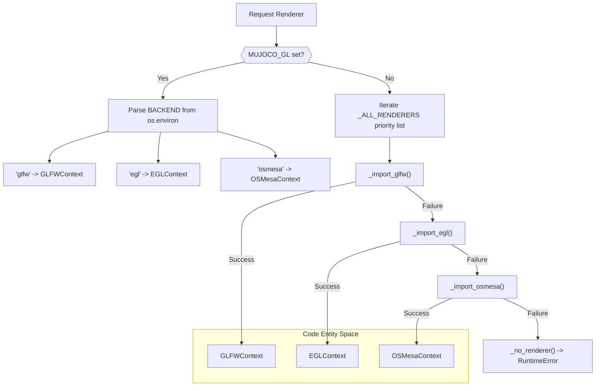
Sources: [dm_control/_render/__init__.py:31-108](), [dm_control/_render/constants.py:19-32]()

### Configuring Rendering Backends

- **GLFW (`glfw`)**: Used for interactive visualization via `dm_control.viewer`. Requires windowing libraries like `libglfw3` on Linux or Homebrew `glfw` on macOS [README.md:96-103]().
- **EGL (`egl`)**: Headless hardware-accelerated rendering using `EGLContext` in `dm_control._render.pyopengl.egl_renderer` [dm_control/_render/pyopengl/egl_renderer.py:93-140](). Controlled via environment variables:
  - `MUJOCO_GL=egl`
  - `MUJOCO_EGL_DEVICE_ID=N` to select a specific GPU device index [dm_control/_render/pyopengl/egl_renderer.py:46-55]()
- **OSMesa (`osmesa`)**: Pure software-based rendering via `OSMesaContext` in `dm_control._render.pyopengl.osmesa_renderer` [dm_control/_render/pyopengl/osmesa_renderer.py:44-86](). Selected with `MUJOCO_GL=osmesa` [dm_control/_render/__init__.py:21-22]().

Sources: [README.md:89-126](), [dm_control/_render/pyopengl/egl_renderer.py:43-70](), [dm_control/_render/pyopengl/osmesa_renderer.py:44-86]()

## Installation and Binding Architecture

### Title: Low-Level Binding Generation and Runtime Initialization Pipeline
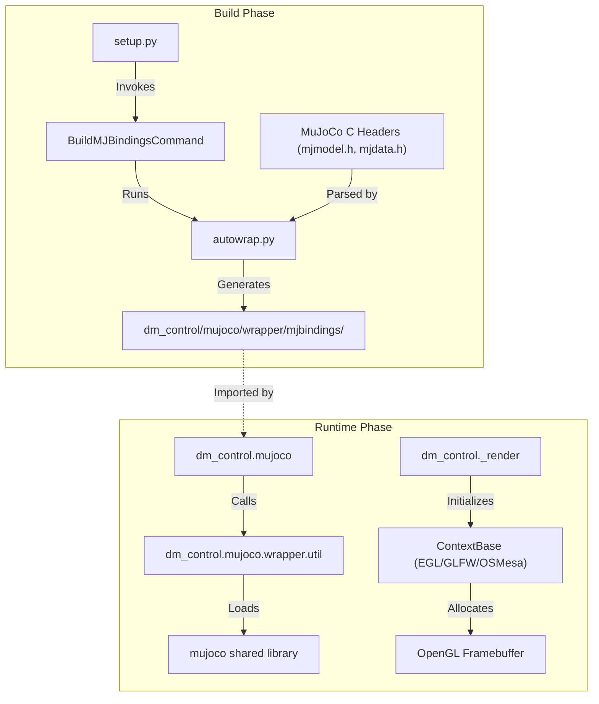
Sources: [setup.py:33-119](), [dm_control/_render/base.py:48-67](), [dm_control/mujoco/wrapper/util.py:20-50]()

## Verification

Verify the complete installation and rendering stack by executing a python snippet that instantiates a Control Suite environment and renders a frame:

```python
from dm_control import suite

# Load a benchmark environment
env = suite.load(domain_name="cartpole", task_name="swingup")

# Render a frame (initializes the physics session and active OpenGL context)
pixels = env.physics.render(height=240, width=320)

print(f"Installation verified. Rendered frame shape: {pixels.shape}")
```

In Google Colab environments, ensure `MUJOCO_GL=egl` is exported prior to importing `dm_control` to route rendering through the GPU runtime [tutorial.ipynb:96-103]().

Sources: [tutorial.ipynb:93-113](), [dm_control/mujoco/tutorial.ipynb:93-112]()

## Environment Variables Summary

| Environment Variable | Code Reference | Description |
| :--- | :--- | :--- |
| `MUJOCO_GL` | [dm_control/_render/constants.py:19-19]() | Selects the active rendering backend (`glfw`, `egl`, `osmesa`). |
| `MUJOCO_EGL_DEVICE_ID` | [dm_control/_render/pyopengl/egl_renderer.py:46-46]() | Specifies the target GPU integer index when using `EGLContext`. |
| `PYOPENGL_PLATFORM` | [dm_control/_render/constants.py:22-22]() | Internal PyOpenGL platform configuration variable. |
| `MJLIB_PATH` | [dm_control/mujoco/wrapper/util.py:25-25]() | Optional direct override path for the compiled MuJoCo shared library. |

Sources: [dm_control/_render/constants.py:18-32](), [dm_control/_render/pyopengl/egl_renderer.py:43-55](), [dm_control/mujoco/wrapper/util.py:20-30]()

---

# Page: Migration Guide (v1.0)

# Migration Guide (v1.0)

<details>
<summary>Relevant source files</summary>

The following files were used as context for generating this wiki page:

- [dm_control/mujoco/engine.py](dm_control/mujoco/engine.py)
- [dm_control/mujoco/engine_test.py](dm_control/mujoco/engine_test.py)
- [dm_control/mujoco/wrapper/core.py](dm_control/mujoco/wrapper/core.py)
- [dm_control/mujoco/wrapper/core_test.py](dm_control/mujoco/wrapper/core_test.py)
- [dm_control/mujoco/wrapper/util.py](dm_control/mujoco/wrapper/util.py)
- [migration_guide_1.0.md](migration_guide_1.0.md)

</details>


This section documents the breaking changes and architectural shifts introduced in `dm_control` version 1.0.0. The primary driver for this update is the migration from legacy internal Python bindings to the official upstream MuJoCo Python bindings (`mujoco` package).

Sources: [migration_guide_1.0.md:1-8]()

---

## Overview of Changes

The transition to the native `mujoco` package improves runtime stability, performance, and error handling. However, it introduces breaking changes in how underlying C data structures are accessed, how memory is managed, and how exceptions are thrown.

### Key Architectural Shift

The following diagram illustrates the relationship between the `dm_control` high-level `Physics` API and the underlying `mujoco` library entities.

**Data Access and Execution Flow**
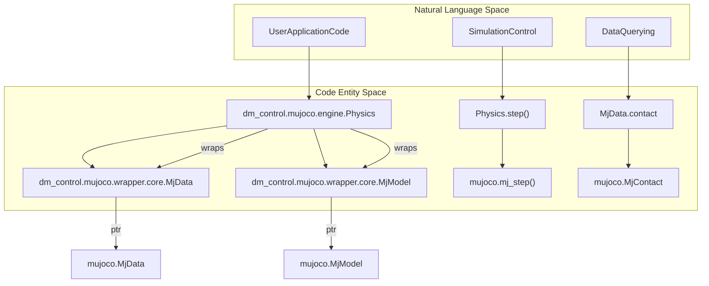
Sources: [dm_control/mujoco/engine.py:83-124](), [dm_control/mujoco/wrapper/core.py:16-30]()

---

## Required Code Changes

### 1. `MjData.contact` Interface
In previous versions, `MjData.contact` behaved like a NumPy structured array, supporting vectorized boolean indexing directly on contact fields. In v1.0, `MjData.contact` is represented as a list-like collection of `MjContact` structs [migration_guide_1.0.md:15-22]().

**Comparison Table: Contact Access**

| Feature | Pre-v1.0 (Legacy) | v1.0 (New Bindings) |
| :--- | :--- | :--- |
| **Data Type** | Structured NumPy Array | List of `MjContact` structs |
| **Filtering** | `contact[contact.geom1 == id]` | List comprehension or loops |
| **Field Access** | `contact.dist` (returns array) | `[c.dist for c in contact]` |

**Example Migration:**
```python
# Legacy code
contact = physics.data.contact
involves_geom = (contact.geom1 == geom_id) | (contact.geom2 == geom_id)
dists = contact[involves_geom].dist

# v1.0 code
contacts = physics.data.contact
dists = [c.dist for c in contacts if c.geom1 == geom_id or c.geom2 == geom_id]
```
Sources: [migration_guide_1.0.md:23-39]()

### 2. Exception Handling and Error Flow
The exception hierarchy has shifted. While `dm_control.mujoco.wrapper.core.Error` remains as a base class [dm_control/mujoco/wrapper/core.py:42-44](), the underlying `mujoco` library now throws native Python exceptions [migration_guide_1.0.md:47-53]().

*   **`ValueError`**: Thrown for invalid input parameters [migration_guide_1.0.md:47-53]().
*   **`mujoco.FatalError`**: Thrown for low-level MuJoCo engine errors (replacing previous process crashes from `mju_error`) [migration_guide_1.0.md:54-59]().

Additionally, Python callables used as user-defined MuJoCo callbacks can now safely raise exceptions that propagate correctly up the call stack [migration_guide_1.0.md:60-64]().

Sources: [dm_control/mujoco/wrapper/core.py:41-44](), [migration_guide_1.0.md:47-64]()

### 3. Pointer Access (`.ptr.contents`)
Code that explicitly accessed `.ptr.contents` on wrapper objects like `MjvScene` or `MjModel` must be updated. In the new bindings, objects can be passed directly without manual dereferencing [migration_guide_1.0.md:41-46]().

Sources: [migration_guide_1.0.md:41-46]()

---

## API Removals and Replacements

### Module Replacements
The module `dm_control.mujoco.wrapper.mjbindings.types` is deprecated. Use the corresponding classes exposed directly in the `mujoco` namespace [migration_guide_1.0.md:11-14]().

| Old Entity | New Entity |
| :--- | :--- |
| `types.MJRRECT` | `mujoco.MjrRect` |
| `mjlib.mj_step` | `mujoco.mj_step` |
| `enums.mjtObj.mjOBJ_SITE` | `mujoco.mjtObj.mjOBJ_SITE` |

Sources: [migration_guide_1.0.md:11-14](), [migration_guide_1.0.md:91-118]()

### Memory Management and Struct Initialization
The new bindings manage memory lifecycle automatically. Functions used to allocate or initialize structs (e.g., `mjv_defaultOption`) are generally unnecessary because Python constructors handle default initialization and memory cleanup [migration_guide_1.0.md:119-134]().

**Comparison: Scene Option Initialization**
```python
# Legacy
scene_option = wrapper.core.MjvOption()
mjlib.mjv_defaultOption(scene_option.ptr)

# v1.0 (Automatic)
scene_option = wrapper.core.MjvOption()
```
Sources: [migration_guide_1.0.md:119-150]()

### Change of Signature for `mj_saveModel`
[`mj_saveModel`](https://mujoco.readthedocs.io/en/latest/APIreference.html#mj-savemodel) now accepts a NumPy `uint8` array instead of a ctypes string buffer, and infers the size directly from the array [migration_guide_1.0.md:65-70]().

Sources: [migration_guide_1.0.md:65-84]()

---

## Implementation Details

The `Physics` class interacts with the `mujoco` library via the `ptr` attribute of `MjModel` and `MjData` [dm_control/mujoco/engine.py:176-176]().

**Simulation Step Logic**
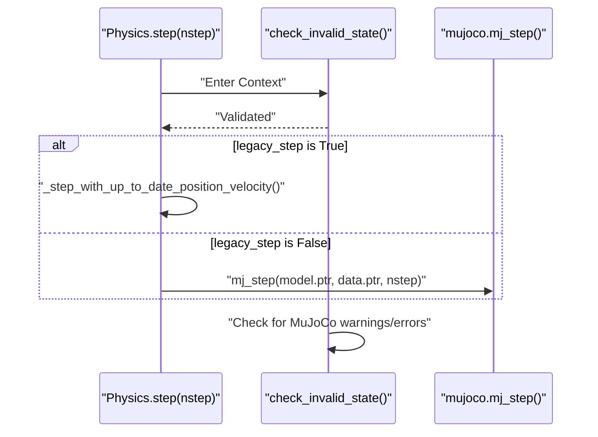
Sources: [dm_control/mujoco/engine.py:164-177](), [dm_control/mujoco/engine.py:147-163]()

### Handling MuJoCo Callbacks
MuJoCo C-level callbacks (such as `mjcb_time`) are managed via `mujoco.set_mjcb_...` functions. `dm_control` provides `set_callback` and the context manager `callback_context` to safely override and restore these handlers in Python [dm_control/mujoco/wrapper/core.py:97-141]().

Sources: [dm_control/mujoco/wrapper/core.py:97-141]()

---

# Page: Core Concepts

# Core Concepts

<details>
<summary>Relevant source files</summary>

The following files were used as context for generating this wiki page:

- [dm_control/composer/__init__.py](dm_control/composer/__init__.py)
- [dm_control/composer/environment.py](dm_control/composer/environment.py)
- [dm_control/composer/environment_test.py](dm_control/composer/environment_test.py)
- [dm_control/composer/observation/fake_physics.py](dm_control/composer/observation/fake_physics.py)
- [dm_control/composer/observation/obs_buffer.py](dm_control/composer/observation/obs_buffer.py)
- [dm_control/composer/observation/observable/base.py](dm_control/composer/observation/observable/base.py)
- [dm_control/composer/observation/updater.py](dm_control/composer/observation/updater.py)
- [dm_control/composer/observation/updater_test.py](dm_control/composer/observation/updater_test.py)
- [dm_control/composer/variation/__init__.py](dm_control/composer/variation/__init__.py)
- [dm_control/mujoco/engine.py](dm_control/mujoco/engine.py)
- [dm_control/mujoco/engine_test.py](dm_control/mujoco/engine_test.py)
- [dm_control/mujoco/wrapper/core.py](dm_control/mujoco/wrapper/core.py)
- [dm_control/mujoco/wrapper/core_test.py](dm_control/mujoco/wrapper/core_test.py)
- [dm_control/mujoco/wrapper/util.py](dm_control/mujoco/wrapper/util.py)

</details>


This page provides an overview of the fundamental concepts and architecture in the `dm_control` framework. The framework offers a Python interface to the MuJoCo physics engine for reinforcement learning and physics-based control. Here we cover the core abstractions and how they fit together to create physically simulated environments.

For specific details on visualization capabilities, see [Visualization and Rendering](#3), and for information about using the locomotion framework, see [Locomotion Framework](#4).

## Physics Engine Integration

At the foundation of `dm_control` is the integration with the MuJoCo physics engine, which provides fast and accurate physics simulation. The framework wraps MuJoCo's C API with a Pythonic interface centered around the `Physics` class [dm_control/mujoco/engine.py:16-33]().

Title: Physics Engine Class Hierarchy
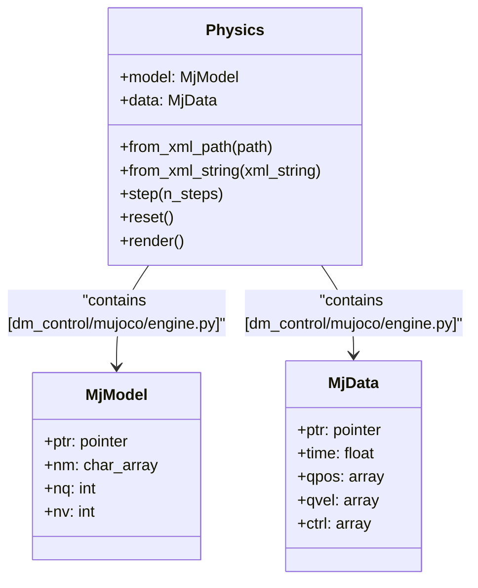

The `Physics` class is the main entry point for interacting with the simulation. It provides methods to load models, step the simulation forward in time, and manage the underlying `mujoco.MjModel` and `mujoco.MjData` structures [dm_control/mujoco/engine.py:83-100]().

For details, see [Physics Engine](#2.1).

Sources: [dm_control/mujoco/engine.py:16-100](), [dm_control/mujoco/wrapper/util.py:45-46]()

## MJCF Model System

MuJoCo models are defined using the MJCF (MuJoCo XML) format. The `mjcf` module provides a Python object model for programmatically creating, modifying, and composing MJCF models.

Title: MJCF Document Object Model (DOM)
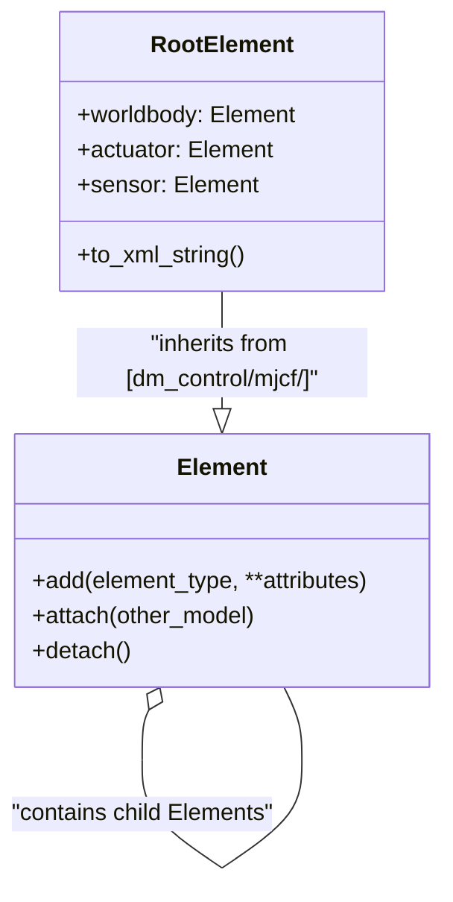

MJCF models are structured hierarchically. The `mjcf` module allows you to:
- Create models programmatically.
- Modify existing models using a DOM-like interface.
- Compose multiple models together through attachments, which handles namespacing automatically.

For details, see [MJCF Model System](#2.2).

Sources: [dm_control/mujoco/wrapper/core.py:151-188](), [dm_control/mujoco/wrapper/core_test.py:64-99]()

## Entity-Component Framework

The `composer` module provides an entity-component framework for building complex physically simulated environments. This framework allows for modular, composable, and reusable environment components [dm_control/composer/__init__.py:16-33]().

Title: Composer Framework Entities
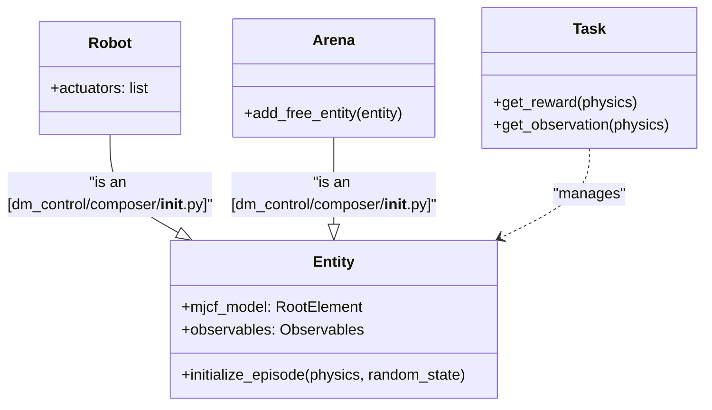

The `composer.Environment` orchestrates the interaction between a `Physics` instance and a `Task` [dm_control/composer/environment.py:165-174](). The `Task` defines the reward function, termination conditions, and observation logic.

For details, see [Entity-Component Framework](#2.3).

Sources: [dm_control/composer/__init__.py:16-33](), [dm_control/composer/environment.py:165-184]()

## Observation System

The observation system defines what information can be observed from the environment and how that information is processed. It provides a flexible framework for defining and configuring observations [dm_control/composer/observation/updater.py:16-30]().

Title: Observation Data Flow
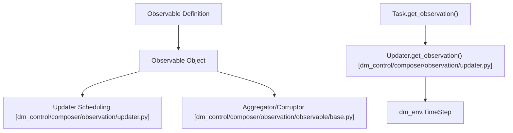

Key components include `Observable` types that can wrap MuJoCo features or cameras [dm_control/composer/observation/observable/base.py:54-65](). The system supports:
- **Updating**: Scheduling when observations are refreshed [dm_control/composer/observation/updater.py:32-73]().
- **Processing**: Buffering, delaying, or adding noise (corruptors) [dm_control/composer/observation/observable/base.py:130-136]().
- **Flattening/Structuring**: Returning nested dictionaries of observation arrays matching `dm_env` specs [dm_control/composer/observation/updater.py:167-175]().

For details, see [Observation System](#2.4).

Sources: [dm_control/composer/observation/updater.py:32-175](), [dm_control/composer/observation/observable/base.py:54-140]()

## Variation System

The variation system is used to randomize environment properties to improve agent robustness (Domain Randomization) [dm_control/composer/variation/__init__.py]().

It includes:
- **Distributions**: Uniform, Normal, etc., for parameter sampling.
- **Variators**: Objects that apply sampled values to MJCF attributes or Physics state.
- **Noises**: Temporal noise processes for actuators or sensors.

For details, see [Variation System](#2.5).

Sources: [dm_control/composer/variation/__init__.py]()

## RL Environment Interface

The core of `dm_control` implements the `dm_env.Environment` interface, making it compatible with the DeepMind RL ecosystem.

Title: Environment Step Lifecycle
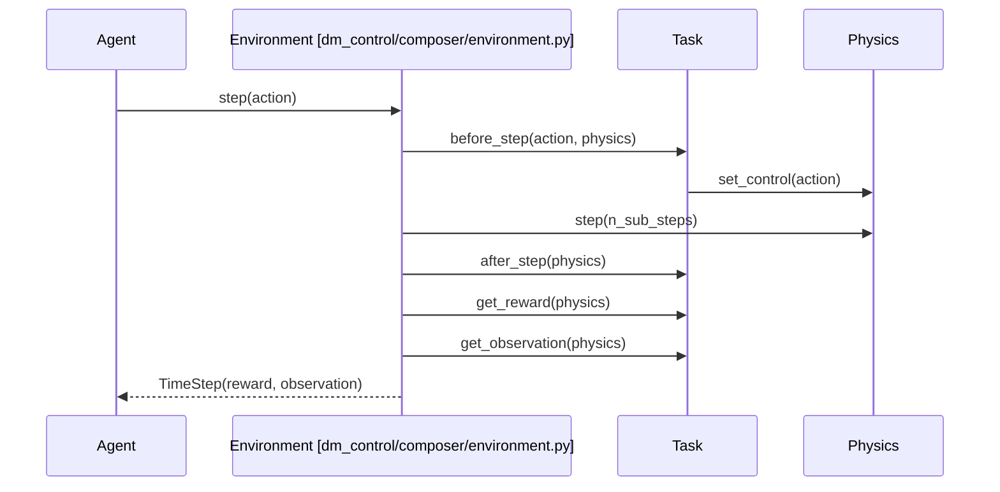

The `Environment` class handles the control loop, executing hook cycles (`before_step`, `before_substep`, `after_substep`, `after_step`) and updating state across multiple substeps [dm_control/composer/environment.py:132-163]().

Sources: [dm_control/composer/environment.py:110-163](), [dm_control/composer/environment_test.py:107-117]()

---

# Page: Physics Engine

# Physics Engine

<details>
<summary>Relevant source files</summary>

The following files were used as context for generating this wiki page:

- [dm_control/mjcf/physics.py](dm_control/mjcf/physics.py)
- [dm_control/mujoco/engine.py](dm_control/mujoco/engine.py)
- [dm_control/mujoco/engine_test.py](dm_control/mujoco/engine_test.py)
- [dm_control/mujoco/index.py](dm_control/mujoco/index.py)
- [dm_control/mujoco/index_test.py](dm_control/mujoco/index_test.py)
- [dm_control/mujoco/testing/assets/arm.xml](dm_control/mujoco/testing/assets/arm.xml)
- [dm_control/mujoco/testing/assets/model_with_ball_joints.xml](dm_control/mujoco/testing/assets/model_with_ball_joints.xml)
- [dm_control/mujoco/testing/assets/model_with_third_order_actuators.xml](dm_control/mujoco/testing/assets/model_with_third_order_actuators.xml)
- [dm_control/mujoco/wrapper/core.py](dm_control/mujoco/wrapper/core.py)
- [dm_control/mujoco/wrapper/core_test.py](dm_control/mujoco/wrapper/core_test.py)
- [dm_control/mujoco/wrapper/mjbindings_test.py](dm_control/mujoco/wrapper/mjbindings_test.py)
- [dm_control/mujoco/wrapper/util.py](dm_control/mujoco/wrapper/util.py)
- [dm_control/rl/control.py](dm_control/rl/control.py)
- [dm_control/rl/control_test.py](dm_control/rl/control_test.py)
- [dm_control/suite/base.py](dm_control/suite/base.py)
- [dm_control/suite/utils/randomizers_test.py](dm_control/suite/utils/randomizers_test.py)
- [dm_control/suite/wrappers/pixels.py](dm_control/suite/wrappers/pixels.py)
- [dm_control/suite/wrappers/pixels_test.py](dm_control/suite/wrappers/pixels_test.py)
- [dm_control/utils/inverse_kinematics.py](dm_control/utils/inverse_kinematics.py)
- [dm_control/utils/inverse_kinematics_test.py](dm_control/utils/inverse_kinematics_test.py)
- [dm_control/utils/xml_tools_test.py](dm_control/utils/xml_tools_test.py)

</details>


The Physics Engine is the foundational component of `dm_control` that provides a Python interface to the MuJoCo physics simulation library. It enables physics-based simulation and control by wrapping the MuJoCo C library in a Pythonic API.

## Overview

The `Physics` class is the central class that encapsulates MuJoCo's simulation capabilities, handling:
- Loading and parsing simulation models.
- Stepping the physics simulation forward in time.
- Managing simulation state (`qpos`, `qvel`, `ctrl`).
- Applying control signals to actuators.
- Rendering the simulation via OpenGL.

For information about how this integrates with the entity-component system, see [Entity-Component Framework]().

Sources: [dm_control/mujoco/engine.py:83-103]()

## Core Architecture

The `Physics` class provides a clean interface around MuJoCo's state and operations, bridging the gap between Python and the underlying C structures.

### Bridge: Natural Language to Code Entities
The following table maps high-level simulation concepts to specific code entities in `dm_control`.

| Concept | Code Entity | Role |
| :--- | :--- | :--- |
| **Simulation Controller** | `engine.Physics` | Main user-facing interface for simulation control. |
| **Static Model** | `wrapper.MjModel` | Contains constant parameters like geometry, mass, and joint types. |
| **Dynamic State** | `wrapper.MjData` | Contains time-varying data like positions, velocities, and forces. |
| **Named Access** | `index.struct_indexer` | Provides `physics.named` for string-based indexing of fields. |
| **Rendering** | `engine.Camera` | Manages OpenGL contexts and pixel extraction. |

Sources: [dm_control/mujoco/engine.py:83-103](), [dm_control/mujoco/wrapper/core.py]()

### System Data Flow
The architecture wraps native MuJoCo pointers into safe Python objects.

Title: "System Data Flow Architecture"
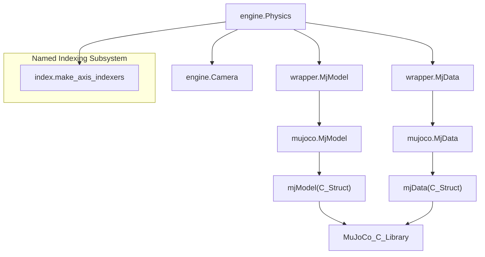
Sources: [dm_control/mujoco/engine.py:83-103](), [dm_control/mujoco/wrapper/core.py](), [dm_control/mujoco/index.py:68-82]()

## Creating Physics Instances

There are multiple named constructors to create a `Physics` instance, typically loading from MJCF XML or MuJoCo's binary MJB format.

Title: "Physics Instance Factory Workflow"
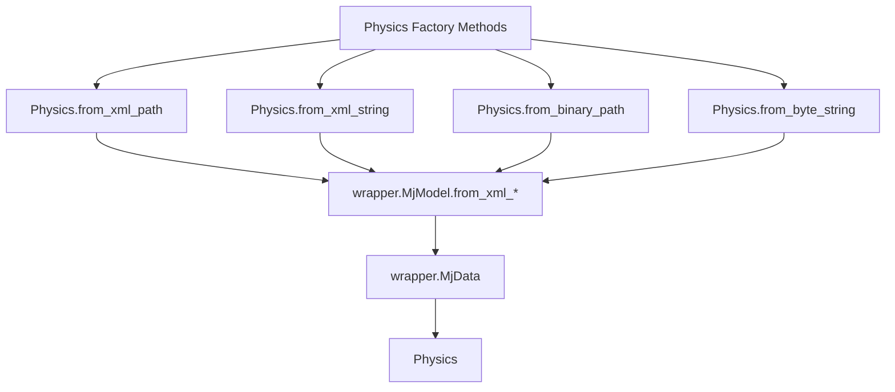
Sources: [dm_control/mujoco/engine.py:424-476](), [dm_control/mujoco/wrapper/core.py:150-186]()

### Loading Examples

```python
# From XML file
physics = Physics.from_xml_path('/path/to/model.xml')

# From XML string with assets
physics = Physics.from_xml_string(xml_string, assets={'mesh.stl': mesh_bytes})

# From MJB binary
physics = Physics.from_binary_path('model.mjb')
```

Sources: [dm_control/mujoco/engine.py:424-476]()

## Simulation Lifecycle

### Stepping and Control
The `step` method advances the simulation. If `legacy_step` is enabled (default in `rl.control.Environment`), `dm_control` ensures that position and velocity dependent fields are updated before returning.

- `set_control(control)`: Copies values into `physics.data.ctrl` [dm_control/mujoco/engine.py:139-146]().
- `step(nstep=1)`: Advances the simulation by `nstep` iterations [dm_control/mujoco/engine.py:164-177]().
- `_step_with_up_to_date_position_velocity(nstep)`: Internal method that calls `mj_step2` then `mj_step1` to synchronize `mjData` with `qpos`/`qvel` [dm_control/mujoco/engine.py:147-162]().

Sources: [dm_control/mujoco/engine.py:139-177](), [dm_control/rl/control.py:31-61]()

### State Management
The `Physics` class allows full serialization and restoration of the simulation state.
- `get_state()`: Returns a concatenated NumPy array of `qpos`, `qvel`, and `act`.
- `set_state(state)`: Restores the state and calls `mj_forward` to update derived fields.
- `reset(keyframe_id=None)`: Resets to initial state or a specific keyframe.

Sources: [dm_control/mujoco/engine.py:235-315]()

## Named Indexing

`dm_control` provides a sophisticated named indexing system that allows accessing MuJoCo fields using strings defined in the MJCF. This is implemented by `index.py` which parses model metadata to determine field dimensions.

```python
# Named access to joint positions
physics.named.data.qpos['hinge_joint']

# Accessing specific columns in 2D fields (e.g., 'x', 'y', 'z' for xpos)
physics.named.data.xpos['body_name', 'z']

# Slicing with names
physics.named.model.geom_rgba[['geom1', 'geom2'], 'r']
```

The system handles "ragged" dimensions (like `qpos` where a joint might have 1, 3, or 7 degrees of freedom) by mapping joint names to the correct underlying indices using address arrays like `jnt_qposadr`.

Sources: [dm_control/mujoco/index.py:16-82](), [dm_control/mujoco/engine.py:404-409]()

## Rendering and Cameras

The rendering pipeline utilizes OpenGL backends (EGL, GLFW, or OSMesa).

### The Camera Class
The `Camera` class manages viewport rendering and object selection.
- `render()`: Returns an RGB or depth array.
- `select(cursor_pos)`: Returns the body/geom under a specific pixel using `mjv_select`.

### Physics.render()
The `Physics` class provides a high-level `render` method that abstracts camera creation.
- `segmentation=True`: Returns an `(H, W, 2)` array where pixels contain `(object_id, object_type)`.
- `scene_callback`: Allows custom drawing (e.g., adding markers) into the `mjvScene` before rendering.

Sources: [dm_control/mujoco/engine.py:178-233](), [dm_control/mujoco/engine.py:620-762]()

## Error Handling

MuJoCo's internal errors and warnings are captured and routed through Python.

- **Warning Callbacks**: `mujoco.set_mju_user_warning` is used to redirect MuJoCo warnings to the Python `logging` module [dm_control/mujoco/wrapper/core.py:62-74]().
- **Exceptions**: By default, invalid physics states (e.g., NaNs in simulation) raise exceptions [dm_control/mujoco/engine.py:122]().
- **Suppression**: `suppress_physics_errors()` context manager allows simulation to continue even if warnings occur, which is useful during domain randomization [dm_control/mujoco/engine.py:125-133]().

Sources: [dm_control/mujoco/engine.py:122-133](), [dm_control/mujoco/wrapper/core.py:62-74]()

## Thread Safety

MuJoCo is thread-safe for separate `MjModel`/`MjData` pairs. `dm_control` ensures that:
- Loading models from strings is thread-safe.
- Multiple `Physics` instances can be stepped in parallel threads.
- **Rendering**: Context creation (especially with GLFW) can have thread-safety limitations depending on the operating system.

Sources: [dm_control/mujoco/thread_safety_test.py:16-100]()

---

# Page: MJCF Model System

# MJCF Model System

<details>
<summary>Relevant source files</summary>

The following files were used as context for generating this wiki page:

- [dm_control/_render/glfw_renderer.py](dm_control/_render/glfw_renderer.py)
- [dm_control/composer/task.py](dm_control/composer/task.py)
- [dm_control/entities/manipulators/kinova/assets_path.py](dm_control/entities/manipulators/kinova/assets_path.py)
- [dm_control/mjcf/__init__.py](dm_control/mjcf/__init__.py)
- [dm_control/mjcf/attribute.py](dm_control/mjcf/attribute.py)
- [dm_control/mjcf/attribute_test.py](dm_control/mjcf/attribute_test.py)
- [dm_control/mjcf/base.py](dm_control/mjcf/base.py)
- [dm_control/mjcf/constants.py](dm_control/mjcf/constants.py)
- [dm_control/mjcf/debugging.py](dm_control/mjcf/debugging.py)
- [dm_control/mjcf/element.py](dm_control/mjcf/element.py)
- [dm_control/mjcf/element_test.py](dm_control/mjcf/element_test.py)
- [dm_control/mjcf/export_with_assets.py](dm_control/mjcf/export_with_assets.py)
- [dm_control/mjcf/export_with_assets_as_zip.py](dm_control/mjcf/export_with_assets_as_zip.py)
- [dm_control/mjcf/export_with_assets_as_zip_test.py](dm_control/mjcf/export_with_assets_as_zip_test.py)
- [dm_control/mjcf/export_with_assets_test.py](dm_control/mjcf/export_with_assets_test.py)
- [dm_control/mjcf/parser.py](dm_control/mjcf/parser.py)
- [dm_control/mjcf/physics_test.py](dm_control/mjcf/physics_test.py)
- [dm_control/mjcf/schema.py](dm_control/mjcf/schema.py)
- [dm_control/mjcf/skin.py](dm_control/mjcf/skin.py)
- [dm_control/mjcf/skin_test.py](dm_control/mjcf/skin_test.py)
- [dm_control/mjcf/test_assets/attribute_test_schema.xml](dm_control/mjcf/test_assets/attribute_test_schema.xml)
- [dm_control/mjcf/test_assets/model_with_assetdir.xml](dm_control/mjcf/test_assets/model_with_assetdir.xml)
- [dm_control/mjcf/test_assets/model_with_assetdir.zip](dm_control/mjcf/test_assets/model_with_assetdir.zip)
- [dm_control/mjcf/test_assets/model_with_nameless_assets.xml](dm_control/mjcf/test_assets/model_with_nameless_assets.xml)
- [dm_control/mjcf/test_assets/model_with_separators.xml](dm_control/mjcf/test_assets/model_with_separators.xml)
- [dm_control/mjcf/test_assets/skins/test_skin.skn](dm_control/mjcf/test_assets/skins/test_skin.skn)
- [dm_control/mjcf/test_assets/test_model.xml](dm_control/mjcf/test_assets/test_model.xml)
- [dm_control/mjcf/traversal_utils.py](dm_control/mjcf/traversal_utils.py)
- [dm_control/mjcf/traversal_utils_test.py](dm_control/mjcf/traversal_utils_test.py)
- [dm_control/mjcf/xml_validation_test.py](dm_control/mjcf/xml_validation_test.py)
- [dm_control/mujoco/testing/image_utils.py](dm_control/mujoco/testing/image_utils.py)
- [dm_control/mujoco/testing/image_utils_test.py](dm_control/mujoco/testing/image_utils_test.py)

</details>


The MJCF (MuJoCo XML Configuration Format) Model System is a Python-based object model for programmatically creating, manipulating, and parsing MuJoCo models. It provides an alternative to directly writing XML files, allowing for more maintainable, reusable, and composable physics model definitions.

## Overview

The MJCF Model System provides a hierarchical representation of MuJoCo models that mirrors the structure of the XML format. Each XML element becomes a Python object, and XML attributes become object attributes. The system handles conversions between Python data structures and XML, manages namescopes, resolves references, and provides a binding mechanism to connect model elements to the underlying physics engine.

### Core Entity Mapping

The following diagram bridges the natural language concepts of the MJCF system to the specific code entities in the `dm_control.mjcf` package.

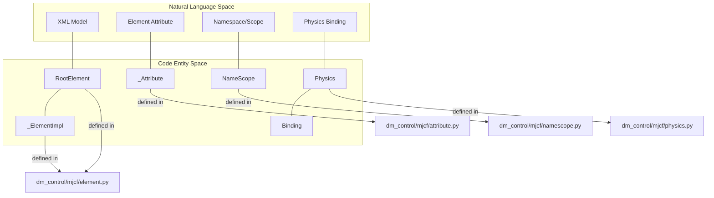
Sources: [dm_control/mjcf/element.py:134-140](), [dm_control/mjcf/attribute.py:48-52](), [dm_control/mjcf/physics.py:24-34]()

## Element and Attribute System

### The DOM Hierarchy
The MJCF system implements a Document Object Model (DOM) where `RootElement` represents the `<mujoco>` tag. All elements inherit from a base `Element` class.

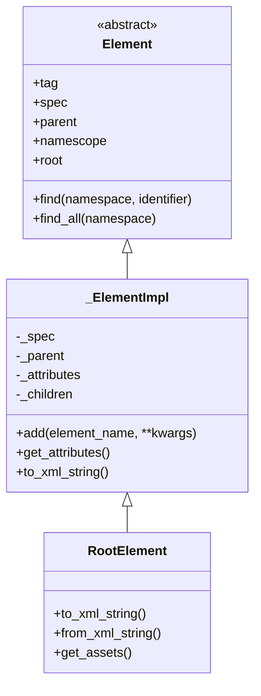
Sources: [dm_control/mjcf/base.py:16-25](), [dm_control/mjcf/element.py:134-168]()

### Attribute Types and Validation
Attributes are strongly typed and validated against the MJCF schema. The system uses specific classes to handle different data types found in the XML [dm_control/mjcf/attribute.py:16-25]().

| Attribute Type | Class Name | Behavior |
| :--- | :--- | :--- |
| **String** | `String` | Validates standard string input [dm_control/mjcf/attribute.py:123](). |
| **Integer** | `Integer` | Ensures float-to-int conversion is lossless [dm_control/mjcf/attribute.py:135](). |
| **Float** | `Float` | Handles scientific precision during XML export [dm_control/mjcf/attribute.py:150](). |
| **Keyword** | `Keyword` | Restricts values to a valid set (e.g., `type="hinge"`) [dm_control/mjcf/attribute.py:176](). |
| **Array** | `Array` | Validates shape and `dtype` (e.g., `pos="0 0 1"`) [dm_control/mjcf/attribute.py:201](). |

Sources: [dm_control/mjcf/attribute.py:123-222](), [dm_control/mjcf/element.py:23-30]()

## Namescopes and Asset Management

### NameScope System
The `NameScope` class manages the unique identification of elements. It handles the `PREFIX_SEPARATOR` (defaulting to `/`) to prevent name collisions when multiple MJCF models are composed [dm_control/mjcf/constants.py:19-22]().

- **Composition**: When a model is added as a child of another, its `NameScope` is nested.
- **Full Identifier**: The `full_identifier` property of an element returns its name prefixed by all parent namescopes.

### Asset Management
Assets such as meshes (`.stl`, `.obj`), textures, and heightfields are managed through asset attributes.
- **Automatic Naming**: If certain asset elements lack a `name` attribute (such as `mesh`, `hfield`, or `texture`), it is derived from the filename [dm_control/mjcf/element.py:131-154]().
- **Asset Collection**: `RootElement.get_assets()` recursively collects all file contents referenced in the model.

Sources: [dm_control/mjcf/namescope.py:1-50](), [dm_control/mjcf/element.py:131-154](), [dm_control/mjcf/constants.py:19-22]()

## Physics Binding

The `mjcf.Physics` class extends the standard physics wrapper to allow direct interaction between MJCF elements and the MuJoCo simulation state.

### Binding Mechanism
The `bind()` method creates a binding object that maps element names to indices in `mjModel` and `mjData`.

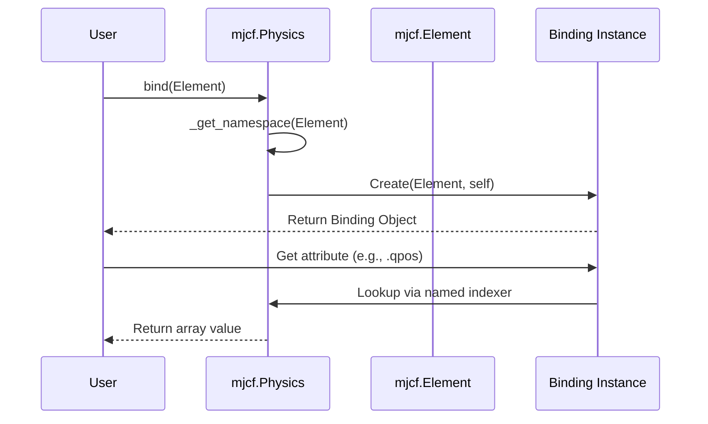

### Dirty State Tracking
Modifying certain attributes through a binding (e.g., `qpos`, `ctrl`, `qfrc_applied`) triggers a "dirty" flag tracking mechanism in the `Physics` object, notifying the system that state updates are required [dm_control/mjcf/constants.py:47-48]().

Sources: [dm_control/mjcf/physics_test.py:36-169](), [dm_control/mjcf/constants.py:47-52]()

## Parsing and Export Utilities

### Parser Functions
The system provides several entry points for loading models:
- `from_xml_string`: Parses a raw XML string [dm_control/mjcf/parser.py:31-55]().
- `from_file`: Parses from a file handle [dm_control/mjcf/parser.py:58-83]().
- `from_path`: Loads from a file path [dm_control/mjcf/parser.py:85-110]().
- `from_zip`: Extracts a model and its assets from a `.zip` archive [dm_control/mjcf/parser.py:112-164]().

### Export Utilities
- `export_with_assets`: Saves the model XML and all collected assets into a directory [dm_control/mjcf/export_with_assets.py:25-40]().
- `export_with_assets_as_zip`: Packages the model and assets into a single zip file [dm_control/mjcf/export_with_assets_as_zip.py:23-49]().

Sources: [dm_control/mjcf/parser.py:31-164](), [dm_control/mjcf/export_with_assets_as_zip.py:23-49]()

## Schema Validation
The MJCF system is strictly governed by schema definitions. 
- **Conflict Resolution**: Attributes can define conflict behavior (such as `min`, `max`, or `max_bytes`) for when multiple definitions are merged [dm_control/mjcf/element.py:66-70]().
- **On-Demand Elements**: Some elements are only created when accessed, reducing the memory footprint of the DOM [dm_control/mjcf/element.py:176-178]().

Sources: [dm_control/mjcf/element.py:66-178]()

---

# Page: Entity-Component Framework

# Entity-Component Framework

<details>
<summary>Relevant source files</summary>

The following files were used as context for generating this wiki page:

- [dm_control/composer/__init__.py](dm_control/composer/__init__.py)
- [dm_control/composer/arena.py](dm_control/composer/arena.py)
- [dm_control/composer/arena.xml](dm_control/composer/arena.xml)
- [dm_control/composer/constants.py](dm_control/composer/constants.py)
- [dm_control/composer/entity.py](dm_control/composer/entity.py)
- [dm_control/composer/entity_test.py](dm_control/composer/entity_test.py)
- [dm_control/composer/environment.py](dm_control/composer/environment.py)
- [dm_control/composer/environment_hooks_test.py](dm_control/composer/environment_hooks_test.py)
- [dm_control/composer/environment_test.py](dm_control/composer/environment_test.py)
- [dm_control/composer/hooks_test_utils.py](dm_control/composer/hooks_test_utils.py)
- [dm_control/composer/initializer.py](dm_control/composer/initializer.py)
- [dm_control/composer/initializers/__init__.py](dm_control/composer/initializers/__init__.py)
- [dm_control/composer/initializers/prop_initializer.py](dm_control/composer/initializers/prop_initializer.py)
- [dm_control/composer/initializers/prop_initializer_test.py](dm_control/composer/initializers/prop_initializer_test.py)
- [dm_control/composer/initializers/tcp_initializer.py](dm_control/composer/initializers/tcp_initializer.py)
- [dm_control/composer/initializers/tcp_initializer_test.py](dm_control/composer/initializers/tcp_initializer_test.py)
- [dm_control/composer/observation/__init__.py](dm_control/composer/observation/__init__.py)
- [dm_control/composer/observation/fake_physics.py](dm_control/composer/observation/fake_physics.py)
- [dm_control/composer/observation/obs_buffer.py](dm_control/composer/observation/obs_buffer.py)
- [dm_control/composer/observation/observable/base.py](dm_control/composer/observation/observable/base.py)
- [dm_control/composer/observation/updater.py](dm_control/composer/observation/updater.py)
- [dm_control/composer/observation/updater_test.py](dm_control/composer/observation/updater_test.py)
- [dm_control/composer/variation/__init__.py](dm_control/composer/variation/__init__.py)
- [dm_control/locomotion/mocap/props.py](dm_control/locomotion/mocap/props.py)
- [dm_control/locomotion/tasks/reference_pose/tracking_test.py](dm_control/locomotion/tasks/reference_pose/tracking_test.py)
- [dm_control/locomotion/tasks/reference_pose/utils.py](dm_control/locomotion/tasks/reference_pose/utils.py)
- [dm_control/locomotion/walkers/base.py](dm_control/locomotion/walkers/base.py)
- [dm_control/locomotion/walkers/base_test.py](dm_control/locomotion/walkers/base_test.py)

</details>


The purpose of the Entity-Component Framework is to provide the foundation for building composable physics-based environments in `dm_control`. It enables developers to create modular, reusable components that can be combined to build complex environments while managing physics interactions, observations, and lifecycle events.

Sources: [dm_control/composer/entity.py:199-214](), [dm_control/composer/environment.py:294-315]()

## Core Concepts

The Entity-Component Framework revolves around several key abstractions:

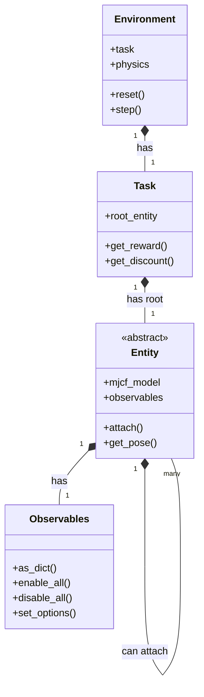

- **Entity**: An abstract base class representing physical objects in the simulation (`[dm_control/composer/entity.py:199]`). Entities encapsulate MuJoCo models, define observables, and can be composed hierarchically.
- **Observables**: Properties of entities that can be exposed to the agent, such as positions, velocities, and forces (`[dm_control/composer/entity.py:70]`).
- **Lifecycle Hooks**: Methods called at specific points during simulation to allow entities to respond to events (`[dm_control/composer/environment.py:33-39]`).
- **Composition**: The ability to attach entities to each other to create complex structures (`[dm_control/composer/entity.py:299-327]`).

Sources: [dm_control/composer/entity.py:199-214](), [dm_control/composer/environment.py:294-315](), [dm_control/composer/task.py:28-50]()

## Natural Language to Code Mapping

This diagram maps high-level framework concepts to concrete codebase symbols and classes.

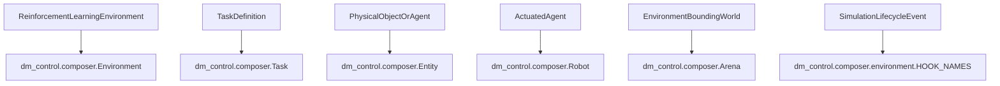

Sources: [dm_control/composer/environment.py:33-40](), [dm_control/composer/entity.py:199-210]()

## Entity Class and Subclasses

The `Entity` class is the foundational class in the framework, designed to represent any physical object in a simulation (`[dm_control/composer/entity.py:199]`). Subclasses implement `_build` (`[dm_control/composer/entity.py:202-233]`) to configure their underlying MJCF representation.

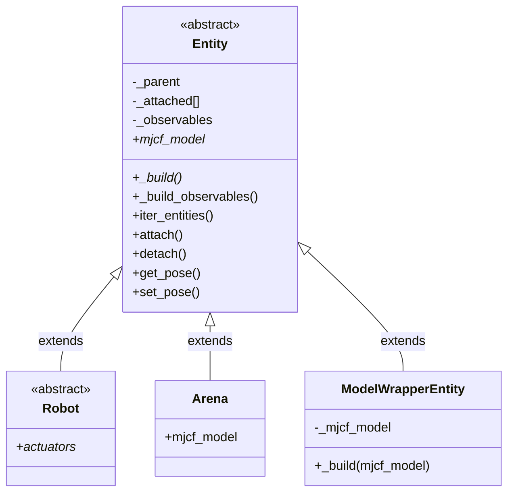

### Key Properties and Methods
- `mjcf_model`: Abstract property returning the entity's MJCF model (`[dm_control/composer/entity.py:394-398]`).
- `observables`: Access to the entity's observable collection (`[dm_control/composer/entity.py:400-405]`).
- `attach(entity, attach_site)`: Attaches a child entity (`[dm_control/composer/entity.py:299-327]`).
- `detach()`: Detaches an entity from its parent (`[dm_control/composer/entity.py:343-353]`).
- `iter_entities(exclude_self)`: Iterates through the entity hierarchy (`[dm_control/composer/entity.py:242-259]`).

Sources: [dm_control/composer/entity.py:199-353](), [dm_control/composer/arena.py]()

## Environment Lifecycle Hooks

The environment execution delegates lifecycle events through `_EnvironmentHooks` (`[dm_control/composer/environment.py:74]`), which scans entity trees for non-trivial hooks defined in `HOOK_NAMES` (`[dm_control/composer/environment.py:33-39]`).

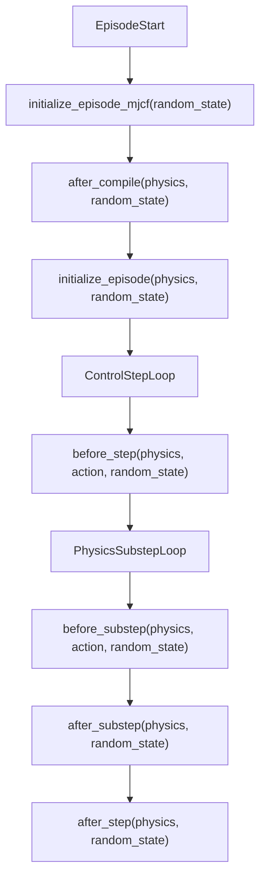

### Lifecycle Hook Functions
- `initialize_episode_mjcf(random_state)`: Called when MJCF model is modified between episodes (`[dm_control/composer/environment.py:110-115]`).
- `after_compile(physics, random_state)`: Called after physics recompilation (`[dm_control/composer/environment.py:117-122]`).
- `initialize_episode(physics, random_state)`: Called at episode initialization (`[dm_control/composer/environment.py:124-130]`).
- `before_step(physics, action, random_state)`: Called before an agent control step (`[dm_control/composer/environment.py:132-141]`).
- `before_substep(physics, action, random_state)`: Called before a physics substep (`[dm_control/composer/environment.py:143-149]`).
- `after_substep(physics, random_state)`: Called after a physics substep (`[dm_control/composer/environment.py:150-155]`).
- `after_step(physics, random_state)`: Called after an agent control step (`[dm_control/composer/environment.py:157-162]`).

Sources: [dm_control/composer/environment.py:33-163]()

## Composing Complex Environments from Reusable Components

Environments are composed hierarchically by combining `Robot`, `Arena`, `Task`, and custom `Entity` instances. When an entity is attached to another via `attach()` (`[dm_control/composer/entity.py:299-327]`), an attachment frame is established, linking their underlying MJCF subtrees.

```mermaid
graph TD
    ParentEntity["ParentEntity"] --> AttachmentSite["AttachmentSite"]
    AttachmentSite --> ChildEntity["ChildEntity"]
    ChildEntity --> GrandchildSite["ChildAttachmentSite"]
    GrandchildSite --> GrandchildEntity["GrandchildEntity"]
```

Sources: [dm_control/composer/entity.py:299-327](), [dm_control/composer/environment.py:294-517]()

---

# Page: Observation System

# Observation System

<details>
<summary>Relevant source files</summary>

The following files were used as context for generating this wiki page:

- [dm_control/composer/__init__.py](dm_control/composer/__init__.py)
- [dm_control/composer/environment.py](dm_control/composer/environment.py)
- [dm_control/composer/environment_test.py](dm_control/composer/environment_test.py)
- [dm_control/composer/observation/fake_physics.py](dm_control/composer/observation/fake_physics.py)
- [dm_control/composer/observation/obs_buffer.py](dm_control/composer/observation/obs_buffer.py)
- [dm_control/composer/observation/observable/base.py](dm_control/composer/observation/observable/base.py)
- [dm_control/composer/observation/observable/base_test.py](dm_control/composer/observation/observable/base_test.py)
- [dm_control/composer/observation/observable/mjcf.py](dm_control/composer/observation/observable/mjcf.py)
- [dm_control/composer/observation/observable/mjcf_test.py](dm_control/composer/observation/observable/mjcf_test.py)
- [dm_control/composer/observation/updater.py](dm_control/composer/observation/updater.py)
- [dm_control/composer/observation/updater_test.py](dm_control/composer/observation/updater_test.py)
- [dm_control/composer/variation/__init__.py](dm_control/composer/variation/__init__.py)
- [dm_control/locomotion/tasks/corridors.py](dm_control/locomotion/tasks/corridors.py)
- [dm_control/locomotion/tasks/go_to_target.py](dm_control/locomotion/tasks/go_to_target.py)
- [dm_control/locomotion/tasks/go_to_target_test.py](dm_control/locomotion/tasks/go_to_target_test.py)
- [dm_control/mjcf/copier_test.py](dm_control/mjcf/copier_test.py)

</details>


The Observation System in `dm_control` provides a flexible framework for defining, capturing, buffering, and processing observations in reinforcement learning environments. This system allows for sophisticated observation behaviors such as delayed sensing, historical buffering, and signal aggregation—capabilities essential for realistic simulations and robust agent learning.

This document details how observations are defined by entities, how they're configured, captured during simulation, and processed before being delivered to reinforcement learning agents.

## Observable Definition

Observables are properties of an entity that can be observed by an agent. Each entity in the composer framework defines its own set of observables, forming the foundation of the observation system.

### Base Observable Types

The system provides several built-in observable types defined in `dm_control/composer/observation/observable/base.py` and `dm_control/composer/observation/observable/mjcf.py`:

1. **Generic**: Wraps any callable that takes a physics object and returns an observation value [dm_control/composer/observation/observable/base.py:156-187]().
2. **MJCFFeature**: Observes specific MuJoCo physics quantities (positions, velocities, etc.) by binding to MJCF elements [dm_control/composer/observation/observable/mjcf.py:43-87]().
3. **MJCFCamera**: Provides camera renderings (RGB, depth, or segmentation) as observations [dm_control/composer/observation/observable/mjcf.py:105-155]().
4. **MujocoFeature**: An observable corresponding to a named MuJoCo feature [dm_control/composer/observation/observable/base.py:195-210]().

### Observable Hierarchy and Code Entities

```mermaid
classDiagram
    class Observable {
        <<abstract>>
        +update_interval
        +buffer_size
        +delay
        +aggregator
        +corruptor
        +enabled
        +array_spec
        +observation_callable(physics, random_state)
        +configure(**kwargs)
    }
    
    Observable <|-- Generic
    Observable <|-- MJCFFeature
    Observable <|-- MJCFCamera
    Observable <|-- MujocoFeature
    
    class Generic {
        +__init__(raw_observation_callable)
        +_callable(physics)
    }
    
    class MJCFFeature {
        +__init__(kind, mjcf_element)
        +_callable(physics)
        +__getitem__(key)
    }
    
    class MJCFCamera {
        +__init__(mjcf_element, height, width, depth, segmentation)
        +array_spec
    }

    class MujocoFeature {
        +__init__(kind, feature_name)
    }
```
Sources: [dm_control/composer/observation/observable/base.py:54-199](), [dm_control/composer/observation/observable/mjcf.py:43-155]()

## Observation Processing Pipeline

The observation system processes raw observations through several stages before delivering them to agents. This is managed by the `Updater` class [dm_control/composer/observation/updater.py:120-125]().

### Buffering and History
The `Updater` creates an `_EnabledObservable` for each active sensor, which wraps a `Buffer` [dm_control/composer/observation/updater.py:32-72]().
1. **Buffer**: Maintains a history of recent observations based on `buffer_size`.
2. **Delay**: Handles delayed delivery of observations. The buffer insertion tracks arrival times and offsets [dm_control/composer/observation/updater.py:161-165]().

### Observation Corruption
The `corruptor` is a callable applied to the observation before it is added to the buffer. This allows for simulating sensor noise [dm_control/composer/observation/observable/base.py:127-135]().

### Aggregation Functions
Buffered observations can be aggregated using methods defined in `AGGREGATORS` [dm_control/composer/observation/observable/base.py:31-37]().

| Aggregator | Description | Preserves Bounds |
| :--- | :--- | :--- |
| `min` | Minimum value across buffer | Yes |
| `max` | Maximum value across buffer | Yes |
| `mean` | Average across buffer | Yes |
| `median` | Median across buffer | Yes |
| `sum` | Sum across buffer | No |

Sources: [dm_control/composer/observation/updater.py:120-165](), [dm_control/composer/observation/observable/base.py:31-37]()

## Observation Update Lifecycle

The `Updater` manages the schedule and synchronization between MuJoCo physics steps and agent control steps.

```mermaid
flowchart TD
    subgraph "Environment_Reset"
        R1["Environment.reset()"] --> R2["Updater.reset(physics, random_state)"]
        R2 --> R3["_EnabledObservable created per enabled sensor"]
        R3 --> R4["Buffer.insert(0, delay, initial_obs)"]
    end
    
    subgraph "Environment_Step"
        S1["Environment.step(action)"] --> S2["Updater.prepare_for_next_control_step()"]
        S2 --> S3["Physics Substeps Loop"]
        S3 --> S4["Updater.update() after each substep"]
        S4 --> S5["Updater.get_observation()"]
    end

    subgraph "Get_Observation_Detail"
        G1["Iterate _EnabledObservable"] --> G2["Buffer.get()"]
        G2 --> G3["Apply Aggregator (if any)"]
        G3 --> G4["Return observation dict/nest"]
    end
```
Sources: [dm_control/composer/observation/updater.py:135-166](), [dm_control/composer/observation/updater.py:236-292]()

### Scheduling Logic
The `Updater` tracks simulation and control steps. Observations are only sampled according to their configured `update_interval` and `delay` parameters [dm_control/composer/observation/updater.py:32-54]().

Sources: [dm_control/composer/observation/updater.py:32-84]()

## Integration with Environment

The `Environment` class in `dm_control/composer/environment.py` acts as the coordinator between tasks, physics, and observations [dm_control/composer/environment.py:165-173]().

### Padding for Delays
When an observation is delayed, the system must provide values for the initial steps of an episode. This is controlled by `ObservationPadding` [dm_control/composer/environment.py:56-59]():
* `ZERO`: Fills the buffer with zeros [dm_control/composer/environment.py:58]().
* `INITIAL_VALUE`: Fills the buffer with the initial value [dm_control/composer/environment.py:57]().

### Observation Specifications
The environment provides an `observation_spec()` which describes the shapes and types of all enabled observations [dm_control/composer/observation/updater.py:167-172](). If an aggregator like `sum` is used, the `Updater` automatically converts `BoundedArray` specs to standard `Array` specs because sums may exceed original bounds [dm_control/composer/observation/updater.py:173-195]().

### Data Flow Diagram

```mermaid
flowchart LR
    P["mjcf.Physics"] -- "raw data" --> O["Observable._callable"]
    O -- "sample" --> C["Corruptor"]
    C -- "corrupted data" --> B["Buffer.insert"]
    B -- "history" --> A["Aggregator"]
    A -- "final value" --> U["Updater.get_observation"]
    U --> E["Environment.step() Result"]
    
    subgraph "Updater_Management"
        S["Updater.update()"] --> O
        V["Updater.observation_spec()"] -- "infers from" --> P
    end
```
Sources: [dm_control/composer/environment.py:165-173](), [dm_control/composer/observation/updater.py:167-234](), [dm_control/composer/observation/updater.py:260-292]()

## Practical Configuration

Observables can be configured with `Variation` objects to randomize sensing properties (like delay or noise) per episode [dm_control/composer/observation/updater.py:74-84]().

Example of configuring an MJCF-based feature in a locomotion task:
```python
walker.observables.add_egocentric_vector(
    'target',
    observable.MJCFFeature('pos', self._target),
    origin_callable=lambda physics: physics.bind(walker.root_body).xpos)
```
Sources: [dm_control/locomotion/tasks/go_to_target.py:117-121](), [dm_control/composer/observation/updater.py:74-84]()

---

# Page: Variation System

# Variation System

<details>
<summary>Relevant source files</summary>

The following files were used as context for generating this wiki page:

- [dm_control/composer/define.py](dm_control/composer/define.py)
- [dm_control/composer/variation/base.py](dm_control/composer/variation/base.py)
- [dm_control/composer/variation/colors.py](dm_control/composer/variation/colors.py)
- [dm_control/composer/variation/deterministic.py](dm_control/composer/variation/deterministic.py)
- [dm_control/composer/variation/distributions.py](dm_control/composer/variation/distributions.py)
- [dm_control/composer/variation/distributions_test.py](dm_control/composer/variation/distributions_test.py)
- [dm_control/composer/variation/math.py](dm_control/composer/variation/math.py)
- [dm_control/composer/variation/noises.py](dm_control/composer/variation/noises.py)
- [dm_control/composer/variation/rotations.py](dm_control/composer/variation/rotations.py)
- [dm_control/composer/variation/variation_broadcaster.py](dm_control/composer/variation/variation_broadcaster.py)
- [dm_control/composer/variation/variation_broadcaster_test.py](dm_control/composer/variation/variation_broadcaster_test.py)
- [dm_control/composer/variation/variation_test.py](dm_control/composer/variation/variation_test.py)
- [dm_control/composer/variation/variation_values.py](dm_control/composer/variation/variation_values.py)
- [dm_control/utils/transformations.py](dm_control/utils/transformations.py)
- [dm_control/utils/transformations_test.py](dm_control/utils/transformations_test.py)

</details>


## Purpose and Scope

The Variation System provides a robust framework for introducing parameterized variability and randomness into simulation environments. It serves as the primary engine for domain randomization within `dm_control`, allowing properties such as physical parameters, initial positions, 3D rotations, colors, noise profiles, and other environment attributes to be systematically randomized across episodes or environment instances to promote robust reinforcement learning policies.

Sources: [dm_control/composer/variation/base.py:16-16](), [dm_control/composer/variation/distributions.py:15-15]()

---

## Core Architecture

The Variation System revolves around a unified `Variation` interface, enabling different types of variations to be composed, nested, and evaluated uniformly. The evaluation pipeline relies on the `evaluate` utility, which traverses nested structures (lists, dictionaries, tuples, and namedtuples) containing callables or constant values [dm_control/composer/variation/variation_values.py:16-35]().

### Class Hierarchy and Code Entities

```mermaid
classDiagram
    class Variation {
        <<abstract>>
        +__call__(initial_value, current_value, random_state)
        +__add__(other)
        +__sub__(other)
        +__mul__(other)
        +__truediv__(other)
        +__getitem__(index)
        +__neg__()
    }
    
    class Distribution {
        <<abstract>>
        +_callable(random_state)
        +single_sample
        +_args
        +_kwargs
    }
    
    class Uniform {
        +__init__(low, high, single_sample)
        +_callable(random_state)
    }

    class Normal {
        +__init__(loc, scale, single_sample)
        +_callable(random_state)
    }

    class UniformQuaternion {
        +__call__(initial_value, current_value, random_state)
    }

    class QuaternionFromAxisAngle {
        +__init__(axis, angle)
        +__call__(initial_value, current_value, random_state)
    }
    
    class Constant {
        +__init__(value)
        +__call__(initial_value, current_value, random_state)
    }

    class Sequence {
        +__init__(values)
        +__call__(initial_value, current_value, random_state)
    }

    class Identity {
        +__call__(initial_value, current_value, random_state)
    }

    class MathOp {
        <<abstract>>
        +_callable*
    }

    class Log {
        +_callable*
    }

    class VariationBroadcaster {
        +__init__(wrapped_variation)
        +get_proxy()
        +_get_value(proxy, random_state)
    }
    
    Variation <|-- Distribution
    Distribution <|-- Uniform
    Distribution <|-- Normal
    Variation <|-- UniformQuaternion
    Variation <|-- QuaternionFromAxisAngle
    Variation <|-- Constant
    Variation <|-- Sequence
    Variation <|-- Identity
    Variation <|-- MathOp
    MathOp <|-- Log
    VariationBroadcaster o-- Variation : wraps
```

Sources: [dm_control/composer/variation/base.py:25-85](), [dm_control/composer/variation/distributions.py:25-157](), [dm_control/composer/variation/deterministic.py:23-70](), [dm_control/composer/variation/rotations.py:27-59](), [dm_control/composer/variation/math.py:26-78](), [dm_control/composer/variation/variation_broadcaster.py:24-55]()

### Evaluation Workflow

When an attribute is configured with a variation, the simulation runtime invokes `variation_values.evaluate()` to resolve its concrete value [dm_control/composer/variation/variation_values.py:21-35]().

```mermaid
flowchart TD
    A["NestedStructureOrVariation"] --> B["variation_values.evaluate(structure, initial_value, current_value, random_state)"]
    B --> C["tree.map_structure()"]
    C --> D{"Is x callable?"}
    D -->|"Yes"| E["x.__call__(initial_value, current_value, random_state)"]
    D -->|"No"| F["Return x as-is"]
    E --> G["Evaluate nested arguments"]
    G --> H["Return Resolved Concrete Value"]
    F --> H
```

Sources: [dm_control/composer/variation/variation_values.py:21-35](), [dm_control/composer/variation/distributions.py:43-60]()

---

## Statistical Distributions

Statistical distributions inherit from the abstract `Distribution` base class [dm_control/composer/variation/distributions.py:25-25](). They wrap NumPy random states and evaluate constructor arguments dynamically, allowing distribution parameters (such as `loc` or `scale`) to themselves be nested variations [dm_control/composer/variation/distributions.py:28-31]().

| Distribution Class | Underlying NumPy Call | Parameters | Description |
|-------------------|----------------------|------------|-------------|
| `Uniform` | `random_state.uniform` [dm_control/composer/variation/distributions.py:97-98]() | `low`, `high`, `single_sample` | Continuous uniform distribution |
| `UniformInteger` | `random_state.randint` [dm_control/composer/variation/distributions.py:101-108]() | `low`, `high`, `single_sample` | Uniform discrete integer distribution |
| `UniformChoice` | `random_state.choice` [dm_control/composer/variation/distributions.py:111-118]() | `choices`, `single_sample` | Random sampling from a collection |
| `Normal` | `random_state.normal` [dm_control/composer/variation/distributions.py:149-156]() | `loc`, `scale`, `single_sample` | Gaussian normal distribution |
| `LogNormal` | `random_state.lognormal` [dm_control/composer/variation/distributions.py:159-166]() | `mean`, `sigma`, `single_sample` | Log-normal distribution |
| `Exponential` | `random_state.exponential` [dm_control/composer/variation/distributions.py:169-176]() | `scale`, `single_sample` | Exponential distribution |
| `Poisson` | `random_state.poisson` [dm_control/composer/variation/distributions.py:179-186]() | `lam`, `single_sample` | Poisson point process distribution |
| `Bernoulli` | `random_state.binomial(1, ...)` [dm_control/composer/variation/distributions.py:189-196]() | `prob`, `single_sample` | Binary Bernoulli trials |

Specialized stochastic variators include:
- `UniformPointOnSphere`: Samples a uniform 3D vector lying strictly on the unit sphere (norm equal to `1.0`) [dm_control/composer/variation/distributions.py:121-135]().
- `BiasedRandomWalk`: Generates time-correlated noise modeled via a zero-mean Ornstein-Uhlenbeck process parameterized by `stdev` and `timescale` [dm_control/composer/variation/distributions.py:203-213]().

Sources: [dm_control/composer/variation/distributions.py:25-213]()

---

## Deterministic Variations

Deterministic variations return predictable or structured values without consuming randomness from `random_state`.

| Class Name | Behavior & Implementation | Sources |
|---|---|---|
| `Constant` | Always returns the static `value` provided at construction, useful for unit testing or fixing specific attributes. | [dm_control/composer/variation/deterministic.py:23-34]() |
| `Sequence` | Iterates through a fixed Python iterable of variations or values cyclically. | [dm_control/composer/variation/deterministic.py:48-63]() |
| `Identity` | Evaluates to the `current_value` passed into the call method, preserving existing states. | [dm_control/composer/variation/deterministic.py:65-67]() |

Sources: [dm_control/composer/variation/deterministic.py:23-70]()

---

## Rotation Variations

Variations governing 3D orientations handle unit quaternions and axis-angle conversions, integrating tightly with `dm_control.utils.transformations` [dm_control/composer/variation/rotations.py:16-21]().

| Class Name | Constructor Arguments | Behavior |
|---|---|---|
| `UniformQuaternion` | None [dm_control/composer/variation/rotations.py:27-37]() | Uniformly samples valid unit quaternions representing 3D rotations. |
| `QuaternionFromAxisAngle` | `axis`, `angle` [dm_control/composer/variation/rotations.py:45-58]() | Constructs a quaternion from independently varied rotation axes and scalar angles. |
| `QuaternionPreMultiply` | `quat`, `cumulative=False` [dm_control/composer/variation/rotations.py:74-92]() | Pre-multiplies a newly sampled quaternion with either the initial or current quaternion value. |
| `QuaternionRotate` | `quat`, `vec=None`, `cumulative=False` [dm_control/composer/variation/rotations.py:106-131]() | Rotates a 3D vector (either static or dynamic) by a sampled quaternion. |

Sources: [dm_control/composer/variation/rotations.py:27-146]()

---

## Noise, Color, and Math Operations

### Noise Variations
Noise meta-variations wrap other variations or base attributes to inject perturbations:
- `Additive`: Adds generated noise values to either `initial_value` or `current_value` depending on the `cumulative` flag [dm_control/composer/variation/noises.py:23-40]().
- `Multiplicative`: Scales base values by generated noise factors [dm_control/composer/variation/noises.py:56-73]().

### Color Variations
Color generators output RGBA or HSV structures:
- `RgbVariation`: Directly samples red, green, blue, and alpha channels [dm_control/composer/variation/colors.py:29-44]().
- `HsvVariation`: Samples in hue-saturation-value space and converts to RGBA [dm_control/composer/variation/colors.py:57-73]().
- `GrayVariation`: Specialization of HSV for grayscale color generation [dm_control/composer/variation/colors.py:92-101]().

### Math Operations
Math wrapper classes (`MathOp`) subclass `Variation` and apply NumPy mathematical functions (e.g., `Log`, `Max`, `Min`, `Norm`) across structured variations automatically [dm_control/composer/variation/math.py:26-98]().

Sources: [dm_control/composer/variation/noises.py:23-87](), [dm_control/composer/variation/colors.py:29-101](), [dm_control/composer/variation/math.py:26-98]()

---

## Advanced Features: Broadcasters and Composition

### Variation Broadcaster

When multiple components in an environment need to share the exact same randomized value during an episode reset or update step (e.g., synchronizing wind speed across multiple entities), `VariationBroadcaster` is utilized [dm_control/composer/variation/variation_broadcaster.py:24-35]().

```mermaid
sequenceDiagram
    participant Caller as Environment Component
    participant Proxy as _BroadcastedValueProxy
    participant Broadcaster as VariationBroadcaster
    participant Wrapped as Distribution

    Caller->>Proxy: __call__(random_state=rs)
    Proxy->>Broadcaster: _get_value(proxy, rs)
    alt Cache is empty for round
        Broadcaster->>Wrapped: evaluate(wrapped_variation, rs)
        Wrapped-->>Broadcaster: new_value
        Broadcaster->>Broadcaster: Cache new_value for all registered proxies
    end
    Broadcaster-->>Proxy: Return cached value
    Proxy-->>Caller: new_value
```

Sources: [dm_control/composer/variation/variation_broadcaster.py:24-65]()

### Arithmetic Composition

`Variation` base classes overload standard Python operators (`__add__`, `__mul__`, `__getitem__`, etc.) [dm_control/composer/variation/base.py:44-84](). This allows expressions such as `Uniform(0, 1) * 2.0 + Constant(5.0)` to construct complex composite variations (`_BinaryOperation`, `_UnaryOperation`, `_GetItemOperation`) without writing custom subclass boilerplate [dm_control/composer/variation/base.py:87-172]().

Sources: [dm_control/composer/variation/base.py:44-172](), [dm_control/composer/variation/variation_test.py:36-93]()

---

# Page: Visualization and Rendering

# Visualization and Rendering

<details>
<summary>Relevant source files</summary>

The following files were used as context for generating this wiki page:

- [dm_control/_render/base.py](dm_control/_render/base.py)
- [dm_control/_render/base_test.py](dm_control/_render/base_test.py)
- [dm_control/_render/executor/render_executor.py](dm_control/_render/executor/render_executor.py)
- [dm_control/composer/observation/obs_buffer_test.py](dm_control/composer/observation/obs_buffer_test.py)
- [dm_control/composer/robot.py](dm_control/composer/robot.py)
- [dm_control/entities/manipulators/base.py](dm_control/entities/manipulators/base.py)
- [dm_control/mjcf/README.md](dm_control/mjcf/README.md)
- [dm_control/viewer/renderer.py](dm_control/viewer/renderer.py)
- [dm_control/viewer/runtime.py](dm_control/viewer/runtime.py)
- [dm_control/viewer/runtime_test.py](dm_control/viewer/runtime_test.py)
- [dm_control/viewer/util.py](dm_control/viewer/util.py)
- [dm_control/viewer/util_test.py](dm_control/viewer/util_test.py)
- [dm_control/viewer/viewer.py](dm_control/viewer/viewer.py)
- [dm_control/viewer/views.py](dm_control/viewer/views.py)

</details>


This page documents the visualization and rendering capabilities in `dm_control`, explaining how simulations can be visually rendered and interacted with. The system provides both programmatic rendering for generating images off-screen and an interactive viewer for real-time visualization and manipulation of simulations.

## Overview

The `dm_control` rendering system is built around MuJoCo's OpenGL-based visualization, providing abstractions for context management, viewport handling, camera controls, and component-based scene rendering. The architecture is designed to handle multiple rendering backends while maintaining thread safety across different components of the application.

```mermaid
flowchart TD
    A[""MuJoCo Physics State""] --> B[""OpenGL Rendering""]
    B --> C1[""Off-screen Rendering""]
    B --> C2[""Interactive Viewer""]
    
    B --> D[""Renderer Selection""]
    D --> E1[""GLFW (GPU)""]
    D --> E2[""EGL (Headless GPU)""]
    D --> E3[""OSMesa (CPU)""]
    
    C1 --> F1[""Image Output""]
    C2 --> F2[""User Interaction""]
    
    G[""Render Settings""] --> B
    H[""Camera Controls""] --> B
    I[""Components & Overlays""] --> B
```

Sources:
- [dm_control/_render/__init__.py:1-109]()
- [dm_control/_render/constants.py:1-33]()
- [dm_control/viewer/renderer.py:1-30]()

## Rendering Architecture

### Backend Selection

The rendering system automatically selects an appropriate OpenGL backend based on system capabilities and environment variables. The backends are attempted in this priority order:

1. **GLFW**: GPU-accelerated rendering with window support. [dm_control/_render/constants.py:29-29]()
2. **EGL**: Headless GPU-accelerated rendering. [dm_control/_render/constants.py:30-30]()
3. **OSMesa**: Software rendering (CPU-based). [dm_control/_render/constants.py:28-28]()

You can explicitly select a backend by setting the `MUJOCO_GL` environment variable to one of: `'glfw'`, `'egl'`, or `'osmesa'`. [dm_control/_render/__init__.py:31-31]()

```mermaid
flowchart TD
    A[""MUJOCO_GL Environment Variable""] -->|"Set"| B{""Check Specified Backend""}
    A -->|"Not Set"| C{""Auto-Select Backend""}
    
    B -->|"'glfw'"| D[""GLFW Backend""]
    B -->|"'egl'"| E[""EGL Backend""]
    B -->|"'osmesa'"| F[""OSMesa Backend""]
    
    C -->|"Try first"| D
    C -->|"Try second"| E
    C -->|"Try third"| F
    
    D --> G[""GPU Rendering w/ Window Support""]
    E --> H[""Headless GPU Rendering""]
    F --> I[""CPU-based Software Rendering""]
```

Sources:
- [dm_control/_render/__init__.py:15-109]()
- [dm_control/_render/constants.py:18-33]()

### OpenGL Context Management

The rendering system uses a context management system to handle thread-safe access to OpenGL resources. The `ContextBase` class [dm_control/_render/base.py:45-45]() provides a common interface for different backends, while specific implementations handle platform-specific details.

*   `EGLContext`: Headless GPU context using PyOpenGL [dm_control/_render/pyopengl/egl_renderer.py:93-93]().
*   `OSMesaContext`: CPU-based software rendering context [dm_control/_render/pyopengl/osmesa_renderer.py:44-44]().

```mermaid
classDiagram
    class ContextBase {
        +__init__(max_width, max_height, render_executor_class)
        +make_current()
        +free()
        +increment_refcount()
        +decrement_refcount()
        -_platform_init(max_width, max_height)*
        -_platform_make_current()*
        -_platform_free()*
    }
    
    class EGLContext {
        -_context
        -_platform_init(max_width, max_height)
        -_platform_make_current()
        -_platform_free()
    }
    
    class OSMesaContext {
        -_context
        -_buffer
        -_platform_init(max_width, max_height)
        -_platform_make_current()
        -_platform_free()
    }
    
    ContextBase <|-- EGLContext
    ContextBase <|-- OSMesaContext
```

Sources:
- [dm_control/_render/base.py:16-166]()
- [dm_control/_render/pyopengl/egl_renderer.py:16-140]()
- [dm_control/_render/pyopengl/osmesa_renderer.py:16-86]()

### Threading Model

Rendering in OpenGL requires operations to be performed from the thread where the context is current. The `RenderExecutor` [dm_control/_render/executor/__init__.py:37-37]() ensures thread safety when rendering from multiple threads.

For details, see [Rendering Pipeline](#3.1).

Sources:
- [dm_control/_render/base.py:122-151]()
- [dm_control/_render/executor/__init__.py:16-51]()

## Rendering Components

### Renderer

The `OffScreenRenderer` [dm_control/viewer/renderer.py:132-132]() manages the process of rendering MuJoCo scenes to pixel buffers. It utilizes a `BaseRenderer` architecture that allows for modular `Component` [dm_control/viewer/renderer.py:98-98]() objects to draw additional content like overlays.

```mermaid
classDiagram
    class BaseRenderer {
        +components: QuietSet
        +screen_capture_components: QuietSet
        +__init__()
        -_render_components(context, viewport)
    }
    
    class OffScreenRenderer {
        -_surface
        -_model
        -_mujoco_context
        -_rgb_buffer
        -_pixels
        +__init__(model, surface)
        +render(viewport, scene)
        +release()
        +pixels
    }
    
    class Component {
        <<abstract>>
        +render(context, viewport)*
    }
    
    BaseRenderer <|-- OffScreenRenderer
    Component --o BaseRenderer
```

Sources:
- [dm_control/viewer/renderer.py:68-207]()

### Camera System

The `SceneCamera` [dm_control/viewer/renderer.py:307-307]() class encapsulates camera functionality, allowing control over viewpoint and managing the rendering of MuJoCo scenes. It supports various modes including `set_freelook_mode`, `set_tracking_mode`, and `set_fixed_mode`. [dm_control/viewer/renderer.py:423-446]()

### Viewport

The `Viewport` class [dm_control/viewer/renderer.py:613-613]() handles screen-to-viewport coordinate conversions and manages the dimensions of the rendering area.

Sources:
- [dm_control/viewer/renderer.py:307-610]()
- [dm_control/viewer/renderer.py:613-686]()

## Viewer Interface

The interactive `Viewer` [dm_control/viewer/viewer.py:94-94]() provides a graphical interface for exploring simulations. It coordinates the `SceneCamera`, `ManipulationController`, and `FreeCameraController` to handle user input and scene updates.

For details, see [Viewer Interface](#3.2).

```mermaid
classDiagram
    class Viewer {
        -_viewport: Viewport
        -_render_settings: RenderSettings
        -_camera: SceneCamera
        -_manipulator: ManipulationController
        -_free_camera: FreeCameraController
        +initialize(physics, renderer_instance, touchpad)
        +render()
    }
    
    class FreeCameraController {
        +activate()
        +deactivate()
        +zoom(zoom_factor)
    }
    
    class ManipulationController {
        +select()
        +perturbation
    }
    
    Viewer --> SceneCamera
    Viewer --> FreeCameraController
    Viewer --> ManipulationController
```

Sources:
- [dm_control/viewer/viewer.py:94-278]()
- [dm_control/viewer/viewer.py:340-458]()

### User Input Mapping

The viewer uses an `InputMap` [dm_control/viewer/viewer.py:116-116]() to connect mouse and keyboard actions to simulation logic.

| Action | Default Binding | Description |
|--------|----------------|-------------|
| Pan Camera | Right mouse button | Move camera up/down/left/right [dm_control/viewer/viewer.py:28-31]() |
| Rotate Camera | Left mouse button | Rotate camera viewpoint [dm_control/viewer/viewer.py:50-50]() |
| Zoom to Scene | Ctrl + A | Zoom to show entire scene [dm_control/viewer/viewer.py:58-58]() |
| Track Object | Ctrl + Double-click Right | Track selected body [dm_control/viewer/viewer.py:53-54]() |

Sources:
- [dm_control/viewer/viewer.py:28-78]()
- [dm_control/viewer/viewer.py:162-224]()

## Integration with Components and Overlays

The rendering system supports component-based extensions through the `Component` interface, allowing custom visualizations to be added to the scene. The `ViewportLayout` [dm_control/viewer/views.py:125-125]() acts as a manager for these views.

```mermaid
classDiagram
    class Component {
        <<abstract>>
        +render(context, viewport)*
    }
    
    class ViewportLayout {
        +add(view, location)
        +render(context, viewport)
    }
    
    class ColumnTextView {
        +render(context, viewport, location)
    }
    
    Component <|-- ViewportLayout
    ViewportLayout o-- ColumnTextView
```

Sources:
- [dm_control/viewer/renderer.py:98-113]()
- [dm_control/viewer/views.py:32-176]()

---

# Page: Rendering Pipeline

# Rendering Pipeline

<details>
<summary>Relevant source files</summary>

The following files were used as context for generating this wiki page:

- [dm_control/_render/__init__.py](dm_control/_render/__init__.py)
- [dm_control/_render/base.py](dm_control/_render/base.py)
- [dm_control/_render/base_test.py](dm_control/_render/base_test.py)
- [dm_control/_render/constants.py](dm_control/_render/constants.py)
- [dm_control/_render/executor/__init__.py](dm_control/_render/executor/__init__.py)
- [dm_control/_render/executor/render_executor.py](dm_control/_render/executor/render_executor.py)
- [dm_control/_render/executor/render_executor_test.py](dm_control/_render/executor/render_executor_test.py)
- [dm_control/_render/glfw_renderer_test.py](dm_control/_render/glfw_renderer_test.py)
- [dm_control/_render/pyopengl/__init__.py](dm_control/_render/pyopengl/__init__.py)
- [dm_control/_render/pyopengl/egl_ext.py](dm_control/_render/pyopengl/egl_ext.py)
- [dm_control/_render/pyopengl/egl_renderer.py](dm_control/_render/pyopengl/egl_renderer.py)
- [dm_control/_render/pyopengl/osmesa_renderer.py](dm_control/_render/pyopengl/osmesa_renderer.py)
- [dm_control/composer/observation/obs_buffer_test.py](dm_control/composer/observation/obs_buffer_test.py)
- [dm_control/composer/robot.py](dm_control/composer/robot.py)
- [dm_control/entities/manipulators/base.py](dm_control/entities/manipulators/base.py)
- [dm_control/mjcf/README.md](dm_control/mjcf/README.md)
- [dm_control/mujoco/engine.py](dm_control/mujoco/engine.py)
- [dm_control/mujoco/engine_test.py](dm_control/mujoco/engine_test.py)
- [dm_control/mujoco/wrapper/core.py](dm_control/mujoco/wrapper/core.py)
- [dm_control/mujoco/wrapper/core_test.py](dm_control/mujoco/wrapper/core_test.py)
- [dm_control/mujoco/wrapper/util.py](dm_control/mujoco/wrapper/util.py)

</details>


The purpose of this page is to detail the rendering pipeline and backends in `dm_control`: EGL (headless GPU), GLFW (windowed), and OSMesa (software). It covers the rendering context lifecycle, depth and segmentation rendering modes, and the render executor threading model that ensures thread safety across OpenGL contexts.

## Overview

The rendering pipeline converts a MuJoCo physics state into visual output using OpenGL. It supports different rendering modes (RGB, depth, segmentation), multiple camera views, and operates on different hardware configurations through pluggable rendering backends.

### System Architecture and Code Entities

The following diagram bridges the high-level rendering concepts to the specific classes and functions in the codebase.

```mermaid
flowchart TD
    subgraph "User API Space"
        A["Physics.render() [dm_control/mujoco/engine.py]"]
        B["Camera.render() [dm_control/mujoco/engine.py]"]
    end
    
    subgraph "MuJoCo Binding Space"
        C["mujoco.MjvScene"]
        D["mujoco.MjvCamera"]
        E["mujoco.MjrContext"]
    end
    
    subgraph "Backend Space"
        G["ContextBase [dm_control/_render/base.py]"]
        H["GLFWContext [dm_control/_render/glfw_renderer.py]"]
        I["EGLContext [dm_control/_render/pyopengl/egl_renderer.py]"]
        J["OSMesaContext [dm_control/_render/pyopengl/osmesa_renderer.py]"]
    end
    
    A -->|calls| B
    B -->|populates| C
    B -->|configures| D
    B -->|executes via| E
    E -->|managed by| G
    G <|-- H
    G <|-- I
    G <|-- J
```

Sources: [dm_control/mujoco/engine.py:178-234](), [dm_control/_render/__init__.py:16-109](), [dm_control/_render/base.py:45-51]()

## Rendering Backends

The pipeline supports three backends to accommodate various environments. Selection is controlled by the `MUJOCO_GL` environment variable [dm_control/_render/__init__.py:31-31]().

| Backend | Implementation Class | Environment Variable | Use Case |
| :--- | :--- | :--- | :--- |
| **GLFW** | `GLFWContext` | `MUJOCO_GL=glfw` | Windowed/Interactive visualization. |
| **EGL** | `EGLContext` | `MUJOCO_GL=egl` | Headless GPU-accelerated rendering. |
| **OSMesa** | `OSMesaContext` | `MUJOCO_GL=osmesa` | Software-based CPU rendering. |

If `MUJOCO_GL` is unset, `dm_control` attempts to load them in the order: GLFW > EGL > OSMesa [dm_control/_render/__init__.py:96-101]().

### EGL (Headless GPU)
The `EGLContext` initializes a headless display directly on a GPU device [dm_control/_render/pyopengl/egl_renderer.py:43-70](). It can be pinned to a specific GPU using the `MUJOCO_EGL_DEVICE_ID` environment variable [dm_control/_render/pyopengl/egl_renderer.py:46-55]().

Sources: [dm_control/_render/__init__.py:61-66](), [dm_control/_render/pyopengl/egl_renderer.py:93-100]()

## Core Components and Lifecycle

### Physics and MjrContext
The `Physics` class manages the lifecycle of rendering contexts (`Contexts` named tuple containing GL and MuJoCo contexts) [dm_control/mujoco/engine.py:62-62](). Contexts are lazily created during the first call to `render()` and thread-safely guarded via `_contexts_lock` [dm_control/mujoco/engine.py:105-114]().

### Camera Lifecycle
The `Camera` class manages the MuJoCo visualization structures:
*   **`MjvScene`**: Holds the geoms and visual objects to be rendered [dm_control/mujoco/engine.py:818-850]().
*   **`MjvCamera`**: Defines the viewpoint, distance, azimuth, and elevation [dm_control/mujoco/engine.py:68-68]().
*   **`MjvOption`**: Controls visualization flags such as frame rendering and wireframes [dm_control/mujoco/engine_test.py:101-105]().

Sources: [dm_control/mujoco/engine.py:83-114](), [dm_control/mujoco/engine.py:818-850]()

## Render Executor Threading Model

Rendering operations require strict adherence to OpenGL thread-affinity rules. `dm_control` solves this via `BaseRenderExecutor` and its subclasses [dm_control/_render/executor/render_executor.py:60-116]().

*   **`PassthroughRenderExecutor`**: Executes rendering calls on the calling thread; used by backends like `EGLContext` [dm_control/_render/pyopengl/egl_renderer.py:100-100](), [dm_control/_render/executor/render_executor.py:118-146]().
*   **`OffloadingRenderExecutor`**: Maintains a dedicated background thread where the OpenGL context is created and made current [dm_control/_render/executor/render_executor.py:170-218]().
*   **`make_current()`**: A context manager in `ContextBase` that verifies thread ownership, binds the context via `_platform_make_current()`, and yields an execution context [dm_control/_render/base.py:123-150]().

Sources: [dm_control/_render/base.py:48-67](), [dm_control/_render/executor/render_executor.py:16-34]()

## Rendering Modes and Data Flow

The pipeline supports three distinct output modes via `physics.render()` [dm_control/mujoco/engine.py:178-190]():

1.  **RGB**: Returns a `uint8` array of shape `(height, width, 3)`.
2.  **Depth**: Returns a `float32` array of shape `(height, width)` containing distances in meters. Non-linear Z-buffer values are converted to linear metric depths [dm_control/mujoco/engine.py:895-902]().
3.  **Segmentation**: Returns an `int32` array of shape `(height, width, 2)`.
    *   `channel 0`: Object ID (e.g., geom ID, site ID) [dm_control/mujoco/engine_test.py:118-127]().
    *   `channel 1`: Object Type (defined by `mjtObj` enum) [dm_control/mujoco/engine_test.py:98-100]().

### Data Flow Diagram

```mermaid
sequenceDiagram
    participant P as Physics.render() [engine.py]
    participant C as Camera.update() [engine.py]
    participant E as BaseRenderExecutor [render_executor.py]
    participant GL as ContextBase [base.py]
    
    P->>C: Prepare scene (mjv_updateScene)
    P->>E: make_current()
    E->>GL: _platform_make_current()
    P->>GL: mjr_render()
    P->>GL: mjr_readPixels()
    GL-->>P: Raw Pixel Buffer
    P->>P: np.flipud (Vertical Flip)
    P-->>P: Depth/Segmentation Conversion
```

Sources: [dm_control/mujoco/engine.py:818-924](), [dm_control/_render/base.py:123-154](), [dm_control/_render/executor/render_executor.py:60-116]()

## Implementation Details

### Scene Callbacks
Users can inject custom geometry or modify the scene dynamically by passing a `scene_callback` function to `render()`. This callback is invoked immediately after the scene is updated (`mjv_updateScene`) and before it is rasterized [dm_control/mujoco/engine_test.py:142-151]().

### Error Handling
If an invalid OpenGL backend is requested or missing dependencies prevent initialization, `_render` raises a `RuntimeError` or `ImportError` [dm_control/_render/__init__.py:54-87](). Inside `Physics`, the `check_invalid_state` context manager catches simulation warnings during rendering steps [dm_control/mujoco/engine.py:172-176]().

### Thread Safety
To prevent race conditions when sharing rendering contexts across threads, `Physics` uses `_contexts_lock` [dm_control/mujoco/engine.py:113-113](), while `base.py` tracks active contexts per thread via `_CURRENT_CONTEXT_FOR_THREAD` [dm_control/_render/base.py:41-41]().

Sources: [dm_control/mujoco/engine.py:107-114](), [dm_control/_render/__init__.py:54-87](), [dm_control/_render/base.py:41-41]()

---

# Page: Viewer Interface

# Viewer Interface

<details>
<summary>Relevant source files</summary>

The following files were used as context for generating this wiki page:

- [dm_control/mjcf/debugging_test.py](dm_control/mjcf/debugging_test.py)
- [dm_control/suite/explore.py](dm_control/suite/explore.py)
- [dm_control/suite/wrappers/action_noise.py](dm_control/suite/wrappers/action_noise.py)
- [dm_control/suite/wrappers/action_noise_test.py](dm_control/suite/wrappers/action_noise_test.py)
- [dm_control/viewer/README.md](dm_control/viewer/README.md)
- [dm_control/viewer/__init__.py](dm_control/viewer/__init__.py)
- [dm_control/viewer/application.py](dm_control/viewer/application.py)
- [dm_control/viewer/application_test.py](dm_control/viewer/application_test.py)
- [dm_control/viewer/gui/__init__.py](dm_control/viewer/gui/__init__.py)
- [dm_control/viewer/gui/base.py](dm_control/viewer/gui/base.py)
- [dm_control/viewer/gui/base_test.py](dm_control/viewer/gui/base_test.py)
- [dm_control/viewer/gui/fullscreen_quad.py](dm_control/viewer/gui/fullscreen_quad.py)
- [dm_control/viewer/gui/glfw_gui.py](dm_control/viewer/gui/glfw_gui.py)
- [dm_control/viewer/gui/glfw_gui_test.py](dm_control/viewer/gui/glfw_gui_test.py)
- [dm_control/viewer/renderer.py](dm_control/viewer/renderer.py)
- [dm_control/viewer/renderer_test.py](dm_control/viewer/renderer_test.py)
- [dm_control/viewer/runtime.py](dm_control/viewer/runtime.py)
- [dm_control/viewer/runtime_test.py](dm_control/viewer/runtime_test.py)
- [dm_control/viewer/user_input.py](dm_control/viewer/user_input.py)
- [dm_control/viewer/user_input_test.py](dm_control/viewer/user_input_test.py)
- [dm_control/viewer/util.py](dm_control/viewer/util.py)
- [dm_control/viewer/util_test.py](dm_control/viewer/util_test.py)
- [dm_control/viewer/viewer.py](dm_control/viewer/viewer.py)
- [dm_control/viewer/viewer_test.py](dm_control/viewer/viewer_test.py)
- [dm_control/viewer/views.py](dm_control/viewer/views.py)
- [dm_control/viewer/views_test.py](dm_control/viewer/views_test.py)

</details>


## Purpose and Scope

The Viewer Interface in `dm_control` provides an interactive visualization system for MuJoCo physics simulations. It enables users to inspect, navigate, and manipulate physics environments using the GLFW windowing system, a robust camera control stack, a physics perturbation mechanism, configurable rendering flags, and 2D overlay views. This page details the implementation of the `Viewer` class [dm_control/viewer/viewer.py:94](), runtime execution [dm_control/viewer/runtime.py:85](), windowing integration via `glfw_gui` [dm_control/viewer/gui/glfw_gui.py:164](), and rendering overlays [dm_control/viewer/views.py:61]().

Sources: [dm_control/viewer/viewer.py:94-110](), [dm_control/viewer/runtime.py:85-112](), [dm_control/viewer/gui/glfw_gui.py:164-187](), [dm_control/viewer/views.py:61-91]()

---

## Architecture Overview

The interactive viewer bridges application-level orchestration (`Application`) with window management (`GlfwWindow`), runtime control (`Runtime`), and viewport rendering (`Viewer`).

```mermaid
graph TD
    APP["application.Application"] --> WIN["gui.glfw_gui.GlfwWindow"]
    APP --> RT["runtime.Runtime"]
    APP --> VW["viewer.Viewer"]
    WIN --> MSE["gui.glfw_gui.GlfwMouse"]
    WIN --> KBD["gui.glfw_gui.GlfwKeyboard"]
    VW --> CAM["renderer.SceneCamera"]
    VW --> MAN["viewer.ManipulationController"]
    VW --> FCC["viewer.FreeCameraController"]
    VW --> REN["renderer.BaseRenderer"]
```
Sources: [dm_control/viewer/application.py:179-203](), [dm_control/viewer/viewer.py:94-159](), [dm_control/viewer/gui/glfw_gui.py:60-163]()

---

## Viewer Class and Camera Controllers

The `Viewer` class [dm_control/viewer/viewer.py:94]() manages input mappings, viewport sizing, and scene rendering. It instantiates camera controllers that govern how the viewpoint reacts to user interactions.

```mermaid
graph LR
    IM["user_input.InputMap"] --> FCC["viewer.FreeCameraController"]
    IM --> MAN["viewer.ManipulationController"]
    IM --> CSC["viewer.CameraSelector"]
    FCC --> SC["renderer.SceneCamera"]
    CSC --> SC
    MAN --> PER["renderer.Perturbation"]
```
Sources: [dm_control/viewer/viewer.py:97-159](), [dm_control/viewer/user_input.py:1-50]()

*   **Free Camera**: Permits unconstrained 6-DOF translation and rotation around a focal point.
*   **Tracking Camera**: Follows a specific body index (`mjvCamera.trackbodyid`) [dm_control/viewer/renderer.py:476-484]().
*   **Fixed Camera**: Cycles through camera slots defined directly in the MJCF model (`0` to `model.ncam - 1`).

Sources: [dm_control/viewer/viewer.py:94-160](), [dm_control/viewer/renderer.py:396-410]()

---

## Perturbation System and Object Manipulation

Direct interaction with bodies in the physics simulation is handled via the perturbation subsystem (`Perturbation` and `ManipulationController`). When active, user drag operations inject forces and torques into `mjData` via MuJoCo's native perturbation routines (`mjv_initPerturb`, `mjv_movePerturb`) [dm_control/viewer/renderer_test.py:123-162]().

Sources: [dm_control/viewer/renderer_test.py:110-183]()

---

## Render Settings and Visualization Flags

Rendering behavior is controlled by `RenderSettings` and MuJoCo visual options (`mjvOption`, `mjvScene.flags`) [dm_control/viewer/renderer.py:41-48](). Users can toggle geom group visibility (`_GEOM_GROUPS`) [dm_control/viewer/viewer.py:69](), site group visibility (`_SITE_GROUPS`) [dm_control/viewer/viewer.py:71](), and rendering flags (such as shadow, reflection, and skybox) [dm_control/viewer/renderer.py:44-46]() via mapped hotkeys.

Sources: [dm_control/viewer/viewer.py:65-78](), [dm_control/viewer/renderer.py:41-48]()

---

## 2D Overlay Views and User Interface

The `views` module [dm_control/viewer/views.py:15]() and `application.py` [dm_control/viewer/application.py:15]() supply 2D heads-up display (HUD) panels rendered directly onto the OpenGL framebuffer using `mujoco.mjr_overlay` [dm_control/viewer/views.py:87]().

*   **ColumnTextView**: Renders structured two-column key-value pairs (such as application status, CPU timing, FPS, and active camera name) [dm_control/viewer/views.py:61-90]().
*   **ViewportLayout**: Manages spatial placement of views across corner quadrants via `PanelLocation` [dm_control/viewer/views.py:25-30](), [dm_control/viewer/views.py:125-176]().
*   **MujocoDepthBuffer**: Subsamples and visualizes the scene depth buffer as a picture-in-picture overlay [dm_control/viewer/views.py:92-123]().

Sources: [dm_control/viewer/views.py:25-176](), [dm_control/viewer/application.py:49-172]()

---

# Page: Locomotion Framework

# Locomotion Framework

<details>
<summary>Relevant source files</summary>

The following files were used as context for generating this wiki page:

- [dm_control/composer/entity.py](dm_control/composer/entity.py)
- [dm_control/composer/entity_test.py](dm_control/composer/entity_test.py)
- [dm_control/locomotion/README.md](dm_control/locomotion/README.md)
- [dm_control/locomotion/arenas/bowl_test.py](dm_control/locomotion/arenas/bowl_test.py)
- [dm_control/locomotion/examples/basic_rodent_2020.py](dm_control/locomotion/examples/basic_rodent_2020.py)
- [dm_control/locomotion/mocap/props.py](dm_control/locomotion/mocap/props.py)
- [dm_control/locomotion/props/__init__.py](dm_control/locomotion/props/__init__.py)
- [dm_control/locomotion/props/target_sphere.py](dm_control/locomotion/props/target_sphere.py)
- [dm_control/locomotion/props/target_sphere_test.py](dm_control/locomotion/props/target_sphere_test.py)
- [dm_control/locomotion/tasks/escape_test.py](dm_control/locomotion/tasks/escape_test.py)
- [dm_control/locomotion/tasks/reference_pose/tracking_test.py](dm_control/locomotion/tasks/reference_pose/tracking_test.py)
- [dm_control/locomotion/tasks/reference_pose/utils.py](dm_control/locomotion/tasks/reference_pose/utils.py)
- [dm_control/locomotion/walkers/base.py](dm_control/locomotion/walkers/base.py)
- [dm_control/locomotion/walkers/base_test.py](dm_control/locomotion/walkers/base_test.py)

</details>


The Locomotion Framework is a specialized component of `dm_control` that provides tools and abstractions for building embodied agents and environments centered around movement [dm_control/locomotion/README.md:1-8](). It extends the core Composer framework with components specifically designed for simulating walking, running, jumping, and multi-agent behaviors in physics-based environments [dm_control/locomotion/README.md:1-8]().

For information about the core physics engine integration, see [Physics Engine](#2.1). For details on the general entity-component system, see [Entity-Component Framework](#2.3).

## Architecture Overview

The framework facilitates the creation of environments where **walkers** perform a **task** in an **arena** [dm_control/locomotion/README.md:15-28]().

Diagram Title: Locomotion System Architecture
```mermaid
graph TD
    subgraph "Code Entity Space"
        Task["dm_control.locomotion.tasks"]
        Walker["dm_control.locomotion.walkers.base.Walker"]
        Arena["dm_control.locomotion.arenas"]
        Prop["dm_control.locomotion.props.target_sphere.TargetSphere"]
        Env["composer.Environment"]
    end

    Task -->|"contains"| Walker
    Task -->|"contains"| Arena
    Task -->|"manages"| Prop
    
    Walker -->|"provides"| Obs["WalkerObservables"]
    Walker -->|"defines"| Act["Actuators"]
    
    Arena -->|"defines"| Terrain["Procedural Terrain"]
    
    Env --> Task
```
Sources: [dm_control/locomotion/README.md:15-28](), [dm_control/locomotion/examples/basic_rodent_2020.py:19-31]()

## Walker System

Walkers are detached bodies that can move around in the environment [dm_control/locomotion/README.md:20-21](). The system provides a standardized interface (`Walker` base class extending `composer.Robot`) for diverse morphologies, from humanoid robots to virtual rodents [dm_control/locomotion/walkers/base.py:68-75]().

Features include egocentric transforms (`transform_vec_to_egocentric_frame`, `transform_xmat_to_egocentric_frame`) [dm_control/locomotion/walkers/base.py:77-124](), specialized observables covering proprioception and kinematic sensors (`WalkerObservables`) [dm_control/locomotion/walkers/base.py:157-196](), and action specification handling [dm_control/locomotion/walkers/base.py:136-150]().

For details, see [Walker System](#4.1).

Sources: [dm_control/locomotion/walkers/base.py:68-196]()

## Arenas

Arenas refer to the surroundings in which walkers and other objects exist [dm_control/locomotion/README.md:23-24](). They manage the physical floor, walls, and procedural terrain generation.

| Arena Type | Description |
| :--- | :--- |
| **Floor** | A simple flat plane with configurable aesthetics [dm_control/locomotion/examples/basic_rodent_2020.py:148-150](). |
| **Corridors** | Linear environments that can include gaps, walls, or obstacles [dm_control/locomotion/examples/basic_rodent_2020.py:71-76](). |
| **Mazes** | Complex layouts generated using `labmaze`, supporting multiple rooms and targets [dm_control/locomotion/examples/basic_rodent_2020.py:106-117](). |
| **Bowl** | A bowl-shaped terrain used for "escape" tasks [dm_control/locomotion/examples/basic_rodent_2020.py:45-47](). |

For details on procedural generation and covering utilities, see [Arenas](#4.2).

Sources: [dm_control/locomotion/examples/basic_rodent_2020.py:21-31](), [dm_control/locomotion/examples/basic_rodent_2020.py:45-150]()

## Locomotion Tasks

Tasks specify observations, rewards, and environment lifecycle logic (initialization and termination) [dm_control/locomotion/README.md:26-28](). Built-in tasks include `RunThroughCorridor`, `Escape`, `ManyGoalsMaze`, and `TwoTouch` [dm_control/locomotion/examples/basic_rodent_2020.py:50-166]().

Tasks frequently utilize **Props**, such as `TargetSphere`, which is a non-colliding sphere activated through touch that updates its activation state and material appearance [dm_control/locomotion/props/target_sphere.py:22-112]().

For details on reward shaping and task configuration, see [Locomotion Tasks](#4.3).

Sources: [dm_control/locomotion/props/target_sphere.py:22-112](), [dm_control/locomotion/examples/basic_rodent_2020.py:37-171]()

## Specialized Subsystems

The locomotion framework includes advanced modules for multi-agent games and imitation learning:

- **Soccer Environment**: A multi-agent competitive environment featuring `Pitch` arenas, `PositionDetector`, and `SoccerBall` entities [dm_control/locomotion/README.md:36-55](). For details, see [Soccer Environment](#4.4).
- **Motion Capture Tracking**: A system for training walkers to mimic motion capture trajectories using reference pose tracking tasks, dataset collections (`ClipCollection`), and utility initializers [dm_control/locomotion/tasks/reference_pose/utils.py:22-71](), [dm_control/locomotion/tasks/reference_pose/tracking_test.py:63-74](). For details, see [Motion Capture Tracking](#4.5).

Sources: [dm_control/locomotion/tasks/reference_pose/utils.py:22-71](), [dm_control/locomotion/tasks/reference_pose/tracking_test.py:63-74]()

## Quickstart Example

The following example demonstrates loading a pre-configured locomotion environment using the `basic_cmu_2019` example module [dm_control/locomotion/README.md:36-55]().

```python
from dm_control import composer
from dm_control.locomotion.examples import basic_cmu_2019
import numpy as np

# Build an environment where a humanoid runs through walls
env = basic_cmu_2019.cmu_humanoid_run_walls()

# Reset and step
time_step = env.reset()
action_spec = env.action_spec()
while not time_step.last():
  action = np.random.uniform(action_spec.minimum, action_spec.maximum, size=action_spec.shape)
  time_step = env.step(action)
```

Sources: [dm_control/locomotion/README.md:36-55]()

---

# Page: Walker System

# Walker System

<details>
<summary>Relevant source files</summary>

The following files were used as context for generating this wiki page:

- [dm_control/composer/entity.py](dm_control/composer/entity.py)
- [dm_control/composer/entity_test.py](dm_control/composer/entity_test.py)
- [dm_control/locomotion/examples/__init__.py](dm_control/locomotion/examples/__init__.py)
- [dm_control/locomotion/mocap/props.py](dm_control/locomotion/mocap/props.py)
- [dm_control/locomotion/tasks/__init__.py](dm_control/locomotion/tasks/__init__.py)
- [dm_control/locomotion/tasks/reference_pose/tracking_test.py](dm_control/locomotion/tasks/reference_pose/tracking_test.py)
- [dm_control/locomotion/tasks/reference_pose/utils.py](dm_control/locomotion/tasks/reference_pose/utils.py)
- [dm_control/locomotion/walkers/__init__.py](dm_control/locomotion/walkers/__init__.py)
- [dm_control/locomotion/walkers/ant.py](dm_control/locomotion/walkers/ant.py)
- [dm_control/locomotion/walkers/assets/dog_v2/add_torque_actuators.py](dm_control/locomotion/walkers/assets/dog_v2/add_torque_actuators.py)
- [dm_control/locomotion/walkers/assets/dog_v2/build_back_legs.py](dm_control/locomotion/walkers/assets/dog_v2/build_back_legs.py)
- [dm_control/locomotion/walkers/assets/dog_v2/build_dog.py](dm_control/locomotion/walkers/assets/dog_v2/build_dog.py)
- [dm_control/locomotion/walkers/assets/dog_v2/build_front_legs.py](dm_control/locomotion/walkers/assets/dog_v2/build_front_legs.py)
- [dm_control/locomotion/walkers/assets/dog_v2/build_neck.py](dm_control/locomotion/walkers/assets/dog_v2/build_neck.py)
- [dm_control/locomotion/walkers/assets/dog_v2/build_tail.py](dm_control/locomotion/walkers/assets/dog_v2/build_tail.py)
- [dm_control/locomotion/walkers/assets/dog_v2/build_torso.py](dm_control/locomotion/walkers/assets/dog_v2/build_torso.py)
- [dm_control/locomotion/walkers/assets/dog_v2/create_skin.py](dm_control/locomotion/walkers/assets/dog_v2/create_skin.py)
- [dm_control/locomotion/walkers/assets/dog_v2/dog.xml](dm_control/locomotion/walkers/assets/dog_v2/dog.xml)
- [dm_control/locomotion/walkers/assets/dog_v2/dog_base.xml](dm_control/locomotion/walkers/assets/dog_v2/dog_base.xml)
- [dm_control/locomotion/walkers/assets/dog_v2/dog_skin.skn](dm_control/locomotion/walkers/assets/dog_v2/dog_skin.skn)
- [dm_control/locomotion/walkers/assets/jumping_ball/jumping_ball_body.png](dm_control/locomotion/walkers/assets/jumping_ball/jumping_ball_body.png)
- [dm_control/locomotion/walkers/assets/jumping_ball/jumping_ball_with_head.xml](dm_control/locomotion/walkers/assets/jumping_ball/jumping_ball_with_head.xml)
- [dm_control/locomotion/walkers/assets/rodent_walker_skin.skn](dm_control/locomotion/walkers/assets/rodent_walker_skin.skn)
- [dm_control/locomotion/walkers/base.py](dm_control/locomotion/walkers/base.py)
- [dm_control/locomotion/walkers/base_test.py](dm_control/locomotion/walkers/base_test.py)
- [dm_control/locomotion/walkers/jumping_ball.py](dm_control/locomotion/walkers/jumping_ball.py)
- [dm_control/locomotion/walkers/jumping_ball_test.py](dm_control/locomotion/walkers/jumping_ball_test.py)
- [dm_control/locomotion/walkers/legacy_base.py](dm_control/locomotion/walkers/legacy_base.py)
- [dm_control/locomotion/walkers/rescale.py](dm_control/locomotion/walkers/rescale.py)
- [dm_control/locomotion/walkers/rescale_test.py](dm_control/locomotion/walkers/rescale_test.py)
- [dm_control/locomotion/walkers/rodent_test.py](dm_control/locomotion/walkers/rodent_test.py)
- [dm_control/suite/dog_assets/BONEXiphoid_cartilage.stl](dm_control/suite/dog_assets/BONEXiphoid_cartilage.stl)

</details>


The Walker System provides a framework for creating physically embodied locomoting agents. These walkers serve as the agent bodies within simulation environments, defining their physical structure, sensory observations, and action capabilities. This system is primarily located in the `dm_control/locomotion/walkers` directory.

## Core Architecture

The Walker System is built as an extension of the Entity-Component framework from the Composer library. Walkers are specialized entities with standardized interfaces for defining physical agents capable of locomotion. The following diagram bridges natural language descriptions of the agent hierarchy to the concrete code entities in the codebase.

```mermaid
classDiagram
    direction TB
    class Entity["composer.Entity"] {
        +mjcf_model
        +parent
    }
    class Robot["composer.Robot"] {
        +apply_action()
    }
    class BaseWalker["base.Walker"] {
        +root_body
        +observable_joints
        +actuators
        +action_spec
        +transform_vec_to_egocentric_frame()
        +transform_xmat_to_egocentric_frame()
    }
    class LegacyWalker["legacy_base.Walker"] {
        +end_effectors
        +ground_contact_geoms
        +aliveness()
        +collect_contacts()
        +end_effector_contacts()
        +egocentric_camera
    }
    class WalkerPose["WalkerPose"] {
        +qpos
        +xpos
        +xquat
    }

    Entity <|-- Robot : inherits
    Robot <|-- BaseWalker : inherits
    BaseWalker <|-- LegacyWalker : inherits
    BaseWalker ..> WalkerPose : uses
```

Sources: [dm_control/composer/entity.py:199-209](), [dm_control/locomotion/walkers/base.py:37-155](), [dm_control/locomotion/walkers/legacy_base.py:31-186]()

## Walker Base Classes

### Base Walker Class

The `base.Walker` class is the abstract base class for all locomoting agents. It extends `composer.Robot` and defines core functionality:
- **Root Joints**: Automatically adds a `freejoint` to the walker's attachment frame [dm_control/locomotion/walkers/base.py:71-72]().
- **Action Spec**: Dynamically calculates action bounds based on the walker's actuators and their `ctrlrange` [dm_control/locomotion/walkers/base.py:136-150]().
- **Egocentric Frames**: Provides methods to transform world vectors and matrices into the walker's local coordinate system [dm_control/locomotion/walkers/base.py:77-123]().

### Legacy Walker Class

The `legacy_base.Walker` provides additional infrastructure for common locomotion tasks:
- **Aliveness**: A measure in range `[-1., 0.]` where `-1` means dead and `0` means alive [dm_control/locomotion/walkers/legacy_base.py:53-68]().
- **Contact Tracking**: Identifies `ground_contact_geoms` for failure termination [dm_control/locomotion/walkers/legacy_base.py:70-85]() and provides `collect_contacts` to calculate contact force magnitudes [dm_control/locomotion/walkers/legacy_base.py:142-154]().
- **Substep Updates**: Explicitly calls `mj_subtreeVel` after physics substeps to ensure accurate velocity sensors for torso-related observables [dm_control/locomotion/walkers/legacy_base.py:179-186]().

Sources: [dm_control/locomotion/walkers/base.py:68-155](), [dm_control/locomotion/walkers/legacy_base.py:31-186]()

## Walker Pose and Initialization

### Walker Pose

The `WalkerPose` class is a `namedtuple` representing a specific configuration of a walker [dm_control/locomotion/walkers/base.py:37-39]():
- `qpos`: Joint positions (defaults to `mjModel.qpos0` if `None`) [dm_control/locomotion/walkers/base.py:47-48]().
- `xpos`: Cartesian displacement (e.g., to lift the walker) [dm_control/locomotion/walkers/base.py:49-50]().
- `xquat`: Root body orientation quaternion [dm_control/locomotion/walkers/base.py:51]().

### Initializers

Initializers are used during `reinitialize_pose` to set the walker's state at the start of an episode [dm_control/locomotion/walkers/legacy_base.py:49-51]().
- `UprightInitializer`: Sets the walker to its defined `upright_pose`, configures joints, and zeroes velocities.
- `RandomlySampledInitializer`: Picks one from a list of provided initializers.

Sources: [dm_control/locomotion/walkers/base.py:37-65](), [dm_control/locomotion/walkers/legacy_base.py:49-51]()

## Observable System and Egocentric Transforms

Walkers provide rich observable properties through the `WalkerObservables` class hierarchy:
- **Proprioception**: Includes joint positions, velocities, and body height [dm_control/locomotion/walkers/base.py:187-190]().
- **Kinematic Sensors**: Gyroscopes, accelerometers, and frame quaternions [dm_control/locomotion/walkers/base.py:192-197]().

Walkers also supply egocentric transformation functions (`transform_vec_to_egocentric_frame` and `transform_xmat_to_egocentric_frame`) to express world-frame vectors and rotations relative to the walker's local coordinate frame [dm_control/locomotion/walkers/base.py:77-123]().

Sources: [dm_control/locomotion/walkers/base.py:77-200]()

## Concrete Walker Implementations

The locomotion framework includes several built-in walker implementations. The diagram below maps natural language walker descriptions to their corresponding code symbols in the codebase.

```mermaid
classDiagram
    direction LR
    class LegacyBaseWalker["legacy_base.Walker"] {
    }
    class Ant["Ant"] {
        +root_body
        +end_effectors
    }
    class Rat["Rat"] {
        +mocap_joints
        +mocap_tracking_bodies
    }
    class CMUHumanoid["CMUHumanoidPositionControlled"] {
        +scale_default
    }
    class JumpingBall["JumpingBallWithHead"] {
    }
    class BoxHead["BoxHead"] {
    }

    LegacyBaseWalker <|-- Ant
    LegacyBaseWalker <|-- Rat
    LegacyBaseWalker <|-- CMUHumanoid
    LegacyBaseWalker <|-- JumpingBall
    LegacyBaseWalker <|-- BoxHead
```

- **Ant**: A quadruped walker with a torso and four legs [dm_control/locomotion/walkers/ant.py:30-31](). Features `appendages_pos` and `bodies_quats` observables [dm_control/locomotion/walkers/ant.py:153-199]().
- **Rat (Rodent)**: A complex model of a position-controlled rat with vertebrae joints, limbs, and tendons [dm_control/locomotion/walkers/rodent.py:60-162]().
- **CMU Humanoid**: Standard humanoid based on CMU motion capture data, available in position-controlled and `V2020` variants [dm_control/locomotion/walkers/cmu_humanoid.py:15-134]().
- **Dog**: A canine anatomical model defined via MJCF assets and generator scripts (`dog.xml`, `build_dog.py`) [dm_control/locomotion/walkers/assets/dog_v2/dog.xml:1-10](), [dm_control/locomotion/walkers/assets/dog_v2/build_dog.py:16-30]().
- **JumpingBall & RollingBall**: Ball-based locomotion agents equipped with an actuated head (`JumpingBallWithHead`, `RollingBallWithHead`) [dm_control/locomotion/walkers/__init__.py:21-22]().
- **BoxHead**: A rollable box-headed agent utilized primarily in multi-agent soccer tasks.

Sources: [dm_control/locomotion/walkers/ant.py:30-199](), [dm_control/locomotion/walkers/cmu_humanoid.py:15-134](), [dm_control/locomotion/walkers/__init__.py:17-23](), [dm_control/locomotion/walkers/assets/dog_v2/dog.xml:1-10]()

## Utilities: Rescale and Scaled Actuators

The walker system provides utility functions for modifying walker geometries, sizes, and masses programmatically:
- **`rescale_subtree`**: Recursively traverses and scales an entire subtree of an MJCF model by specified position and size factors [dm_control/locomotion/walkers/rescale.py:21-36]().
- **`rescale_humanoid`**: Adjusts lengths, sizes, and total mass for humanoid walker variants [dm_control/locomotion/walkers/rescale.py:39-60]().

Sources: [dm_control/locomotion/walkers/rescale.py:21-60]()

---

# Page: Arenas

# Arenas

<details>
<summary>Relevant source files</summary>

The following files were used as context for generating this wiki page:

- [dm_control/locomotion/arenas/__init__.py](dm_control/locomotion/arenas/__init__.py)
- [dm_control/locomotion/arenas/assets/__init__.py](dm_control/locomotion/arenas/assets/__init__.py)
- [dm_control/locomotion/arenas/assets/outdoor_natural/OutdoorGrassFloorD.png](dm_control/locomotion/arenas/assets/outdoor_natural/OutdoorGrassFloorD.png)
- [dm_control/locomotion/arenas/assets/outdoor_natural/OutdoorSkybox2048.png](dm_control/locomotion/arenas/assets/outdoor_natural/OutdoorSkybox2048.png)
- [dm_control/locomotion/arenas/corridors.py](dm_control/locomotion/arenas/corridors.py)
- [dm_control/locomotion/arenas/corridors_test.py](dm_control/locomotion/arenas/corridors_test.py)
- [dm_control/locomotion/arenas/covering.py](dm_control/locomotion/arenas/covering.py)
- [dm_control/locomotion/arenas/covering_test.py](dm_control/locomotion/arenas/covering_test.py)
- [dm_control/locomotion/arenas/floors.py](dm_control/locomotion/arenas/floors.py)
- [dm_control/locomotion/arenas/floors_test.py](dm_control/locomotion/arenas/floors_test.py)
- [dm_control/locomotion/arenas/labmaze_textures.py](dm_control/locomotion/arenas/labmaze_textures.py)
- [dm_control/locomotion/arenas/mazes.py](dm_control/locomotion/arenas/mazes.py)
- [dm_control/locomotion/arenas/mazes_test.py](dm_control/locomotion/arenas/mazes_test.py)
- [dm_control/locomotion/arenas/padded_room.py](dm_control/locomotion/arenas/padded_room.py)
- [dm_control/locomotion/arenas/padded_room_test.py](dm_control/locomotion/arenas/padded_room_test.py)
- [dm_control/locomotion/examples/basic_cmu_2019.py](dm_control/locomotion/examples/basic_cmu_2019.py)
- [dm_control/locomotion/examples/examples_test.py](dm_control/locomotion/examples/examples_test.py)
- [dm_control/locomotion/gaps.png](dm_control/locomotion/gaps.png)
- [dm_control/locomotion/walkers/scaled_actuators_test.py](dm_control/locomotion/walkers/scaled_actuators_test.py)

</details>


This section documents the arena types available within the `dm_control` locomotion framework (`dm_control.locomotion.arenas`) [dm_control/locomotion/arenas/__init__.py:15](). Arenas define the physical bounds, terrain, obstacles, and aesthetic properties of the simulation environment. They inherit from `composer.Arena` [dm_control/locomotion/arenas/floors.py:26]() and manage `mjcf.RootElement` definitions [dm_control/locomotion/arenas/floors.py:37]() to construct MuJoCo models.

## Overview

Arenas serve as the base container for agents (`walker`) and task-specific entities (`props`). They handle geometry generation, texture and material loading, top-down camera setup, and procedural layout resets across episodes.

### Class Hierarchy and Entity Relationships

The following diagram maps the high-level natural language concepts of terrain and environment layout to their concrete Python class implementations in the codebase.

**Diagram: Arena Code Entity Map**
```mermaid
classDiagram
    class Arena {
        <<Entity>>
        +mjcf_model
        +regenerate(random_state)
    }
    
    class Floor {
        +ground_geoms
        +size
    }
    
    class Corridor {
        <<abstract>>
        +corridor_length
        +corridor_width
    }
    
    class EmptyCorridor {
        +_corridor_width
        +_corridor_length
        +regenerate(random_state)
    }

    class GapsCorridor {
        +_platform_length
        +_gap_length
    }

    class WallsCorridor {
        +_wall_gap
        +_wall_width
    }
    
    class MazeWithTargets {
        +maze : labmaze.BaseMaze
        +xy_scale
        +z_height
        +top_camera
    }

    class RandomMazeWithTargets {
        +regenerate(random_state)
    }
    
    class Bowl {
        +size
    }

    class PaddedRoom {
        +room_size
        +regenerate()
    }

    Arena <|-- Floor
    Arena <|-- Corridor
    Arena <|-- MazeWithTargets
    Arena <|-- Bowl
    Corridor <|-- EmptyCorridor
    EmptyCorridor <|-- GapsCorridor
    EmptyCorridor <|-- WallsCorridor
    MazeWithTargets <|-- RandomMazeWithTargets
    BaseMaze <|-- PaddedRoom
```
Sources:
- [dm_control/locomotion/arenas/floors.py:26-104]()
- [dm_control/locomotion/arenas/corridors.py:31-176]()
- [dm_control/locomotion/arenas/mazes.py:38-178]()
- [dm_control/locomotion/arenas/padded_room.py:22-81]()
- [dm_control/locomotion/arenas/__init__.py:17-27]()

---

## Arena Types

### 1. Floor (`Floor`)
The `Floor` class provides a planar ground surface with a customizable checkerboard pattern or procedural textures [dm_control/locomotion/arenas/floors.py:26-75]().

*   **Implementation**: Adds a MuJoCo plane geom (`type='plane'`) to `self._mjcf_root.worldbody` [dm_control/locomotion/arenas/floors.py:77-82]().
*   **Aesthetics**: Supports custom textures via `aesthetic` arguments which resolve paths using `locomotion_arenas_assets.get_ground_texture_info` and `locomotion_arenas_assets.get_sky_texture_info` [dm_control/locomotion/arenas/floors.py:40-44]().
*   **Cameras**: Automatically calculates and attaches a `top_camera` with field-of-view (`fovy`) scaled to encapsulate the floor dimensions [dm_control/locomotion/arenas/floors.py:84-93]().

Sources:
- [dm_control/locomotion/arenas/floors.py:26-104]()

### 2. Corridors (`Corridor`, `EmptyCorridor`, `GapsCorridor`, `WallsCorridor`)
Corridor arenas provide linear paths for locomotion tasks, incorporating boundary planes and obstacles [dm_control/locomotion/arenas/corridors.py:31-176]().

*   **Corridor (Abstract Base)**: Defines interface properties (`corridor_length`, `corridor_width`, `ground_geoms`) and helper functions like `is_at_target_position` [dm_control/locomotion/arenas/corridors.py:31-70]().
*   **EmptyCorridor**: Renders a flat ground strip with bounding side planes (`_left_plane`, `_right_plane`, `_near_plane`, `_far_plane`) [dm_control/locomotion/arenas/corridors.py:72-120]().
*   **GapsCorridor**: Subclass of `EmptyCorridor` that creates alternating platforms and pits where agents must leap across gaps [dm_control/locomotion/arenas/corridors.py:178-185]().
*   **WallsCorridor**: Generates transverse walls obstructing the path, requiring the agent to navigate around lateral barriers.

Sources:
- [dm_control/locomotion/arenas/corridors.py:31-176]()

### 3. Mazes (`MazeWithTargets`, `RandomMazeWithTargets`, `PaddedRoom`)
Maze arenas rely on the `labmaze` package to construct grid-based labyrinths [dm_control/locomotion/arenas/mazes.py:24-43]().

*   **MazeWithTargets**: Parses a `labmaze.BaseMaze` grid instance into MuJoCo geoms, mapping grid walls to box geoms and extracting spawn/target locations [dm_control/locomotion/arenas/mazes.py:38-72]().
*   **RandomMazeWithTargets**: Dynamically generates new maze topologies and randomized target locations upon each reset [dm_control/locomotion/arenas/mazes.py:350-362]().
*   **PaddedRoom**: A specialized `labmaze.BaseMaze` subclass enforcing an empty inner room surrounded by padded outer perimeter cells [dm_control/locomotion/arenas/padded_room.py:22-30]().

Sources:
- [dm_control/locomotion/arenas/mazes.py:38-178]()
- [dm_control/locomotion/arenas/padded_room.py:22-81]()

### 4. Bowl and Natural Arenas (`Bowl`)
The `Bowl` arena provides a concave circular dish surface useful for escape and containment tasks. Additionally, outdoor natural assets (`OutdoorGrassFloorD.png`, `OutdoorSkybox2048.png`) can be loaded via aesthetic configs [dm_control/locomotion/arenas/floors.py:40-44]().

Sources:
- [dm_control/locomotion/arenas/__init__.py:17]()
- [dm_control/locomotion/arenas/floors.py:40-44]()

---

## Procedural Terrain & Utilities

### Regeneration Pipeline
Arenas implement a `regenerate(random_state)` method called during task initialization (`initialize_episode_mjcf`) [dm_control/locomotion/arenas/floors.py:99-100](). This method samples new parameters (e.g., width, length, wall layouts) from `composer.variation` distributions and updates the underlying MJCF elements [dm_control/locomotion/arenas/corridors.py:125-141]().

### Wall Covering Algorithm (`covering.py`)
To minimize the number of MuJoCo collision and visual geoms generated for grid-based mazes, `dm_control.locomotion.arenas.covering` employs a greedy rectangular covering algorithm [dm_control/locomotion/arenas/covering.py:24-31]().

**Diagram: Maze Wall Covering Data Flow**
```mermaid
flowchart TD
    TM["labmaze.TextGrid"] --> Ctx["_MazeWallCoveringContext"]
    Ctx --> Calc["calculate()"]
    Calc --> Find["_find_next_start()"]
    Find --> Scan["_find_next_wall()"]
    Scan --> Ext["Merge Cells into Max Rectangle"]
    Ext --> MW["MazeWall(start, end)"]
    MW --> MJCF["MJCF Box Geoms"]
```
Sources:
- [dm_control/locomotion/arenas/covering.py:24-137]()

---

## Technical Implementation Detail: Maze Parsing Pipeline

When `MazeWithTargets` processes a maze instance, it translates text-grid characters into physical geometry and metadata [dm_control/locomotion/arenas/mazes.py:38-72]().

1.  **Grid Scale Translation**: Maps 2D indices `(y, x)` to 3D Cartesian coordinates using `xy_scale` and `z_height` [dm_control/locomotion/arenas/mazes.py:41-49]().
2.  **Texture and Asset Binding**: Attaches skybox, wall, and floor texture providers (`labmaze_textures.SkyBox`, `labmaze_textures.WallTextures`, `labmaze_textures.FloorTextures`) to the `mjcf.RootElement` asset pool [dm_control/locomotion/arenas/mazes.py:76-131]().
3.  **Geometry Generation**: Iterates through the `entity_layer` grid to construct optimized box geoms for walls and register spawn/target coordinates [dm_control/locomotion/arenas/mazes.py:138-153]().

Sources:
- [dm_control/locomotion/arenas/mazes.py:38-250]()
- [dm_control/locomotion/arenas/labmaze_textures.py:23-83]()

---

# Page: Locomotion Tasks

# Locomotion Tasks

<details>
<summary>Relevant source files</summary>

The following files were used as context for generating this wiki page:

- [dm_control/composer/observation/observable/base_test.py](dm_control/composer/observation/observable/base_test.py)
- [dm_control/composer/observation/observable/mjcf.py](dm_control/composer/observation/observable/mjcf.py)
- [dm_control/composer/observation/observable/mjcf_test.py](dm_control/composer/observation/observable/mjcf_test.py)
- [dm_control/locomotion/README.md](dm_control/locomotion/README.md)
- [dm_control/locomotion/arenas/bowl.py](dm_control/locomotion/arenas/bowl.py)
- [dm_control/locomotion/arenas/bowl_test.py](dm_control/locomotion/arenas/bowl_test.py)
- [dm_control/locomotion/examples/basic_rodent_2020.py](dm_control/locomotion/examples/basic_rodent_2020.py)
- [dm_control/locomotion/props/__init__.py](dm_control/locomotion/props/__init__.py)
- [dm_control/locomotion/props/target_sphere.py](dm_control/locomotion/props/target_sphere.py)
- [dm_control/locomotion/props/target_sphere_test.py](dm_control/locomotion/props/target_sphere_test.py)
- [dm_control/locomotion/tasks/corridors.py](dm_control/locomotion/tasks/corridors.py)
- [dm_control/locomotion/tasks/escape.py](dm_control/locomotion/tasks/escape.py)
- [dm_control/locomotion/tasks/escape_test.py](dm_control/locomotion/tasks/escape_test.py)
- [dm_control/locomotion/tasks/go_to_target.py](dm_control/locomotion/tasks/go_to_target.py)
- [dm_control/locomotion/tasks/go_to_target_test.py](dm_control/locomotion/tasks/go_to_target_test.py)
- [dm_control/locomotion/tasks/random_goal_maze.py](dm_control/locomotion/tasks/random_goal_maze.py)
- [dm_control/locomotion/tasks/random_goal_maze_test.py](dm_control/locomotion/tasks/random_goal_maze_test.py)
- [dm_control/locomotion/tasks/reach.py](dm_control/locomotion/tasks/reach.py)
- [dm_control/locomotion/walkers/rodent.py](dm_control/locomotion/walkers/rodent.py)
- [dm_control/mjcf/copier_test.py](dm_control/mjcf/copier_test.py)
- [dm_control/utils/rewards.py](dm_control/utils/rewards.py)
- [dm_control/utils/rewards_test.py](dm_control/utils/rewards_test.py)

</details>


This page documents the built-in locomotion tasks provided by `dm_control`, including corridor navigation, target-reaching, maze foraging, escape, and reach tasks, alongside the pre-configured example environments (`basic_cmu_2019` and `basic_rodent_2020`). It covers task structures, reward shaping mechanics, and the props system used to build complex reinforcement learning environments.

---

## Task Structure and Lifecycle

Locomotion tasks follow a compositional design pattern implemented via the `composer.Task` class. A task coordinates interactions between a mobile agent (`Walker`), a physical environment (`Arena`), and interactive objects (**props**). 

The following diagram bridges natural language task descriptions to the underlying code entities (`composer.Task`, `composer.Entity`, `Arena`, `Walker`) and outlines the environment initialization and execution flow.

Title: Task Lifecycle and Code Entity Mapping
```mermaid
graph TD
  subgraph "Code Entity Space"
    T["composer.Task (e.g., RunThroughCorridor, GoToTarget)"]
    A["Arena (e.g., Floor, GapsCorridor, RandomMazeWithTargets)"]
    W["Walker (e.g., CMUHumanoid, Rat)"]
    P["Entity / Prop (e.g., TargetSphere)"]
  end

  subgraph "Initialization Phase"
    T -->|"initialize_episode_mjcf()"| A
    T -->|"regenerate()"| A
    T -->|"reinitialize_pose()"| W
  end

  subgraph "Runtime Loop"
    T -->|"before_step()"| W
    W -->|"apply_action()"| S[("Physics.step()")]
    S -->|"after_substep()"| P
    P -->|"_update_activation()"| S
    S -->|"get_reward()"| T
    S -->|"should_terminate_episode()"| T
  end
```
Sources: [dm_control/locomotion/tasks/random_goal_maze.py:154-158](), [dm_control/locomotion/tasks/go_to_target.py:132-154](), [dm_control/locomotion/tasks/corridors.py:127-152](), [dm_control/locomotion/props/target_sphere.py:88-110]()

---

## Core Task Types

### 1. Corridor Tasks
Corridor tasks require a walker to traverse a constrained linear corridor, often featuring obstacles, walls, or gaps.
*   **`RunThroughCorridor`**: Defined in [dm_control/locomotion/tasks/corridors.py:25-31](), this task rewards the walker for moving at a specified `target_velocity` along the longitudinal axis of the corridor while minimizing control magnitudes. It supports contact termination (`contact_termination=True`) if non-foot geoms touch the ground [dm_control/locomotion/tasks/corridors.py:38-40]().

Sources: [dm_control/locomotion/tasks/corridors.py:25-158]()

### 2. Target and Navigation Tasks
Target-directed navigation tasks test spatial movement and goal acquisition.
*   **`GoToTarget`**: Requires the walker to navigate toward a target represented by a MuJoCo `site` element [dm_control/locomotion/tasks/go_to_target.py:101-107](). Supports fixed or moving targets (`moving_target=True`) and randomized spawn locations [dm_control/locomotion/tasks/go_to_target.py:34-40]().
*   **`Escape`**: Used in environments like `rodent_escape_bowl`, rewarding the agent for moving away from the origin and climbing out of a recessed area.
*   **`TwoTouch` (Reach)**: Implemented in reach tasks where the agent must touch target orbs sequentially with specific temporal constraints (e.g., touch, wait, touch again) [dm_control/locomotion/props/target_sphere.py:113-131]().

Sources: [dm_control/locomotion/tasks/go_to_target.py:28-43](), [dm_control/locomotion/tasks/reach.py:27-27](), [dm_control/locomotion/tasks/escape.py:19-19]()

### 3. Maze Foraging Tasks
Maze tasks integrate with `labmaze` to generate procedural room layouts and multi-target collection tasks.
*   **`ManyGoalsMaze`**: Requires the walker to navigate a random maze layout and collect all distributed `TargetSphere` props [dm_control/locomotion/tasks/random_goal_maze.py:36-50]().

Title: Maze Task Entity Mapping
```mermaid
classDiagram
    class ManyGoalsMaze {
        -_walker: Walker
        -_maze_arena: MazeWithTargets
        -_target_builders: list
        +get_reward(physics)
    }
    class MazeWithTargets {
        -_maze: labmaze.BaseMaze
        +target_positions: tuple
        +spawn_positions: tuple
    }
    class TargetSphere {
        -_geom: mjcf.Element
        -_activated: bool
        +after_substep(physics)
    }
    ManyGoalsMaze --> MazeWithTargets : "root_entity"
    ManyGoalsMaze --> TargetSphere : "manages"
```
Sources: [dm_control/locomotion/tasks/random_goal_maze.py:36-50](), [dm_control/locomotion/arenas/mazes.py:38-65](), [dm_control/locomotion/props/target_sphere.py:22-38]()

---

## The Props System

Props are interactive `composer.Entity` objects managed by tasks, distinct from static arena geometries and walker bodies.

| Class Name | File Path | Interaction Logic & State |
| :--- | :--- | :--- |
| `TargetSphere` | `dm_control/locomotion/props/target_sphere.py` [dm_control/locomotion/props/target_sphere.py:22-23]() | Uses `physics.data.contact` to detect collisions [dm_control/locomotion/props/target_sphere.py:92-104](). Sets `activated = True` and changes material transparency. |
| `TargetSphereTwoTouch` | `dm_control/locomotion/props/target_sphere.py` [dm_control/locomotion/props/target_sphere.py:113-114]() | Tracks multi-touch events with a `touch_debounce` threshold [dm_control/locomotion/props/target_sphere.py:129-166](). |

Sources: [dm_control/locomotion/props/target_sphere.py:22-181]()

---

## Observables and Reward Shaping

### Observation Spaces
Tasks expose observables through `task_observables` or augment walker observations:
*   **Egocentric Information**: Tasks such as `GoToTarget` inject an egocentric vector pointing from the walker root body to the target position [dm_control/locomotion/tasks/go_to_target.py:117-121]().
*   **Global Task Observables**: In tasks like `NullGoalMaze`, global features such as `maze_layout`, `absolute_position`, and discrete cell locations can be enabled via `enable_global_task_observables=True` [dm_control/locomotion/tasks/random_goal_maze.py:98-140]().

### Reward Shaping
Rewards are calculated using soft indicator functions from `dm_control.utils.rewards` [dm_control/utils/rewards.py:93-136]() to evaluate velocity matching or distance tolerances:
*   **Velocity Tolerances**: `RunThroughCorridor` uses `rewards.tolerance` with linear or gaussian sigmoids to evaluate root linear velocity against `target_velocity` [dm_control/locomotion/tasks/corridors.py:143-149]() [dm_control/utils/rewards.py:93-135]().
*   **Aliveness Rewards**: Constant bonuses provided per timestep while the agent remains un-terminated [dm_control/locomotion/tasks/random_goal_maze.py:81-82]().

Sources: [dm_control/locomotion/tasks/corridors.py:142-149](), [dm_control/utils/rewards.py:93-135](), [dm_control/locomotion/tasks/random_goal_maze.py:81-82]()

---

## Example Environments

The `dm_control.locomotion.examples` module supplies reference reinforcement learning environments used across various research publications.

| Function Loader | Walker | Arena | Task |
| :--- | :--- | :--- | :--- |
| `basic_cmu_2019.cmu_humanoid_run_walls` | `CMUHumanoid` | `WallsCorridor` | `RunThroughCorridor` |
| `basic_cmu_2019.cmu_humanoid_maze_forage` | `CMUHumanoid` | `RandomMazeWithTargets` | `ManyGoalsMaze` |
| `basic_rodent_2020.rodent_escape_bowl` | `Rat` | `Bowl` | `Escape` |
| `basic_rodent_2020.rodent_two_touch` | `Rat` | `Floor` | `TwoTouch` |

Sources: [dm_control/locomotion/examples/basic_cmu_2019.py:34-63](), [dm_control/locomotion/examples/basic_cmu_2019.py:119-161](), [dm_control/locomotion/examples/basic_rodent_2020.py:37-171]()

---

# Page: Soccer Environment

# Soccer Environment

<details>
<summary>Relevant source files</summary>

The following files were used as context for generating this wiki page:

- [dm_control/entities/__init__.py](dm_control/entities/__init__.py)
- [dm_control/entities/props/position_detector.py](dm_control/entities/props/position_detector.py)
- [dm_control/entities/props/position_detector_test.py](dm_control/entities/props/position_detector_test.py)
- [dm_control/entities/props/primitive.py](dm_control/entities/props/primitive.py)
- [dm_control/entities/props/primitive_test.py](dm_control/entities/props/primitive_test.py)
- [dm_control/locomotion/__init__.py](dm_control/locomotion/__init__.py)
- [dm_control/locomotion/soccer/README.md](dm_control/locomotion/soccer/README.md)
- [dm_control/locomotion/soccer/__init__.py](dm_control/locomotion/soccer/__init__.py)
- [dm_control/locomotion/soccer/assets/boxhead/boxhead.xml](dm_control/locomotion/soccer/assets/boxhead/boxhead.xml)
- [dm_control/locomotion/soccer/assets/pitch/pitch_l.png](dm_control/locomotion/soccer/assets/pitch/pitch_l.png)
- [dm_control/locomotion/soccer/assets/pitch/pitch_m.png](dm_control/locomotion/soccer/assets/pitch/pitch_m.png)
- [dm_control/locomotion/soccer/assets/pitch/pitch_nologo_l.png](dm_control/locomotion/soccer/assets/pitch/pitch_nologo_l.png)
- [dm_control/locomotion/soccer/assets/pitch/pitch_nologo_m.png](dm_control/locomotion/soccer/assets/pitch/pitch_nologo_m.png)
- [dm_control/locomotion/soccer/assets/pitch/pitch_nologo_s.png](dm_control/locomotion/soccer/assets/pitch/pitch_nologo_s.png)
- [dm_control/locomotion/soccer/assets/pitch/pitch_nologo_xs.png](dm_control/locomotion/soccer/assets/pitch/pitch_nologo_xs.png)
- [dm_control/locomotion/soccer/assets/pitch/pitch_s.png](dm_control/locomotion/soccer/assets/pitch/pitch_s.png)
- [dm_control/locomotion/soccer/assets/pitch/pitch_xs.png](dm_control/locomotion/soccer/assets/pitch/pitch_xs.png)
- [dm_control/locomotion/soccer/boxhead.py](dm_control/locomotion/soccer/boxhead.py)
- [dm_control/locomotion/soccer/initializers.py](dm_control/locomotion/soccer/initializers.py)
- [dm_control/locomotion/soccer/loader_test.py](dm_control/locomotion/soccer/loader_test.py)
- [dm_control/locomotion/soccer/observables.py](dm_control/locomotion/soccer/observables.py)
- [dm_control/locomotion/soccer/pitch.py](dm_control/locomotion/soccer/pitch.py)
- [dm_control/locomotion/soccer/soccer.png](dm_control/locomotion/soccer/soccer.png)
- [dm_control/locomotion/soccer/soccer_ball.py](dm_control/locomotion/soccer/soccer_ball.py)
- [dm_control/locomotion/soccer/soccer_ball_test.py](dm_control/locomotion/soccer/soccer_ball_test.py)
- [dm_control/locomotion/soccer/task.py](dm_control/locomotion/soccer/task.py)
- [dm_control/locomotion/soccer/task_test.py](dm_control/locomotion/soccer/task_test.py)
- [dm_control/locomotion/tasks/corridors_test.py](dm_control/locomotion/tasks/corridors_test.py)
- [dm_control/locomotion/walkers/initializers/__init__.py](dm_control/locomotion/walkers/initializers/__init__.py)

</details>


The Soccer Environment in `dm_control` provides a multi-agent reinforcement learning simulation framework for competitive team soccer using the MuJoCo physics engine [dm_control/locomotion/soccer/__init__.py:16](). It supports flexible team sizes, distinct agent morphologies, customizable field dimensions, and specialized game task rules [dm_control/locomotion/soccer/__init__.py:92-152]().

## Overview

The soccer environment is structured around the `composer` entity-component framework. It coordinates multiple interacting components:
- **Pitch / RandomizedPitch**: The physical arena encompassing goals, bounding walls, lighting, and goal-scoring position detectors [dm_control/locomotion/soccer/pitch.py]().
- **SoccerBall**: A specialized primitive entity that tracks player contacts, hits, interceptions, and distances traveled [dm_control/locomotion/soccer/soccer_ball.py:50-58]().
- **Players and Teams**: Containers coupling walker agents (such as `BoxHead`, `Ant`, or `Humanoid`) with team assignments (`Team.HOME` or `Team.AWAY`) [dm_control/locomotion/soccer/__init__.py:47-84]().
- **Tasks (`Task` and `MultiturnTask`)**: High-level game state controllers managing episode termination, sparse scoring rewards, and resets [dm_control/locomotion/soccer/task.py]().

## System Entity Architecture

The following diagram bridges the conceptual domain concepts of the soccer environment to their underlying codebase classes.

```mermaid
graph TD
    subgraph "NaturalLanguageSpace"
        Game["SoccerGame"]
        Field["PitchArena"]
        Ball["MatchBall"]
        Agent["TeamPlayer"]
        Goal["GoalDetectionZone"]
    end

    subgraph "CodeEntitySpace"
        TaskClass["soccer.Task"]
        PitchClass["soccer.Pitch"]
        BallClass["soccer.SoccerBall"]
        PlayerClass["soccer.Player"]
        DetectorClass["props.PositionDetector"]
    end

    Game --- TaskClass
    Field --- PitchClass
    Ball --- BallClass
    Agent --- PlayerClass
    Goal --- DetectorClass
    
    TaskClass --> PitchClass
    TaskClass --> BallClass
    TaskClass --> PlayerClass
    PitchClass --> DetectorClass
```
Sources: [dm_control/locomotion/soccer/task.py:36-110](), [dm_control/locomotion/soccer/soccer_ball.py:50-58](), [dm_control/entities/props/position_detector.py:42-68]()

## Pitch and RandomizedPitch Arena

The arena is defined by the `Pitch` class and its randomized variant `RandomizedPitch` [dm_control/locomotion/soccer/__init__.py:33-34]().
- **Physical Layout**: Configures the ground geometry, lighting corner posts, and bounding walls. Walkers are permitted outside the inner field bounds, while bounding walls and optional field boxes confine the ball [dm_control/locomotion/soccer/pitch.py:81-144]().
- **PositionDetector**: Goal scoring is monitored via `props.PositionDetector` [dm_control/entities/props/position_detector.py:42](), which detects when any part of an entity (such as the soccer ball) enters the axis-aligned cuboidal scoring volume representing home and away goals.
- **RandomizedPitch**: Dynamically samples pitch size between `min_size` and `max_size` at the start of each episode, varying dimensions and lighting parameters [dm_control/locomotion/soccer/__init__.py:143-148]().

Sources: [dm_control/locomotion/soccer/pitch.py](), [dm_control/locomotion/soccer/__init__.py:143-148]()

## SoccerBall and Contact Tracking

The `SoccerBall` class inherits from `props.Primitive` and represents the ball in the simulation [dm_control/locomotion/soccer/soccer_ball.py:50]().
- **Physical Properties**: Configured with specific radius, mass, friction parameters `(slide, spin, roll)`, and soft contact damping (`solref`) [dm_control/locomotion/soccer/soccer_ball.py:53-96](). Regulation properties are provided by `regulation_soccer_ball()` [dm_control/locomotion/soccer/soccer_ball.py:42-47]().
- **Substep Contact Resolution**: In `after_substep`, the ball inspects `physics.data.contact` to identify collisions between its geom and any registered player's geoms [dm_control/locomotion/soccer/soccer_ball.py:152-182](). It tracks attributes such as `_last_hit`, `_hit`, `_repossessed`, and `_intercepted` [dm_control/locomotion/soccer/soccer_ball.py:130-135]().

Sources: [dm_control/locomotion/soccer/soccer_ball.py:50-205]()

## Team Structure and Player Observables

Teams consist of `Player` instances grouping a walker and a `Team` enumeration value (`Team.HOME` or `Team.AWAY`) [dm_control/locomotion/soccer/team.py]().
- **Walker Morphologies**: Supported walkers include `BoxHead` (rollable jumping ball with head and camera controls) [dm_control/locomotion/soccer/boxhead.py:153](), `Ant` [dm_control/locomotion/soccer/__init__.py:61-62](), and `Humanoid` (using CMU mocap initializers) [dm_control/locomotion/soccer/__init__.py:63-70]().
- **Observables Adder**: Observables are added to each player via implementations of `ObservablesAdder` (e.g., `CoreObservablesAdder`, `InterceptionObservablesAdder`) [dm_control/locomotion/soccer/observables.py:24-95](). These inject egocentric measurements of the ball, teammates, opponents, arena properties, and game statistics into the observation spec.

Sources: [dm_control/locomotion/soccer/observables.py:24-95](), [dm_control/locomotion/soccer/boxhead.py:102-151]()

## Task and MultiturnTask Logic

The high-level game rules and step lifecycle are managed by `Task` and its continuous-play variant `MultiturnTask` [dm_control/locomotion/soccer/task.py:36]().

### Execution Data Flow

```mermaid
sequenceDiagram
    participant Env as composer.Environment
    participant Task as soccer.Task
    participant Arena as soccer.Pitch
    participant Ball as soccer.SoccerBall
    participant Walkers as Walkers
    
    Env->>Task: initialize_episode(physics, random_state)
    Task->>Arena: initialize_episode()
    Task->>Walkers: reinitialize_pose()
    Task->>Ball: initialize_entity_trackers()
    
    loop Simulation Step
        Task->>Ball: before_step()
        Note over Walkers: Agents Apply Actions
        Note over Ball: after_substep() [Contact Detection]
        Task->>Ball: after_step() [Update Tracking Metrics]
        Task->>Arena: detected_goal()
        Arena-->>Task: scoring_team
        Task->>Task: get_reward(physics)
    end
```
Sources: [dm_control/locomotion/soccer/task.py:140-189](), [dm_control/locomotion/soccer/soccer_ball.py:152-205]()

- **Rewards**: Returns a per-player reward of `+1` if their team scores, `-1` if they concede, and `0` otherwise [dm_control/locomotion/soccer/task.py:161-189]().
- **Termination vs. Multiturn**: If `terminate_on_goal` is `True`, scoring a goal immediately terminates the episode (`discount = 0`). If `terminate_on_goal` is `False`, `MultiturnTask` is used, which resets player and ball positions upon scoring without ending the episode [dm_control/locomotion/soccer/__init__.py:136-139](), [dm_control/locomotion/soccer/README.md:61-70]().

Sources: [dm_control/locomotion/soccer/task.py:36-267](), [dm_control/locomotion/soccer/__init__.py:136-152]()

## Factory Loading Function

The primary entry point for instantiating the environment is `load()` [dm_control/locomotion/soccer/__init__.py:92]().

```python
env = dm_soccer.load(
    team_size=2,
    time_limit=10.0,
    disable_walker_contacts=False,
    enable_field_box=True,
    terminate_on_goal=False,
    walker_type=dm_soccer.WalkerType.BOXHEAD
)
```
Sources: [dm_control/locomotion/soccer/README.md:24-29]()

| Parameter | Type | Description |
| :--- | :--- | :--- |
| `team_size` | `int` | Number of players per team (must be between 1 and 11) [dm_control/locomotion/soccer/__init__.py:92-104]() |
| `time_limit` | `float` | Maximum duration of each episode in seconds [dm_control/locomotion/soccer/__init__.py:105]() |
| `random_state` | `int` or `RandomState` | Random seed or generator instance [dm_control/locomotion/soccer/__init__.py:106]() |
| `disable_walker_contacts` | `bool` | If `True`, disables physical contact collisions between players [dm_control/locomotion/soccer/__init__.py:107-108]() |
| `enable_field_box` | `bool` | If `True`, enables an invisible physical bounding box trapping the ball on the pitch [dm_control/locomotion/soccer/__init__.py:109-110]() |
| `terminate_on_goal` | `bool` | If `False`, uses `MultiturnTask` for continuous gameplay across goals [dm_control/locomotion/soccer/__init__.py:113-114]() |
| `walker_type` | `WalkerType` | Morphology choice (`BOXHEAD`, `ANT`, or `HUMANOID`) [dm_control/locomotion/soccer/__init__.py:47-51, 115]() |

Sources: [dm_control/locomotion/soccer/__init__.py:92-152](), [dm_control/locomotion/soccer/README.md:20-29]()

---

# Page: Motion Capture Tracking

# Motion Capture Tracking

<details>
<summary>Relevant source files</summary>

The following files were used as context for generating this wiki page:

- [dm_control/blender/fake_core/bpy.py](dm_control/blender/fake_core/bpy.py)
- [dm_control/blender/fake_core/mathutils.py](dm_control/blender/fake_core/mathutils.py)
- [dm_control/blender/mujoco_exporter/blender_scene.py](dm_control/blender/mujoco_exporter/blender_scene.py)
- [dm_control/blender/mujoco_exporter/mujoco_assets.py](dm_control/blender/mujoco_exporter/mujoco_assets.py)
- [dm_control/blender/mujoco_exporter/mujoco_scene.py](dm_control/blender/mujoco_exporter/mujoco_scene.py)
- [dm_control/locomotion/examples/cmu_2020_tracking.py](dm_control/locomotion/examples/cmu_2020_tracking.py)
- [dm_control/locomotion/examples/explore.py](dm_control/locomotion/examples/explore.py)
- [dm_control/locomotion/mocap/__init__.py](dm_control/locomotion/mocap/__init__.py)
- [dm_control/locomotion/mocap/cmu_mocap_data.py](dm_control/locomotion/mocap/cmu_mocap_data.py)
- [dm_control/locomotion/mocap/loader.py](dm_control/locomotion/mocap/loader.py)
- [dm_control/locomotion/mocap/loader_test.py](dm_control/locomotion/mocap/loader_test.py)
- [dm_control/locomotion/mocap/mocap.proto](dm_control/locomotion/mocap/mocap.proto)
- [dm_control/locomotion/mocap/mocap_pb2.py](dm_control/locomotion/mocap/mocap_pb2.py)
- [dm_control/locomotion/mocap/test_001.textproto](dm_control/locomotion/mocap/test_001.textproto)
- [dm_control/locomotion/mocap/test_002.textproto](dm_control/locomotion/mocap/test_002.textproto)
- [dm_control/locomotion/mocap/test_trajectories.h5](dm_control/locomotion/mocap/test_trajectories.h5)
- [dm_control/locomotion/mocap/trajectory.py](dm_control/locomotion/mocap/trajectory.py)
- [dm_control/locomotion/mocap/walkers.py](dm_control/locomotion/mocap/walkers.py)
- [dm_control/locomotion/soccer/camera.py](dm_control/locomotion/soccer/camera.py)
- [dm_control/locomotion/soccer/explore.py](dm_control/locomotion/soccer/explore.py)
- [dm_control/locomotion/soccer/humanoid.py](dm_control/locomotion/soccer/humanoid.py)
- [dm_control/locomotion/tasks/reference_pose/__init__.py](dm_control/locomotion/tasks/reference_pose/__init__.py)
- [dm_control/locomotion/tasks/reference_pose/cmu_subsets.py](dm_control/locomotion/tasks/reference_pose/cmu_subsets.py)
- [dm_control/locomotion/tasks/reference_pose/datasets.py](dm_control/locomotion/tasks/reference_pose/datasets.py)
- [dm_control/locomotion/tasks/reference_pose/mocap_playback.py](dm_control/locomotion/tasks/reference_pose/mocap_playback.py)
- [dm_control/locomotion/tasks/reference_pose/rewards.py](dm_control/locomotion/tasks/reference_pose/rewards.py)
- [dm_control/locomotion/tasks/reference_pose/rewards_test.py](dm_control/locomotion/tasks/reference_pose/rewards_test.py)
- [dm_control/locomotion/tasks/reference_pose/tracking.py](dm_control/locomotion/tasks/reference_pose/tracking.py)
- [dm_control/locomotion/tasks/reference_pose/types.py](dm_control/locomotion/tasks/reference_pose/types.py)
- [dm_control/locomotion/walkers/assets/humanoid_CMU_V2019.xml](dm_control/locomotion/walkers/assets/humanoid_CMU_V2019.xml)
- [dm_control/locomotion/walkers/assets/humanoid_CMU_V2020.xml](dm_control/locomotion/walkers/assets/humanoid_CMU_V2020.xml)
- [dm_control/locomotion/walkers/cmu_humanoid.py](dm_control/locomotion/walkers/cmu_humanoid.py)
- [dm_control/locomotion/walkers/initializers/mocap.py](dm_control/locomotion/walkers/initializers/mocap.py)

</details>


## Purpose and Scope

This document details the Motion Capture Tracking system within the `dm_control` locomotion framework. The system enables reinforcement learning agents to track reference motion capture data, facilitating the training of humanoid and other walkers to replicate realistic movements from predefined datasets.

Sources: [dm_control/locomotion/tasks/reference_pose/tracking.py:15-17]()

## Overview and Data Flow

The Motion Capture Tracking subsystem establishes environments where reinforcement learning agents mimic reference trajectories. It supports loading HDF5 or protocol buffer datasets, computing rich reward functions based on pose and velocity discrepancies, constructing future reference observations, and rendering reference poses via "ghost" walkers and props.

### System Architecture: Data Flow

```mermaid
flowchart TD
    Dataset["HDF5 Dataset File (.h5)"] --> Loader["dm_control.locomotion.mocap.loader.HDF5TrajectoryLoader"]
    Loader --> Proto["dm_control.locomotion.mocap.mocap_pb2.FittedTrajectory"]
    Proto --> Traj["dm_control.locomotion.mocap.trajectory.Trajectory"]
    Traj --> Task["dm_control.locomotion.tasks.reference_pose.tracking.ReferencePosesTask"]
    Task --> MultiClip["dm_control.locomotion.tasks.reference_pose.tracking.MultiClipMocapTracking"]
    MultiClip --> Env["composer.Environment"]
```

Sources: [dm_control/locomotion/tasks/reference_pose/tracking.py:15-17](), [dm_control/locomotion/mocap/loader.py:77-78](), [dm_control/locomotion/mocap/trajectory.py:15-16]()

## Data Representation and Loading

### Trajectory Representation
Reference data is structured using protocol buffers defined in `mocap.proto`. Key message definitions include:
- **`FittedTrajectory`**: Root container holding metadata (`dt`, identifier, date), walker definitions, prop definitions, and a sequence of `TimestepData` entries [dm_control/locomotion/mocap/mocap.proto:172-192]().
- **`WalkerPose`**: Encapsulates Cartesian position, quaternions, joint angles, center of mass, end effectors, velocities, and body positions/quaternions for a single walker frame [dm_control/locomotion/mocap/mocap.proto:105-147]().

The `Trajectory` class [dm_control/locomotion/mocap/trajectory.py:43]() wraps the underlying proto, offering temporal slicing (`start_time`, `end_time`, `start_step`, `end_step`), velocity zeroing options [dm_control/locomotion/mocap/trajectory.py:31-40](), and dictionary conversion via `as_dict()` [dm_control/locomotion/mocap/trajectory.py:82-124]().

### HDF5 and Proto Loading
The `HDF5TrajectoryLoader` class inherits from `TrajectoryLoader` [dm_control/locomotion/mocap/loader.py:29]() and parses HDF5 archives using `h5py` [dm_control/locomotion/mocap/loader.py:77-98](). It populates `FittedTrajectory` protocol buffers by mapping HDF5 attributes and groups to proto fields [dm_control/locomotion/mocap/loader.py:103-172]().

Sources: [dm_control/locomotion/mocap/mocap_pb2.py:1-102](), [dm_control/locomotion/mocap/loader.py:77-173](), [dm_control/locomotion/mocap/trajectory.py:43-124]()

## Core Task Components

### ReferencePosesTask and MultiClipMocapTracking
The abstract base class `ReferencePosesTask` [dm_control/locomotion/tasks/reference_pose/tracking.py:99]() handles episode management, reference tracking state, termination thresholds, and observation generation. `MultiClipMocapTracking` [dm_control/locomotion/tasks/reference_pose/tracking.py:813]() extends this to support multi-clip training datasets.

```mermaid
classDiagram
    class ReferencePosesTask {
        <<abstract>>
        -_walker: Callable
        -_arena: composer.Arena
        -_current_clip: Trajectory
        -_reward_fn: Callable
        +initialize_episode(physics, random_state)
        +get_reward(physics)
        +get_all_reference_observations(physics)
        +should_terminate_episode(physics)
    }
    
    class MultiClipMocapTracking {
        -_dataset: ClipCollection
        +after_step(physics, random_state)
    }
    
    class Trajectory {
        -_proto: FittedTrajectory
        +as_dict()
        +_get_step_id(time)
    }
    
    ReferencePosesTask <|-- MultiClipMocapTracking
    ReferencePosesTask o-- Trajectory
```

Sources: [dm_control/locomotion/tasks/reference_pose/tracking.py:99-169](), [dm_control/locomotion/tasks/reference_pose/tracking.py:813-907](), [dm_control/locomotion/mocap/trajectory.py:43-164]()

## Reward Functions

Reward calculations compare the current walker state against reference features. The `rewards.py` module defines available reward functions and their associated observation channels [dm_control/locomotion/tasks/reference_pose/rewards.py:15-187]().

| Reward Type | Key Features Used | Description |
|:---|:---|:---|
| `termination_reward` | `termination_error` | Scalar reward derived from `termination_error` relative to `termination_error_threshold` [dm_control/locomotion/tasks/reference_pose/rewards.py:73-96](). |
| `multi_term_pose_reward` | CoM, Joints, Appendages, Quaternions | Weighted sum of exponential squared differences across feature channels [dm_control/locomotion/tasks/reference_pose/rewards.py:104-121](). |
| `comic` | Mixed | Equal blend of `termination_reward` and `multi_term_pose_reward` [dm_control/locomotion/tasks/reference_pose/rewards.py:123-156](). |

Quaternion distance errors are computed using `bounded_quat_dist` to ensure numerical stability and bound orientation error to $\pi/2$ [dm_control/locomotion/tasks/reference_pose/rewards.py:25-46]().

Sources: [dm_control/locomotion/tasks/reference_pose/rewards.py:25-187](), [dm_control/locomotion/tasks/reference_pose/tracking.py:740-759]()

## Observation System

The tracking task registers specialized observables providing policy inputs relative to the reference trajectory:
- **Reference Relatives**: Observables such as `reference_rel_joints` and `reference_rel_bodies_pos_local` supply relative displacement between the walker and the target frame [dm_control/locomotion/tasks/reference_pose/tracking.py:586-642]().
- **Future Lookahead**: The `ref_steps` parameter configures lookahead observations (e.g., $t+1, t+2$) to provide temporal trajectory context [dm_control/locomotion/tasks/reference_pose/tracking.py:160-161]().

Sources: [dm_control/locomotion/tasks/reference_pose/tracking.py:160-161](), [dm_control/locomotion/tasks/reference_pose/tracking.py:586-642]()

## Initialization and Utilities

### MocapInitializer
The `MocapInitializer` configures walker states to match a specific reference frame at episode initialization.

### Utility Functions
- **`set_walker_from_features`**: Sets physics states (`qpos`, `qvel`) for the walker based on extracted trajectory features [dm_control/locomotion/tasks/reference_pose/utils.py]().
- **`add_walker` (Ghost Mode)**: Instantiates a transparent, non-colliding ghost walker reflecting the reference pose for visualization.
- **`set_props_from_features`**: Synchronizes physical props with reference poses [dm_control/locomotion/tasks/reference_pose/utils.py]().

Sources: [dm_control/locomotion/tasks/reference_pose/utils.py](), [dm_control/locomotion/walkers/initializers/mocap.py]()

## Usage Example: Playback

The `PlaybackTask` provides a simplified environment structure for inspecting and debugging reference clips without reinforcement learning overhead [dm_control/locomotion/tasks/reference_pose/mocap_playback.py:30-51]().

Sources: [dm_control/locomotion/tasks/reference_pose/mocap_playback.py:30-51]()

---

# Page: Control Suite and Manipulation

# Control Suite and Manipulation

<details>
<summary>Relevant source files</summary>

The following files were used as context for generating this wiki page:

- [dm_control/manipulation/manipulation_test.py](dm_control/manipulation/manipulation_test.py)
- [dm_control/mujoco/README.md](dm_control/mujoco/README.md)
- [dm_control/mujoco/wrapper/README.md](dm_control/mujoco/wrapper/README.md)
- [dm_control/suite/README.md](dm_control/suite/README.md)
- [dm_control/suite/__init__.py](dm_control/suite/__init__.py)
- [dm_control/suite/all_domains.png](dm_control/suite/all_domains.png)
- [dm_control/suite/loader_test.py](dm_control/suite/loader_test.py)
- [dm_control/suite/lqr_test.py](dm_control/suite/lqr_test.py)
- [dm_control/suite/suite_test.py](dm_control/suite/suite_test.py)

</details>


The `dm_control` repository provides two primary sets of standardized reinforcement learning environments: the **DeepMind Control Suite** and the **Manipulation** task library. These suites serve as benchmarks for continuous control algorithms, offering a range of complexities from simple classic control problems to high-dimensional robotic manipulation.

### Task Suite Architecture

Both suites are built upon the MuJoCo physics engine but differ in their implementation philosophy. The Control Suite primarily uses a legacy procedural generation approach, while the Manipulation library is built using the modular `composer` entity-component framework.

| Feature | Control Suite (`suite/`) | Manipulation (`manipulation/`) |
| :--- | :--- | :--- |
| **Framework** | Custom Procedural | `composer` Entity-Component |
| **Primary Focus** | Locomotion & Classic Control | Robotic Arm Interaction |
| **Robot Entities** | Built-in (Cartpole, Cheetah, etc.) | Kinova Jaco Arm |
| **Loading API** | `suite.load(domain, task)` | `manipulation.load(task_name)` |
| **Task Variation** | Fixed parameters/XMLs | Dynamic `composer.Variation` |

### System Mapping: API to Code Entities

The following diagram illustrates how the high-level suite loading APIs map to the underlying code structures.

**Suite Loading and Execution Flow**
```mermaid
graph TD
    subgraph "API Space"
        S_LOAD["suite.load()"]
        M_LOAD["manipulation.load()"]
    end

    subgraph "Code Entity Space"
        S_LOAD -->|Calls| BUILD_ENV["build_environment() [dm_control/suite/__init__.py:117-150]"]
        M_LOAD -->|Calls| M_REG["registry.all() [dm_control/manipulation/shared/registry.py]"]
        
        BUILD_ENV -->|Accesses| DOMAINS["_DOMAINS [dm_control/suite/__init__.py:45-46]"]
        DOMAINS -->|Returns| RL_ENV["control.Environment [dm_control/rl/control.py]"]
        
        M_REG -->|Instantiates| COMP_TASK["composer.Task [dm_control/composer/task.py]"]
        COMP_TASK -->|Wraps| COMP_ENV["composer.Environment [dm_control/composer/environment.py]"]
    end
```
Sources: [dm_control/suite/__init__.py:45-150](), [dm_control/manipulation/shared/registry.py:1-30]()

---

## DeepMind Control Suite

The **DeepMind Control Suite** is a set of continuous control tasks with a standardized structure and reward interface [dm_control/suite/README.md:1-4](). It includes classic domains such as `cartpole`, `pendulum`, and `acrobot`, alongside more complex locomotion domains like `humanoid`, `cheetah`, and `quadruped` [dm_control/suite/__init__.py:24-42]().

### Key Characteristics
*   **Standardized Rewards:** Most tasks provide a reward signal in the range $[0, 1]$ [dm_control/suite/suite_test.py:89-94]().
*   **Domain-Task Structure:** Environments are organized by "domain" (the physical model) and "task" (the specific objective) [dm_control/suite/__init__.py:93-114]().
*   **Deterministic Execution:** Identical seeds and action sequences produce bit-for-bit identical trajectories [dm_control/suite/suite_test.py:170-186]().
*   **LQR Integration:** Includes a Linear Quadratic Regulator (LQR) solver for domains that can be linearized [dm_control/suite/lqr_test.py:23-25]().

For detailed documentation on available domains, task parameters, and suite wrappers, see **[DeepMind Control Suite](#5.1)**.

Sources: [dm_control/suite/README.md:1-4](), [dm_control/suite/__init__.py:24-42](), [dm_control/suite/__init__.py:93-114](), [dm_control/suite/suite_test.py:89-186](), [dm_control/suite/lqr_test.py:23-25]()

---

## Manipulation Tasks

The **Manipulation** library focuses on robotic arm tasks using the Kinova Jaco arm. Unlike the Control Suite, these tasks are built using the `composer` framework, allowing for highly modular environment construction where robots, props, and arenas are distinct `Entity` objects [dm_control/manipulation/lift.py:101-122]().

### Task Library Overview
The library includes several fundamental manipulation archetypes:
*   **Reach:** Moving the end-effector to a target site or prop [dm_control/manipulation/reach.py:64-68]().
*   **Lift:** Elevating a prop (e.g., a Duplo brick or box) above a target height [dm_control/manipulation/lift.py:101-105]().
*   **Stack/Bricks:** Complex interaction involving the assembly or disassembly of multiple bricks [dm_control/manipulation/bricks.py:181-194]().

### Shared Infrastructure
The manipulation tasks share a common set of infrastructure components located in `dm_control/manipulation/shared/`:
*   **Arenas:** Standardized workspaces with ground planes and lighting [dm_control/manipulation/shared/arenas.py:22-32]().
*   **Cameras:** Pre-defined camera configurations such as `FRONT_CLOSE`, `TOP_DOWN`, and `LEFT_CLOSE` [dm_control/manipulation/shared/cameras.py:25-55]().
*   **Observations:** Shared observation settings for proprioception and visual features [dm_control/manipulation/shared/observations.py:1-30]().

**Manipulation Task Composition**
```mermaid
graph LR
    subgraph "Task: Lift [dm_control/manipulation/lift.py]"
        TASK["Lift Class"] -->|Attaches| ARM["Jaco Arm [robots.py]"]
        TASK -->|Attaches| HAND["Jaco Hand [robots.py]"]
        TASK -->|Adds| PROP["Prop (Duplo/Box) [props.py]"]
        TASK -->|Uses| ARENA["Standard Arena [arenas.py]"]
        
        ARM -->|Parent| ARENA
        HAND -->|Child| ARM
    end
```
Sources: [dm_control/manipulation/lift.py:101-141](), [dm_control/manipulation/shared/arenas.py:86-99]()

For details on the Kinova Jaco model, reward shaping for manipulation, and the registry system, see **[Manipulation Tasks](#5.2)**.

Sources: [dm_control/manipulation/lift.py:101-141](), [dm_control/manipulation/reach.py:64-68](), [dm_control/manipulation/bricks.py:181-194](), [dm_control/manipulation/shared/arenas.py:22-99](), [dm_control/manipulation/shared/cameras.py:25-55](), [dm_control/manipulation/shared/observations.py:1-30]()

---

# Page: DeepMind Control Suite

# DeepMind Control Suite

<details>
<summary>Relevant source files</summary>

The following files were used as context for generating this wiki page:

- [dm_control/manipulation/manipulation_test.py](dm_control/manipulation/manipulation_test.py)
- [dm_control/mujoco/math.py](dm_control/mujoco/math.py)
- [dm_control/mujoco/math_test.py](dm_control/mujoco/math_test.py)
- [dm_control/rl/control.py](dm_control/rl/control.py)
- [dm_control/rl/control_test.py](dm_control/rl/control_test.py)
- [dm_control/suite/__init__.py](dm_control/suite/__init__.py)
- [dm_control/suite/acrobot.py](dm_control/suite/acrobot.py)
- [dm_control/suite/ball_in_cup.py](dm_control/suite/ball_in_cup.py)
- [dm_control/suite/base.py](dm_control/suite/base.py)
- [dm_control/suite/cartpole.py](dm_control/suite/cartpole.py)
- [dm_control/suite/cheetah.py](dm_control/suite/cheetah.py)
- [dm_control/suite/common/materials.xml](dm_control/suite/common/materials.xml)
- [dm_control/suite/finger.py](dm_control/suite/finger.py)
- [dm_control/suite/finger.xml](dm_control/suite/finger.xml)
- [dm_control/suite/fish.py](dm_control/suite/fish.py)
- [dm_control/suite/hopper.py](dm_control/suite/hopper.py)
- [dm_control/suite/humanoid.py](dm_control/suite/humanoid.py)
- [dm_control/suite/humanoid_CMU.py](dm_control/suite/humanoid_CMU.py)
- [dm_control/suite/loader_test.py](dm_control/suite/loader_test.py)
- [dm_control/suite/lqr.py](dm_control/suite/lqr.py)
- [dm_control/suite/lqr_solver.py](dm_control/suite/lqr_solver.py)
- [dm_control/suite/lqr_test.py](dm_control/suite/lqr_test.py)
- [dm_control/suite/manipulator.py](dm_control/suite/manipulator.py)
- [dm_control/suite/manipulator.xml](dm_control/suite/manipulator.xml)
- [dm_control/suite/pendulum.py](dm_control/suite/pendulum.py)
- [dm_control/suite/point_mass.py](dm_control/suite/point_mass.py)
- [dm_control/suite/quadruped.py](dm_control/suite/quadruped.py)
- [dm_control/suite/quadruped.xml](dm_control/suite/quadruped.xml)
- [dm_control/suite/reacher.py](dm_control/suite/reacher.py)
- [dm_control/suite/stacker.py](dm_control/suite/stacker.py)
- [dm_control/suite/stacker.xml](dm_control/suite/stacker.xml)
- [dm_control/suite/suite_test.py](dm_control/suite/suite_test.py)
- [dm_control/suite/swimmer.py](dm_control/suite/swimmer.py)
- [dm_control/suite/utils/parse_amc.py](dm_control/suite/utils/parse_amc.py)
- [dm_control/suite/walker.py](dm_control/suite/walker.py)
- [dm_control/suite/wrappers/action_scale.py](dm_control/suite/wrappers/action_scale.py)
- [dm_control/suite/wrappers/action_scale_test.py](dm_control/suite/wrappers/action_scale_test.py)
- [dm_control/suite/wrappers/pixels.py](dm_control/suite/wrappers/pixels.py)
- [dm_control/suite/wrappers/pixels_test.py](dm_control/suite/wrappers/pixels_test.py)

</details>


The DeepMind Control Suite is a set of MuJoCo-based reinforcement learning environments with a standardized structure and interpretable rewards. It serves as a performance benchmark for continuous control algorithms, offering a diverse range of physical domains and tasks.

## Architecture and Loading API

The suite is organized into **domains** (physical systems) and **tasks** (specific objectives within those systems). The primary entry point for users is the `suite.load()` function, which handles the instantiation of the environment by looking up the requested domain and task.

### Environment Loading Flow
The `suite.load()` function in `dm_control/suite/__init__.py` calls `build_environment`, which retrieves the domain module and executes the task function registered in that domain's `SUITE` container.

Title: suite.load() Execution Logic
```mermaid
graph TD
    User["User Code"] -- "suite.load(domain, task)" --> Load["suite.load()"]
    Load -- "calls" --> Build["suite.build_environment()"]
    Build -- "look up" --> Domains["_DOMAINS dict"]
    Domains -- "returns" --> Mod["Domain Module (e.g., cheetah.py)"]
    Mod -- "executes" --> TaskFunc["Task Function (e.g., run())"]
    TaskFunc -- "instantiates" --> Phys["Physics class"]
    TaskFunc -- "instantiates" --> Task["Task class"]
    TaskFunc -- "returns" --> Env["control.Environment"]
```
Sources: [dm_control/suite/__init__.py:93-114](), [dm_control/suite/__init__.py:117-150](), [dm_control/suite/cheetah.py:42-49]()

### Standard API
The suite returns an instance of `dm_control.rl.control.Environment`, which implements the `dm_env.Environment` interface.
*   **Action Spec**: Defined by the actuators in the MJCF model [dm_control/suite/base.py:58-60]().
*   **Observation Spec**: Typically an `OrderedDict` of NumPy arrays [dm_control/rl/control.py:137-154]().
*   **Control Timestep**: The interval between agent actions, calculated as `physics.timestep() * n_sub_steps` [dm_control/rl/control.py:163-165]().

Sources: [dm_control/suite/__init__.py:93-150](), [dm_control/rl/control.py:129-166](), [dm_control/suite/base.py:58-60]()

## Core Domains and Tasks

The suite includes several canonical domains, each defining a `Physics` subclass (extending `mujoco.Physics`) and a `Task` subclass (extending `base.Task`).

| Domain | Description | Key Tasks |
| :--- | :--- | :--- |
| **Cartpole** | Classic pole balancing on a cart. | `balance`, `swingup`, `two_poles` [dm_control/suite/cartpole.py:39-102]() |
| **Cheetah** | A 2D running quadruped. | `run` [dm_control/suite/cheetah.py:42-49]() |
| **Humanoid** | Complex 3D bipedal locomotion. | `stand`, `walk`, `run` [dm_control/suite/humanoid_CMU.py:47-77]() |
| **Quadruped** | 3D quadruped with various terrains. | `walk`, `run`, `escape`, `fetch` [dm_control/suite/quadruped.py:96-142]() |
| **Manipulator** | Planar arm for object interaction. | `bring_ball`, `insert_peg` [dm_control/suite/manipulator.py:70-127]() |
| **Stacker** | Stacking boxes with a planar arm. | `stack_2`, `stack_4` [dm_control/suite/stacker.py:55-82]() |

### Reward Visualization
The `base.Task` class provides a `visualize_reward` property. When enabled, it modifies the colors of geoms in the simulation (using materials like `self`, `effector`, and `target`) to reflect the current reward value [dm_control/suite/base.py:79-93]().

Sources: [dm_control/suite/base.py:24-93](), [dm_control/suite/cheetah.py:52-60](), [dm_control/suite/cartpole.py:130-151](), [dm_control/suite/humanoid_CMU.py:80-117](), [dm_control/suite/quadruped.py:145-181](), [dm_control/suite/manipulator.py:130-160]()

## Task Structure and Lifecycle

Every task in the suite inherits from `control.Task` (often via `base.Task`). The `control.Environment` manages the interaction between the `Physics` and the `Task`.

Title: Control Suite Environment Loop
```mermaid
sequenceDiagram
    participant E as control.Environment
    participant P as mujoco.Physics
    participant T as suite.base.Task

    Note over E: reset() called
    E->>P: reset_context()
    E->>T: initialize_episode(physics)
    T->>P: set initial qpos/qvel
    E->>T: get_observation(physics)
    
    Note over E: step(action) called
    E->>T: before_step(action, physics)
    T->>P: set_control(action)
    E->>P: step(n_sub_steps)
    E->>T: after_step(physics)
    T->>T: _set_reward_colors() (if enabled)
    E->>T: get_reward(physics)
    E->>T: get_termination(physics)
```
Sources: [dm_control/rl/control.py:82-128](), [dm_control/suite/base.py:62-84]()

## Suite Wrappers

Wrappers are used to modify the observation or action space of a loaded environment.

### Pixel Wrapper
The `pixels.Wrapper` captures frames from MuJoCo cameras and adds them to the observation dictionary.
*   **`pixels_only`**: If `True`, the original state-based observations are removed [dm_control/suite/wrappers/pixels_test.py:72-88]().
*   **`render_kwargs`**: Allows specifying `width`, `height`, and `camera_id` [dm_control/suite/wrappers/pixels_test.py:75]().

### Action Wrappers
*   **`action_scale`**: Rescales actions from a specified range (e.g., `[-1, 1]`) to the actual actuator limits defined in the MJCF.
*   **`action_noise`**: Adds Gaussian or other noise processes to the agent's actions before they are applied to the physics.

Sources: [dm_control/suite/wrappers/pixels.py](), [dm_control/suite/wrappers/pixels_test.py:58-125](), [dm_control/suite/wrappers/action_scale.py](), [dm_control/suite/wrappers/action_scale_test.py]()

## LQR Solver

The suite includes a utility for solving **Linear-Quadratic Regulator** problems for compatible domains (like `lqr` or `cartpole` in linear regimes).

The `lqr_solver.solve(env)` function:
1.  Extracts the mass matrix using `mjlib.mju_sym2dense` over model mass elements [dm_control/suite/lqr_solver.py:48-51]().
2.  Computes the state transition matrix $A$ and control transition matrix $B$ via joint stiffness and damping values defined in the physics model [dm_control/suite/lqr_solver.py:55-66]().
3.  Solves the **Discrete Algebraic Riccati Equation (DARE)** using `scipy.linalg.solve_discrete_are` [dm_control/suite/lqr_solver.py:74-75]().
4.  Returns the Hessian of the optimal cost-to-go $P$, optimal linear policy $K$, and stability metric $\beta$ [dm_control/suite/lqr_solver.py:28-82]().

Sources: [dm_control/suite/lqr_solver.py:28-82]()

---

# Page: Manipulation Tasks

# Manipulation Tasks

<details>
<summary>Relevant source files</summary>

The following files were used as context for generating this wiki page:

- [dm_control/entities/manipulators/__init__.py](dm_control/entities/manipulators/__init__.py)
- [dm_control/entities/manipulators/kinova/__init__.py](dm_control/entities/manipulators/kinova/__init__.py)
- [dm_control/entities/manipulators/kinova/jaco_arm.py](dm_control/entities/manipulators/kinova/jaco_arm.py)
- [dm_control/entities/manipulators/kinova/kinova_test.py](dm_control/entities/manipulators/kinova/kinova_test.py)
- [dm_control/entities/props/__init__.py](dm_control/entities/props/__init__.py)
- [dm_control/entities/props/duplo/__init__.py](dm_control/entities/props/duplo/__init__.py)
- [dm_control/entities/props/duplo/autotune.py](dm_control/entities/props/duplo/autotune.py)
- [dm_control/entities/props/duplo/duplo2x4.xml](dm_control/entities/props/duplo/duplo2x4.xml)
- [dm_control/entities/props/duplo/duplo_test.py](dm_control/entities/props/duplo/duplo_test.py)
- [dm_control/entities/props/duplo/utils.py](dm_control/entities/props/duplo/utils.py)
- [dm_control/manipulation/__init__.py](dm_control/manipulation/__init__.py)
- [dm_control/manipulation/bricks.py](dm_control/manipulation/bricks.py)
- [dm_control/manipulation/explore.py](dm_control/manipulation/explore.py)
- [dm_control/manipulation/lift.py](dm_control/manipulation/lift.py)
- [dm_control/manipulation/place.py](dm_control/manipulation/place.py)
- [dm_control/manipulation/reach.py](dm_control/manipulation/reach.py)
- [dm_control/manipulation/shared/__init__.py](dm_control/manipulation/shared/__init__.py)
- [dm_control/manipulation/shared/arenas.py](dm_control/manipulation/shared/arenas.py)
- [dm_control/manipulation/shared/cameras.py](dm_control/manipulation/shared/cameras.py)
- [dm_control/manipulation/shared/constants.py](dm_control/manipulation/shared/constants.py)
- [dm_control/manipulation/shared/registry.py](dm_control/manipulation/shared/registry.py)
- [dm_control/manipulation/shared/workspaces.py](dm_control/manipulation/shared/workspaces.py)
- [dm_control/third_party/kinova/LICENSE](dm_control/third_party/kinova/LICENSE)
- [dm_control/third_party/kinova/common.xml](dm_control/third_party/kinova/common.xml)
- [dm_control/third_party/kinova/jaco_arm.xml](dm_control/third_party/kinova/jaco_arm.xml)
- [dm_control/third_party/kinova/jaco_hand.xml](dm_control/third_party/kinova/jaco_hand.xml)

</details>


The `dm_control.manipulation` library provides a set of standardized tasks and components for robotic manipulation research. It leverages the `composer` framework to build environments featuring a Kinova Jaco arm, various arenas, and interactable objects (props) like Duplo bricks and primitive shapes.

## High-Level Architecture

The manipulation library is organized into tasks, shared infrastructure, and specialized entities. The system follows a modular design where robots, arenas, and props are composed within a `composer.Task` implementation.

### Code Entity Map: Manipulation System

The following diagram shows how the natural language concepts of "Task", "Robot", and "Workspace" map to specific code entities within the repository.

```mermaid
graph TD
    subgraph "NaturalLanguageSpace"
        TaskConcept[""Manipulation Task""]
        RobotConcept[""Robot Arm and Hand""]
        PropConcept[""Interactable Object""]
        WorkspaceConcept[""Operating Area""]
    end

    subgraph "CodeEntitySpace"
        TaskClass[""composer.Task""]
        JacoArm[""kinova.JacoArm""]
        JacoHand[""kinova.JacoHand""]
        DuploProp[""props.Duplo""]
        BBox[""workspaces.BoundingBox""]
        LoadAPI[""manipulation.load()""]
    end

    TaskConcept --> TaskClass
    RobotConcept --> JacoArm
    RobotConcept --> JacoHand
    PropConcept --> DuploProp
    WorkspaceConcept --> BBox
    LoadAPI -.-> TaskClass
    
    style TaskClass stroke-dasharray: 5 5
```
**Sources:** [dm_control/manipulation/shared/robots.py:1-33](), [dm_control/manipulation/shared/workspaces.py:1-50](), [dm_control/manipulation/lift.py:101-116]()

---

## The `manipulation.load()` API

Environments are typically instantiated using the `manipulation.load()` function (found in `dm_control/manipulation/__init__.py`). This API uses a registry system to look up task configurations based on a name string.

1.  **Registry:** Tasks are registered using the `@registry.add` decorator, which associates task functions with tags (e.g., `FEATURES`, `VISION`, `EASY`) [dm_control/manipulation/shared/registry.py:1-35]().
2.  **Observation Settings:** The API allows users to specify `ObservationSettings`, which control whether the agent receives low-dimensional features or pixel-based observations [dm_control/manipulation/shared/observations.py:1-50]().

**Sources:** [dm_control/manipulation/shared/registry.py:1-35](), [dm_control/manipulation/shared/observations.py:1-50]()

---

## Kinova Jaco Arm Entity

The primary manipulator used in this library is the Kinova Jaco arm. It is implemented as a `composer.Entity` and split into two main components: the arm and the hand.

### Components
*   **`JacoArm`**: Represents the 6-DOF or 7-DOF arm. It includes velocity-actuated joints and torque sensors [dm_control/entities/manipulators/kinova/jaco_arm.py:1-50]().
*   **`JacoHand`**: A three-fingered gripper that attaches to the arm's end-effector. It supports grasping via `set_grasp` [dm_control/entities/manipulators/kinova/kinova_test.py:165-170]().

### Data Flow: Actuation to Observation
The following diagram illustrates the data flow from control inputs to the observations generated by the arm's sensors.

```mermaid
graph LR
    subgraph "ControlSpace"
        Ctrl[""ctrl (Velocity)""]
    end

    subgraph "PhysicsSpace"
        Actuator[""Actuators""]
        Joints[""Joints (qpos, qvel)""]
        Sensors[""Torque Sensors""]
    end

    subgraph "ObservationSpace"
        JointPos[""joints_pos""]
        JointVel[""joints_vel""]
        JointTorque[""joints_torque""]
    end

    Ctrl --> Actuator
    Actuator --> Joints
    Joints --> Sensors
    Joints --> JointPos
    Joints --> JointVel
    Sensors --> JointTorque
```
**Sources:** [dm_control/entities/manipulators/kinova/jaco_arm.py:1-100](), [dm_control/entities/manipulators/kinova/kinova_test.py:56-87]()

---

## Available Tasks

### 1. Reach
The goal is to move the robot's Tool Center Point (TCP) to a target location [dm_control/manipulation/reach.py:64-81](). The target can be a fixed site in the workspace or a moveable prop [dm_control/manipulation/reach.py:165-184]().
*   **Reward:** Based on the Euclidean distance between the hand and the target [dm_control/manipulation/reach.py:148-154]().

### 2. Lift
The goal is to elevate a prop (usually a Duplo brick or a box) to a target height [dm_control/manipulation/lift.py:101-116]().
*   **Reward:** Calculated using the height of the lowest vertex of the prop [dm_control/manipulation/lift.py:175-181]().
*   **Initialization:** Uses a `PropPlacer` to randomize the object's starting position on the table [dm_control/manipulation/lift.py:135-141]().

### 3. Place
The goal is to place a movable prop on top of another fixed prop held up by a pedestal and cradle structure [dm_control/manipulation/place.py:116-132]().
*   **Reward:** Based on proximity and alignment of the prop within the target cradle [dm_control/manipulation/place.py:1-293]().

### 4. Bricks (Stacking and Assembly)
These tasks involve manipulating Duplo bricks. The library includes complex logic for "clicking" bricks together using specialized sites (`stud` and `hole`) [dm_control/entities/props/duplo/duplo2x4.xml:43-60]().
*   **Stack:** Build a vertical tower of bricks [dm_control/manipulation/bricks.py:181-203]().
*   **Reward Shaping:** Includes components for reaching, grasping, and the alignment of studs and holes [dm_control/manipulation/bricks.py:63-67]().

**Sources:** [dm_control/manipulation/reach.py:64-184](), [dm_control/manipulation/lift.py:101-181](), [dm_control/manipulation/place.py:116-132](), [dm_control/manipulation/bricks.py:63-203]()

---

## Shared Infrastructure

### Arenas
The `Standard` arena provides a uniform environment with a ground plane, lighting, and a skybox [dm_control/manipulation/shared/arenas.py:22-32](). It includes a utility `attach_offset` to place the robot arm at a specific location relative to the workspace [dm_control/manipulation/shared/arenas.py:86-99]().

### Workspaces and Bounding Boxes
Workspaces are defined using `BoundingBox` named tuples, which specify the valid regions for spawning props and initializing the robot's TCP [dm_control/manipulation/shared/workspaces.py:1-50]().
*   **`_LiftWorkspace`**: Defines `prop_bbox` (on the table) and `tcp_bbox` (above the table) [dm_control/manipulation/lift.py:37-48]().
*   **`_PlaceWorkspace`**: Defines `prop_bbox`, `target_bbox`, and `tcp_bbox` [dm_control/manipulation/place.py:39-58]().
*   **`_ReachWorkspace`**: Defines `target_bbox` and `tcp_bbox` [dm_control/manipulation/reach.py:37-50]().

### Props
Props are interactable entities. The library provides:
*   **`Primitive`**: Simple shapes (Box, Sphere, Cylinder) with built-in sensors for position, orientation, and velocity [dm_control/entities/props/__init__.py:1-23]().
*   **`Duplo`**: Highly detailed bricks with complex collision geometry and attachment sites [dm_control/entities/props/duplo/duplo2x4.xml:1-112]().
*   **`PositionDetector`**: Sensor prop for tracking relative positions.

### Cameras
Standardized camera positions are provided in `dm_control/manipulation/shared/cameras.py`, including `FRONT_CLOSE`, `TOP_DOWN`, and `LEFT_CLOSE` [dm_control/manipulation/shared/cameras.py:1-75]().

**Sources:** [dm_control/manipulation/shared/arenas.py:22-99](), [dm_control/manipulation/shared/workspaces.py:1-50](), [dm_control/entities/props/__init__.py:1-23](), [dm_control/manipulation/shared/cameras.py:1-75]()

---

# Page: Advanced Topics

# Advanced Topics

<details>
<summary>Relevant source files</summary>

The following files were used as context for generating this wiki page:

- [dm_control/composer/initializers/utils.py](dm_control/composer/initializers/utils.py)
- [dm_control/entities/manipulators/kinova/jaco_hand.py](dm_control/entities/manipulators/kinova/jaco_hand.py)
- [dm_control/mujoco/render_test.py](dm_control/mujoco/render_test.py)
- [dm_control/mujoco/testing/decorators.py](dm_control/mujoco/testing/decorators.py)
- [dm_control/mujoco/testing/decorators_test.py](dm_control/mujoco/testing/decorators_test.py)
- [dm_control/mujoco/thread_safety_test.py](dm_control/mujoco/thread_safety_test.py)
- [dm_control/mujoco/wrapper/__init__.py](dm_control/mujoco/wrapper/__init__.py)
- [dm_control/suite/wrappers/mujoco_profiling.py](dm_control/suite/wrappers/mujoco_profiling.py)
- [dm_control/suite/wrappers/mujoco_profiling_test.py](dm_control/suite/wrappers/mujoco_profiling_test.py)
- [dm_control/utils/containers.py](dm_control/utils/containers.py)
- [dm_control/utils/containers_test.py](dm_control/utils/containers_test.py)

</details>


This document covers advanced topics in `dm_control` for power users and contributors. It focuses on threading, performance optimization, utility modules (such as environment wrappers and tag containers), and the infrastructure for extending the framework. These topics are intended for users who need to understand the internal architecture or optimize performance for specific use cases.

## Threading and Performance

The `dm_control` framework provides thread safety guarantees that allow environments to be used concurrently in multi-threaded applications. Understanding these guarantees is crucial for developing high-performance applications. Independent `engine.Physics` instances can be safely executed and stepped across multiple threads [dm_control/mujoco/thread_safety_test.py:59-65](). For profiling execution overhead, the `mujoco_profiling.Wrapper` injects MuJoCo step timing statistics into the observation space [dm_control/suite/wrappers/mujoco_profiling.py:25-74]().

```mermaid
flowchart TD
    A["PhysicsInstances\nengine.Physics"] --> B["ThreadSafetyGuarantees"]
    B --> C["IndependentPhysics\nthread_safety_test.py"]
    B --> D["RenderingContexts\nrender_test.py"]
    B --> E["ProfilingWrapper\nmujoco_profiling.Wrapper"]
    
    C --> F["ParallelExecution\n(e.g., test_load_and_step_multiple_physics_parallel)"]
    D --> G["GLResourceManagement\n(_make_rendering_contexts)"]
    E --> H["StepTimingObservation\n(enable_profiling)"]
```

Sources: [dm_control/mujoco/thread_safety_test.py:45-65](), [dm_control/mujoco/render_test.py:84-90](), [dm_control/suite/wrappers/mujoco_profiling.py:25-74]()

### Key Thread Safety and Profiling Features
- **Concurrent Execution**: Multiple physics models can be loaded and stepped concurrently using test decorators like `decorators.run_threaded` [dm_control/mujoco/testing/decorators.py:22-61]() and verified in [dm_control/mujoco/thread_safety_test.py:59-65]().
- **Context Lifecycle**: Rendering contexts can be repeatedly allocated and freed without leaking OpenGL resources, tested via `RenderTest.test_repeatedly_create_and_destroy_rendering_contexts` [dm_control/mujoco/render_test.py:84-90]().
- **Profiling**: The `mujoco_profiling.Wrapper` class enables MuJoCo's internal profiling (`physics.enable_profiling()`) and appends step duration and call count metrics to observation structures [dm_control/suite/wrappers/mujoco_profiling.py:69-104]().

For detailed technical specifications on GL context management and MuJoCo thread safety, see **[Threading and Performance](#6.1)**.

Sources: [dm_control/mujoco/thread_safety_test.py:16-101](), [dm_control/mujoco/render_test.py:36-91](), [dm_control/suite/wrappers/mujoco_profiling.py:25-107]()

## Extending the Framework

The `dm_control` framework is designed to be extensible through its Entity-Component system, specialized initializers, and manipulator components. Advanced users can construct custom robotics tasks by combining components like `JacoHand` [dm_control/entities/manipulators/kinova/jaco_hand.py:33-46]() and applying utilities such as `JointStaticIsolator` to freeze non-target joint dynamics during initialization [dm_control/composer/initializers/utils.py:29-35]().

```mermaid
flowchart LR
    subgraph "Components"
    A["Entity\n(e.g. JacoHand)"] --> B["RobotHand\n(jaco_hand.py)"]
    C["Initializer\n(JointStaticIsolator)"] --> D["IsolateJoints\n(_get_root_model)"]
    end

    subgraph "Extension Pipeline"
    B --> E["ComposerEnvironment"]
    D --> E
    end
```

Sources: [dm_control/composer/initializers/utils.py:29-54](), [dm_control/entities/manipulators/kinova/jaco_hand.py:33-46]()

### Component Customization and Initializers
- **Manipulators**: Classes like `JacoHand` extend `RobotHand` to manage tool center points, touch geoms, and velocity actuators [dm_control/entities/manipulators/kinova/jaco_hand.py:33-64]().
- **State Isolation**: The `JointStaticIsolator` context manager caches and restores qpos/qvel states for non-target joints during setup phases [dm_control/composer/initializers/utils.py:29-64]().

For a guide on creating custom components and using the Blender-to-MJCF exporter, see **[Extending the Framework](#6.2)**.

Sources: [dm_control/composer/initializers/utils.py:29-64](), [dm_control/entities/manipulators/kinova/jaco_hand.py:33-138]()

## Utility Modules

Beyond core simulation, `dm_control` provides helper containers and modules for managing task registries and environment factories.

| Module | Purpose | Key Classes / Functions |
| :--- | :--- | :--- |
| `utils.containers` | Task factory grouping & tags | `TaggedTasks` |
| `suite.wrappers.mujoco_profiling` | Step timing observation wrapper | `mujoco_profiling.Wrapper` |
| `composer.initializers.utils` | Joint state isolation helpers | `JointStaticIsolator` |

### Task Containers (`TaggedTasks`)
The `utils.containers` module implements `TaggedTasks`, a mapping container that stores environment factory functions indexed by task names and metadata tags [dm_control/utils/containers.py:25-44](). It supports registering functions via decorators (`@tasks.add(...)`) and querying subsets by intersecting tag sets [dm_control/utils/containers_test.py:25-121]().

Sources: [dm_control/utils/containers.py:25-79](), [dm_control/utils/containers_test.py:25-121]()

## Child Pages
- **[Threading and Performance](#6.1)**: Discusses thread safety, GL context management, and the `mujoco_profiling` wrapper.
- **[Extending the Framework](#6.2)**: Guide on creating custom `Entities`, `Tasks`, and `Variations`, plus the Blender exporter.

---

# Page: Threading and Performance

# Threading and Performance

<details>
<summary>Relevant source files</summary>

The following files were used as context for generating this wiki page:

- [dm_control/_render/base.py](dm_control/_render/base.py)
- [dm_control/_render/base_test.py](dm_control/_render/base_test.py)
- [dm_control/_render/executor/render_executor.py](dm_control/_render/executor/render_executor.py)
- [dm_control/composer/initializers/utils.py](dm_control/composer/initializers/utils.py)
- [dm_control/composer/observation/obs_buffer_test.py](dm_control/composer/observation/obs_buffer_test.py)
- [dm_control/composer/robot.py](dm_control/composer/robot.py)
- [dm_control/entities/manipulators/base.py](dm_control/entities/manipulators/base.py)
- [dm_control/entities/manipulators/kinova/jaco_hand.py](dm_control/entities/manipulators/kinova/jaco_hand.py)
- [dm_control/mjcf/README.md](dm_control/mjcf/README.md)
- [dm_control/mujoco/render_test.py](dm_control/mujoco/render_test.py)
- [dm_control/mujoco/testing/decorators.py](dm_control/mujoco/testing/decorators.py)
- [dm_control/mujoco/testing/decorators_test.py](dm_control/mujoco/testing/decorators_test.py)
- [dm_control/mujoco/thread_safety_test.py](dm_control/mujoco/thread_safety_test.py)
- [dm_control/mujoco/wrapper/__init__.py](dm_control/mujoco/wrapper/__init__.py)
- [dm_control/suite/wrappers/mujoco_profiling.py](dm_control/suite/wrappers/mujoco_profiling.py)
- [dm_control/suite/wrappers/mujoco_profiling_test.py](dm_control/suite/wrappers/mujoco_profiling_test.py)
- [dm_control/utils/containers.py](dm_control/utils/containers.py)
- [dm_control/utils/containers_test.py](dm_control/utils/containers_test.py)

</details>


This wiki page covers thread safety and performance considerations in `dm_control`. It details the render executor threading model, OpenGL (GL) context management, MuJoCo thread safety guarantees, and profiling utilities.

Sources: [dm_control/mujoco/thread_safety_test.py:16-38](), [dm_control/_render/base.py:16-27]()

## Thread Safety Overview

`dm_control` is designed to support multi-threaded simulation and rendering, which is critical for parallel reinforcement learning workloads. However, thread safety depends heavily on the component and the rendering backend being utilized.

### Diagram: Thread Safety Architecture and Code Mapping
```mermaid
flowchart TD
    subgraph ThreadSafetyDomain ["Thread Safety Domain"]
        PhysicsLoad["engine.Physics.from_xml_string()"] -->|"Creates"| PhysicsObj1["engine.Physics Instance 1"]
        PhysicsLoad -->|"Creates"| PhysicsObj2["engine.Physics Instance 2"]
        PhysicsObj1 -->|"Executes Concurrently"| PhysicsStep1["engine.Physics.step()"]
        PhysicsObj2 -->|"Executes Concurrently"| PhysicsStep2["engine.Physics.step()"]
        ThreadDecorator["decorators.run_threaded()"] -->|"Decorates tests in"| ThreadSafetyTestFile["dm_control/mujoco/thread_safety_test.py"]
    end
```
Sources: [dm_control/mujoco/thread_safety_test.py:41-75](), [dm_control/mujoco/testing/decorators.py:22-61]()

### MuJoCo Physics Thread Safety Guarantees

The underlying MuJoCo physics engine integration provides robust concurrency guarantees across independent simulation objects:
1. **Model Loading**: `engine.Physics.from_xml_string` is fully thread-safe, enabling parallel model parsing across worker threads [dm_control/mujoco/thread_safety_test.py:43-45]().
2. **Independent Stepping**: Multiple threads can execute `physics.step()` simultaneously provided they operate on distinct `engine.Physics` instances [dm_control/mujoco/thread_safety_test.py:58-65]().
3. **State Encapsulation**: Each `engine.Physics` instance encapsulates its own `mjModel` and `mjData` pointer structures, eliminating cross-thread data races during step execution.

Sources: [dm_control/mujoco/thread_safety_test.py:41-75]()

## Render Executor and GL Context Management

Rendering operations require valid OpenGL contexts, which inherently enforce strict thread affinity. `dm_control` abstracts these constraints through the `RenderExecutor` hierarchy and `ContextBase`.

### Diagram: Render Executor and Context Lifecycle Code Mapping
```mermaid
flowchart TD
    subgraph RenderingDomain ["Rendering Execution Domain"]
        BaseContext["base.ContextBase"] -->|"Manages"| PassthroughExec["executor.PassthroughRenderExecutor"]
        BaseContext -->|"Manages"| OffloadExec["executor.OffloadingRenderExecutor"]
        OffloadExec -->|"Submits to"| ThreadPool["executor._ThreadPoolExecutorPool"]
        BaseContext -->|"Executes Context Manager"| MakeCurrentMethod["base.ContextBase.make_current()"]
        MakeCurrentMethod -->|"Calls platform hook"| PlatformInit["base.ContextBase._platform_init()"]
    end
```
Sources: [dm_control/_render/base.py:45-166](), [dm_control/_render/executor/render_executor.py:60-218]()

### The Render Executor Threading Model

To ensure that OpenGL calls occur on the thread where the context was initialized, `dm_control` implements an executor pattern in `dm_control/_render/executor/render_executor.py`:
* **`BaseRenderExecutor`**: Defines the abstract execution context interface and locking primitives [dm_control/_render/executor/render_executor.py:60-116]().
* **`PassthroughRenderExecutor`**: A no-op executor that runs GL calls directly on the calling thread, minimizing overhead when using headless backends like EGL [dm_control/_render/executor/render_executor.py:118-147]().
* **`OffloadingRenderExecutor`**: Allocates a dedicated worker thread via `_ThreadPoolExecutorPool` to own the GL context and marshal all rendering calls safely [dm_control/_render/executor/render_executor.py:148-218]().

Sources: [dm_control/_render/base.py:45-66](), [dm_control/_render/executor/render_executor.py:118-218]()

### Backend Threading Characteristics

| Backend | Executor Type | Threading Behavior and Limitations |
| :--- | :--- | :--- |
| **EGL** | `PassthroughRenderExecutor` | High concurrency; supports independent GL contexts per thread. Ideal for headless training clusters [dm_control/_render/pyopengl/egl_renderer.py:93-100](). |
| **GLFW** | `OffloadingRenderExecutor` | Restricted on macOS where windowing requires the main application thread; on Linux it can spawn on worker threads [dm_control/mujoco/thread_safety_test.py:30-36](). |
| **OSMesa** | `OffloadingRenderExecutor` | Software rendering backend; avoids GPU affinity bottlenecks entirely [dm_control/mujoco/thread_safety_test.py:37-38](). |

Sources: [dm_control/mujoco/thread_safety_test.py:30-38](), [dm_control/_render/pyopengl/egl_renderer.py:93-100]()

## Performance Optimization

### The mujoco_profiling Wrapper

For performance profiling, `mujoco_profiling.Wrapper` exposes MuJoCo's internal profiling timers directly as environment observations [dm_control/suite/wrappers/mujoco_profiling.py:25-35]().

```python
# Enabling profiling and recording timing metrics
env.physics.enable_profiling()
timing = env.physics.data.timer[0]
```

This wrapper captures the active execution duration and call counts from `mjData.timer`, covering physics stages such as position updates, velocity constraints, and global integration steps [dm_control/suite/wrappers/mujoco_profiling.py:97-104]().

Sources: [dm_control/suite/wrappers/mujoco_profiling.py:25-107]()

### Rendering Efficiency and Context Lifecycle

Frequent allocation and deallocation of rendering contexts introduce significant overhead. Tests confirm that repeated context creation must be managed carefully to avoid resource leakage [dm_control/mujoco/render_test.py:84-90](). Reusing `Physics` instances across multiple rollout steps avoids re-invoking XML parsing and context setup overhead.

Sources: [dm_control/mujoco/render_test.py:84-90]()

## Best Practices

1. **Use EGL for Parallel Training**: Configure `export MUJOCO_GL=egl` for multi-worker reinforcement learning pipelines to bypass GLFW thread restrictions [dm_control/mujoco/thread_safety_test.py:30-38]().
2. **Isolate Physics Instances**: Avoid sharing a single `Physics` instance concurrently across threads without synchronization; instead, instantiate one `engine.Physics` per worker thread [dm_control/mujoco/thread_safety_test.py:58-65]().
3. **Profile Simulation Bottlenecks**: Wrap environments with `mujoco_profiling.Wrapper` to isolate whether performance degradation stems from collision detection, constraint solving, or rendering [dm_control/suite/wrappers/mujoco_profiling.py:25-35]().
4. **Manage GL Refcounts Explicitly**: When interacting with `ContextBase`, utilize `increment_refcount()` and `decrement_refcount()` to ensure proper thread cleanup [dm_control/_render/base.py:78-83]().

Sources: [dm_control/_render/base.py:78-115](), [dm_control/mujoco/thread_safety_test.py:16-99](), [dm_control/suite/wrappers/mujoco_profiling.py:25-35]()

---

# Page: Extending the Framework

# Extending the Framework

<details>
<summary>Relevant source files</summary>

The following files were used as context for generating this wiki page:

- [dm_control/autowrap/autowrap.py](dm_control/autowrap/autowrap.py)
- [dm_control/autowrap/binding_generator.py](dm_control/autowrap/binding_generator.py)
- [dm_control/autowrap/codegen_util.py](dm_control/autowrap/codegen_util.py)
- [dm_control/autowrap/header_parsing.py](dm_control/autowrap/header_parsing.py)
- [dm_control/blender/mujoco_exporter/README.md](dm_control/blender/mujoco_exporter/README.md)
- [dm_control/blender/mujoco_exporter/__init__.py](dm_control/blender/mujoco_exporter/__init__.py)
- [dm_control/blender/mujoco_exporter/blender_scene_test.py](dm_control/blender/mujoco_exporter/blender_scene_test.py)
- [dm_control/blender/mujoco_exporter/doc/add_ik_constraint.png](dm_control/blender/mujoco_exporter/doc/add_ik_constraint.png)
- [dm_control/blender/mujoco_exporter/doc/convhull_blend.png](dm_control/blender/mujoco_exporter/doc/convhull_blend.png)
- [dm_control/blender/mujoco_exporter/doc/convhull_mj_hull.png](dm_control/blender/mujoco_exporter/doc/convhull_mj_hull.png)
- [dm_control/blender/mujoco_exporter/doc/convhull_mj_rend.png](dm_control/blender/mujoco_exporter/doc/convhull_mj_rend.png)
- [dm_control/blender/mujoco_exporter/doc/enable_plugin.png](dm_control/blender/mujoco_exporter/doc/enable_plugin.png)
- [dm_control/blender/mujoco_exporter/testing.py](dm_control/blender/mujoco_exporter/testing.py)
- [dm_control/composer/initializers/__init__.py](dm_control/composer/initializers/__init__.py)
- [dm_control/composer/initializers/prop_initializer.py](dm_control/composer/initializers/prop_initializer.py)
- [dm_control/composer/initializers/prop_initializer_test.py](dm_control/composer/initializers/prop_initializer_test.py)
- [dm_control/composer/initializers/tcp_initializer.py](dm_control/composer/initializers/tcp_initializer.py)
- [dm_control/composer/initializers/tcp_initializer_test.py](dm_control/composer/initializers/tcp_initializer_test.py)
- [dm_control/mujoco/wrapper/mjbindings/__init__.py](dm_control/mujoco/wrapper/mjbindings/__init__.py)
- [dm_control/mujoco/wrapper/mjbindings/functions.py](dm_control/mujoco/wrapper/mjbindings/functions.py)

</details>


This page provides a comprehensive guide on how to extend the `dm_control` framework by creating custom components, including custom `Entity` classes, tasks, arenas, observables, variations, initializers, the autowrap binding generation pipeline, and the Blender-to-MJCF exporter.

## Core Extension Points

The `dm_control` framework is designed around modular composition, allowing developers to plug in custom subsystems. The primary extension points consist of physical entities, observation streams, locomotion walkers, spatial initializers, and low-level code generation tools.

Sources: [dm_control/composer/entity.py:199-214](), [dm_control/composer/initializers/prop_initializer.py:53-68](), [dm_control/autowrap/binding_generator.py:28-60]().

## Custom Entities and Component Composition

To introduce new physical objects into a simulation, developers subclass `Entity` found in `dm_control/composer/entity.py`. An entity wraps an `mjcf.RootElement` and manages its own lifecycle hooks, child attachments, and state queries.

Title: Entity and Robot Code Architecture
```mermaid
graph TD
    classDef default font-family:monospace;
    NL_Entity[""Natural Language: Base Physics Entity""] --> Code_Entity[""dm_control/composer/entity.py:Entity""]
    NL_Robot[""Natural Language: Actuated Robot""] --> Code_Robot[""dm_control/composer/robot.py:Robot""]
    NL_Walker[""Natural Language: Locomotion Agent""] --> Code_Walker[""dm_control/locomotion/walkers/base.py:Walker""]
    
    Code_Entity -->|"Defines lifecycle hook"| Code_Init[""Entity.initialize_episode(physics, random_state)""]
    Code_Entity -->|"Defines step hook"| Code_Step[""Entity.before_step(physics, random_state)""]
    Code_Robot -->|"Adds actuators"| Code_Act[""Robot.actuators""]
    Code_Walker -->|"Adds kinematics"| Code_Walk[""Walker.observable_joints""]
```
Sources: [dm_control/composer/entity.py:199-292](), [dm_control/composer/robot.py:26-33](), [dm_control/locomotion/walkers/base.py:68-155]().

### Entity Lifecycle Hooks

Entities participate in simulation steps through a sequence of lifecycle methods invoked by the Composer environment framework:
1. `initialize_episode_mjcf(random_state)` [dm_control/composer/entity.py:266-270](): Called before physics compilation to modify the MJCF tree dynamically.
2. `after_compile(physics, random_state)` [dm_control/composer/entity.py:272-276](): Called immediately after the MuJoCo `MjModel` and `MjData` are built.
3. `initialize_episode(physics, random_state)` [dm_control/composer/entity.py:278-282](): Called at the start of every episode to randomize poses or internal states.
4. `before_step(physics, random_state)` [dm_control/composer/entity.py:284-288]() and `after_step(physics, random_state)` [dm_control/composer/entity.py:290-294](): Executed at the beginning and end of each control step.

Sources: [dm_control/composer/entity.py:266-294]().

## Custom Observables

Observables extract telemetry from entities and physics states. They are declared on subclasses of `entity.Observables` using the `@define.observable` decorator [dm_control/composer/entity.py:70-75]().

### Observable Configuration Options

Observables support various wrappers and aggregators to shape observation streams for reinforcement learning agents:

| Option | Description | Source |
| :--- | :--- | :--- |
| `update_interval` | Frequency of observation updates in environment steps. | [dm_control/composer/entity.py:29-30]() |
| `buffer_size` | Number of historical measurement values retained in a rolling buffer. | [dm_control/composer/entity.py:29-30]() |
| `delay` | Temporal lag applied between measurement capture and retrieval. | [dm_control/composer/entity.py:29-30]() |
| `aggregator` | Reduction function (e.g., mean, max) applied across buffered history. | [dm_control/composer/entity.py:29-30]() |
| `corruptor` | Noise or perturbation function applied to the output array. | [dm_control/composer/entity.py:30-31]() |

Sources: [dm_control/composer/entity.py:29-35]().

## Spatial Initializers

Initializers dictate how entities and props are positioned when an episode starts. Two key initializers are `PropPlacer` and `ToolCenterPointInitializer`.

### Prop Placer and TCP Initializer

`PropPlacer` (`dm_control/composer/initializers/prop_initializer.py`) positions unanchored props while performing rejection sampling against collisions and optional physics settling [dm_control/composer/initializers/prop_initializer.py:53-122](). 

`ToolCenterPointInitializer` (`dm_control/composer/initializers/tcp_initializer.py`) sets the pose of a robotic hand's tool center point using inverse kinematics, ensuring valid joint configurations and avoiding self-collisions or unauthorized contact [dm_control/composer/initializers/tcp_initializer.py:30-88]().

Sources: [dm_control/composer/initializers/prop_initializer.py:53-122](), [dm_control/composer/initializers/tcp_initializer.py:30-88]().

## Advanced Extension: Autowrap Pipeline

To integrate new versions or custom additions of MuJoCo C APIs, `dm_control` provides an automated binding generation pipeline in `dm_control/autowrap/` [dm_control/autowrap/autowrap.py:16-38]().

Title: Autowrap Pipeline Code Architecture
```mermaid
graph LR
    classDef default font-family:monospace;
    NL_Headers[""Natural Language: C Header Files (.h)""] --> Code_Parser[""dm_control/autowrap/header_parsing.py:XMACRO""]
    Code_Parser --> Code_Gen[""dm_control/autowrap/binding_generator.py:BindingGenerator""]
    Code_Util[""dm_control/autowrap/codegen_util.py:UniqueOrderedDict""] --> Code_Gen
    Code_Gen --> Code_Output[""Natural Language: Python Bindings (.py)""]
```
Sources: [dm_control/autowrap/header_parsing.py:16-210](), [dm_control/autowrap/binding_generator.py:28-60](), [dm_control/autowrap/codegen_util.py:68-78]().

### Header Parsing and Binding Generation

The `BindingGenerator` class parses C header declarations using `pyparsing` rules defined in `header_parsing.py`, resolves array dimensions and size macros via `codegen_util.py`, and emits structured Python modules (`constants.py`, `enums.py`, `sizes.py`) [dm_control/autowrap/binding_generator.py:28-60](), [dm_control/autowrap/autowrap.py:16-38]().

Sources: [dm_control/autowrap/binding_generator.py:28-173](), [dm_control/autowrap/autowrap.py:16-38]().

## Blender-to-MJCF Exporter

The `dm_control.blender.mujoco_exporter` package provides a Blender 3.4+ plugin to export 3D scenes, meshes, armatures, and lights directly into MuJoCo's native MJCF XML format [dm_control/blender/mujoco_exporter/__init__.py:16-40]().

### Exporter Operator and Context Caching

The `ExportMjcf` operator (`dm_control/blender/mujoco_exporter/__init__.py`) manages file dialog exports, applying object scales and using `context_settings_cacher` to temporarily enforce object mode and rest poses during asset extraction [dm_control/blender/mujoco_exporter/__init__.py:43-151]().

Sources: [dm_control/blender/mujoco_exporter/__init__.py:16-151]().

---

# Page: Glossary

# Glossary

<details>
<summary>Relevant source files</summary>

The following files were used as context for generating this wiki page:

- [README.md](README.md)
- [dm_control/composer/__init__.py](dm_control/composer/__init__.py)
- [dm_control/composer/environment.py](dm_control/composer/environment.py)
- [dm_control/composer/environment_test.py](dm_control/composer/environment_test.py)
- [dm_control/composer/observation/fake_physics.py](dm_control/composer/observation/fake_physics.py)
- [dm_control/composer/observation/obs_buffer.py](dm_control/composer/observation/obs_buffer.py)
- [dm_control/composer/observation/observable/base.py](dm_control/composer/observation/observable/base.py)
- [dm_control/composer/observation/updater.py](dm_control/composer/observation/updater.py)
- [dm_control/composer/observation/updater_test.py](dm_control/composer/observation/updater_test.py)
- [dm_control/composer/variation/__init__.py](dm_control/composer/variation/__init__.py)
- [dm_control/mjcf/attribute.py](dm_control/mjcf/attribute.py)
- [dm_control/mjcf/attribute_test.py](dm_control/mjcf/attribute_test.py)
- [dm_control/mjcf/base.py](dm_control/mjcf/base.py)
- [dm_control/mjcf/constants.py](dm_control/mjcf/constants.py)
- [dm_control/mjcf/element.py](dm_control/mjcf/element.py)
- [dm_control/mjcf/element_test.py](dm_control/mjcf/element_test.py)
- [dm_control/mjcf/export_with_assets.py](dm_control/mjcf/export_with_assets.py)
- [dm_control/mjcf/export_with_assets_as_zip.py](dm_control/mjcf/export_with_assets_as_zip.py)
- [dm_control/mjcf/schema.py](dm_control/mjcf/schema.py)
- [dm_control/mjcf/schema.xml](dm_control/mjcf/schema.xml)
- [dm_control/mjcf/schema_test.py](dm_control/mjcf/schema_test.py)
- [dm_control/mjcf/test_assets/attribute_test_schema.xml](dm_control/mjcf/test_assets/attribute_test_schema.xml)
- [dm_control/mjcf/test_assets/model_with_nameless_assets.xml](dm_control/mjcf/test_assets/model_with_nameless_assets.xml)
- [dm_control/mjcf/test_assets/test_model.xml](dm_control/mjcf/test_assets/test_model.xml)
- [dm_control/mujoco/engine.py](dm_control/mujoco/engine.py)
- [dm_control/mujoco/engine_test.py](dm_control/mujoco/engine_test.py)
- [dm_control/mujoco/tutorial.ipynb](dm_control/mujoco/tutorial.ipynb)
- [dm_control/mujoco/wrapper/core.py](dm_control/mujoco/wrapper/core.py)
- [dm_control/mujoco/wrapper/core_test.py](dm_control/mujoco/wrapper/core_test.py)
- [dm_control/mujoco/wrapper/util.py](dm_control/mujoco/wrapper/util.py)
- [requirements.txt](requirements.txt)
- [setup.py](setup.py)
- [tutorial.ipynb](tutorial.ipynb)

</details>


This glossary defines technical terms, domain-specific jargon, and abbreviations used throughout the `dm_control` codebase. It serves as a reference for engineers to map conceptual terminology to specific implementation details in the code.

## Core Simulation Terms

### MJCF (MuJoCo Control Format)
The XML-based modeling language used by MuJoCo to describe physical worlds. In `dm_control`, this is handled by the `mjcf` library, which provides a Document Object Model (DOM) for programmatic manipulation and schema validation [dm_control/mjcf/schema.xml:1-45]().
*   **Implementation**: `dm_control.mjcf` [dm_control/mujoco/engine.py:20-21]()
*   **Key Class**: `_Attribute` and subclasses represent attribute nodes [dm_control/mjcf/attribute.py:48-122]().

### Physics
The primary Python interface to the MuJoCo simulation. It encapsulates both the static model (`MjModel`) and the dynamic state (`MjData`), exposing methods to step the simulation and render scenes [dm_control/mujoco/engine.py:83-103]().
*   **Implementation**: `dm_control.mujoco.Physics` [dm_control/mujoco/engine.py:83-103]()
*   **Lifecycle**: Uses `step()` to advance simulation time [dm_control/mujoco/engine.py:164-177]().

### MjModel & MjData
MuJoCo's internal C structures. `MjModel` contains the static description of the scene (geoms, joints, limits), while `MjData` contains the time-varying state (positions, velocities, forces).
*   **Implementation**: `mujoco.MjModel` and `mujoco.MjData` [dm_control/mujoco/wrapper/core.py:47-49]()
*   **Wrapper**: `dm_control` provides robust loading and error checking via `core.py` [dm_control/mujoco/wrapper/core.py:151-187]().

Sources: [dm_control/mujoco/engine.py:83-103](), [dm_control/mujoco/wrapper/core.py:47-49](), [dm_control/mjcf/attribute.py:48-122]()

---

## Entity-Component Terms

### Entity
The fundamental building block in the `composer` framework. An `Entity` is a self-contained MJCF model (like a robot or a prop) that can be composed into larger scenes [README.md:28-29]().

### Arena
A specialized `Entity` that defines the environment's physical layout, such as floors, walls, and lighting [README.md:28-29]().

### Task
Defines the rules of the environment, including reward functions, termination conditions, and observation requirements [README.md:28-29]().

Sources: [README.md:28-29]()

---

## System Architecture Diagrams

### Simulation Data Flow
The following diagram illustrates how the `Physics` class bridges high-level Python commands to the low-level MuJoCo C library (`mujoco`).

**Diagram: Natural Language to Code Entity Space (Physics)**
```mermaid
graph TD
    subgraph "Natural Language Space"
        UserCmd[""Advance Simulation""]
        ControlSignal[""Apply Motor Torque""]
    end

    subgraph "Code Entity Space"
        EnginePhysics["dm_control.mujoco.Physics"]
        MjStep["mujoco.mj_step"]
        MjData["mujoco.MjData"]
        MjModel["mujoco.MjModel"]
    end

    UserCmd -->|calls| EnginePhysics
    ControlSignal -->|set_control()| EnginePhysics
    EnginePhysics -->|invokes| MjStep
    MjStep -->|mutates| MjData
    MjStep -->|reads| MjModel
```
Sources: [dm_control/mujoco/engine.py:83-103](), [dm_control/mujoco/engine.py:164-177](), [dm_control/mujoco/engine.py:139-145]()

### MJCF Modeling Architecture
The MJCF library maps XML attributes and elements to Python objects that enforce MuJoCo's schema [dm_control/mjcf/schema.xml:1-45]().

**Diagram: Natural Language to Code Entity Space (MJCF)**
```mermaid
graph LR
    subgraph "Natural Language Space"
        XMLDescription[""XML Model Description""]
    end

    subgraph "Code Entity Space"
        MJCFElement["dm_control.mjcf.Element"]
        MJCFAttribute["dm_control.mjcf.attribute.Float"]
        Schema["dm_control.mjcf.schema.xml"]
    end

    XMLDescription -->|parsed by| MJCFElement
    MJCFElement -->|contains| MJCFAttribute
    MJCFAttribute -->|validated by| Schema
```
Sources: [dm_control/mjcf/attribute.py:150-174](), [dm_control/mjcf/schema.xml:1-45]()

---

## Technical Jargon & Abbreviations

| Term | Definition | Code Pointer |
| :--- | :--- | :--- |
| **Autowrap** | The automated pipeline that generates low-level Python bindings from MuJoCo C headers. | [setup.py:34-35]() |
| **EGL** | A headless GPU rendering backend, preferred for cluster training. | [README.md:104-107]() |
| **GLFW** | A windowed rendering backend used for the interactive viewer. | [README.md:96-103]() |
| **OSMesa** | Software-based rendering backend requiring no physical GPU. | [README.md:109-110]() |
| **qpos / qvel** | MuJoCo shorthand for generalized coordinates (positions) and velocities. | [dm_control/mujoco/wrapper/core_test.py:130-132]() |
| **MJB** | Serialized binary format for MuJoCo models. | [dm_control/mujoco/wrapper/core_test.py:123-128]() |

Sources: [setup.py:34-35](), [README.md:96-110](), [dm_control/mujoco/wrapper/core_test.py:123-132]()

---

## Rendering Backends

The codebase supports multiple OpenGL backends, selected via the `MUJOCO_GL` environment variable [README.md:113-114]().

| Backend | Purpose | Library Requirement |
| :--- | :--- | :--- |
| `glfw` | Interactive visualization with windows. | `libglfw3` |
| `egl` | Headless, hardware-accelerated rendering. | NVIDIA Drivers / `libEGL` |
| `osmesa` | Software-based rendering (no GPU required). | `libosmesa6` |

Sources: [README.md:91-117]()

---

## Glossary Logic: MjBindings Generation

The `dm_control` package relies on a build-time step to generate `mjbindings` via `autowrap.py` [setup.py:71-118]().

```mermaid
graph TD
    subgraph "Build Process"
        Headers["MuJoCo C Headers (.h)"]
        Autowrap["dm_control/autowrap/autowrap.py"]
        Generated["dm_control/mujoco/wrapper/mjbindings/"]
    end

    Headers -->|Input| Autowrap
    Autowrap -->|Generates ctypes| Generated
    Generated -->|Imported by| WrapperCore["dm_control.mujoco.wrapper.core"]
```
Sources: [setup.py:34-49](), [setup.py:71-118](), [dm_control/mujoco/wrapper/core.py:28-28]()