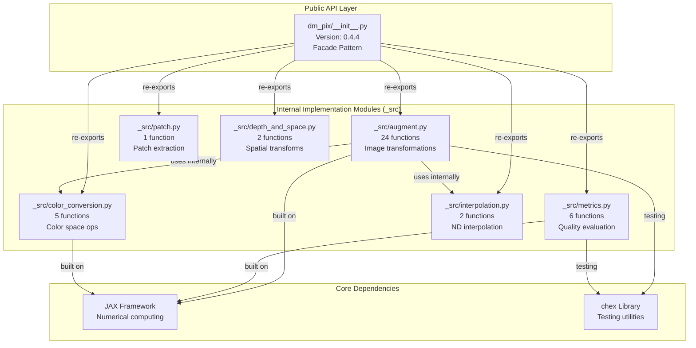
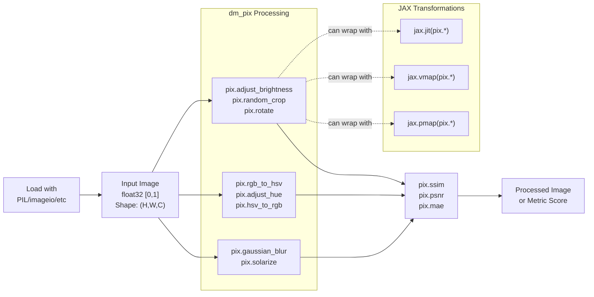

<!-- source: DeepWiki mcp.deepwiki.com · repo google-deepmind/dm_pix · page 1 PIX Overview · fetched 2026-10-26 -->

# PIX Overview

<details>
<summary>Relevant source files</summary>

The following files were used as context for generating this wiki page:

- [README.md](README.md)
- [dm_pix/__init__.py](dm_pix/__init__.py)
- [dm_pix/images/pix_logo.png](dm_pix/images/pix_logo.png)
- [pyproject.toml](pyproject.toml)

</details>


## Purpose and Scope

This document introduces **dm_pix**, a JAX-based image processing library designed for machine learning workflows. It covers the library's purpose, architecture, module organization, and design principles. For detailed information about the public API structure and function organization, see [Public API Organization](#1.1). For installation procedures and dependency setup, see [Installation and Setup](#1.2).

## What is dm_pix?

dm_pix is an image processing library built on top of [JAX](https://github.com/jax-ml/jax) that provides image manipulation functions optimized for high-performance machine learning research. The library exposes functions that can be seamlessly integrated with JAX transformations:

- **`jax.jit`** - Just-in-time compilation for performance optimization
- **`jax.vmap`** - Automatic vectorization for batch processing  
- **`jax.pmap`** - Multi-device parallelization for distributed computing

All functions in dm_pix are designed as pure functions that operate on JAX arrays, making them fully compatible with JAX's functional programming paradigm and automatic differentiation capabilities.

**Current Version:** `0.4.4` ([dm_pix/__init__.py:23]())

Sources: [README.md:1-20](), [dm_pix/__init__.py:14-23]()

## High-Level Architecture

dm_pix implements a **facade pattern** where a single public API module ([dm_pix/__init__.py]()) re-exports functionality from six internal implementation modules located in the `_src` directory. This design hides implementation details while providing a clean, flat namespace for users.

### Module Organization



**Diagram: dm_pix Module Architecture and Dependencies**

The public API explicitly deletes internal module references after re-exporting to prevent direct access to `_src` internals ([dm_pix/__init__.py:78]()). A warning message in the source code emphasizes this: "Please don't use symbols in `_src` they are not part of the PIX public API" ([dm_pix/__init__.py:123-131]()).

Sources: [dm_pix/__init__.py:16-78]()

## Core Modules and Function Inventory

The following table summarizes the six implementation modules and their exported functionality:

| Module | Exported Functions | Primary Purpose |
|--------|-------------------|-----------------|
| `augment` | 24 | Image augmentation operations (color adjustments, geometric transforms, filters) |
| `metrics` | 6 | Image quality metrics (MAE, MSE, PSNR, RMSE, SSIM, SIMSE) |
| `color_conversion` | 5 | Color space conversions (RGB↔HSV, RGB↔HSL, RGB→Grayscale) |
| `patch` | 1 | Patch extraction from images |
| `depth_and_space` | 2 | Channel-spatial dimension rearrangement |
| `interpolation` | 2 | N-dimensional linear interpolation |

**Total Public API Surface:** 40 functions exposed through `dm_pix.__all__` ([dm_pix/__init__.py:80-121]())

For comprehensive documentation of each module, see:
- Image augmentation: [Image Augmentation Module](#2)
- Quality metrics: [Image Quality Metrics](#3)
- Color operations: [Color Space Conversions](#4)
- Other utilities: [Additional Core Modules](#5)

Sources: [dm_pix/__init__.py:25-76](), [dm_pix/__init__.py:80-121]()

## Public API Function Mapping

The following diagram shows how public API functions map to their internal module implementations:


**Diagram: Public API Function Categories**

Sources: [dm_pix/__init__.py:25-76]()

## Dependency Model

dm_pix has an unusual dependency configuration due to JAX's platform-specific installation requirements. The library is written in pure Python but depends on C++ code via JAX ([README.md:23]()).

### Core Dependencies

**Required:**
- `chex>=0.0.6` - Testing and assertion utilities ([pyproject.toml:30]())

**Optional (but essential):**
- `jax>=0.2.17` - Not listed in `dependencies` but required for all functionality
- `jaxlib>=0.1.69` - Platform-specific JAX backend

The JAX dependencies are commented out in `pyproject.toml` ([pyproject.toml:31-32]()) and instead listed in `[project.optional-dependencies.extras]` ([pyproject.toml:36-39]()). This allows users to install the correct JAX variant for their CUDA version before installing dm_pix.

### Optional Dependencies

```python
# Test dependencies (pyproject.toml:40-44)
test = [
    "scipy",           # Reference implementations for validation
    "tensorflow",      # Reference implementations for validation  
    "pytest-xdist",    # Parallel test execution
]

# Documentation dependencies (pyproject.toml:45-57)
docs = [
    "sphinx>=6.0.0",
    "sphinx_rtd_theme",
    "sphinxcontrib-katex",
    "sphinx-autodoc-typehints",
    "myst_nb",
    "matplotlib",
    # ... and others
]

# Example dependencies (pyproject.toml:58-60)
examples = [
    "Pillow",          # Image I/O for examples
]
```

Sources: [README.md:23-36](), [pyproject.toml:29-60]()

## Design Principles

### 1. Pure Functional Design

All dm_pix functions are implemented as pure functions with no side effects. This design enables:
- **Composability**: Functions can be chained and combined
- **JAX Transformation Compatibility**: Works with `jit`, `vmap`, `pmap`
- **Automatic Differentiation**: Functions are differentiable where mathematically valid

### 2. Array Format Conventions

Images in dm_pix follow consistent format conventions:
- **Data Type**: Float arrays (typically `float32`)
- **Value Range**: `[0, 1]` for RGB channels
- **Shape Format**: `(H, W, C)` or `(N, H, W, C)` where:
  - `H` = height, `W` = width, `C` = channels, `N` = batch size

### 3. JAX Transformation Examples

The README demonstrates all three major JAX transformations ([README.md:67-91]()):

```python
import dm_pix as pix
import jax

image = load_image()  # Shape: (H, W, C)

# Vanilla function call
result = pix.flip_left_right(image)

# JIT compilation
result = jax.jit(pix.flip_left_right)(image)

# Vectorized batch processing
images = image[np.newaxis, ...]  # Shape: (1, H, W, C)
result = jax.vmap(pix.flip_left_right)(images)

# Multi-device parallelization
result = jax.pmap(pix.flip_left_right)(images)
```

### 4. Internal Module Isolation

The `_src` directory pattern isolates implementation details:
- Public API surface remains stable
- Internal refactoring doesn't break user code
- Clear separation between public and private interfaces

The `__init__.py` explicitly deletes internal module references ([dm_pix/__init__.py:78]()) and includes a cow ASCII art warning about not using `_src` symbols ([dm_pix/__init__.py:123-131]()).

Sources: [README.md:12-20](), [README.md:67-96](), [dm_pix/__init__.py:78](), [dm_pix/__init__.py:123-136]()

## Typical Usage Pattern

The following diagram illustrates a common image processing pipeline using dm_pix functions:



**Diagram: Typical dm_pix Processing Pipeline**

Sources: [README.md:38-96]()

## Integration with JAX Ecosystem

dm_pix is part of the [DeepMind JAX Ecosystem](https://deepmind.com/blog/article/using-jax-to-accelerate-our-research), a collection of libraries designed to accelerate ML research. For JAX integration details including performance optimization strategies, see [JAX Integration](#6).

Key integration points:
- **JIT Compilation**: See [JIT Compilation](#6.1)
- **Vectorization**: See [Vectorization with vmap](#6.2)
- **Parallelization**: See [Parallelization with pmap](#6.3)

Sources: [README.md:124-127]()

## Quick Start Example

From the README, here's the simplest usage example ([README.md:38-61]()):

```python
import dm_pix as pix

# Load an image into a NumPy array with your preferred library
image = load_image()

# Apply transformation
flip_left_right_image = pix.flip_left_right(image)
```

All functions maintain consistent behavior across JAX transformations, with results identical up to floating-point precision ([README.md:93-95]()).

For more examples including Jupyter notebooks, see [Examples and Usage Patterns](#10).

Sources: [README.md:38-96]()

## Repository Structure Overview

```
dm_pix/
├── __init__.py              # Public API facade
├── _src/                    # Internal implementations
│   ├── augment.py          # 24 augmentation functions
│   ├── metrics.py          # 6 quality metrics
│   ├── color_conversion.py # 5 color space functions
│   ├── patch.py            # Patch extraction
│   ├── depth_and_space.py  # Spatial transforms
│   └── interpolation.py    # ND interpolation
├── *_test.py               # Test files for each module
└── images/                 # Logo and assets
```

The `_src` directory is intentionally excluded from the public API namespace. The `__init__.py` includes explicit cleanup code to prevent accidental usage ([dm_pix/__init__.py:133-136]()).

Sources: [dm_pix/__init__.py:16-22](), [pyproject.toml:62-64]()

## Testing and Quality Assurance

dm_pix includes a comprehensive test suite that validates:
- **Correctness**: Comparison against TensorFlow and SciPy reference implementations
- **JAX Compatibility**: Testing with `chex.all_variants` for `jit`, `vmap`, `pmap`
- **Edge Cases**: NaN handling, boundary conditions, gradient stability

For detailed testing procedures, see [Testing and Quality Assurance](#7).

Sources: [README.md:103-122]()

## Documentation and Resources

- **Source Code**: https://github.com/google-deepmind/dm_pix
- **API Documentation**: https://dm-pix.readthedocs.io/
- **PyPI Package**: https://pypi.org/project/dm-pix/

For documentation system architecture, see [Documentation System](#9).

Sources: [README.md:7-9]()

## Version History

**Current Version**: `0.4.4` ([dm_pix/__init__.py:23]())

The version string is defined directly in the `__init__.py` module and is accessible as `dm_pix.__version__`.

Sources: [dm_pix/__init__.py:23]()

---

