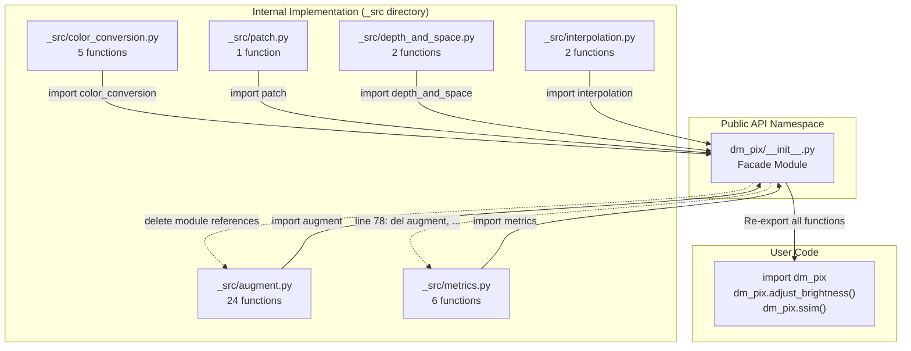
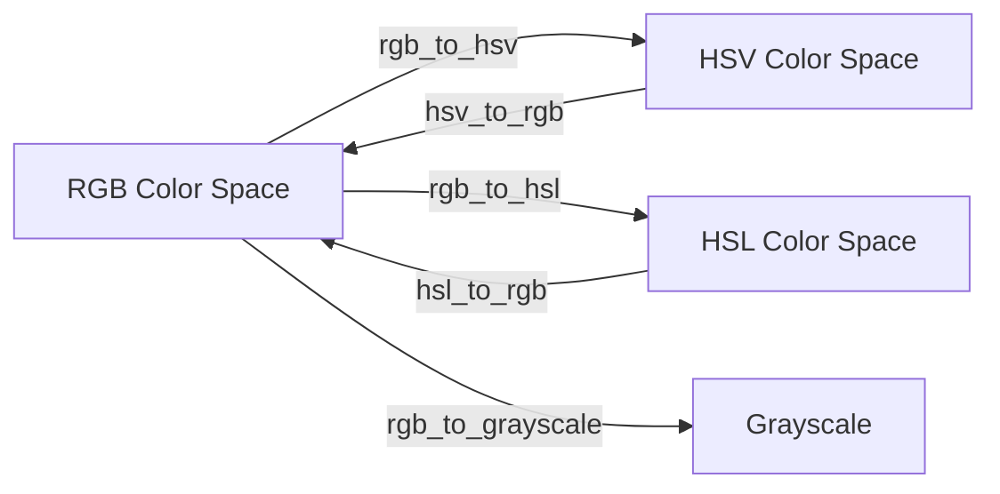
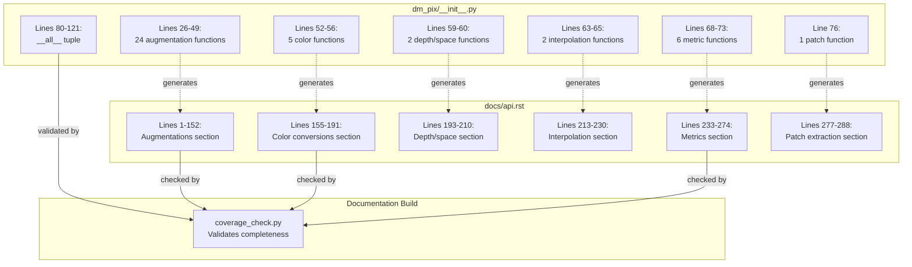

<!-- source: DeepWiki mcp.deepwiki.com · repo google-deepmind/dm_pix · page 1.1 Public API Organization · fetched 2026-10-26 -->

# Public API Organization

<details>
<summary>Relevant source files</summary>

The following files were used as context for generating this wiki page:

- [dm_pix/__init__.py](dm_pix/__init__.py)
- [docs/api.rst](docs/api.rst)

</details>


## Purpose and Scope

This document describes the structure and organization of dm_pix's public API, explaining how internal modules are organized and exposed to users through a facade pattern. It covers the API surface area, module categorization, and the design principles that keep internal implementation details hidden from users.

For information about specific augmentation functions and their implementations, see [Image Augmentation Module](#2). For details about installation and initial setup, see [Installation and Setup](#1.2).

## API Facade Pattern

dm_pix implements a **facade pattern** in [`dm_pix/__init__.py`](dm_pix/__init__.py:1-137)() to provide a clean, flat public API while maintaining internal modularity. All implementation code resides in the `dm_pix._src` directory, but users interact exclusively with the top-level `dm_pix` namespace.

### Module Import and Re-export Architecture



**Facade Implementation Pattern**

Sources: [dm_pix/__init__.py:16-22](dm_pix/__init__.py:16-22)(), [dm_pix/__init__.py:78](dm_pix/__init__.py:78)()

The facade pattern follows this three-step process:

1. **Import internal modules** from `_src` directory ([lines 16-21](dm_pix/__init__.py:16-21)())
2. **Re-export individual functions** by direct assignment ([lines 26-76](dm_pix/__init__.py:26-76)())
3. **Delete module references** to prevent direct access ([line 78](dm_pix/__init__.py:78)())

```python
# Step 1: Import
from dm_pix._src import augment
from dm_pix._src import metrics

# Step 2: Re-export
adjust_brightness = augment.adjust_brightness
ssim = metrics.ssim

# Step 3: Clean up
del augment, metrics
```

This ensures users cannot access `dm_pix._src` directly, enforcing API stability.

Sources: [dm_pix/__init__.py:16-78](dm_pix/__init__.py:16-78)()

## Module Organization and Categories

The public API organizes 40 functions into six logical categories, each corresponding to an internal module:

| Category | Internal Module | Function Count | Lines in __init__.py |
|----------|----------------|----------------|---------------------|
| Augmentations | `augment` | 24 | [26-49](dm_pix/__init__.py:26-49)() |
| Metrics | `metrics` | 6 | [68-73](dm_pix/__init__.py:68-73)() |
| Color conversions | `color_conversion` | 5 | [52-56](dm_pix/__init__.py:52-56)() |
| Interpolation | `interpolation` | 2 | [63-65](dm_pix/__init__.py:63-65)() |
| Depth/space transforms | `depth_and_space` | 2 | [59-60](dm_pix/__init__.py:59-60)() |
| Patch extraction | `patch` | 1 | [76](dm_pix/__init__.py:76)() |

Sources: [dm_pix/__init__.py:1-137](dm_pix/__init__.py:1-137)()

### Function Categories Mapped to Code Entities


Sources: [dm_pix/__init__.py:26-76](dm_pix/__init__.py:26-76)()

## Public API Definition

### The __all__ Tuple

The public API is formally defined in the `__all__` tuple at [lines 80-121](dm_pix/__init__.py:80-121)(). This tuple:

- **Lists all 40 public functions** in alphabetical order
- **Controls wildcard imports** (`from dm_pix import *`)
- **Serves as API contract** for documentation and testing
- **Enables API coverage validation** (see [API Documentation Structure](#9.3))

The `__all__` tuple is the authoritative source of truth for what constitutes the dm_pix public API.

Sources: [dm_pix/__init__.py:80-121](dm_pix/__init__.py:80-121)()

### Augmentation Functions

The augmentation category is the largest, comprising 24 of the 40 public functions ([lines 26-49](dm_pix/__init__.py:26-49)()). These functions follow a naming pattern:

**Deterministic Functions** (14 functions):
- Color adjustments: `adjust_brightness`, `adjust_contrast`, `adjust_gamma`, `adjust_hue`, `adjust_saturation`
- Geometric transforms: `affine_transform`, `center_crop`, `flip_left_right`, `flip_up_down`, `rotate`, `rot90`
- Filters/effects: `gaussian_blur`, `pad_to_size`, `solarize`
- Layout operations: `resize_with_crop_or_pad`, `elastic_deformation`

**Stochastic Functions** (10 functions):
- Random variants: `random_brightness`, `random_contrast`, `random_gamma`, `random_hue`, `random_saturation`
- Random geometric: `random_flip_left_right`, `random_flip_up_down`, `random_crop`

For detailed documentation of these functions, see [Image Augmentation Module](#2).

Sources: [dm_pix/__init__.py:26-49](dm_pix/__init__.py:26-49)(), [docs/api.rst:1-152](docs/api.rst:1-152)()

### Metrics Functions

Six image quality and similarity metrics ([lines 68-73](dm_pix/__init__.py:68-73)()):

| Function | Description | Documentation |
|----------|-------------|---------------|
| `mae` | Mean Absolute Error | [docs/api.rst:246-249](docs/api.rst:246-249)() |
| `mse` | Mean Squared Error | [docs/api.rst:251-254](docs/api.rst:251-254)() |
| `rmse` | Root Mean Squared Error | [docs/api.rst:261-264](docs/api.rst:261-264)() |
| `psnr` | Peak Signal-to-Noise Ratio | [docs/api.rst:256-259](docs/api.rst:256-259)() |
| `ssim` | Structural Similarity Index | [docs/api.rst:271-274](docs/api.rst:271-274)() |
| `simse` | Structural Information MSE | [docs/api.rst:266-269](docs/api.rst:266-269)() |

For implementation details, see [Image Quality Metrics](#3).

Sources: [dm_pix/__init__.py:68-73](dm_pix/__init__.py:68-73)(), [docs/api.rst:233-274](docs/api.rst:233-274)()

### Color Conversion Functions

Five bidirectional color space transformations ([lines 52-56](dm_pix/__init__.py:52-56)()):



**Available Conversions:**
- `rgb_to_hsv` / `hsv_to_rgb` - RGB ↔ Hue-Saturation-Value
- `rgb_to_hsl` / `hsl_to_rgb` - RGB ↔ Hue-Saturation-Lightness  
- `rgb_to_grayscale` - RGB → Grayscale (one-way)

For conversion algorithms and use cases, see [Color Space Conversions](#4).

Sources: [dm_pix/__init__.py:52-56](dm_pix/__init__.py:52-56)(), [docs/api.rst:155-191](docs/api.rst:155-191)()

### Interpolation Functions

Two N-dimensional linear interpolation functions ([lines 63-65](dm_pix/__init__.py:63-65)()):

- `flat_nd_linear_interpolate` - Standard ND interpolation
- `flat_nd_linear_interpolate_constant` - Constant boundary variant

These functions support the geometric transformations in the augmentation module. For technical details, see [ND Linear Interpolation](#5.2).

Sources: [dm_pix/__init__.py:63-65](dm_pix/__init__.py:63-65)(), [docs/api.rst:213-230](docs/api.rst:213-230)()

### Depth and Space Functions

Two channel-spatial dimension rearrangement functions ([lines 59-60](dm_pix/__init__.py:59-60)()):

- `depth_to_space` - Move depth dimension to spatial dimensions
- `space_to_depth` - Move spatial dimensions to depth dimension

For implementation and use cases, see [Depth and Space Transforms](#5.3).

Sources: [dm_pix/__init__.py:59-60](dm_pix/__init__.py:59-60)(), [docs/api.rst:193-210](docs/api.rst:193-210)()

### Patch Extraction Functions

One function for extracting patches from images ([line 76](dm_pix/__init__.py:76)()):

- `extract_patches` - TensorFlow-compatible patch extraction

For details on patch extraction, see [Patch Extraction](#5.1).

Sources: [dm_pix/__init__.py:76](dm_pix/__init__.py:76)(), [docs/api.rst:277-288](docs/api.rst:277-288)()

## Version Management

The library version is defined as a module constant at [line 23](dm_pix/__init__.py:23)():

```python
__version__ = "0.4.4"
```

This version string:
- Follows semantic versioning (MAJOR.MINOR.PATCH)
- Is accessible via `dm_pix.__version__`
- Is used by the PyPI publishing workflow (see [PyPI Publishing Workflow](#8.2))
- Must be manually updated before releases

Sources: [dm_pix/__init__.py:23](dm_pix/__init__.py:23)()

## Internal Module Hiding

### The _src Directory Pattern

All implementation code resides in `dm_pix._src`, following Python's convention that underscore-prefixed modules are private. The facade enforces this in two ways:

**1. Module Deletion** ([line 78](dm_pix/__init__.py:78)()):
```python
del augment, color_conversion, depth_and_space, interpolation, metrics, patch
```

After re-exporting functions, the module references are deleted, preventing:
```python
import dm_pix
dm_pix.augment.adjust_brightness()  # AttributeError: no attribute 'augment'
```

**2. _src Cleanup** ([lines 133-136](dm_pix/__init__.py:133-136)()):
```python
try:
  del _src  # pylint: disable=undefined-variable
except NameError:
  pass
```

This attempts to delete any `_src` attribute that might exist, though this is primarily defensive programming since the import statement `from dm_pix._src import X` doesn't create an `_src` attribute.

### User Warning

The module includes an ASCII art warning at [lines 123-132](dm_pix/__init__.py:123-132)():

```
#  _________________________________________
# / Please don't use symbols in `_src` they \
# \ are not part of the PIX public API.     /
#  -----------------------------------------
#         \   ^__^
#          \  (oo)\_______
#             (__)\       )\/\
#                 ||----w |
#                 ||     ||
```

This serves as documentation for developers reading the source code that `_src` is internal-only.

Sources: [dm_pix/__init__.py:78](dm_pix/__init__.py:78)(), [dm_pix/__init__.py:123-136](dm_pix/__init__.py:123-136)()

## API Documentation Correspondence

The public API structure in `__init__.py` corresponds directly to the documentation structure in `docs/api.rst`:



The `coverage_check.py` Sphinx extension ensures that every function in `__all__` is documented in `api.rst`. For details on the documentation system, see [Documentation System](#9).

Sources: [dm_pix/__init__.py:80-121](dm_pix/__init__.py:80-121)(), [docs/api.rst:1-289](docs/api.rst:1-289)()

## Summary Table: Public API Surface

| Module Category | Internal Module | Function Count | Public API Lines | Documentation Lines |
|----------------|-----------------|----------------|------------------|---------------------|
| Augmentations | `_src/augment` | 24 | [26-49](dm_pix/__init__.py:26-49)() | [1-152](docs/api.rst:1-152)() |
| Metrics | `_src/metrics` | 6 | [68-73](dm_pix/__init__.py:68-73)() | [233-274](docs/api.rst:233-274)() |
| Color conversions | `_src/color_conversion` | 5 | [52-56](dm_pix/__init__.py:52-56)() | [155-191](docs/api.rst:155-191)() |
| Interpolation | `_src/interpolation` | 2 | [63-65](dm_pix/__init__.py:63-65)() | [213-230](docs/api.rst:213-230)() |
| Depth/space | `_src/depth_and_space` | 2 | [59-60](dm_pix/__init__.py:59-60)() | [193-210](docs/api.rst:193-210)() |
| Patch extraction | `_src/patch` | 1 | [76](dm_pix/__init__.py:76)() | [277-288](docs/api.rst:277-288)() |
| **Total** | **6 modules** | **40 functions** | **51 lines** | **289 lines** |

Sources: [dm_pix/__init__.py:1-137](dm_pix/__init__.py:1-137)(), [docs/api.rst:1-289](docs/api.rst:1-289)()

---

