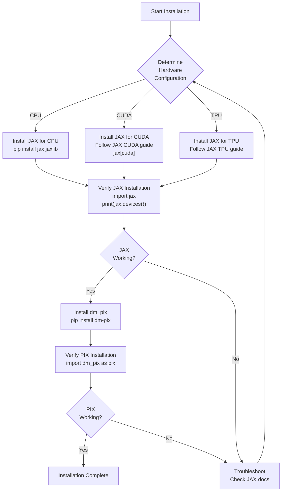
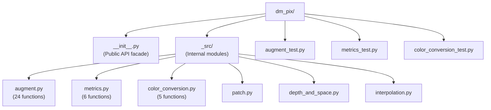

<!-- source: DeepWiki mcp.deepwiki.com · repo google-deepmind/dm_pix · page 1.2 Installation and Setup · fetched 2026-10-26 -->

# Installation and Setup

<details>
<summary>Relevant source files</summary>

The following files were used as context for generating this wiki page:

- [README.md](README.md)
- [dm_pix/images/pix_logo.png](dm_pix/images/pix_logo.png)
- [pyproject.toml](pyproject.toml)

</details>


## Purpose and Scope

This document provides comprehensive instructions for installing and configuring dm_pix for use in your environment. It covers the mandatory JAX dependency installation, the dm_pix package installation, optional dependencies for testing and development, and verification procedures. For information about the overall system architecture and public API organization, see [PIX Overview](#1) and [Public API Organization](#1.1).

## Prerequisites

dm_pix requires the following system prerequisites:

| Requirement | Minimum Version | Notes |
|------------|----------------|-------|
| Python | 3.8 | Specified in [pyproject.toml:11]() |
| pip | Latest stable | For package installation |
| Virtual environment tool | Any | Recommended: venv, virtualenv, or conda |

**Important**: dm_pix is written in pure Python but depends on C++ code via JAX. The installation process requires careful attention to JAX setup, as JAX installation varies based on your accelerator configuration (CPU, CUDA, TPU).

**Sources**: [pyproject.toml:11](), [README.md:23-27]()

## Dependency Architecture

```mermaid
graph TB
    subgraph "User Environment"
        PYTHON["Python >=3.8"]
        VENV["Virtual Environment<br/>(recommended)"]
    end
    
    subgraph "Core Dependencies"
        JAX["jax>=0.2.17<br/>jaxlib>=0.1.69<br/>(NOT auto-installed)"]
        CHEX["chex>=0.0.6<br/>(auto-installed)"]
    end
    
    subgraph "dm_pix Package"
        PIX["dm-pix<br/>(PyPI package)"]
    end
    
    subgraph "Optional Dependencies"
        TEST["Test Dependencies<br/>scipy, tensorflow<br/>pytest-xdist"]
        DOCS["Documentation<br/>sphinx, sphinx_rtd_theme<br/>sphinxcontrib-*"]
        EXAMPLES["Examples<br/>Pillow"]
    end
    
    PYTHON --> VENV
    VENV --> JAX
    JAX --> PIX
    CHEX --> PIX
    
    PIX -.->|pip install -e '.[test]'| TEST
    PIX -.->|pip install -e '.[docs]'| DOCS
    PIX -.->|pip install -e '.[examples]'| EXAMPLES
    
    PIX -.->|imports| JAX
    PIX -.->|imports| CHEX
```

**Diagram**: Dependency installation hierarchy showing the critical JAX prerequisite and optional dependency groups.

**Sources**: [pyproject.toml:29-60](), [README.md:23-27]()

## JAX Installation (Critical First Step)

### Why JAX Must Be Installed Separately

JAX is **not** listed as an automatic dependency in dm_pix's [pyproject.toml:29-33]() because JAX installation differs based on hardware accelerators:

- **CPU-only**: Standard JAX installation
- **CUDA GPUs**: Requires CUDA-version-specific jaxlib builds
- **TPUs**: Requires TPU-specific jaxlib builds

The JAX dependency lines in [pyproject.toml:31-32]() are commented out for this reason:

```toml
# jax>=0.2.17
# jaxlib>=0.1.69
```

### Installation Workflow



**Diagram**: Complete installation workflow showing JAX prerequisite verification before dm_pix installation.

**Sources**: [README.md:23-36]()

### JAX Installation Commands

Follow the [official JAX installation instructions](https://github.com/jax-ml/jax#installation) at the JAX repository. As referenced in [README.md:29-30](), the installation method depends on your configuration:

**CPU-only installation**:
```bash
pip install jax jaxlib
```

**CUDA GPU installation** (example for CUDA 11.x):
```bash
pip install "jax[cuda11_pip]" -f https://storage.googleapis.com/jax-releases/jax_cuda_releases.html
```

**TPU installation** (on Google Cloud TPU):
```bash
pip install "jax[tpu]" -f https://storage.googleapis.com/jax-releases/libtpu_releases.html
```

**Sources**: [README.md:29-30]()

## dm_pix Installation

Once JAX is successfully installed and verified, install dm_pix from PyPI:

```bash
pip install dm-pix
```

This command installs:
- The `dm_pix` Python package
- The `chex>=0.0.6` dependency (automatically, as specified in [pyproject.toml:30]())

The package is built using the flit build system as defined in [pyproject.toml:1-3]().

### Package Metadata

The installed package has the following metadata from [pyproject.toml:6-28]():

| Attribute | Value |
|-----------|-------|
| Package name | `dm_pix` |
| Distribution name (PyPI) | `dm-pix` |
| Python version requirement | `>=3.8` |
| Development status | Beta |
| License | Apache 2.0 |

**Sources**: [README.md:32-36](), [pyproject.toml:1-33]()

## Optional Dependencies

dm_pix defines three optional dependency groups in [pyproject.toml:35-60]():

### Test Dependencies (`test`)

Required for running the test suite:

```bash
pip install -e ".[test]"
```

Installs:
- `scipy` - Reference implementations for validation (see [Reference Implementation Validation](#7.2))
- `tensorflow` - Reference implementations for validation
- `pytest-xdist` - Parallel test execution

**Usage**: Enables running tests with `pytest` as described in [README.md:109-115]().

### Documentation Dependencies (`docs`)

Required for building documentation locally:

```bash
pip install -e ".[docs]"
```

Installs:
- `sphinx>=6.0.0` - Documentation generator
- `sphinx_rtd_theme` - ReadTheDocs theme
- `sphinxcontrib-katex` - Math rendering
- `sphinxcontrib-bibtex` - Bibliography support
- `sphinx-autodoc-typehints` - Type hint documentation
- `IPython`, `ipykernel` - Notebook support
- `pandoc`, `myst_nb` - Markdown notebook support
- `matplotlib` - Plotting for documentation

See [Documentation System](#9) for details on the documentation build process.

### Examples Dependencies (`examples`)

Required for running example scripts and notebooks:

```bash
pip install -e ".[examples]"
```

Installs:
- `Pillow` - Image loading/saving library

**Usage**: Enables running examples in the `examples/` directory as mentioned in [README.md:97-101]().

### Multiple Optional Groups

Install multiple dependency groups simultaneously:

```bash
pip install -e ".[test,examples]"
```

**Sources**: [pyproject.toml:35-60](), [README.md:109-115]()

## Dependency Resolution Matrix

The following table shows which dependencies are installed for each configuration:

| Dependency | Base Install | `[test]` | `[docs]` | `[examples]` |
|------------|--------------|----------|----------|--------------|
| `chex>=0.0.6` | ✓ | ✓ | ✓ | ✓ |
| `jax>=0.2.17` | Manual | Manual | Manual | Manual |
| `jaxlib>=0.1.69` | Manual | Manual | Manual | Manual |
| `scipy` | ✗ | ✓ | ✗ | ✗ |
| `tensorflow` | ✗ | ✓ | ✗ | ✗ |
| `pytest-xdist` | ✗ | ✓ | ✗ | ✗ |
| `sphinx>=6.0.0` | ✗ | ✗ | ✓ | ✗ |
| `Pillow` | ✗ | ✗ | ✗ | ✓ |

**Sources**: [pyproject.toml:29-60]()

## Verifying Installation

### Basic Import Verification

After installation, verify that dm_pix is correctly installed:

```python
import dm_pix as pix
print(pix.__version__)
```

As shown in [README.md:40-41](), the package is imported using the `dm_pix` module name with conventional alias `pix`.

### Functional Verification

Test a basic operation as demonstrated in [README.md:50-57]():

```python
import dm_pix as pix
import jax.numpy as jnp

# Create a test image (random data)
image = jnp.ones((100, 100, 3))

# Test a simple augmentation function
flipped = pix.flip_left_right(image)
print(f"Original shape: {image.shape}")
print(f"Flipped shape: {flipped.shape}")
```

Expected output:
```
Original shape: (100, 100, 3)
Flipped shape: (100, 100, 3)
```

### JAX Transformation Verification

Verify that dm_pix functions work with JAX transformations as shown in [README.md:67-91]():

```python
import dm_pix as pix
import jax
import jax.numpy as jnp

image = jnp.ones((100, 100, 3))

# Test jax.jit compilation
jitted_flip = jax.jit(pix.flip_left_right)
result = jitted_flip(image)
print(f"JIT compilation: {'✓' if result.shape == image.shape else '✗'}")

# Test jax.vmap vectorization
batch_images = jnp.ones((4, 100, 100, 3))
vmapped_flip = jax.vmap(pix.flip_left_right)
batch_result = vmapped_flip(batch_images)
print(f"vmap vectorization: {'✓' if batch_result.shape == batch_images.shape else '✗'}")
```

Expected output:
```
JIT compilation: ✓
vmap vectorization: ✓
```

**Sources**: [README.md:40-95]()

## Development Setup

### Editable Installation

For development and contribution, install dm_pix in editable mode:

```bash
# Clone the repository
git clone https://github.com/google-deepmind/dm_pix.git
cd dm_pix

# Install in editable mode with test dependencies
pip install -e ".[test]"
```

The editable installation (`-e` flag) allows you to modify source code without reinstalling the package.

### Running Tests

Two methods are available for running tests:

**Method 1: Using pytest directly** (as shown in [README.md:109-115]()):
```bash
# Install test dependencies
pip install -e ".[test]"

# Run all tests
python -m pytest dm_pix

# Run tests in parallel using all available CPUs
python -m pytest -n auto dm_pix

# Run tests in parallel with specific CPU count
python -m pytest -n 4 dm_pix
```

**Method 2: Using the test script** (as shown in [README.md:117-122]()):
```bash
# Creates isolated virtual environment and runs tests
./test.sh
```

The [test.sh]() script provides an isolated environment for testing.

### File System Structure

After installation, the dm_pix package structure matches the repository layout:



**Diagram**: Package file structure showing the public API layer and internal `_src` modules.

**Sources**: [README.md:117-122](), [pyproject.toml:62-65]()

## Common Installation Issues

### Issue: JAX Not Found

**Symptom**:
```
ModuleNotFoundError: No module named 'jax'
```

**Solution**: Install JAX first (see [JAX Installation](#jax-installation-critical-first-step))

### Issue: Incorrect JAX Version for Hardware

**Symptom**: JAX installed but not detecting GPU/TPU

**Solution**: Reinstall JAX with correct accelerator support. Follow JAX installation guide for your specific hardware configuration.

### Issue: Test Dependencies Missing

**Symptom**:
```
ModuleNotFoundError: No module named 'scipy'
```

**Solution**: Install test dependencies:
```bash
pip install -e ".[test]"
```

### Issue: Build System Errors

**Symptom**: Installation fails during package build

**Solution**: Ensure build system dependencies are available:
```bash
pip install --upgrade pip setuptools wheel
pip install flit_core
```

**Sources**: [pyproject.toml:1-3](), [README.md:23-27]()

## Virtual Environment Recommendations

It is strongly recommended to use a virtual environment for dm_pix installation:

**Using venv** (Python 3.8+):
```bash
python -m venv dm_pix_env
source dm_pix_env/bin/activate  # On Unix/macOS
# dm_pix_env\Scripts\activate  # On Windows

pip install dm-pix
```

**Using conda**:
```bash
conda create -n dm_pix_env python=3.9
conda activate dm_pix_env
pip install dm-pix
```

Virtual environments prevent dependency conflicts with other Python projects and ensure reproducible installations.

**Sources**: [pyproject.toml:11](), [README.md:117-122]()

## Next Steps

After successful installation:

1. Review the [Public API Organization](#1.1) to understand available functions
2. Explore the [Image Augmentation Module](#2) for data augmentation capabilities
3. Check [Image Quality Metrics](#3) for evaluation functions
4. Read [JAX Integration](#6) to learn about optimization with `jit`, `vmap`, and `pmap`
5. Try the [Examples and Usage Patterns](#10) for practical demonstrations

For contributing to dm_pix development, see the [Developer Guide](#11).

**Sources**: [README.md:1-151](), [pyproject.toml:1-65]()

---

