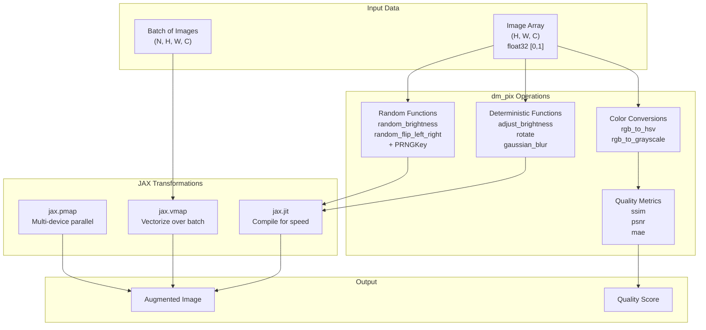
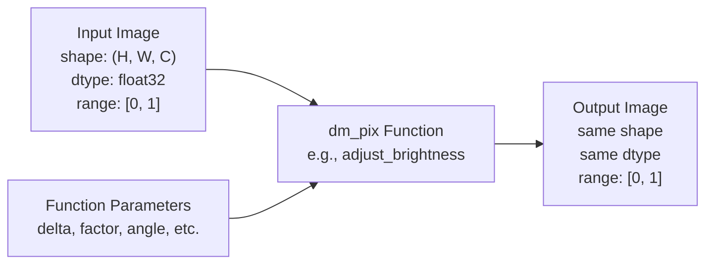
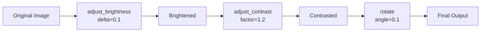
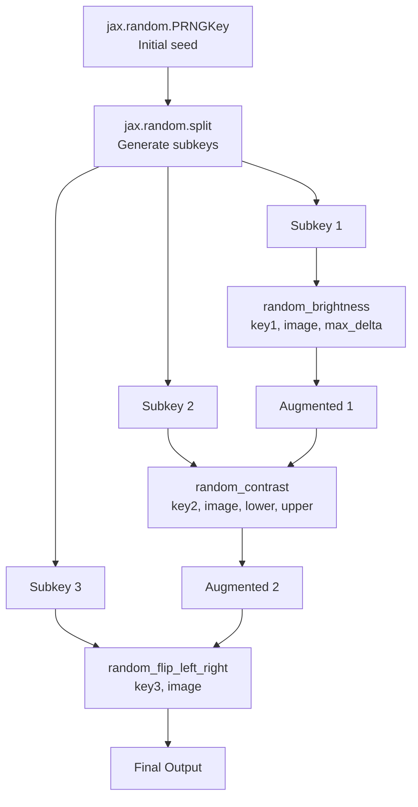
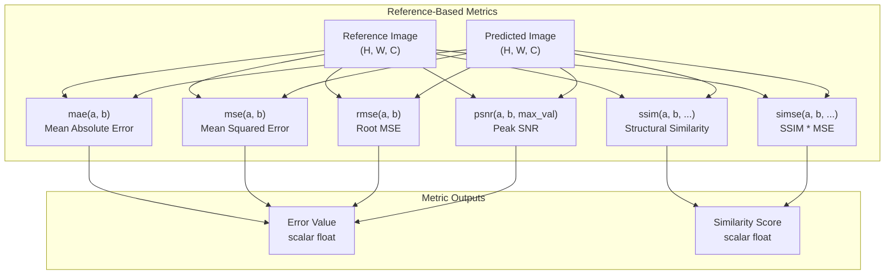
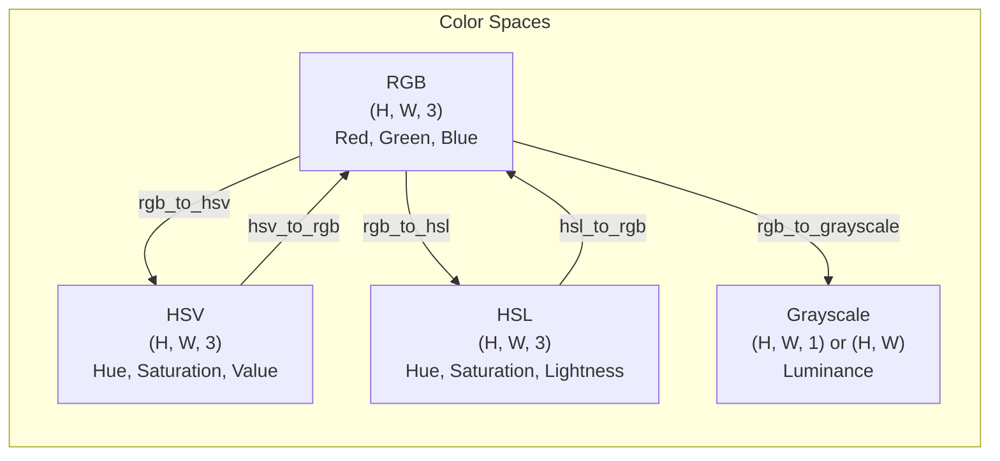
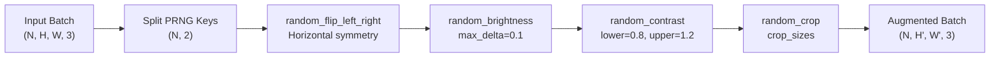
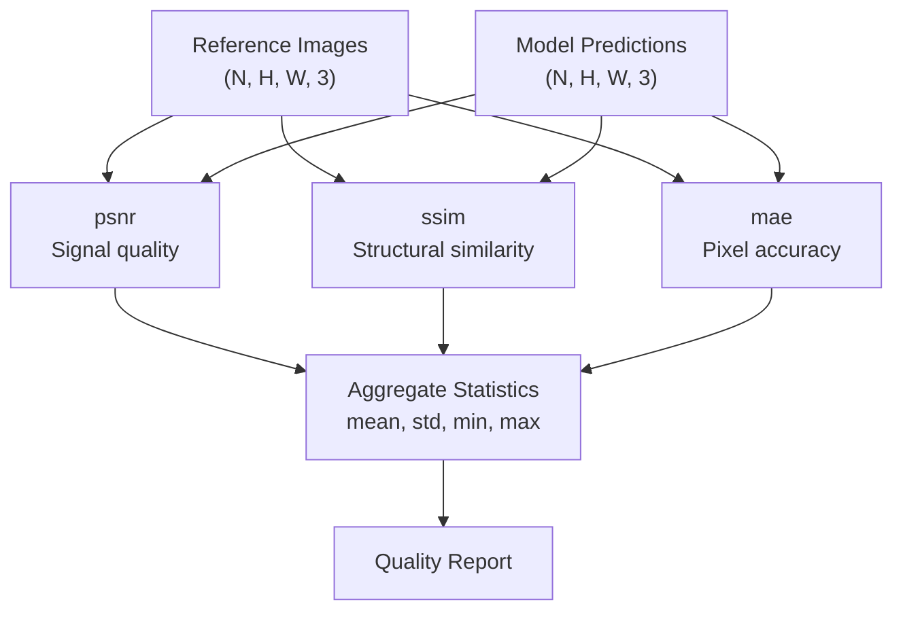

<!-- source: DeepWiki mcp.deepwiki.com · repo google-deepmind/dm_pix · page 10 Examples and Usage Patterns · fetched 2026-10-26 -->

# Examples and Usage Patterns

<details>
<summary>Relevant source files</summary>

The following files were used as context for generating this wiki page:

- [examples/README.md](examples/README.md)
- [examples/image_augmentation.ipynb](examples/image_augmentation.ipynb)

</details>


## Purpose and Scope

This page provides practical examples and common usage patterns for the dm_pix library. It demonstrates how to apply image augmentations, evaluate image quality metrics, perform color space conversions, and integrate these operations with JAX transformations for high-performance ML workflows.

For detailed function-level documentation of augmentation operations, see [Image Augmentation Module](#2). For quality metrics implementation details, see [Image Quality Metrics](#3). For JAX integration principles and transformation specifics, see [JAX Integration](#6).

Sources: [examples/README.md:1-17]()

## Common Usage Patterns Overview

dm_pix provides a functional API built on JAX, designed for composability and high performance. The library organizes functionality into distinct usage patterns:

| Usage Pattern | Primary Modules | Key Functions | Typical Use Case |
|---------------|----------------|---------------|------------------|
| Deterministic Augmentation | `augment` | `adjust_brightness`, `rotate`, `gaussian_blur` | Reproducible preprocessing pipelines |
| Stochastic Augmentation | `augment` | `random_brightness`, `random_flip_left_right` | Training data augmentation with PRNG keys |
| Quality Assessment | `metrics` | `ssim`, `psnr`, `mae` | Model evaluation, image comparison |
| Color Space Processing | `color_conversion` | `rgb_to_hsv`, `hsv_to_rgb` | Pre-processing, color-based augmentations |
| Batch Processing | All modules | Combined with `jax.vmap` | Efficient batch operations |
| Accelerated Pipelines | All modules | Combined with `jax.jit` | High-performance production systems |



**Diagram: dm_pix Usage Pattern Flow**

Sources: [examples/README.md:1-17]()

## Basic Image Augmentation Workflow

The fundamental workflow applies a single augmentation function to an image. All augmentation functions in `dm_pix._src.augment` follow consistent input/output conventions:



**Diagram: Basic Augmentation Pipeline**

### Single Augmentation Application

Deterministic augmentations (functions without `random_` prefix) apply transformations with explicit parameters. Examples from `dm_pix._src.augment`:

- **Brightness**: `adjust_brightness(image, delta)` - Adds `delta` to all pixels
- **Contrast**: `adjust_contrast(image, factor)` - Scales pixel deviations from mean
- **Rotation**: `rotate(image, angle, order)` - Rotates by `angle` radians with interpolation
- **Blur**: `gaussian_blur(image, sigma, kernel_size)` - Applies Gaussian convolution

All functions preserve image shape and dtype, operating on the expected `[0, 1]` float range.

Sources: [examples/README.md:1-17]()

## Combining Multiple Augmentations

Augmentation pipelines compose multiple operations sequentially. The functional design enables straightforward chaining:



**Diagram: Sequential Augmentation Pipeline**

### Augmentation Pipeline Pattern

When composing augmentations, consider:

1. **Order Dependency**: Some augmentations are commutative (brightness + contrast), others are not (crop + rotate)
2. **Value Range Preservation**: Each function maintains `[0, 1]` range, enabling safe composition
3. **Performance**: Wrap entire pipeline in `jax.jit` rather than individual functions
4. **Color Space Dependencies**: `adjust_hue` and `adjust_saturation` internally convert to HSV via `dm_pix._src.color_conversion`

### Common Pipeline Configurations

| Pipeline Type | Function Sequence | Use Case |
|---------------|------------------|----------|
| Color Enhancement | `adjust_brightness` → `adjust_contrast` → `adjust_saturation` | Display preparation |
| Geometric | `random_flip_left_right` → `rotate` → `center_crop` | Spatial augmentation |
| Style Transfer Prep | `rgb_to_grayscale` → `adjust_gamma` | Artistic effects |
| Training Augmentation | `random_brightness` → `random_contrast` → `random_flip_left_right` → `random_crop` | Data augmentation |

Sources: [examples/README.md:1-17]()

## Working with Random Augmentations and PRNG Keys

Random augmentations (functions with `random_` prefix) require JAX PRNG keys for reproducible stochasticity. These functions are defined in `dm_pix._src.augment` and follow a consistent pattern.



**Diagram: Random Augmentation Pipeline with PRNG Key Management**

### Random Augmentation Functions

The `random_*` functions wrap their deterministic counterparts with parameter sampling:

| Random Function | Parameters | Deterministic Wrapper | Sampling Distribution |
|----------------|------------|----------------------|----------------------|
| `random_brightness` | `key, image, max_delta` | `adjust_brightness` | Uniform[-max_delta, max_delta] |
| `random_contrast` | `key, image, lower, upper` | `adjust_contrast` | Uniform[lower, upper] |
| `random_flip_left_right` | `key, image` | `flip_left_right` | Bernoulli(p=0.5) |
| `random_flip_up_down` | `key, image` | `flip_up_down` | Bernoulli(p=0.5) |
| `random_hue` | `key, image, max_delta` | `adjust_hue` | Uniform[-max_delta, max_delta] |
| `random_saturation` | `key, image, lower, upper` | `adjust_saturation` | Uniform[lower, upper] |
| `random_gamma` | `key, image, min_gamma, max_gamma` | `adjust_gamma` | Log-uniform[min_gamma, max_gamma] |
| `random_crop` | `key, image, crop_sizes` | N/A | Random offset selection |

### PRNG Key Best Practices

1. **Key Splitting**: Use `jax.random.split(key, num)` to generate independent subkeys for each random operation
2. **Key Threading**: Pass different subkeys to each random function to ensure independence
3. **Reproducibility**: Same initial seed produces identical augmentation sequences
4. **Batch Processing**: When using `jax.vmap`, split keys across batch dimension

Sources: [examples/README.md:1-17]()

## Quality Metric Evaluation Patterns

The `dm_pix._src.metrics` module provides functions for evaluating image quality and similarity. These are commonly used for model evaluation and comparison tasks.



**Diagram: Quality Metric Evaluation Pattern**

### Metric Selection Guide

| Metric | Function | Output Range | Best For | Properties |
|--------|----------|--------------|----------|------------|
| MAE | `mae(a, b)` | [0, ∞) | Pixel-level accuracy | Linear error scale |
| MSE | `mse(a, b)` | [0, ∞) | Overall fidelity | Emphasizes large errors |
| RMSE | `rmse(a, b)` | [0, ∞) | Same as MSE | Same units as input |
| PSNR | `psnr(a, b, max_val)` | [0, ∞) dB | Signal quality | Logarithmic scale |
| SSIM | `ssim(a, b, filter_size, filter_sigma, k1, k2)` | [-1, 1] | Perceptual similarity | Structure-aware |
| SIMSE | `simse(a, b, ...)` | [0, ∞) | Combined metric | SSIM weighted MSE |

### Metric Evaluation Pattern

Common usage pattern for evaluating augmentation or model quality:

1. **Before/After Comparison**: Compute metrics between original and augmented images to assess degradation
2. **Model Evaluation**: Compare model outputs against ground truth using multiple metrics
3. **Hyperparameter Tuning**: Use metrics to optimize augmentation strength parameters
4. **Batch Evaluation**: Apply `jax.vmap` to compute metrics over entire validation sets

Sources: [examples/README.md:1-17]()

## Color Space Conversion Usage

The `dm_pix._src.color_conversion` module provides bidirectional conversions between RGB, HSV, HSL, and Grayscale color spaces.

### Conversion Function Matrix

| From / To | RGB | HSV | HSL | Grayscale |
|-----------|-----|-----|-----|-----------|
| **RGB** | - | `rgb_to_hsv` | `rgb_to_hsl` | `rgb_to_grayscale` |
| **HSV** | `hsv_to_rgb` | - | Manual | Manual |
| **HSL** | `hsl_to_rgb` | Manual | - | Manual |
| **Grayscale** | Expand dims | Manual | Manual | - |



**Diagram: Color Space Conversion Paths**

### Common Color Conversion Patterns

1. **Hue/Saturation Adjustment Pipeline**:
   - Input RGB → `rgb_to_hsv` → Modify H/S channels → `hsv_to_rgb` → Output RGB
   - Used internally by `adjust_hue` and `adjust_saturation`

2. **Grayscale Processing**:
   - RGB → `rgb_to_grayscale(keep_dims=True)` → Process single channel → Expand back to RGB
   - Parameter `keep_dims` controls output shape: `True` → (H, W, 1), `False` → (H, W)

3. **Luma Standard Selection**:
   - `rgb_to_grayscale(image, luma='rec601')` - Standard definition TV (default)
   - `rgb_to_grayscale(image, luma='rec709')` - High definition TV
   - `rgb_to_grayscale(image, luma='bt2001')` - ITU-R BT.2001 (constant luminance)

4. **Color-Preserving Operations**:
   - Convert to HSL → Modify lightness only → Convert back to preserve hue/saturation relationship

Sources: [examples/README.md:1-17]()

## JAX Transformation Patterns

dm_pix functions are designed for seamless integration with JAX transformations: `jax.jit`, `jax.vmap`, and `jax.pmap`.

```mermaid
graph TB
    subgraph "Single Image Operations"
        IMG["Image<br/>(H, W, C)"]
        FUNC["dm_pix.adjust_brightness"]
        OUT["Augmented<br/>(H, W, C)"]
        IMG --> FUNC --> OUT
    end
    
    subgraph "JIT Compiled"
        JIT_FUNC["jax.jit(dm_pix.adjust_brightness)"]
        JIT_IMG["Image"] --> JIT_FUNC --> JIT_OUT["Augmented"]
        NOTE1["Compile once<br/>Fast repeated calls"]
        JIT_FUNC -.-> NOTE1
    end
    
    subgraph "Vectorized Batch"
        BATCH["Batch<br/>(N, H, W, C)"]
        VMAP["jax.vmap(dm_pix.adjust_brightness)"]
        BATCH_OUT["Batch<br/>(N, H, W, C)"]
        BATCH --> VMAP --> BATCH_OUT
        NOTE2["Automatic parallelization<br/>Single function call"]
        VMAP -.-> NOTE2
    end
    
    subgraph "Multi-Device Parallel"
        SHARDED["Sharded Batch<br/>(Devices, N/D, H, W, C)"]
        PMAP["jax.pmap(dm_pix.adjust_brightness)"]
        SHARDED_OUT["Sharded Result<br/>(Devices, N/D, H, W, C)"]
        SHARDED --> PMAP --> SHARDED_OUT
        NOTE3["Parallel execution<br/>across devices"]
        PMAP -.-> NOTE3
    end
```



**Diagram: JAX Transformation Application Patterns**

### JIT Compilation Pattern

Compile augmentation pipelines for production performance:

```python
# Example pattern (not executable):
# compiled_pipeline = jax.jit(lambda img: 
#     dm_pix.rotate(dm_pix.adjust_brightness(img, delta=0.1), angle=0.1))
```

**Benefits**: First call compiles to XLA, subsequent calls execute at C++ speed. Recommended for production inference pipelines.

### Vectorization (vmap) Pattern

Process batches efficiently without explicit loops:

```python
# Example pattern (not executable):
# batched_augment = jax.vmap(dm_pix.adjust_brightness, in_axes=(0, None))
# augmented_batch = batched_augment(image_batch, delta=0.1)
```

**Key Parameters**:
- `in_axes=(0, None)`: Vectorize over first argument (images), broadcast second (delta)
- Can vectorize over parameter axis: `in_axes=(0, 0)` applies different deltas to each image

### Multi-Device Parallelization (pmap) Pattern

Distribute computation across multiple GPUs/TPUs:

```python
# Example pattern (not executable):
# parallel_augment = jax.pmap(dm_pix.adjust_brightness)
# sharded_batch = reshape_for_devices(image_batch)  # (n_devices, batch_per_device, H, W, C)
# result = parallel_augment(sharded_batch, delta=0.1)
```

**Requirements**: Batch must be evenly divisible by number of devices, first axis is device axis.

Sources: [examples/README.md:1-17]()

## Batch Processing Patterns

Efficient batch processing combines `jax.vmap` with dm_pix functions to handle multiple images simultaneously.

### Basic Batch Processing

| Pattern | Implementation | Input Shape | Output Shape |
|---------|---------------|-------------|--------------|
| Uniform Parameter | `vmap(func, in_axes=(0, None))` | (N, H, W, C), scalar | (N, H, W, C) |
| Per-Image Parameter | `vmap(func, in_axes=(0, 0))` | (N, H, W, C), (N,) | (N, H, W, C) |
| Random Per-Image | `vmap(func, in_axes=(0, 0))` with key splitting | (N, H, W, C), (N, 2) keys | (N, H, W, C) |

### Random Augmentation Batch Pattern

For random augmentations on batches, split PRNG keys across batch dimension:

```python
# Example pattern (not executable):
# keys = jax.random.split(rng_key, num_images)  # (N, 2)
# batched_random_brightness = jax.vmap(dm_pix.random_brightness, in_axes=(0, 0, None))
# augmented = batched_random_brightness(keys, image_batch, max_delta=0.2)
```

This ensures each image receives independent random augmentation.

### Metric Computation on Batches

Compute metrics over entire validation sets:

```python
# Example pattern (not executable):
# batched_psnr = jax.vmap(dm_pix.psnr, in_axes=(0, 0, None))
# scores = batched_psnr(reference_batch, predicted_batch, max_val=1.0)
# mean_score = jnp.mean(scores)
```

### Combined JIT + VMAP Pattern

Maximum performance combines both transformations:

```python
# Example pattern (not executable):
# fast_batched_pipeline = jax.jit(jax.vmap(augmentation_pipeline))
```

Order matters: `jit(vmap(f))` compiles vectorized version, while `vmap(jit(f))` vectorizes compiled version (usually less efficient).

Sources: [examples/README.md:1-17]()

## Common Pipelines and Recipes

### Training Augmentation Pipeline

Typical pipeline for training image classification models:



**Diagram: Training Augmentation Recipe**

### Image Quality Evaluation Pipeline

Evaluate model output quality:



**Diagram: Quality Evaluation Recipe**

### Color-Based Augmentation Pipeline

Augmentation pipeline that preserves spatial structure:

| Step | Function | Purpose |
|------|----------|---------|
| 1 | `random_brightness(key1, image, max_delta=0.2)` | Lighting variation |
| 2 | `random_contrast(key2, image, lower=0.7, upper=1.3)` | Dynamic range variation |
| 3 | `random_hue(key3, image, max_delta=0.1)` | Color shift (internally uses `rgb_to_hsv`) |
| 4 | `random_saturation(key4, image, lower=0.8, upper=1.2)` | Color intensity variation |
| 5 | `random_gamma(key5, image, min_gamma=0.8, max_gamma=1.2)` | Non-linear brightness |

### Geometric Augmentation Pipeline

Augmentation pipeline that modifies spatial structure:

| Step | Function | Purpose |
|------|----------|---------|
| 1 | `random_flip_left_right(key1, image)` | Horizontal flip (50% probability) |
| 2 | `random_flip_up_down(key2, image)` | Vertical flip (50% probability) |
| 3 | `rotate(image, angle=random_angle)` | Rotation (uses `affine_transform`) |
| 4 | `random_crop(key3, image, crop_sizes)` | Random spatial crop |
| 5 | `resize_with_crop_or_pad(image, target_height, target_width)` | Standardize size |

Sources: [examples/README.md:1-17]()

## Running the Examples

The dm_pix repository includes practical examples in the `examples/` directory.

### Setup Requirements

Install additional dependencies required for examples:

```bash
pip install -r requirements_examples.txt
```

This installs visualization libraries (matplotlib, jupyter) and other utilities not required for core dm_pix functionality.

Sources: [examples/README.md:1-8]()

### Running Python Scripts

Execute the example script directly:

```bash
cd examples/
python image_augmentation.py
```

The script demonstrates various augmentation functions on sample images, displaying results and saving outputs.

Sources: [examples/README.md:10-15]()

### Running Jupyter Notebooks

For interactive exploration, use the Jupyter notebook:

**Local Execution**:
```bash
cd examples/
jupyter notebook image_augmentation.ipynb
```

**Google Colab**: The notebook is also available on Colab for cloud execution without local setup requirements.

Sources: [examples/README.md:16-16]()

### Example Structure

The `image_augmentation.py` and `image_augmentation.ipynb` files demonstrate:

1. **Basic Augmentations**: Single-function applications (brightness, contrast, rotation, blur)
2. **Random Augmentations**: PRNG key usage with `random_*` functions
3. **Sequential Pipelines**: Combining multiple augmentations
4. **Color Space Operations**: RGB ↔ HSV/HSL conversions
5. **Metric Evaluation**: Quality assessment using SSIM and PSNR
6. **Batch Processing**: Using `jax.vmap` for efficient batch operations
7. **Visualization**: Displaying original vs. augmented images

For detailed walkthrough of the notebook content, see [Image Augmentation Tutorial](#10.1).

Sources: [examples/README.md:1-17]()

---

