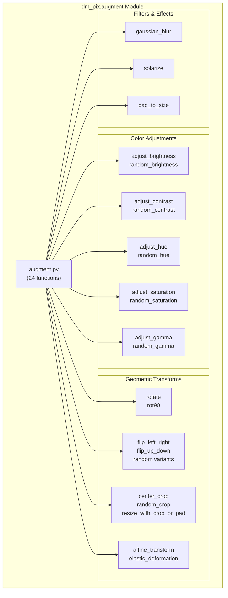
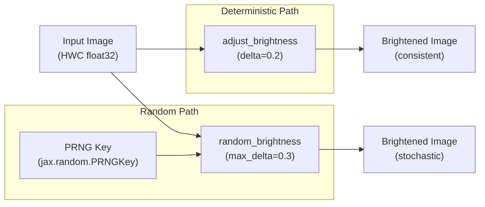
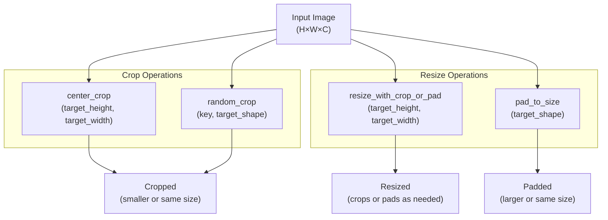
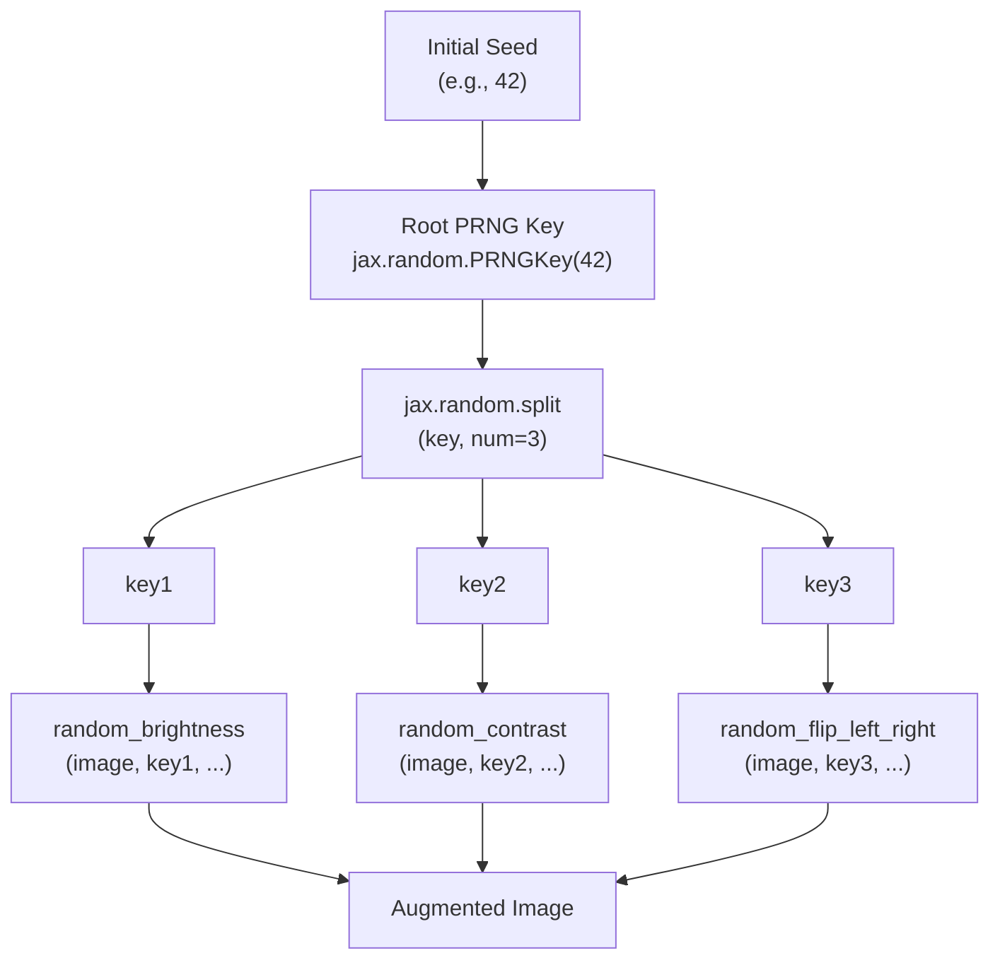
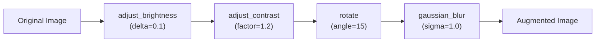
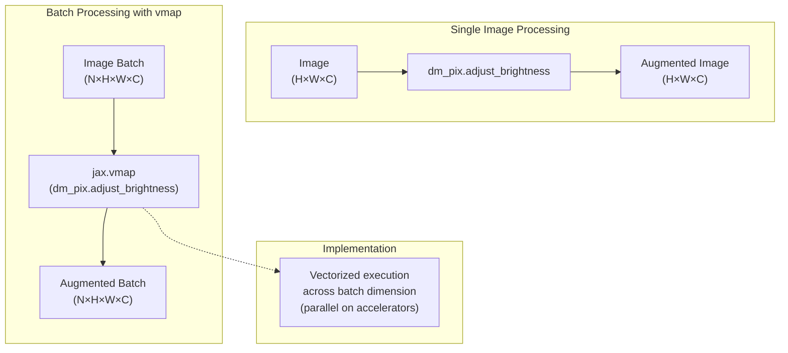
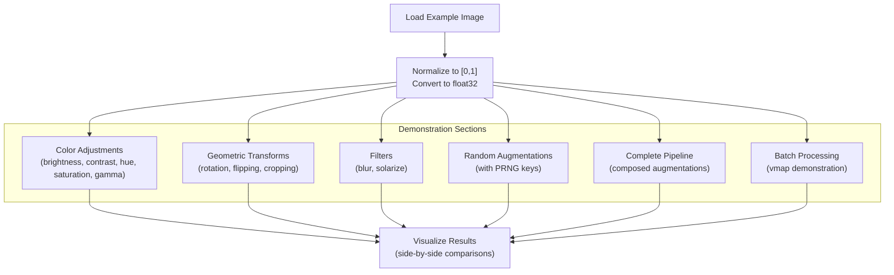

<!-- source: DeepWiki mcp.deepwiki.com · repo google-deepmind/dm_pix · page 10.1 Image Augmentation Tutorial · fetched 2026-10-26 -->

# Image Augmentation Tutorial

<details>
<summary>Relevant source files</summary>

The following files were used as context for generating this wiki page:

- [examples/README.md](examples/README.md)
- [examples/image_augmentation.ipynb](examples/image_augmentation.ipynb)

</details>


## Purpose and Scope

This tutorial walks through practical usage of the `dm_pix` augmentation module, demonstrating how to apply various image transformations for data augmentation in machine learning pipelines. The tutorial is based on the example notebook and script located in the `examples/` directory.

For detailed reference documentation of individual augmentation functions, see [Image Augmentation Module](#2). For information on the random augmentation pattern and PRNG key usage, see [Random Augmentation Pattern](#2.4). For JAX transformation integration (jit, vmap, pmap), see [JAX Integration](#6).

## Prerequisites and Setup

Before running the augmentation examples, install the required dependencies specified in [examples/README.md:4-8]():

```bash
pip install -r requirements_examples.txt
```

The example can be run as a Python script or interactively:
- Python script: `python examples/image_augmentation.py`
- Jupyter notebook: `examples/image_augmentation.ipynb` (also available on Colab)

**Sources:** [examples/README.md:1-17]()

## Input Image Format Requirements

All `dm_pix` augmentation functions expect images in a standardized format:

| Property | Requirement |
|----------|-------------|
| **Data type** | Float32 or Float64 |
| **Value range** | [0.0, 1.0] |
| **Channel format** | HWC (Height, Width, Channels) or NHWC (batch) |
| **Color space** | RGB (unless specified otherwise) |

Images must be converted from typical uint8 [0, 255] format to float [0, 1] before processing:

```python
# Typical preprocessing
image_float = image_uint8.astype(jnp.float32) / 255.0
```

**Sources:** Diagram 6 (Data Flow: Image Processing Pipeline)

## Augmentation Function Categories



**Sources:** Diagram 4 (Augmentation Module Internal Structure), Diagram 1 (Core Module Architecture)

## Color Adjustment Operations

Color adjustments modify pixel intensity and color properties. Each operation has both deterministic and random variants.

### Basic Color Operations

The tutorial demonstrates five primary color adjustments:

| Function | Parameter | Effect |
|----------|-----------|--------|
| `adjust_brightness` | `delta` | Adds constant value to all pixels |
| `adjust_contrast` | `factor` | Scales deviation from mean |
| `adjust_gamma` | `gamma` | Applies power-law transformation |
| `adjust_hue` | `delta` | Shifts hue in HSV color space |
| `adjust_saturation` | `factor` | Scales saturation in HSV space |

### Deterministic vs Random Variants



Deterministic functions take explicit parameter values, while random variants require a JAX PRNG key and sample from a range:

```python
# Deterministic: same output every time
bright_img = dm_pix.adjust_brightness(image, delta=0.2)

# Random: requires PRNG key, different output each time
key = jax.random.PRNGKey(42)
random_bright = dm_pix.random_brightness(image, key, max_delta=0.3)
```

**Sources:** [dm_pix/_src/augment.py](), Diagram 4 (Augmentation Module Internal Structure), [Random Augmentation Pattern](#2.4)

## Geometric Transformations

Geometric transformations modify the spatial arrangement of pixels through rotation, flipping, and cropping operations.

### Rotation Operations

| Function | Description | Usage |
|----------|-------------|-------|
| `rot90` | 90-degree rotation | `rot90(image, k=1)` for k×90° |
| `rotate` | Arbitrary angle rotation | `rotate(image, angle=45.0)` in degrees |

The `rotate` function uses bilinear interpolation and depends on the interpolation module for resampling.

### Flipping Operations

| Function | Axis | Random Variant |
|----------|------|----------------|
| `flip_left_right` | Horizontal | `random_flip_left_right` |
| `flip_up_down` | Vertical | `random_flip_up_down` |

### Cropping and Padding



- `center_crop`: Extracts central region
- `random_crop`: Extracts random region (requires PRNG key)
- `resize_with_crop_or_pad`: Adjusts to target size by cropping or padding
- `pad_to_size`: Adds padding to reach target size

**Sources:** [dm_pix/_src/augment.py](), Diagram 4 (Augmentation Module Internal Structure)

## Filters and Effects

### Gaussian Blur

The `gaussian_blur` function applies Gaussian smoothing using a depthwise convolution:

```python
blurred = dm_pix.gaussian_blur(image, sigma=2.0, kernel_size=5)
```

Parameters:
- `sigma`: Standard deviation of Gaussian kernel
- `kernel_size`: Size of convolution kernel (must be odd)

### Solarization

The `solarize` function inverts pixel values above a threshold:

```python
solarized = dm_pix.solarize(image, threshold=0.5)
```

Pixels above threshold are inverted: `output = 1.0 - input`

**Sources:** [dm_pix/_src/augment.py](), Diagram 4 (Augmentation Module Internal Structure)

## Random Augmentation with PRNG Keys

Random augmentation functions follow a consistent pattern for stochastic data augmentation pipelines.

### PRNG Key Management



Each random augmentation requires a unique PRNG key. Keys are split to ensure independent random behavior:

```python
# Initialize root key
key = jax.random.PRNGKey(seed=42)

# Split for multiple augmentations
key, *subkeys = jax.random.split(key, num=4)

# Apply random augmentations with different keys
img = dm_pix.random_brightness(img, subkeys[0], max_delta=0.2)
img = dm_pix.random_contrast(img, subkeys[1], lower=0.8, upper=1.2)
img = dm_pix.random_flip_left_right(img, subkeys[2])
```

### Random Function Signatures

Random augmentation functions follow this pattern:

| Deterministic | Random | Random Parameters |
|---------------|--------|-------------------|
| `adjust_brightness(image, delta)` | `random_brightness(image, key, max_delta)` | Uniform[-max_delta, max_delta] |
| `adjust_contrast(image, factor)` | `random_contrast(image, key, lower, upper)` | Uniform[lower, upper] |
| `adjust_hue(image, delta)` | `random_hue(image, key, max_delta)` | Uniform[-max_delta, max_delta] |
| `adjust_saturation(image, factor)` | `random_saturation(image, key, lower, upper)` | Uniform[lower, upper] |
| `adjust_gamma(image, gamma)` | `random_gamma(image, key, min_gamma, max_gamma)` | Uniform[min_gamma, max_gamma] |

**Sources:** [dm_pix/_src/augment.py](), [Random Augmentation Pattern](#2.4)

## Composing Augmentation Pipelines

The functional design of `dm_pix` enables easy composition of multiple augmentations.

### Sequential Application



Augmentations are applied sequentially by chaining function calls:

```python
def augmentation_pipeline(image, key):
    # Split keys for random operations
    key1, key2, key3 = jax.random.split(key, 3)
    
    # Apply color adjustments
    image = dm_pix.random_brightness(image, key1, max_delta=0.2)
    image = dm_pix.random_contrast(image, key2, lower=0.8, upper=1.2)
    
    # Apply geometric transforms
    image = dm_pix.random_flip_left_right(image, key3)
    image = dm_pix.rotate(image, angle=15.0)
    
    # Apply filters
    image = dm_pix.gaussian_blur(image, sigma=1.0, kernel_size=3)
    
    return image
```

### Conditional Augmentation

Probabilistic augmentation can be implemented using JAX conditionals:

```python
def conditional_augment(image, key, probability=0.5):
    key_apply, key_aug = jax.random.split(key)
    
    # Apply augmentation with given probability
    apply = jax.random.uniform(key_apply) < probability
    augmented = dm_pix.random_brightness(image, key_aug, max_delta=0.3)
    
    return jax.lax.cond(apply, lambda x: augmented, lambda x: image, image)
```

**Sources:** [dm_pix/_src/augment.py](), [JAX Integration](#6)

## Batch Processing with vmap

`dm_pix` functions are designed to work seamlessly with `jax.vmap` for efficient batch processing.

### Single Image vs Batch Processing



To process a batch of images efficiently:

```python
# Single image function
def augment_single(image, key):
    return dm_pix.adjust_brightness(image, delta=0.2)

# Vectorized batch function
augment_batch = jax.vmap(augment_single, in_axes=(0, 0))

# Apply to batch
batch_images = jnp.stack([img1, img2, img3])  # Shape: (3, H, W, C)
batch_keys = jax.random.split(key, num=3)     # 3 independent keys
augmented_batch = augment_batch(batch_images, batch_keys)
```

### Vectorizing Random Augmentations

When using random augmentations with `vmap`, ensure each image receives a unique PRNG key:

```python
def random_augment_pipeline(image, key):
    key1, key2 = jax.random.split(key)
    image = dm_pix.random_brightness(image, key1, max_delta=0.2)
    image = dm_pix.random_contrast(image, key2, lower=0.8, upper=1.2)
    return image

# Vectorize with proper key handling
augment_batch = jax.vmap(random_augment_pipeline, in_axes=(0, 0))

# Generate unique keys for each image in batch
batch_size = 16
batch_keys = jax.random.split(root_key, num=batch_size)

# Process entire batch
augmented = augment_batch(image_batch, batch_keys)
```

**Sources:** [dm_pix/_src/augment.py](), [Vectorization with vmap](#6.2)

## Example Structure Overview

The augmentation example demonstrates the following workflow:



The example typically includes:

1. **Image Loading**: Load and preprocess sample images
2. **Individual Operations**: Demonstrate each augmentation function independently
3. **Parameter Exploration**: Show effects of different parameter values
4. **Random Variants**: Compare deterministic vs stochastic augmentations
5. **Pipeline Composition**: Combine multiple augmentations
6. **Batch Processing**: Show vmap usage for efficient batch augmentation
7. **Visualization**: Display before/after comparisons

### Running the Example

As specified in [examples/README.md:10-16]():

```bash
# Run as Python script
cd examples/
python image_augmentation.py

# Or open interactive notebook
jupyter notebook image_augmentation.ipynb
```

The interactive Colab version provides real-time parameter adjustment and visualization.

**Sources:** [examples/README.md:1-17](), Diagram 4 (Augmentation Module Internal Structure), Diagram 6 (Data Flow: Image Processing Pipeline)

## Performance Considerations

### JIT Compilation

For production use, compile augmentation pipelines with `jax.jit` for optimal performance:

```python
@jax.jit
def compiled_pipeline(image, key):
    key1, key2, key3 = jax.random.split(key, 3)
    image = dm_pix.random_brightness(image, key1, max_delta=0.2)
    image = dm_pix.random_contrast(image, key2, lower=0.8, upper=1.2)
    image = dm_pix.random_flip_left_right(image, key3)
    return image

# First call compiles, subsequent calls are fast
augmented = compiled_pipeline(image, key)
```

### Combining JIT and vmap

For maximum efficiency with batches:

```python
@jax.jit
def batch_augment(images, keys):
    # vmap inside jit for compiled vectorization
    return jax.vmap(random_augment_pipeline)(images, keys)

# Highly optimized batch processing
augmented_batch = batch_augment(image_batch, key_batch)
```

**Sources:** [JIT Compilation](#6.1), [Vectorization with vmap](#6.2)

## Common Patterns and Best Practices

### Pattern 1: Training Data Augmentation

```python
def training_augment(image, key):
    """Standard augmentation for training data."""
    key1, key2, key3, key4 = jax.random.split(key, 4)
    
    # Random color adjustments
    image = dm_pix.random_brightness(image, key1, max_delta=0.2)
    image = dm_pix.random_contrast(image, key2, lower=0.8, upper=1.2)
    
    # Random geometric transforms
    image = dm_pix.random_flip_left_right(image, key3)
    image = dm_pix.random_crop(image, key4, target_shape=image.shape)
    
    return image
```

### Pattern 2: Test-Time Augmentation

```python
def test_time_augment(image, num_versions=5):
    """Generate multiple augmented versions for prediction averaging."""
    keys = jax.random.split(jax.random.PRNGKey(0), num=num_versions)
    
    # Lighter augmentation for test time
    def light_augment(img, key):
        return dm_pix.random_flip_left_right(img, key)
    
    return jax.vmap(light_augment, in_axes=(None, 0))(image, keys)
```

### Pattern 3: Curriculum Augmentation

```python
def progressive_augment(image, key, training_step, max_steps):
    """Gradually increase augmentation strength during training."""
    strength = jnp.minimum(training_step / max_steps, 1.0)
    
    key1, key2 = jax.random.split(key)
    
    # Scale augmentation by training progress
    image = dm_pix.random_brightness(
        image, key1, max_delta=0.3 * strength
    )
    image = dm_pix.random_contrast(
        image, key2, 
        lower=1.0 - 0.3 * strength,
        upper=1.0 + 0.3 * strength
    )
    
    return image
```

**Sources:** [dm_pix/_src/augment.py](), [Random Augmentation Pattern](#2.4)

## Summary

This tutorial demonstrated:

| Topic | Key Functions | Concepts |
|-------|---------------|----------|
| **Color Adjustments** | `adjust_brightness`, `adjust_contrast`, `adjust_hue`, `adjust_saturation`, `adjust_gamma` | Deterministic and random variants |
| **Geometric Transforms** | `rotate`, `flip_left_right`, `flip_up_down`, `center_crop`, `random_crop` | Spatial transformations with interpolation |
| **Filters** | `gaussian_blur`, `solarize` | Convolution-based and threshold effects |
| **Random Augmentation** | `random_*` functions | PRNG key management with `jax.random` |
| **Pipeline Composition** | Function chaining | Sequential and conditional augmentation |
| **Batch Processing** | `jax.vmap` | Efficient vectorization across batches |
| **Performance** | `jax.jit` | JIT compilation for production use |

For detailed API reference of each function, see [Image Augmentation Module](#2). For integration with JAX transformations, see [JAX Integration](#6).

**Sources:** [examples/README.md:1-17](), Diagram 4 (Augmentation Module Internal Structure), Diagram 6 (Data Flow: Image Processing Pipeline)

---

