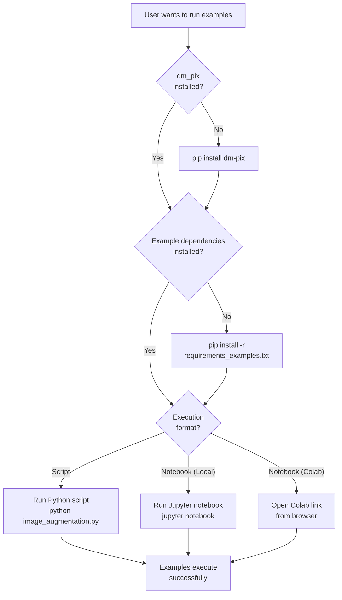
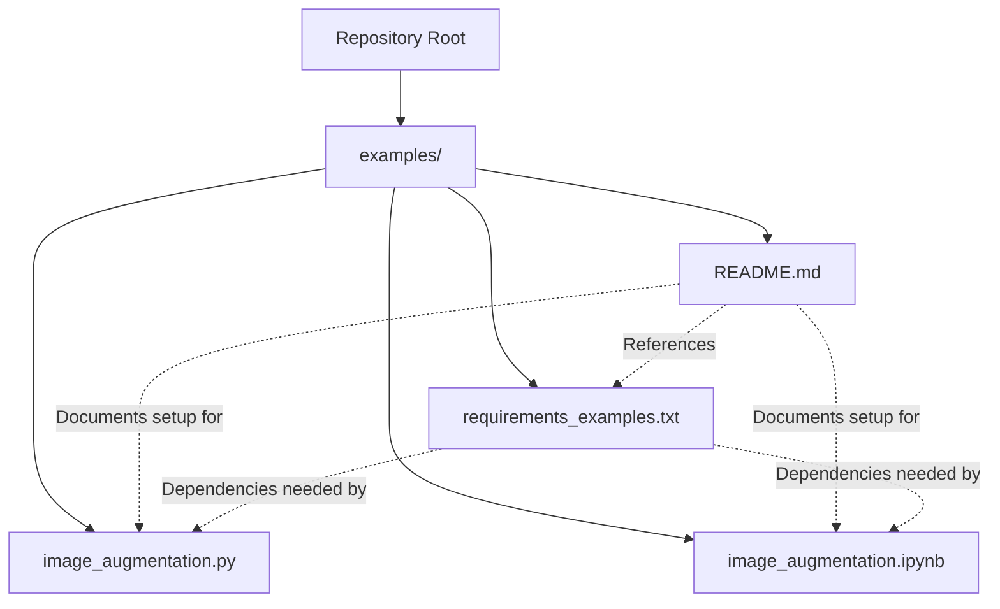
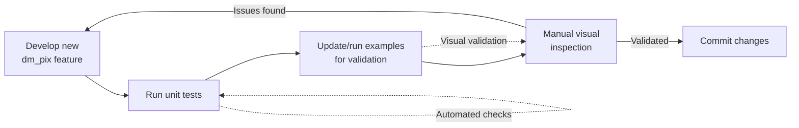

<!-- source: DeepWiki mcp.deepwiki.com · repo google-deepmind/dm_pix · page 10.2 Running Examples · fetched 2026-10-26 -->

# Running Examples

<details>
<summary>Relevant source files</summary>

The following files were used as context for generating this wiki page:

- [examples/README.md](examples/README.md)

</details>


## Purpose and Scope

This page provides practical instructions for setting up and executing the example scripts and notebooks included in the dm_pix repository. It covers installation of example-specific dependencies, running standalone Python scripts, and executing Jupyter notebooks both locally and on Google Colab.

For detailed explanation of what the image augmentation examples demonstrate and their implementation details, see [Image Augmentation Tutorial](#10.1).

**Sources:** [examples/README.md:1-17]()

---

## Overview of Example Resources

The dm_pix repository provides example code demonstrating library functionality in two formats:

| Format | File | Purpose | Execution Environment |
|--------|------|---------|----------------------|
| Python Script | `image_augmentation.py` | Command-line executable demo | Local terminal |
| Jupyter Notebook | `image_augmentation.ipynb` | Interactive tutorial | Local Jupyter or Colab |

Both examples demonstrate the same augmentation functionality but in different execution contexts. The notebook format includes visualizations and explanatory text suitable for learning, while the script format is optimized for batch execution and automation.

**Sources:** [examples/README.md:10-16]()

---

## Example Execution Workflow



**Diagram: Steps required to execute dm_pix examples from initial setup through successful execution**

**Sources:** [examples/README.md:1-17]()

---

## Installing Example Dependencies

### Requirements File

The examples require additional packages beyond the core dm_pix dependencies. These are specified in `requirements_examples.txt`, located in the `examples/` directory.

**Installation Command:**

```bash
pip install -r requirements_examples.txt
```

This command must be executed from the repository root directory, or with the full path to the requirements file specified.

**Sources:** [examples/README.md:3-8]()

### Typical Example Dependencies

While the exact dependencies are defined in `requirements_examples.txt`, example code typically requires:

| Dependency Type | Purpose | Example Packages |
|----------------|---------|------------------|
| Visualization | Displaying images and plots | matplotlib, pillow |
| Data Loading | Reading image files | pillow, imageio |
| Notebook Support | Running Jupyter notebooks locally | jupyter, ipython |
| Utilities | File handling and data manipulation | numpy (if not already present) |

**Note:** The core dm_pix library does not require these dependencies for normal usage. They are only needed to execute the example demonstrations.

**Sources:** [examples/README.md:3-8]()

---

## Running Python Script Examples

### Directory Navigation

Example scripts must be executed from within the `examples/` directory to ensure proper file path resolution:

```bash
cd examples/
```

**Sources:** [examples/README.md:13]()

### Script Execution

The primary example script is `image_augmentation.py`, which demonstrates various augmentation functions:

```bash
python image_augmentation.py
```

This script will:
1. Load or generate sample images
2. Apply a series of augmentation transformations
3. Display or save the augmented results
4. Demonstrate both deterministic and random augmentation variants

**Sources:** [examples/README.md:10-15]()

### Expected Output

The script execution produces visual output showing before/after comparisons of augmentation effects. The exact output format (displayed windows, saved files, or terminal output) depends on the script's implementation.

**Sources:** [examples/README.md:14]()

---

## Running Jupyter Notebook Examples

### Local Execution

To run notebooks locally, ensure Jupyter is installed (included in `requirements_examples.txt`):

```bash
# From repository root
cd examples/
jupyter notebook
```

This launches the Jupyter server and opens a browser interface. Navigate to `image_augmentation.ipynb` to open the example notebook.

**Alternative with JupyterLab:**

```bash
jupyter lab
```

**Sources:** [examples/README.md:1-17]()

### Google Colab Execution

The examples are designed to run on Google Colab without local setup. The notebook file `image_augmentation.ipynb` can be opened directly in Colab:

1. Navigate to the notebook on GitHub
2. Click the "Open in Colab" badge if present, or
3. Manually open the notebook URL in Colab

Colab provides pre-installed JAX support, though it may require updating to the latest version compatible with dm_pix.

**Sources:** [examples/README.md:16]()

---

## Example Directory Structure



**Diagram: Organization of example files within the repository**

**Sources:** [examples/README.md:1-17]()

---

## Execution Context Comparison

| Aspect | Python Script | Jupyter Notebook (Local) | Google Colab |
|--------|--------------|-------------------------|--------------|
| Setup Required | Python + dependencies | Python + Jupyter + dependencies | Browser only |
| Interactivity | None | Full | Full |
| Execution Model | Sequential batch | Cell-by-cell | Cell-by-cell |
| Visualization | File output or display windows | Inline rendering | Inline rendering |
| Modification | Edit `.py` file | Edit cells interactively | Edit cells interactively |
| Best For | Automation, batch processing | Learning, experimentation | Quick testing, sharing |

**Sources:** [examples/README.md:10-16]()

---

## Command Reference

### Complete Setup and Execution Sequence

```bash
# Install dm_pix (if not already installed)
pip install dm-pix

# Install example dependencies
pip install -r requirements_examples.txt

# Navigate to examples directory
cd examples/

# Run Python script example
python image_augmentation.py

# Or launch Jupyter notebook
jupyter notebook  # Then open image_augmentation.ipynb
```

**Sources:** [examples/README.md:3-15]()

---

## Common Issues and Solutions

### Issue: ModuleNotFoundError

**Symptom:** Script fails with `ModuleNotFoundError` for packages like matplotlib or PIL.

**Solution:** Install example dependencies:
```bash
pip install -r requirements_examples.txt
```

### Issue: Script Not Found

**Symptom:** `python image_augmentation.py` fails with file not found error.

**Solution:** Ensure you are in the `examples/` directory:
```bash
cd examples/
python image_augmentation.py
```

### Issue: Import Errors in Notebook

**Symptom:** Notebook cells fail to import dm_pix modules.

**Solution:** In notebook cells, ensure dm_pix is installed in the notebook kernel's environment:
```python
!pip install dm-pix
```

For Colab, this installation may need to happen in the first cell of the notebook.

### Issue: JAX Version Mismatch

**Symptom:** Examples run but produce incorrect results or raise JAX-related errors.

**Solution:** Update JAX to a compatible version. See [Installation and Setup](#1.2) for JAX installation guidance.

**Sources:** [examples/README.md:1-17]()

---

## Integration with Development Workflow



**Diagram: Role of examples in development workflow for validating visual output**

Examples serve as smoke tests for visual validation during development. While unit tests verify numerical correctness, examples provide qualitative assessment of augmentation visual effects.

**Sources:** [examples/README.md:1-17]()

---

## Next Steps

After successfully running examples:

- **Integrate into pipelines**: Adapt example patterns for production data augmentation pipelines
- **Explore variations**: Modify example parameters to understand augmentation effects
- **Consult API documentation**: See [API Documentation Structure](#9.3) for comprehensive function reference
- **Review tutorials**: See [Image Augmentation Tutorial](#10.1) for detailed explanation of augmentation techniques

**Sources:** [examples/README.md:1-17]()

---

