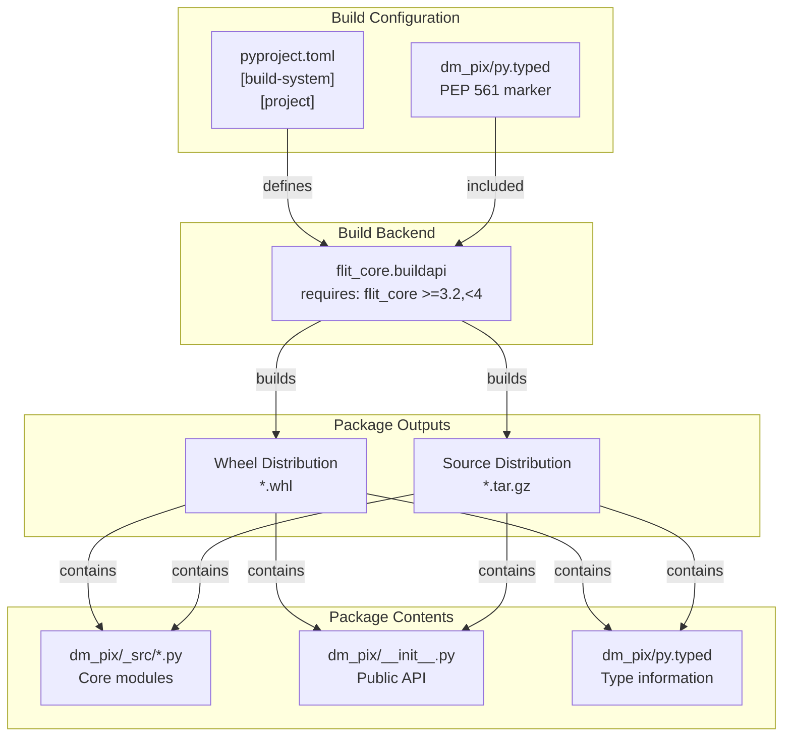
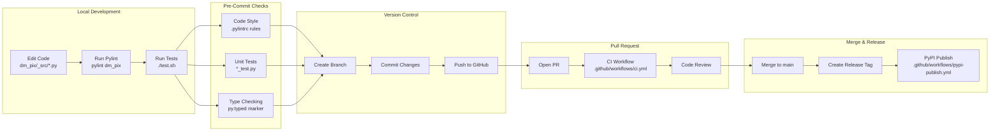
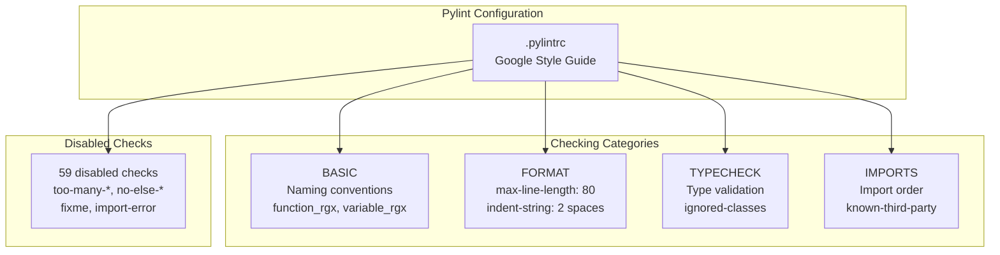
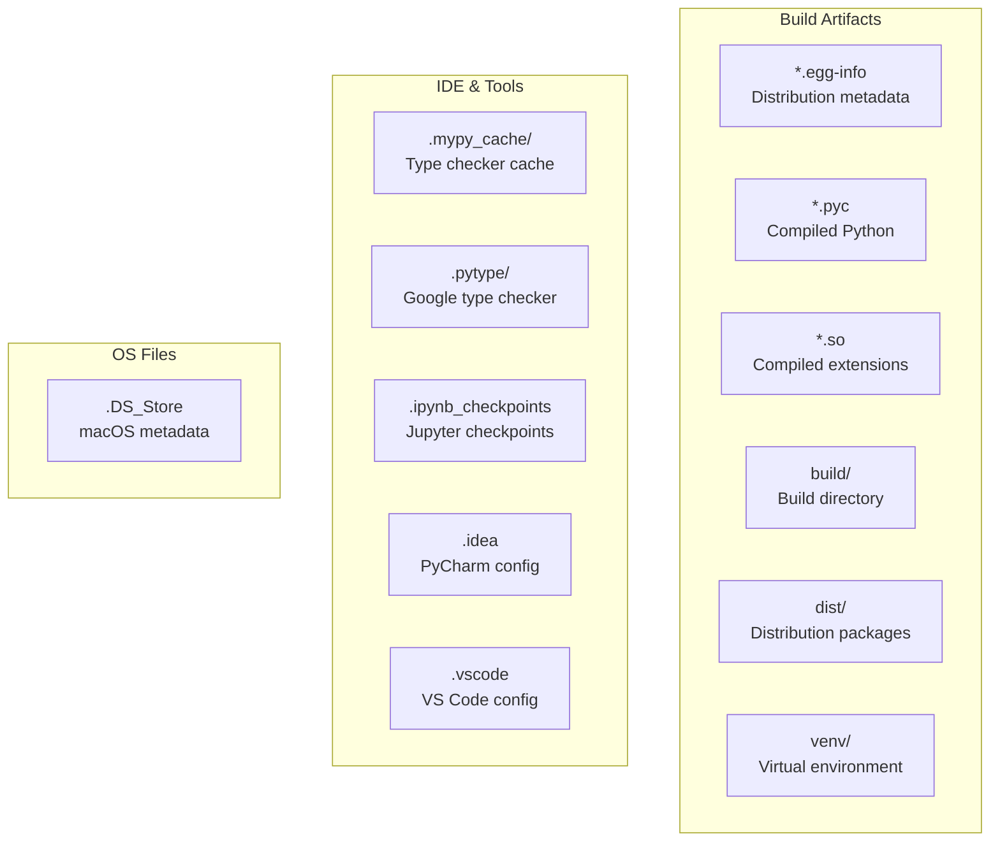
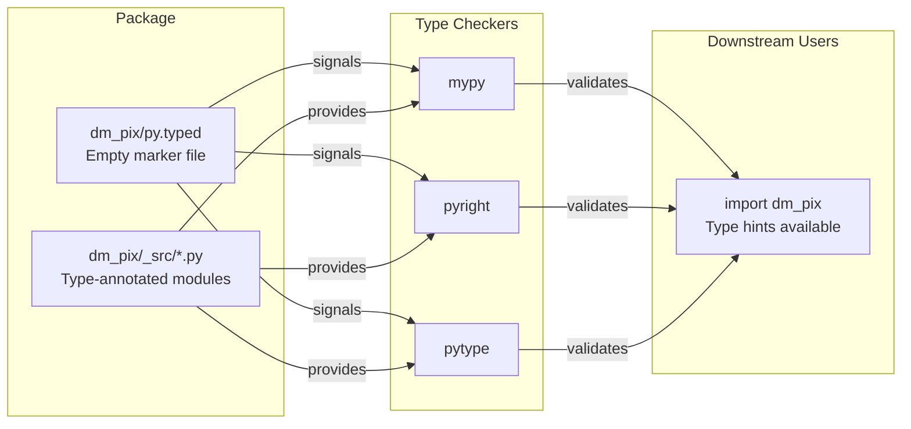
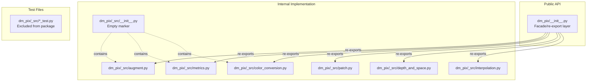

<!-- source: DeepWiki mcp.deepwiki.com · repo google-deepmind/dm_pix · page 11 Developer Guide · fetched 2026-10-26 -->

# Developer Guide

<details>
<summary>Relevant source files</summary>

The following files were used as context for generating this wiki page:

- [.gitignore](.gitignore)
- [.pylintrc](.pylintrc)
- [CONTRIBUTING.md](CONTRIBUTING.md)
- [LICENSE](LICENSE)
- [dm_pix/_src/__init__.py](dm_pix/_src/__init__.py)
- [dm_pix/py.typed](dm_pix/py.typed)
- [pyproject.toml](pyproject.toml)

</details>


This guide provides technical information for developers who want to contribute to dm_pix or understand its internal development practices. It covers development environment setup, build configuration, code quality standards, and the development workflow.

For specific contribution procedures and CLA requirements, see [Contributing to PIX](#11.1). For detailed code style rules and linting configuration, see [Code Style and Linting](#11.2). For directory organization and design principles, see [Project Structure](#11.3).

---

## Development Environment Setup

### Prerequisites

dm_pix requires Python 3.8 or higher. The project is built on JAX, which has specific platform requirements:

- **Python version**: `>=3.8` as specified in [pyproject.toml:11]()
- **JAX/JAXlib**: Version `>=0.2.17` and `>=0.1.69` respectively
- **Core dependency**: `chex>=0.0.6` for array assertions and testing utilities

### Dependency Categories

The project defines four dependency groups in [pyproject.toml:29-60]():

| Dependency Group | Purpose | Key Packages |
|------------------|---------|--------------|
| **Core** | Runtime requirements | `chex>=0.0.6` |
| **extras** | JAX framework | `jax>=0.2.17`, `jaxlib>=0.1.69` |
| **test** | Testing infrastructure | `scipy`, `tensorflow`, `pytest-xdist` |
| **docs** | Documentation generation | `sphinx>=6.0.0`, `sphinx_rtd_theme`, `myst_nb` |
| **examples** | Example notebooks | `Pillow` |

### Installation for Development

```bash
# Clone the repository
git clone https://github.com/google-deepmind/dm_pix.git
cd dm_pix

# Install in editable mode with test dependencies
pip install -e ".[test]"

# Install with all optional dependencies
pip install -e ".[extras,test,docs,examples]"
```

**Sources:** [pyproject.toml:1-65](), [CONTRIBUTING.md:1-33]()

---

## Build System Architecture

dm_pix uses `flit_core` as its build backend, a lightweight PEP 517-compliant build system that reads metadata from `pyproject.toml`.



**Build System Configuration**

The build system is configured in [pyproject.toml:1-3]():

- **Build system**: `flit_core` version `>=3.2,<4`
- **Build backend**: `flit_core.buildapi`
- **Version source**: Dynamic, read from `dm_pix/__version__.py`

### Package Metadata

Key metadata fields in [pyproject.toml:5-28]():

| Field | Value |
|-------|-------|
| **name** | `dm_pix` |
| **description** | "PIX is an image processing library in JAX, for JAX." |
| **license** | Apache License 2.0 ([LICENSE:1-203]()) |
| **authors** | Google DeepMind (`pix-dev@google.com`) |
| **requires-python** | `>=3.8` |

### Type Information

The project includes [dm_pix/py.typed:1](), an empty marker file that signals to type checkers (mypy, pyright) that the package includes inline type annotations per PEP 561. This enables static type checking for downstream users.

**Sources:** [pyproject.toml:1-65](), [dm_pix/py.typed:1](), [LICENSE:1-203]()

---

## Development Workflow



### Step-by-Step Workflow

1. **Fork and Clone**: Fork the repository and clone your fork
2. **Create Branch**: Create a feature branch from `main`
3. **Make Changes**: Edit source files in `dm_pix/_src/`
4. **Lint Code**: Run `pylint dm_pix` to check style compliance
5. **Run Tests**: Execute `./test.sh` to run the full test suite
6. **Commit**: Commit changes with descriptive messages
7. **Push**: Push your branch to GitHub
8. **Open PR**: Create a pull request against the main repository
9. **CI Validation**: Automated CI checks run on your PR
10. **Review**: Maintainers review your code
11. **Merge**: Once approved, your PR is merged

**Sources:** [CONTRIBUTING.md:1-33](), [.pylintrc:1-432]()

---

## Code Quality Tools

### Pylint Configuration

The project uses Pylint for code quality enforcement with a custom configuration based on the Google Python Style Guide.



**Key Configuration Sections**

| Section | Setting | Value |
|---------|---------|-------|
| **MASTER** | `jobs` | `4` (parallel execution) |
| **BASIC** | `function-rgx` | snake_case or CamelCase ([.pylintrc:194]()) |
| **BASIC** | `variable-rgx` | `^[a-z][a-z0-9_]*$` ([.pylintrc:197]()) |
| **FORMAT** | `max-line-length` | `80` characters ([.pylintrc:265]()) |
| **FORMAT** | `indent-string` | `'  '` (2 spaces) ([.pylintrc:292]()) |
| **LOGGING** | `logging-modules` | `logging`, `absl.logging`, `tensorflow.google.logging` ([.pylintrc:333]()) |

**Naming Conventions**

From [.pylintrc:194-221]():

- **Functions**: snake_case (`_?[a-z][a-z0-9_]*`) or CamelCase for test methods
- **Variables**: snake_case (`^[a-z][a-z0-9_]*$`)
- **Constants**: UPPER_CASE or snake_case for module-level constants
- **Classes**: CamelCase (`^_?[A-Z][a-zA-Z0-9]*$`)
- **Modules**: snake_case (`^(_?[a-z][a-z0-9_]*|__init__)$`)

**Disabled Checks**

The configuration disables 59 checks ([.pylintrc:59-143]()), including:

- Complexity checks: `too-many-arguments`, `too-many-locals`, `too-many-branches`
- Style preferences: `no-else-return`, `no-else-raise`, `fixme`
- Import checks: `import-error`, `wrong-import-order`
- Duplicate code detection: `duplicate-code`

**Running Pylint**

```bash
# Run on entire package
pylint dm_pix

# Run on specific module
pylint dm_pix/_src/augment.py

# Run with 4 parallel jobs
pylint --jobs=4 dm_pix
```

**Sources:** [.pylintrc:1-432]()

---

## Version Control Exclusions

The `.gitignore` file defines patterns for files excluded from version control:



**Exclusion Categories** ([.gitignore:1-20]()):

1. **Build and Release**: `*.egg-info`, `*.pyc`, `*.so`, `build/`, `dist/`, `venv/`
2. **Python Tools**: `.mypy_cache/`, `.pytype/`, `.ipynb_checkpoints`
3. **Editors**: `.idea`, `.vscode`
4. **OS-specific**: `.DS_Store` (macOS)

**Sources:** [.gitignore:1-20]()

---

## Testing Infrastructure

### Test Execution

The project uses a shell script for test execution:

```bash
# Run all tests
./test.sh

# Run specific test file
pytest dm_pix/_src/augment_test.py

# Run with parallel execution
pytest -n auto

# Run with verbose output
pytest -v
```

### Test Dependencies

Test dependencies are specified in [pyproject.toml:40-44]():

- **scipy**: For reference implementations
- **tensorflow**: For TensorFlow-compatible function validation
- **pytest-xdist**: For parallel test execution

### Testing Tools

| Tool | Purpose | Usage |
|------|---------|-------|
| **pytest** | Test framework | Primary test runner |
| **chex** | JAX testing utilities | Array assertions, variant testing |
| **pytest-xdist** | Parallel execution | `pytest -n auto` |
| **parameterized** | Test parameterization | Multiple test cases from single function |

**Sources:** [pyproject.toml:40-44]()

---

## Type Checking

### PEP 561 Compliance

The project includes [dm_pix/py.typed:1](), an empty marker file that enables type checking for downstream users. This signals to type checkers that the package provides inline type hints.



### Type Annotation Guidelines

When contributing code:

1. **Add type hints** to all function signatures
2. **Use JAX types** for arrays: `jax.Array` or `jnp.ndarray`
3. **Import typing modules** as needed: `from typing import Optional, Tuple, Union`
4. **Document return types** explicitly
5. **Use type variables** for generic functions

**Example Type Annotation Pattern:**

```python
def function_name(
    image: jax.Array,
    param: float,
    optional_param: Optional[int] = None
) -> jax.Array:
  """Function documentation."""
  ...
```

**Sources:** [dm_pix/py.typed:1]()

---

## Project Classifiers

The project metadata includes PyPI classifiers that describe its maturity, audience, and topic areas ([pyproject.toml:15-28]()):

| Category | Classifier |
|----------|-----------|
| **Development Status** | Beta |
| **Intended Audience** | Developers, Education, Science/Research |
| **License** | Apache License 2.0 |
| **Programming Language** | Python 3 |
| **Topics** | Artificial Intelligence, Image Processing, Mathematics, Software Development Libraries |

These classifiers help users discover the package on PyPI and understand its intended use cases.

**Sources:** [pyproject.toml:15-28]()

---

## Internal Module Organization

The project follows a private-public module pattern:



**Module Structure:**

- **`dm_pix/`**: Public package root
  - **`__init__.py`**: Public API facade (see [Public API Organization](#1.1))
  - **`py.typed`**: Type checking marker
  - **`_src/`**: Internal implementation directory (private by convention)
    - **`__init__.py`**: Empty marker file ([dm_pix/_src/__init__.py:1-14]())
    - Core modules: `augment.py`, `metrics.py`, etc.
    - Test files: `*_test.py` (excluded from distribution per [pyproject.toml:64]())

**Naming Conventions:**

- **Public modules**: Imported directly: `import dm_pix`
- **Private modules**: Prefixed with `_`: `dm_pix._src` (not intended for external use)
- **Test files**: Suffixed with `_test.py`, excluded from package builds

**Sources:** [dm_pix/_src/__init__.py:1-14](), [pyproject.toml:62-65]()

---

## Package Distribution Exclusions

The build configuration explicitly excludes certain files from distributions ([pyproject.toml:62-65]()):

```python
[tool.setuptools.packages.find]
include=["dm_pix/py.typed"]
exclude = ["*_test.py", "examples"]
```

**Excluded from Package:**

- **Test files**: `*_test.py` - Development-only, not needed by users
- **Examples**: `examples/` directory - Separate installation via `pip install dm_pix[examples]`

**Included in Package:**

- **Type marker**: `dm_pix/py.typed` - Required for PEP 561 compliance
- **Source modules**: All `dm_pix/_src/*.py` except tests
- **Public API**: `dm_pix/__init__.py`

**Sources:** [pyproject.toml:62-65]()

---

## Development Best Practices

### Before Committing

1. **Run Pylint**: `pylint dm_pix/_src/modified_file.py`
2. **Run tests**: `./test.sh` or `pytest dm_pix/_src/modified_file_test.py`
3. **Check types**: Ensure type annotations are present
4. **Update documentation**: Update docstrings and API documentation if needed

### Code Organization

- **Keep modules focused**: Each module in `_src/` has a single responsibility
- **Use internal dependencies**: Import from other `_src` modules as needed
- **Maintain test coverage**: Add tests for new functions in corresponding `*_test.py` files
- **Follow naming patterns**: Use snake_case for functions, CamelCase for classes

### Pull Request Guidelines

- **Title**: Use clear, descriptive titles
- **Description**: Explain what changes were made and why
- **Testing**: Describe how changes were tested
- **Breaking changes**: Clearly mark any API changes
- **Documentation**: Update relevant documentation

For complete contribution guidelines, see [Contributing to PIX](#11.1).

**Sources:** [CONTRIBUTING.md:1-33](), [.pylintrc:1-432]()

---

