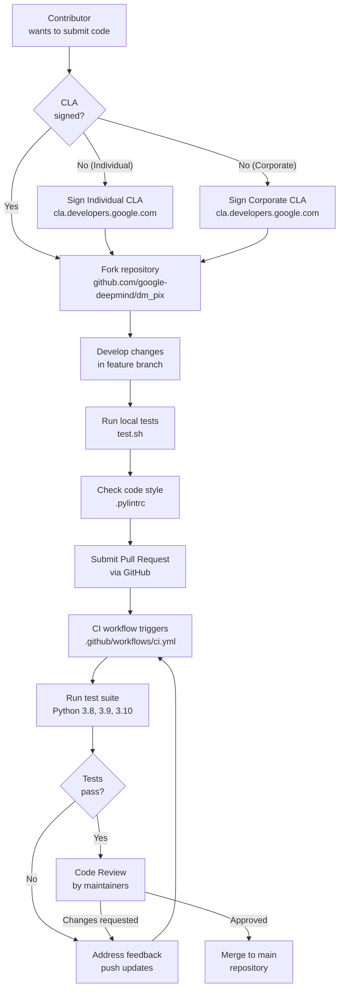
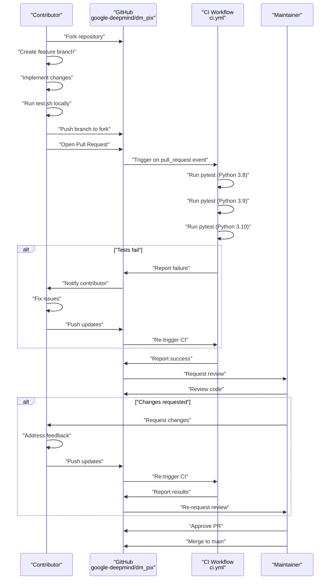
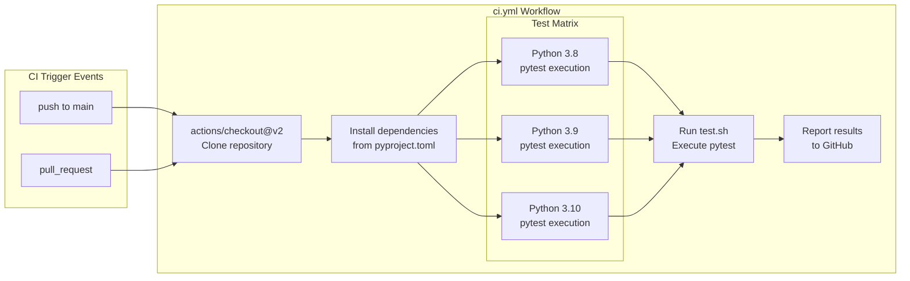

<!-- source: DeepWiki mcp.deepwiki.com · repo google-deepmind/dm_pix · page 11.1 Contributing to PIX · fetched 2026-10-26 -->

# Contributing to PIX

<details>
<summary>Relevant source files</summary>

The following files were used as context for generating this wiki page:

- [CONTRIBUTING.md](CONTRIBUTING.md)
- [LICENSE](LICENSE)
- [dm_pix/_src/__init__.py](dm_pix/_src/__init__.py)

</details>


## Purpose and Scope

This document describes the process for contributing code to the dm_pix library, including legal requirements, submission workflows, and quality standards. It covers the Contributor License Agreement (CLA) requirements, pull request procedures, and integration with the automated testing and review infrastructure.

For information about code style standards and linting configuration, see [Code Style and Linting](#11.2). For details on the project's directory structure and design principles, see [Project Structure](#11.3). For information about the testing infrastructure, see [Testing and Quality Assurance](#7).

---

## Overview of the Contribution Process

Contributing to dm_pix requires completing a legal agreement before code can be accepted, followed by submission through GitHub's pull request system. All contributions must pass automated CI validation before review.



**Sources:** [CONTRIBUTING.md:1-33]()

---

## Contributor License Agreement Requirements

### Legal Requirements

Before any code can be accepted into the dm_pix repository, contributors must sign a Contributor License Agreement (CLA). This legal requirement ensures that Google has the necessary rights to use and distribute contributed code.

| Contributor Type | Required CLA | When to Use |
|-----------------|-------------|-------------|
| Individual | [Individual CLA](https://cla.developers.google.com/about/google-individual?csw=1) | You are contributing original code that you personally own |
| Corporate | [Corporate CLA](https://cla.developers.google.com/about/google-corporate?csw=1) | Your employer owns the intellectual property of your contributions |

**Sources:** [CONTRIBUTING.md:5-24]()

### Individual CLA

Sign an Individual CLA if you are:
- Writing original source code yourself
- Sure you own the intellectual property
- Not contributing on behalf of an employer

The Individual CLA is available at `cla.developers.google.com/about/google-individual`.

**Sources:** [CONTRIBUTING.md:13-14]()

### Corporate CLA

Sign a Corporate CLA if:
- Your employer has policies about code contributions
- Your work is done as part of your employment
- Your company wants to allow you to contribute

The Corporate CLA is available at `cla.developers.google.com/about/google-corporate`.

**Sources:** [CONTRIBUTING.md:15-16]()

### Code Ownership Restrictions

Only original source code from contributors who have signed the CLA can be accepted into the main repository. This means:

- All submitted code must be original work
- Code copied from other sources (without proper licensing) cannot be accepted
- All co-authors must have signed CLAs
- Third-party code must be properly attributed and licensed

**Sources:** [CONTRIBUTING.md:22-23](), [LICENSE:49-61]()

---

## Pull Request Workflow

### Creating a Pull Request

The standard GitHub pull request workflow is used for all contributions. The process follows these steps:



**Sources:** [CONTRIBUTING.md:25-32](), [.github/workflows/ci.yml]() (referenced from Diagram 2)

### Pull Request Guidelines

When submitting a pull request:

1. **Branch naming**: Use descriptive branch names (e.g., `add-flip-vertical`, `fix-ssim-gradient`)
2. **Commit messages**: Write clear, concise commit messages explaining the change
3. **Documentation**: Update relevant documentation if adding/modifying public APIs
4. **Tests**: Include tests for new functionality or bug fixes
5. **Scope**: Keep pull requests focused on a single feature or fix

**Sources:** [CONTRIBUTING.md:27-28]()

---

## Development Environment Setup

### Repository Structure

After forking and cloning the repository, the working directory contains:

| Path | Purpose |
|------|---------|
| `dm_pix/` | Main package directory |
| `dm_pix/_src/` | Internal module implementations |
| `dm_pix/_src/*_test.py` | Test files for each module |
| `test.sh` | Test execution script |
| `.pylintrc` | Code style configuration |
| `pyproject.toml` | Package configuration and dependencies |
| `.github/workflows/` | CI/CD pipeline definitions |

**Sources:** [.pylintrc]() (referenced from Diagram 1), [test.sh]() (referenced from Diagram 2), [pyproject.toml]() (referenced from Diagram 2)

### Local Testing Requirements

Before submitting a pull request, contributors should:

1. **Run the full test suite** using [test.sh:1-*]()
2. **Verify code style** compliance with [.pylintrc:1-*]()
3. **Test JAX transformations** (jit, vmap, pmap) if modifying core functions
4. **Check documentation** builds correctly if updating docstrings

For detailed testing procedures, see [Running Tests](#7.3).

**Sources:** [test.sh]() (referenced from Diagram 2), [.pylintrc]() (referenced from Diagram 1)

---

## Continuous Integration Validation

### CI Pipeline Overview

All pull requests automatically trigger the CI pipeline defined in `.github/workflows/ci.yml`. The pipeline validates code across multiple Python versions:



**Sources:** [.github/workflows/ci.yml]() (referenced from Diagram 2)

### Test Requirements

For a pull request to be merged, it must:

| Requirement | Validation Method |
|------------|-------------------|
| Pass all existing tests | `pytest` execution via `test.sh` |
| Maintain test coverage | All test files in `dm_pix/_src/*_test.py` |
| Support Python 3.8-3.10 | Matrix testing in `ci.yml` |
| Follow code style | `.pylintrc` configuration |
| Include new tests | For new features or bug fixes |

**Sources:** [.github/workflows/ci.yml]() (referenced from Diagram 2), [test.sh]() (referenced from Diagram 2)

### Understanding Test Failures

When CI tests fail, contributors should:

1. **Review the GitHub Actions log** to identify which test failed
2. **Reproduce locally** using `test.sh` or `pytest` directly
3. **Check the specific test file** (e.g., `augment_test.py`, `metrics_test.py`)
4. **Verify JAX transformations** if the failure involves `chex.all_variants`

Common failure patterns:
- **Numerical precision**: Floating-point comparison tolerances
- **Shape mismatches**: Incorrect array dimensions
- **JAX transformation issues**: Functions not compatible with jit/vmap/pmap

For details on test architecture, see [Test Architecture](#7.1).

**Sources:** [dm_pix/_src/augment_test.py]() (referenced from Diagram 3), [dm_pix/_src/metrics_test.py]() (referenced from Diagram 3)

---

## Code Review Process

### Review Criteria

Maintainers evaluate pull requests based on:

1. **Correctness**: Does the code work as intended?
2. **Testing**: Are there adequate tests with good coverage?
3. **API design**: Is the interface consistent with existing functions?
4. **Documentation**: Are docstrings clear and complete?
5. **JAX compatibility**: Does it work with jit/vmap/pmap?
6. **Performance**: Are there unnecessary computational bottlenecks?

**Sources:** [CONTRIBUTING.md:27-28]()

### Response to Feedback

When maintainers request changes:

1. **Address all comments** individually
2. **Push updates** to the same branch
3. **CI will automatically re-run** validation
4. **Reply to comments** when changes are complete
5. **Request re-review** if needed

**Sources:** [CONTRIBUTING.md:27-28]()

---

## Licensing and Copyright

### License Terms

All contributions to dm_pix are licensed under the Apache License 2.0. By submitting code:

- You grant Google a perpetual, worldwide, non-exclusive, royalty-free license
- Your contribution remains under Apache 2.0 terms
- You retain copyright to your original work
- The project can redistribute and modify your contribution

**Sources:** [LICENSE:1-203]()

### Copyright Headers

All source files must include the standard copyright header:

```python
# Copyright 2021 DeepMind Technologies Limited. All Rights Reserved.
#
# Licensed under the Apache License, Version 2.0 (the "License");
# you may not use this file except in compliance with the License.
# You may obtain a copy of the License at
#
#     http://www.apache.org/licenses/LICENSE-2.0
#
# Unless required by applicable law or agreed to in writing, software
# distributed under the License is distributed on an "AS IS" BASIS,
# WITHOUT WARRANTIES OR CONDITIONS OF ANY KIND, either express or implied.
# See the License for the specific language governing permissions and
# limitations under the License.
```

**Sources:** [dm_pix/_src/__init__.py:1-14]()

---

## Contribution Checklist

Before submitting a pull request, verify:

- [ ] CLA signed (Individual or Corporate)
- [ ] Changes implemented in feature branch
- [ ] Tests added/updated for new functionality
- [ ] All tests pass locally via `test.sh`
- [ ] Code follows style guidelines (`.pylintrc`)
- [ ] Documentation updated if API changed
- [ ] Copyright header present in new files
- [ ] Commit messages are clear and descriptive
- [ ] PR description explains the change

**Sources:** [CONTRIBUTING.md:1-33]()

---

## Getting Help

For questions about contributing:

1. **Review existing issues** on GitHub for similar discussions
2. **Check documentation** at Read the Docs
3. **Open a GitHub issue** for clarification before starting major work
4. **Reference the GitHub PR HowTo** at https://help.github.com/articles/using-pull-requests/

**Sources:** [CONTRIBUTING.md:28-32]()

---

