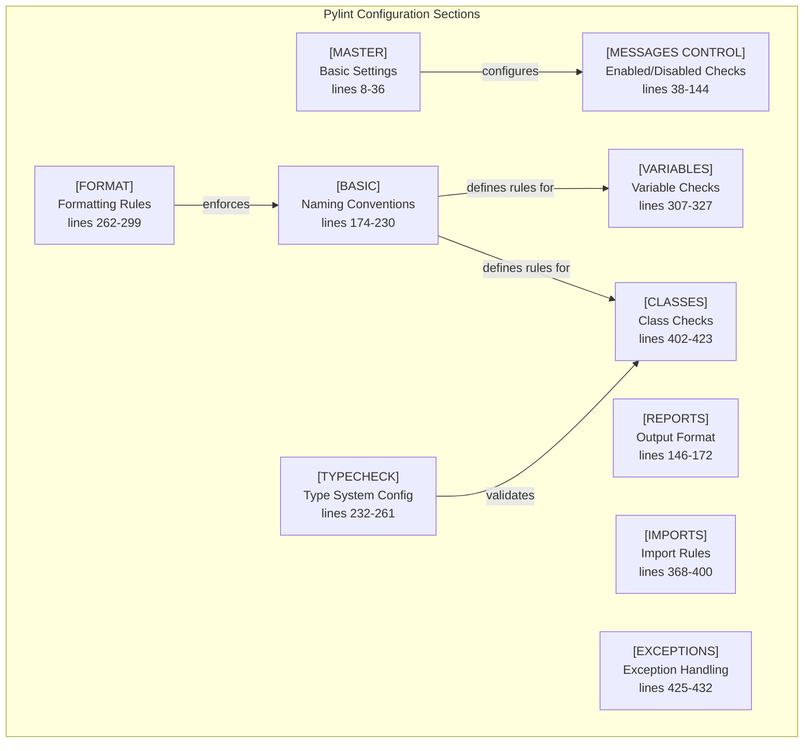
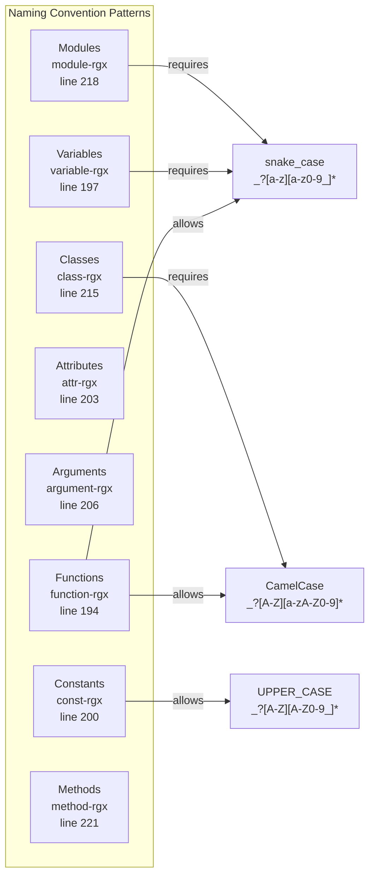
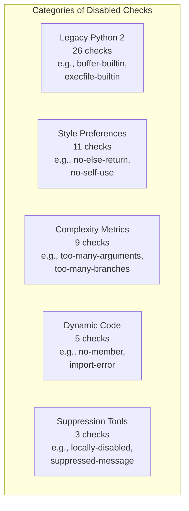
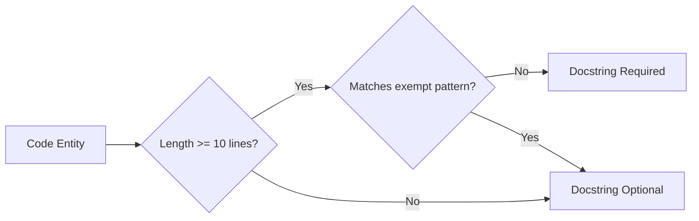
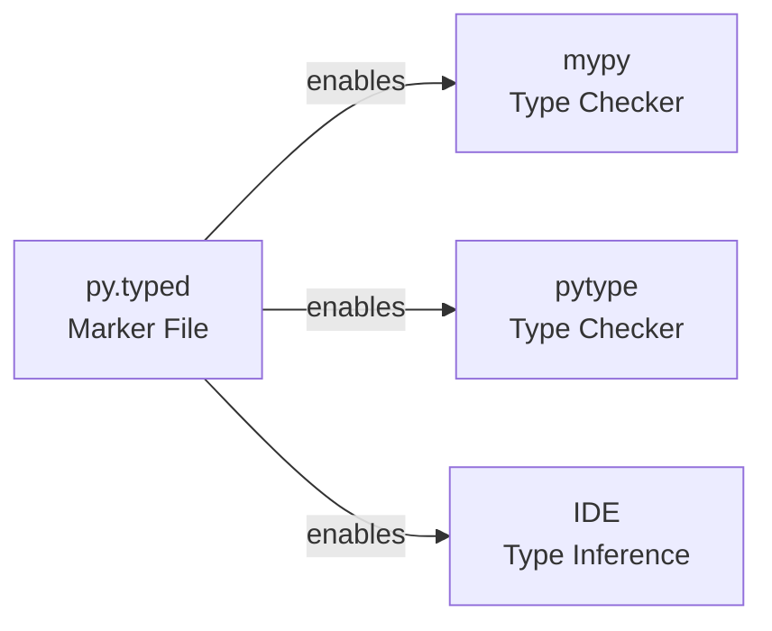

<!-- source: DeepWiki mcp.deepwiki.com · repo google-deepmind/dm_pix · page 11.2 Code Style and Linting · fetched 2026-10-26 -->

# Code Style and Linting

<details>
<summary>Relevant source files</summary>

The following files were used as context for generating this wiki page:

- [.gitignore](.gitignore)
- [.pylintrc](.pylintrc)
- [dm_pix/py.typed](dm_pix/py.typed)

</details>


## Purpose and Scope

This page documents the code style requirements and linting configuration for dm_pix. It covers the Pylint setup, naming conventions, disabled checks, and format requirements that contributors must follow. For information about the contribution workflow and PR process, see [Contributing to PIX](#11.1). For details about the project's directory organization, see [Project Structure](#11.3).

## Overview

dm_pix enforces code quality through Pylint, configured to follow the [Google Python Style Guide](https://google.github.io/styleguide/pyguide.html). The configuration is based on Google's canonical Pylint configuration and has been adapted for the dm_pix codebase. Type checking is enabled via the `py.typed` marker file at [dm_pix/py.typed:1]().

## Pylint Configuration Structure

The Pylint configuration is defined in [.pylintrc:1-432]() and organizes settings into multiple sections:



**Sources:** [.pylintrc:1-432]()

## Master Configuration

The `[MASTER]` section [.pylintrc:8-36]() defines core Pylint behavior:

| Setting | Value | Purpose |
|---------|-------|---------|
| `ignore` | `third_party` | Excludes third-party code from linting |
| `persistent` | `no` | Disables data caching between runs |
| `jobs` | `4` | Enables parallel processing with 4 workers |
| `unsafe-load-any-extension` | `no` | Prevents loading arbitrary C extensions |

The parallel processing configuration enables faster linting of the codebase by distributing checks across 4 worker processes [.pylintrc:26]().

**Sources:** [.pylintrc:8-36]()

## Naming Conventions

dm_pix follows strict naming conventions defined in [.pylintrc:174-230](). The configuration supports both snake_case and CamelCase where appropriate:



### Pattern Details

**Function Names** [.pylintrc:194]():
```
^(?:(?P<exempt>setUp|tearDown|setUpModule|tearDownModule)|
  (?P<camel_case>_?[A-Z][a-zA-Z0-9]*)|
  (?P<snake_case>_?[a-z][a-z0-9_]*))$
```
- Supports snake_case (e.g., `adjust_brightness`, `random_hue`)
- Supports CamelCase for test methods (e.g., `setUp`, `tearDown`)
- Allows leading underscore for private functions

**Variable Names** [.pylintrc:197]():
```
^[a-z][a-z0-9_]*$
```
- Requires lowercase with underscores (e.g., `input_image`, `kernel_size`)

**Constant Names** [.pylintrc:200]():
```
^(_?[A-Z][A-Z0-9_]*|__[a-z0-9_]+__|_?[a-z][a-z0-9_]*)$
```
- Uppercase with underscores (e.g., `DEFAULT_KERNEL_SIZE`)
- Allows dunder constants (e.g., `__version__`)
- Allows lowercase for module-level private constants

**Class Names** [.pylintrc:215]():
```
^_?[A-Z][a-zA-Z0-9]*$
```
- Requires CamelCase (e.g., `ImageTransform`, `MetricCalculator`)

**Module Names** [.pylintrc:218]():
```
^(_?[a-z][a-z0-9_]*|__init__)$
```
- Requires lowercase with underscores (e.g., `augment`, `color_conversion`, `metrics`)

**Sources:** [.pylintrc:174-230]()

## Disabled Checks

dm_pix disables 84 Pylint checks [.pylintrc:59-143]() to align with Google's style guide and practical development needs:



### Key Disabled Checks

| Check | Reason | Impact |
|-------|--------|--------|
| `no-else-return` [.pylintrc:100]() | Allows explicit else after return | Improves readability in some cases |
| `too-many-arguments` [.pylintrc:126]() | Disables function argument count limit | Necessary for complex image processing functions |
| `too-many-locals` [.pylintrc:130]() | Disables local variable count limit | Allows detailed computations in functions |
| `no-member` [.pylintrc:101]() | Disables attribute existence checks | Prevents false positives with JAX |
| `import-error` [.pylintrc:82]() | Disables import resolution checks | Avoids issues with dynamic imports |
| `duplicate-code` [.pylintrc:71]() | Disables code duplication detection | Allows similar patterns across modules |
| `fixme` [.pylintrc:76]() | Allows TODO comments | Supports incremental development |
| `global-statement` [.pylintrc:78]() | Allows global statements | Necessary for module-level state |

**Sources:** [.pylintrc:59-143]()

## Format Requirements

### Line Length

Maximum line length is set to **80 characters** [.pylintrc:265]():

```python
# Maximum number of characters on a single line.
max-line-length=80
```

Exceptions are made for:
- URLs [.pylintrc:271-273]()
- Import statements [.pylintrc:271-273]()

The pattern for allowed long lines [.pylintrc:271-273]():
```
(?x)(
  ^\s*(\#\ )?<?https?://\S+>?$|
  ^\s*(from\s+\S+\s+)?import\s+.+$)
```

### Indentation

dm_pix uses **2-space indentation** [.pylintrc:292]() to align with Google's internal style and open-source projects like TensorFlow:

```python
# String used as indentation unit.  The internal Google style guide mandates 2
# spaces.  Google's externally-published style guide says 4, consistent with
# PEP 8.  Here, we use 2 spaces, for conformity with many open-sourced Google
# projects (like TensorFlow).
indent-string='  '
```

Hanging/continued lines require **4-space indent** [.pylintrc:295]():
```python
indent-after-paren=4
```

### Single-Line Conditionals

Single-line if statements are allowed [.pylintrc:277]() when there is no else clause:
```python
single-line-if-stmt=yes
```

**Sources:** [.pylintrc:262-299]()

## Docstring Requirements

Functions and classes require docstrings based on length [.pylintrc:224-229]():



**Exempt Patterns** [.pylintrc:225]():
- Dunder methods (e.g., `__init__`, `__str__`)
- `main` function
- Test methods (e.g., `test_*`, `*Test`)

**Minimum Length**: 10 lines [.pylintrc:229]()

**Sources:** [.pylintrc:224-229]()

## Type Checking

dm_pix supports type checking through the `py.typed` marker file [dm_pix/py.typed:1](), indicating that the package provides inline type annotations compatible with PEP 561.

This enables:
- Static type checking with mypy or pytype
- IDE type inference and autocompletion
- Documentation generation from type hints



**Sources:** [dm_pix/py.typed:1]()

## Import Configuration

The imports section [.pylintrc:368-400]() defines module categorization:

### Known Third-Party Libraries

Specified in [.pylintrc:394]():
```python
known-third-party=enchant, absl
```

### Deprecated Modules

Modules that should not be used [.pylintrc:371-375]():
```python
deprecated-modules=regsub,
                   TERMIOS,
                   Bastion,
                   rexec,
                   sets
```

**Sources:** [.pylintrc:368-400]()

## Variable Checking

The variables section [.pylintrc:307-327]() configures variable usage checks:

### Dummy Variables

Pattern for intentionally unused variables [.pylintrc:314]():
```python
dummy-variables-rgx=^\*{0,2}(_$|unused_|dummy_)
```

Examples:
- `_` (single underscore)
- `unused_variable`
- `dummy_param`

### Callback Naming

Callback functions must start or end with [.pylintrc:322]():
```python
callbacks=cb_,_cb
```

**Sources:** [.pylintrc:307-327]()

## Running Pylint

### Command Line Usage

Basic execution:
```bash
pylint dm_pix
```

With specific configuration:
```bash
pylint --rcfile=.pylintrc dm_pix
```

Parallel execution (configured by default):
```bash
pylint --jobs=4 dm_pix
```

### Output Format

Configured to use text format [.pylintrc:151]():
```python
output-format=text
```

Reports are disabled by default [.pylintrc:160]() for cleaner output:
```python
reports=no
```

### Evaluation Formula

Code quality score is calculated using [.pylintrc:167]():
```python
evaluation=10.0 - ((float(5 * error + warning + refactor + convention) / statement) * 10)
```

Where:
- **error**: Critical issues (weight: 5)
- **warning**: Potential problems (weight: 1)
- **refactor**: Code improvement suggestions (weight: 1)
- **convention**: Style violations (weight: 1)
- **statement**: Total statements analyzed

**Sources:** [.pylintrc:146-172]()

## Ignored Files

The [.gitignore:1-20]() file excludes build artifacts and tool outputs from version control:

### Build Artifacts
- `*.egg-info` [.gitignore:2]()
- `*.pyc` [.gitignore:3]()
- `*.so` [.gitignore:4]()
- `build/` [.gitignore:5]()
- `dist/` [.gitignore:6]()
- `venv/` [.gitignore:7]()

### Tool Outputs
- `.mypy_cache/` [.gitignore:13]() - MyPy type checking cache
- `.pytype/` [.gitignore:14]() - Pytype type checking output
- `.ipynb_checkpoints` [.gitignore:15]() - Jupyter notebook checkpoints

**Sources:** [.gitignore:1-20]()

## Integration with CI/CD

Pylint is integrated into the development workflow through the CI pipeline (see [Continuous Integration Workflow](#8.1)). The linting checks run automatically on:
- Every push to the repository
- Every pull request
- Across Python 3.8, 3.9, and 3.10

This ensures code quality is maintained consistently across all contributions.

**Sources:** [.pylintrc:1-432](), [dm_pix/py.typed:1](), [.gitignore:1-20]()

---

