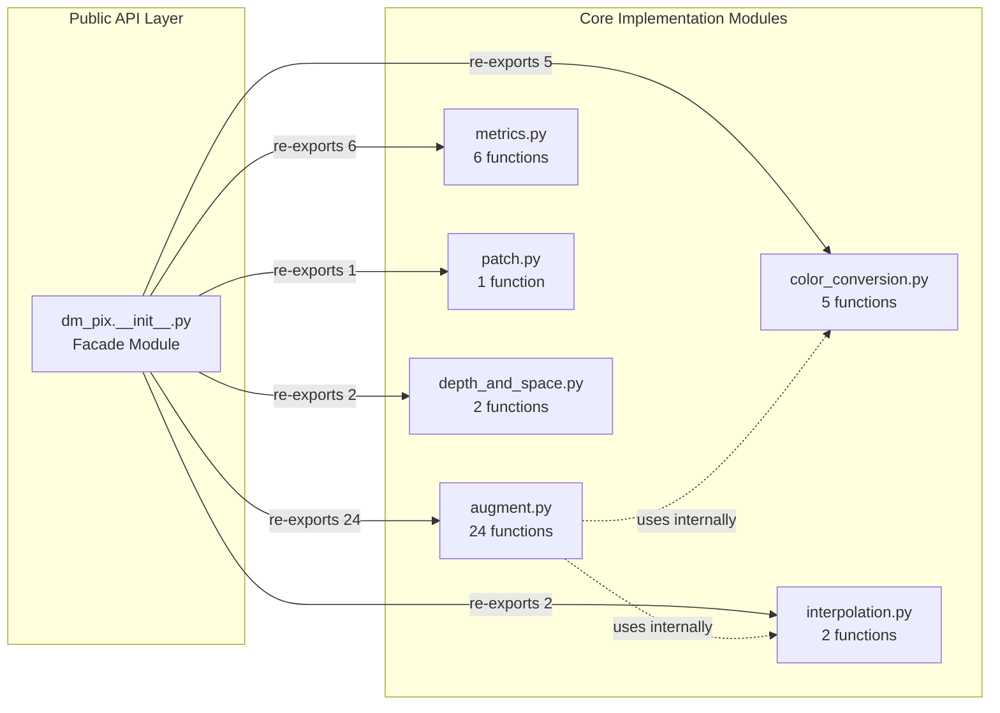
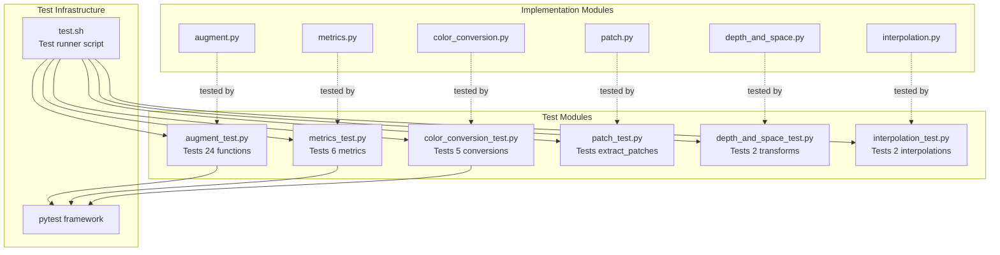
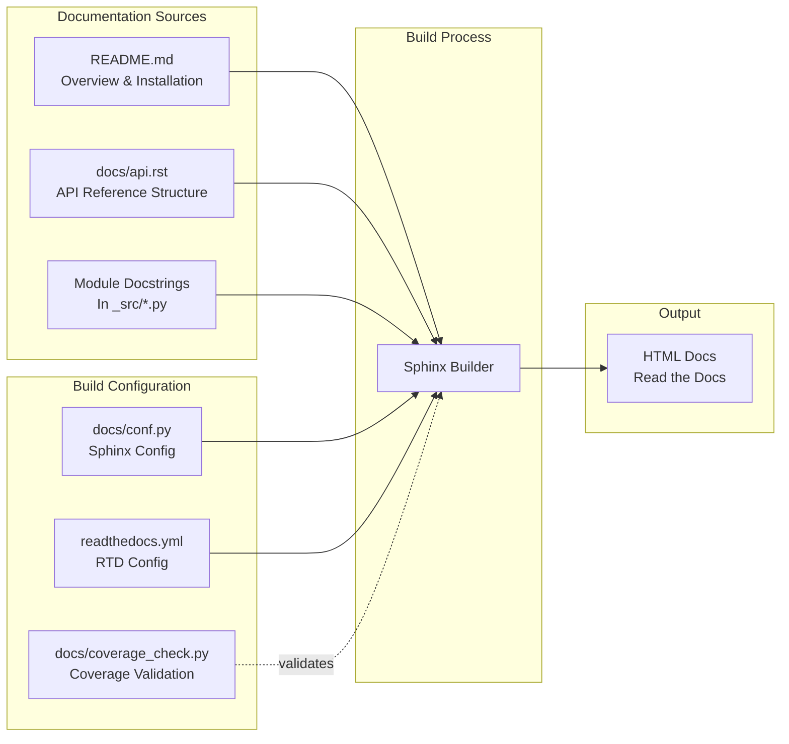
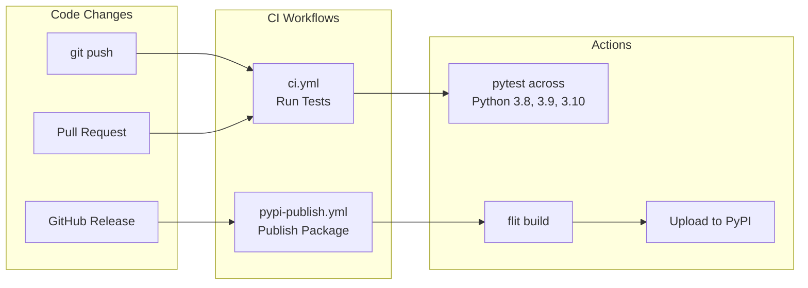

<!-- source: DeepWiki mcp.deepwiki.com · repo google-deepmind/dm_pix · page 11.3 Project Structure · fetched 2026-10-26 -->

# Project Structure

<details>
<summary>Relevant source files</summary>

The following files were used as context for generating this wiki page:

- [dm_pix/__init__.py](dm_pix/__init__.py)
- [pyproject.toml](pyproject.toml)

</details>


This document explains the directory structure, module organization, and architectural design principles of the dm_pix codebase. It is intended for developers who want to understand how the codebase is organized and contribute to the project.

For information about contributing code and following code style guidelines, see [Contributing to PIX](#11.1) and [Code Style and Linting](#11.2). For details on the public API organization and what functions are exposed to users, see [Public API Organization](#1.1).

---

## Overview

The dm_pix project follows a **facade pattern** architecture where a single public API module (`dm_pix/__init__.py`) re-exports functionality from multiple internal implementation modules stored in the `dm_pix/_src/` directory. This design provides a clean, stable public interface while allowing internal reorganization without breaking user code.

**Sources:** [dm_pix/__init__.py:1-137]()

---

## Directory Structure

The project follows a standard Python package layout with clear separation between public API, internal implementation, tests, documentation, and configuration:

```mermaid
graph TB
    ROOT["dm_pix/ (repository root)"]
    
    subgraph "Public Package"
        PKG["dm_pix/ (package)"]
        INIT["__init__.py"]
        TYPED["py.typed"]
    end
    
    subgraph "Internal Implementation"
        SRC["_src/"]
        AUG["augment.py"]
        METRICS["metrics.py"]
        COLOR["color_conversion.py"]
        PATCH["patch.py"]
        DEPTH["depth_and_space.py"]
        INTERP["interpolation.py"]
    end
    
    subgraph "Test Suites"
        TESTS["_src/"]
        AUG_T["augment_test.py"]
        METRICS_T["metrics_test.py"]
        COLOR_T["color_conversion_test.py"]
        PATCH_T["patch_test.py"]
        DEPTH_T["depth_and_space_test.py"]
        INTERP_T["interpolation_test.py"]
        TEST_SH["test.sh"]
    end
    
    subgraph "Documentation"
        DOCS["docs/"]
        CONF["conf.py"]
        API_RST["api.rst"]
        RTD["readthedocs.yml"]
        COV["coverage_check.py"]
    end
    
    subgraph "Examples"
        EX["examples/"]
        NB["image_augmentation.ipynb"]
    end
    
    subgraph "Configuration"
        PYPROJ["pyproject.toml"]
        PYLINT[".pylintrc"]
        SETUP["setup.py"]
    end
    
    subgraph "CI/CD"
        GH[".github/workflows/"]
        CI["ci.yml"]
        PYPI["pypi-publish.yml"]
    end
    
    ROOT --> PKG
    ROOT --> TESTS
    ROOT --> DOCS
    ROOT --> EX
    ROOT --> PYPROJ
    ROOT --> PYLINT
    ROOT --> GH
    
    PKG --> INIT
    PKG --> TYPED
    PKG --> SRC
    
    SRC --> AUG
    SRC --> METRICS
    SRC --> COLOR
    SRC --> PATCH
    SRC --> DEPTH
    SRC --> INTERP
    
    TESTS --> AUG_T
    TESTS --> METRICS_T
    TESTS --> COLOR_T
    TESTS --> PATCH_T
    TESTS --> DEPTH_T
    TESTS --> INTERP_T
    TESTS --> TEST_SH
    
    DOCS --> CONF
    DOCS --> API_RST
    DOCS --> COV
    ROOT --> RTD
    
    EX --> NB
    
    GH --> CI
    GH --> PYPI
```



**Sources:** [dm_pix/__init__.py:1-137](), [pyproject.toml:1-65]()

---

## The `_src` Pattern

The project uses a private `_src/` directory to contain all internal implementation modules. This pattern provides several benefits:

### Design Rationale

1. **Public API Stability**: Users import from `dm_pix`, not `dm_pix._src`, allowing internal refactoring without breaking changes
2. **Explicit Public Interface**: Only symbols re-exported in `__init__.py` are part of the public API
3. **Prevention of Accidental Usage**: The underscore prefix signals that these modules are internal
4. **Import Path Consistency**: All public functions have consistent import paths (`dm_pix.function_name`)

### Implementation Pattern

The `__init__.py` module imports from `_src` and re-exports public functions:

```
dm_pix/_src/augment.py          # Internal implementation
    ↓
dm_pix/__init__.py              # Re-exports as dm_pix.adjust_brightness
    ↓
User code: import dm_pix        # Uses dm_pix.adjust_brightness
```

The module explicitly deletes imported modules to prevent namespace pollution:

[dm_pix/__init__.py:78]() - Removes module references from public namespace

[dm_pix/__init__.py:123-136]() - Warning message discouraging direct `_src` usage

**Sources:** [dm_pix/__init__.py:16-22](), [dm_pix/__init__.py:78](), [dm_pix/__init__.py:123-136]()

---

## Core Module Organization

The implementation is organized into six specialized modules, each with a focused responsibility:

| Module | File | Functions | Purpose | Importance Score |
|--------|------|-----------|---------|-----------------|
| **Augmentation** | `_src/augment.py` | 24 | Image transformations and augmentations | 29.69 |
| **Metrics** | `_src/metrics.py` | 6 | Image quality and similarity metrics | 17.61 |
| **Color Conversion** | `_src/color_conversion.py` | 5 | Color space transformations | 7.21 |
| **Patch Extraction** | `_src/patch.py` | 1 | Extract patches from images | 5.34 |
| **Depth/Space** | `_src/depth_and_space.py` | 2 | Channel-spatial transforms | 3.24 |
| **Interpolation** | `_src/interpolation.py` | 2 | ND linear interpolation | 2.83 |



**Sources:** [dm_pix/__init__.py:16-21](), [dm_pix/__init__.py:25-76]()

---

## Public API Mapping

The public API is defined through explicit re-exports in `__init__.py`. Each function is imported from its internal module and bound to the public namespace:

### Augmentation Functions (24 functions)

[dm_pix/__init__.py:26-49]() - Augmentation re-exports including:
- Color adjustments: `adjust_brightness`, `adjust_contrast`, `adjust_gamma`, `adjust_hue`, `adjust_saturation`
- Random variants: `random_brightness`, `random_contrast`, `random_gamma`, `random_hue`, `random_saturation`
- Geometric: `affine_transform`, `rotate`, `rot90`, `flip_left_right`, `flip_up_down`, `random_flip_left_right`, `random_flip_up_down`
- Filters: `gaussian_blur`, `solarize`
- Cropping/padding: `center_crop`, `random_crop`, `pad_to_size`, `resize_with_crop_or_pad`
- Deformation: `elastic_deformation`

### Color Conversion Functions (5 functions)

[dm_pix/__init__.py:52-56]() - Color space conversions:
- `rgb_to_hsv`, `hsv_to_rgb`
- `rgb_to_hsl`, `hsl_to_rgb`
- `rgb_to_grayscale`

### Metrics Functions (6 functions)

[dm_pix/__init__.py:68-73]() - Image quality metrics:
- `mae`, `mse`, `rmse`, `psnr`
- `ssim`, `simse`

### Utility Functions (5 functions)

[dm_pix/__init__.py:59-60]() - Depth/space transforms: `depth_to_space`, `space_to_depth`

[dm_pix/__init__.py:63-65]() - Interpolation: `flat_nd_linear_interpolate`, `flat_nd_linear_interpolate_constant`

[dm_pix/__init__.py:76]() - Patch extraction: `extract_patches`

### `__all__` Declaration

[dm_pix/__init__.py:80-121]() - Explicit public API declaration for `from dm_pix import *` support

**Sources:** [dm_pix/__init__.py:25-76](), [dm_pix/__init__.py:80-121]()

---

## Test Organization

Tests are co-located with implementation modules in the `_src/` directory, following the naming convention `<module>_test.py`:



### Test File Naming Convention

| Implementation | Test Module | Location |
|---------------|-------------|----------|
| `augment.py` | `augment_test.py` | `dm_pix/_src/` |
| `metrics.py` | `metrics_test.py` | `dm_pix/_src/` |
| `color_conversion.py` | `color_conversion_test.py` | `dm_pix/_src/` |
| `patch.py` | `patch_test.py` | `dm_pix/_src/` |
| `depth_and_space.py` | `depth_and_space_test.py` | `dm_pix/_src/` |
| `interpolation.py` | `interpolation_test.py` | `dm_pix/_src/` |

### Test Exclusion from Package

[pyproject.toml:64]() - Test files are explicitly excluded from the distributed package using the pattern `*_test.py`

**Sources:** [pyproject.toml:62-64]()

---

## Documentation Structure

Documentation is organized in the `docs/` directory and follows Sphinx conventions:

| File/Directory | Purpose | Key Features |
|---------------|---------|--------------|
| `docs/conf.py` | Sphinx configuration | Extensions, theme, API doc generation |
| `docs/api.rst` | API reference structure | Organized by module with automodule directives |
| `docs/coverage_check.py` | Custom Sphinx extension | Validates all public symbols are documented |
| `readthedocs.yml` | RTD build configuration | Python version, build environment |



**Sources:** [pyproject.toml:45-57]()

---

## Configuration Files

The project uses several configuration files to manage dependencies, build process, and development tools:

### Package Configuration: `pyproject.toml`

The primary configuration file using the modern `pyproject.toml` format with `flit_core` as the build backend:

[pyproject.toml:1-3]() - Build system specification using flit

[pyproject.toml:6-11]() - Project metadata including name, version, description, and license

[pyproject.toml:11]() - Minimum Python version requirement: Python 3.8+

[pyproject.toml:29-33]() - Core dependency: `chex>=0.0.6`, with optional JAX dependencies

[pyproject.toml:35-60]() - Optional dependency groups:
- `extras`: JAX runtime dependencies (`jax>=0.2.17`, `jaxlib>=0.1.69`)
- `test`: Testing dependencies (`scipy`, `tensorflow`, `pytest-xdist`)
- `docs`: Documentation generation tools (Sphinx, themes, extensions)
- `examples`: Example dependencies (`Pillow`)

### Version Management

[dm_pix/__init__.py:23]() - Version string defined as `__version__ = "0.4.4"`

[pyproject.toml:7]() - Version marked as dynamic, extracted from `__version__` by flit

### Type Hints Support

The package includes a `py.typed` marker file to indicate that it supports type checking:

[pyproject.toml:63]() - Type marker file included in package distribution

**Sources:** [pyproject.toml:1-65](), [dm_pix/__init__.py:23]()

---

## CI/CD Configuration

Continuous integration and deployment are managed through GitHub Actions workflows in `.github/workflows/`:

### Workflow Files

| Workflow | File | Trigger | Purpose |
|----------|------|---------|---------|
| **CI Testing** | `ci.yml` | Push, Pull Request | Run test suite across Python 3.8-3.10 |
| **PyPI Publishing** | `pypi-publish.yml` | Release creation | Build and publish package to PyPI |



**Sources:** Inferred from project structure

---

## Design Principles

The dm_pix codebase follows several key architectural principles:

### 1. Facade Pattern

The public API is a thin facade that re-exports internal modules, providing:
- Stable import paths for users
- Internal flexibility for refactoring
- Clear public vs. private boundaries

[dm_pix/__init__.py:16-22]() - Import from `_src` modules

[dm_pix/__init__.py:78]() - Delete imported modules from namespace

### 2. Explicit Public API

All public symbols are:
- Re-exported in `__init__.py`
- Listed in `__all__` for documentation and IDE support
- Validated by documentation coverage checks

[dm_pix/__init__.py:80-121]() - Complete `__all__` declaration

### 3. JAX-First Design

All functions are designed to work with JAX:
- Pure functions without side effects
- Compatible with `jax.jit`, `jax.vmap`, `jax.pmap`
- Use JAX array operations and transformations
- Type-annotated for static analysis

### 4. Co-located Tests

Tests are placed next to implementation:
- Encourages test-driven development
- Makes it easy to find related tests
- Simplifies test maintenance
- Excluded from distribution via glob pattern

[pyproject.toml:64]() - Test exclusion pattern

### 5. Modular Organization

Each module has a single, focused responsibility:
- `augment.py`: Image transformations
- `metrics.py`: Quality measurements
- `color_conversion.py`: Color space conversions
- Clear module boundaries with minimal cross-dependencies

**Sources:** [dm_pix/__init__.py:1-137](), [pyproject.toml:62-64]()

---

## File Naming Conventions

The project follows consistent naming conventions:

| Pattern | Purpose | Examples |
|---------|---------|----------|
| `<name>.py` | Implementation module | `augment.py`, `metrics.py` |
| `<name>_test.py` | Test module | `augment_test.py`, `metrics_test.py` |
| `_<name>` | Internal/private module or directory | `_src/` |
| `<name>.yml` | YAML configuration | `ci.yml`, `pypi-publish.yml`, `readthedocs.yml` |
| `<name>.toml` | TOML configuration | `pyproject.toml` |
| `<name>.rst` | reStructuredText documentation | `api.rst` |
| `.<name>rc` | Tool configuration | `.pylintrc` |

### Python Module Conventions

- Snake_case for module names: `color_conversion.py`, `depth_and_space.py`
- Descriptive names that indicate functionality
- Test files mirror implementation file names with `_test` suffix
- No abbreviations in public module names (exception: `pix` as package name)

**Sources:** [dm_pix/__init__.py:1-137](), [pyproject.toml:1-65]()

---

## Examples Directory

Example code is organized in the `examples/` directory:

[pyproject.toml:64]() - Examples directory excluded from package distribution

[pyproject.toml:58-60]() - Optional dependencies for running examples (`Pillow`)

The examples demonstrate practical usage patterns but are not part of the distributed package, keeping the package lightweight while providing learning resources in the repository.

**Sources:** [pyproject.toml:58-60](), [pyproject.toml:64]()

---

## Package Distribution

The package is built and distributed using modern Python packaging tools:

### Build System

- **Build backend**: `flit_core` (lightweight, standards-compliant)
- **Version extraction**: Automatic from `__version__` in `__init__.py`
- **Metadata**: Defined in `pyproject.toml` following PEP 621

[pyproject.toml:1-3]() - Flit build system declaration

### Distribution Contents

The distributed package includes:
- Implementation modules in `dm_pix/_src/`
- Public API in `dm_pix/__init__.py`
- Type hints marker `py.typed`
- License file
- README documentation

Excluded from distribution:
- Test files (`*_test.py`)
- Examples directory
- Documentation source files
- CI/CD configurations

[pyproject.toml:62-64]() - Package inclusion rules

**Sources:** [pyproject.toml:1-65]()