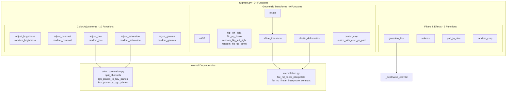
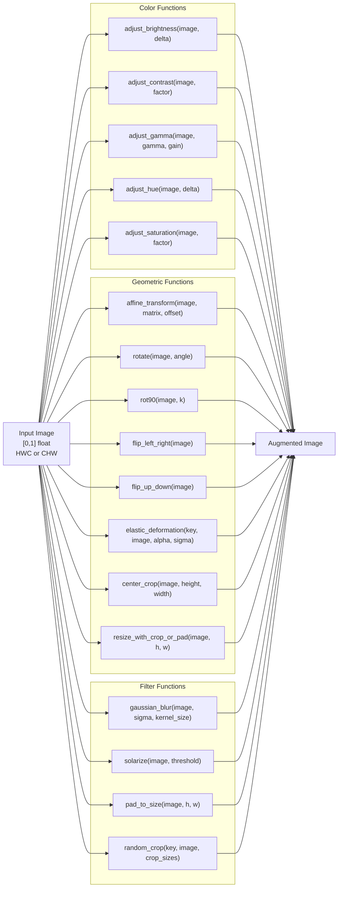
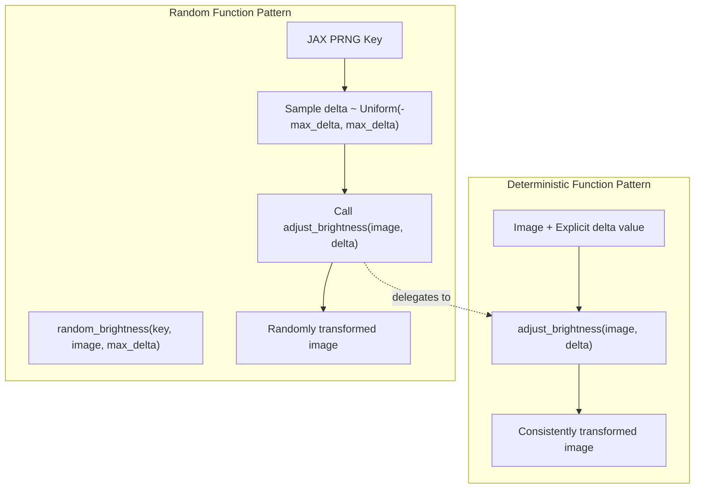
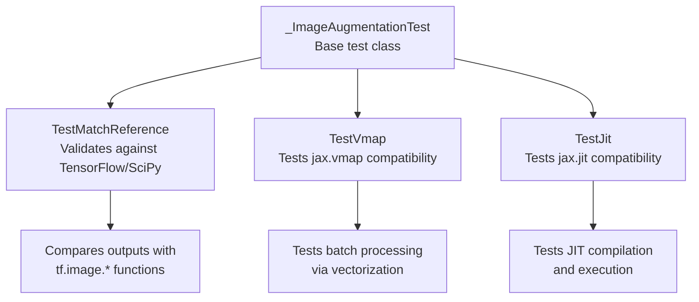
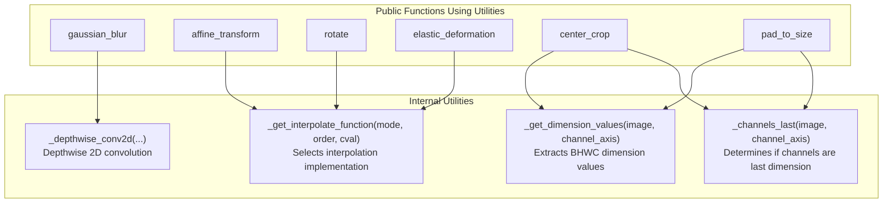
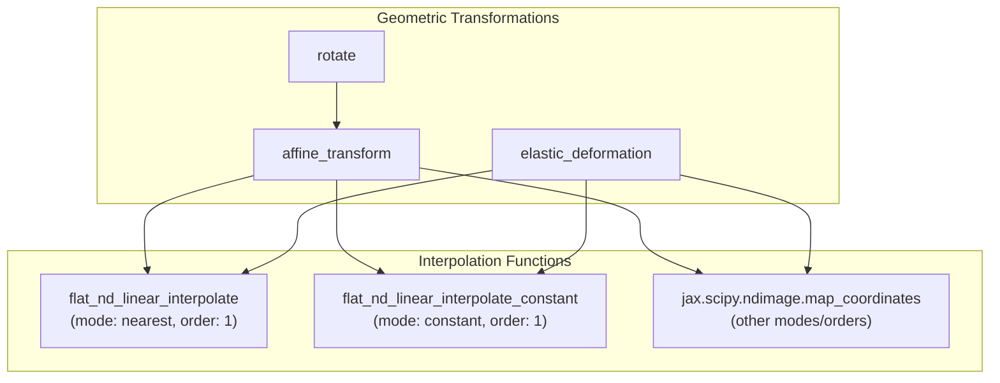
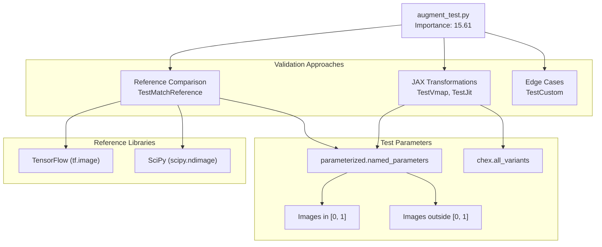

<!-- source: DeepWiki mcp.deepwiki.com · repo google-deepmind/dm_pix · page 2 Image Augmentation Module · fetched 2026-10-26 -->

# Image Augmentation Module

<details>
<summary>Relevant source files</summary>

The following files were used as context for generating this wiki page:

- [dm_pix/_src/augment.py](dm_pix/_src/augment.py)
- [dm_pix/_src/augment_test.py](dm_pix/_src/augment_test.py)

</details>


## Purpose and Scope

The image augmentation module ([dm_pix/_src/augment.py]()) is the largest and most important component of dm_pix, with an importance score of 29.69 and containing 24 distinct augmentation functions. This module provides a comprehensive set of tools for applying transformations to images during training or inference, including color adjustments, geometric transformations, and filtering effects.

This page documents the overall architecture, design patterns, and conventions used throughout the augmentation module. For detailed information on specific function categories, see:
- Color adjustment functions: [Color Adjustments](#2.1)
- Geometric transformation functions: [Geometric Transformations](#2.2)
- Filter and effect functions: [Filters and Effects](#2.3)
- Random augmentation design pattern: [Random Augmentation Pattern](#2.4)

For information on how augmentation functions integrate with JAX transformations, see [JAX Integration](#6).

**Sources:** [dm_pix/_src/augment.py:1-32]()

---

## Module Architecture

The augmentation module organizes its 24 functions into three logical categories and maintains dependencies on two internal modules for specialized operations. The diagram below shows the high-level organization:



**Function Distribution:**
| Category | Count | Examples |
|----------|-------|----------|
| Color Adjustments | 10 | `adjust_brightness`, `adjust_contrast`, `adjust_hue`, `adjust_saturation`, `adjust_gamma` + random variants |
| Geometric Transforms | 9 | `affine_transform`, `rotate`, `rot90`, `flip_left_right`, `flip_up_down`, `elastic_deformation`, `center_crop`, `resize_with_crop_or_pad` + random variants |
| Filters & Effects | 5 | `gaussian_blur`, `solarize`, `pad_to_size`, `random_crop` |

**Sources:** [dm_pix/_src/augment.py:1-1040](), [dm_pix/_src/augment.py:22-29]()

---

## Input and Output Conventions

All augmentation functions follow consistent conventions for image representation and processing:

### Image Encoding

Images must be **float-encoded** with pixel values in the range **[0, 1]**. This is explicitly documented at the module level:

[dm_pix/_src/augment.py:14-20]()

```python
"""This module provides image augmentation functions.

All functions expect float-encoded images, with values in [0, 1].
Do not clip their outputs to this range to allow chaining without losing
information. The outside-of-bounds behavior is (as much as possible) similar to
that of TensorFlow.
"""
```

### Output Behavior

Importantly, **outputs are not clipped** to the [0, 1] range. This design decision allows multiple augmentations to be chained without losing information through intermediate clipping. Users should clip the final result if needed for their specific use case.

### Image Format Support

Functions support both channel-last and channel-first image formats:

| Format | Shape | Description |
|--------|-------|-------------|
| HWC (channels-last) | `(height, width, channels)` | Default format, `channel_axis=-1` |
| CHW (channels-first) | `(channels, height, width)` | Alternative format, `channel_axis=-3` or `0` |
| NHWC (batched) | `(batch, height, width, channels)` | Batch with channels-last |
| NCHW (batched) | `(batch, channels, height, width)` | Batch with channels-first |

The `channel_axis` parameter (default: `-1`) controls interpretation of the image format. Internal helper function `_channels_last()` determines the format:

[dm_pix/_src/augment.py:931-936]()

**Sources:** [dm_pix/_src/augment.py:14-20](), [dm_pix/_src/augment.py:931-936](), [dm_pix/_src/augment.py:1009-1040]()

---

## Function Organization by Category

### Overview Diagram

The following diagram maps specific function names to their categories and shows the data flow pattern:



Each category has distinct characteristics:

**Color Adjustments** ([Color Adjustments](#2.1)) modify pixel values to change brightness, contrast, hue, saturation, or apply gamma correction. These operations work in the value domain and some require color space conversions.

**Geometric Transformations** ([Geometric Transformations](#2.2)) modify the spatial arrangement of pixels through rotation, flipping, affine transformations, elastic deformations, cropping, and padding. These often require interpolation to sample pixel values at non-integer coordinates.

**Filters and Effects** ([Filters and Effects](#2.3)) apply convolution-based filters (blur) or threshold-based effects (solarization), as well as spatial resizing operations.

**Sources:** [dm_pix/_src/augment.py:34-929]()

---

## Design Patterns

### Deterministic and Random Variants

The module follows a consistent pattern where many augmentation functions come in two flavors:

1. **Deterministic functions**: Take explicit parameters and produce reproducible results
2. **Random functions**: Wrap deterministic functions with random parameter sampling



**Example Implementation:** The `random_brightness` function demonstrates this pattern:

[dm_pix/_src/augment.py:815-824]()

**Random Function Naming Convention:**
| Deterministic | Random Variant |
|---------------|----------------|
| `adjust_brightness` | `random_brightness` |
| `adjust_contrast` | `random_contrast` |
| `adjust_gamma` | `random_gamma` |
| `adjust_hue` | `random_hue` |
| `adjust_saturation` | `random_saturation` |
| `flip_left_right` | `random_flip_left_right` |
| `flip_up_down` | `random_flip_up_down` |

For detailed information on the random augmentation pattern and PRNG key usage, see [Random Augmentation Pattern](#2.4).

**Sources:** [dm_pix/_src/augment.py:815-824](), [dm_pix/_src/augment.py:767-813](), [dm_pix/_src/augment.py:827-886]()

---

## JAX Integration and Transformations

All augmentation functions are designed to be compatible with JAX's core transformations: `jax.jit`, `jax.vmap`, and `jax.pmap`. This compatibility is extensively tested in the test suite.

### Transformation Testing

The test suite includes specialized test classes to verify transformation compatibility:



**Test Coverage Examples:**

| Test Class | Purpose | Key Methods |
|------------|---------|-------------|
| `TestMatchReference` | Validates correctness against reference implementations | `_test_fn()`, `_test_fn_with_random_arg()` |
| `TestVmap` | Ensures functions work with `jax.vmap` for batch processing | Tests stacking and vectorization |
| `TestJit` | Verifies JIT compilation compatibility | Tests compilation and execution consistency |

**Sources:** [dm_pix/_src/augment_test.py:428-509](), [dm_pix/_src/augment_test.py:35-426]()

### Practical JAX Usage

Functions can be directly composed with JAX transformations:

```python
# JIT compilation for performance
blur_jitted = jax.jit(dm_pix.gaussian_blur)

# Vectorization for batch processing
rotate_batch = jax.vmap(dm_pix.rotate, in_axes=(0, None))

# Parallel execution across devices
parallel_flip = jax.pmap(dm_pix.flip_left_right)
```

For comprehensive documentation on JAX integration patterns, see [JAX Integration](#6).

**Sources:** [dm_pix/_src/augment_test.py:456-509]()

---

## Internal Utilities

The augmentation module includes several internal utility functions that support the public API:

### Helper Functions



### Key Utility Descriptions

**`_channels_last(image, channel_axis)`** [dm_pix/_src/augment.py:931-936]()
- Determines whether the channel dimension is the last axis
- Returns boolean indicating format (HWC vs CHW)
- Used throughout the module to handle both formats correctly

**`_depthwise_conv2d(...)`** [dm_pix/_src/augment.py:938-970]()
- Implements depthwise 2D convolution using `jax.lax.conv_general_dilated`
- Used by `gaussian_blur` for separable convolution
- Supports both NHWC and NCHW formats via `dimension_numbers`

**`_get_interpolate_function(mode, order, cval)`** [dm_pix/_src/augment.py:972-1006]()
- Selects the appropriate interpolation implementation based on parameters
- Prefers fast PIX interpolation when possible (modes: "nearest", "constant"; order: 1)
- Falls back to `jax.scipy.ndimage.map_coordinates` for other modes ("wrap", "mirror", "reflect") or orders

**Interpolation Selection Logic:**
| Mode | Order | Implementation |
|------|-------|----------------|
| "nearest" | 1 | `interpolation.flat_nd_linear_interpolate` |
| "constant" | 1 | `interpolation.flat_nd_linear_interpolate_constant` |
| Others | Any | `jax.scipy.ndimage.map_coordinates` |

**`_get_dimension_values(image, channel_axis)`** [dm_pix/_src/augment.py:1009-1040]()
- Extracts shape values in consistent BHWC order
- Handles both single images (3D) and batches (4D)
- Returns tuple: `(batch, height, width, channel)` where `batch` is `None` for single images

**Sources:** [dm_pix/_src/augment.py:931-936](), [dm_pix/_src/augment.py:938-970](), [dm_pix/_src/augment.py:972-1006](), [dm_pix/_src/augment.py:1009-1040]()

---

## Dependencies

The augmentation module has two key internal dependencies:

### Color Conversion Module

Used by hue and saturation adjustment functions to perform RGB ↔ HSV color space conversions:


**Functions using color conversion:**
- `adjust_hue` [dm_pix/_src/augment.py:110-136]()
- `adjust_saturation` [dm_pix/_src/augment.py:139-164]()

For details on color conversion operations, see [Color Space Conversions](#4).

### Interpolation Module

Used by geometric transformation functions to sample pixel values at non-integer coordinates:



**Functions using interpolation:**
- `affine_transform` [dm_pix/_src/augment.py:572-726]()
- `rotate` [dm_pix/_src/augment.py:728-764]()
- `elastic_deformation` [dm_pix/_src/augment.py:167-254]()

For details on interpolation methods, see [ND Linear Interpolation](#5.2).

**Sources:** [dm_pix/_src/augment.py:26-27](), [dm_pix/_src/augment.py:110-136](), [dm_pix/_src/augment.py:139-164](), [dm_pix/_src/augment.py:572-726](), [dm_pix/_src/augment.py:728-764](), [dm_pix/_src/augment.py:167-254]()

---

## Testing Strategy

The augmentation module has the most comprehensive test coverage in dm_pix, with an importance score of 15.61 for the test file. The testing strategy employs three validation approaches:

### Three-Pronged Validation



**Test Statistics:**
- Total test file lines: 566
- Test images: 10 random images per range (in-range and out-of-range)
- Image dimensions: (131, 111, 3)
- Tolerance: 1e-4 (CPU/GPU), 1e-2 (TPU)

**Sources:** [dm_pix/_src/augment_test.py:1-566](), [dm_pix/_src/augment_test.py:27-32](), [dm_pix/_src/augment_test.py:428-509]()

---

