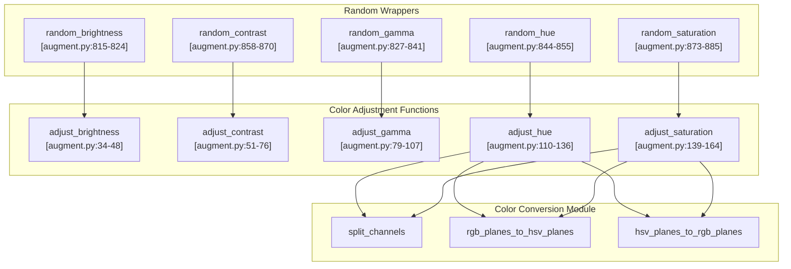
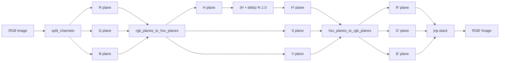
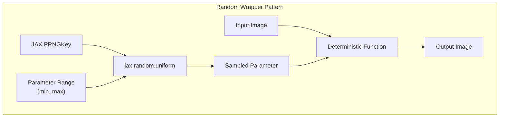
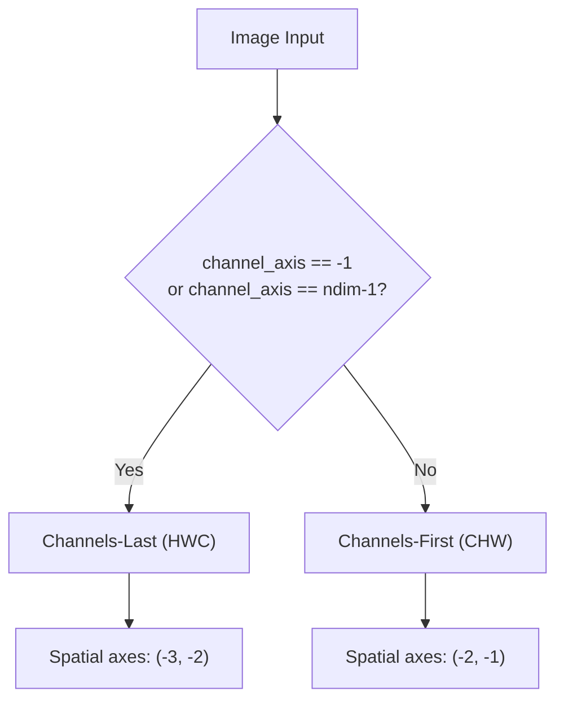
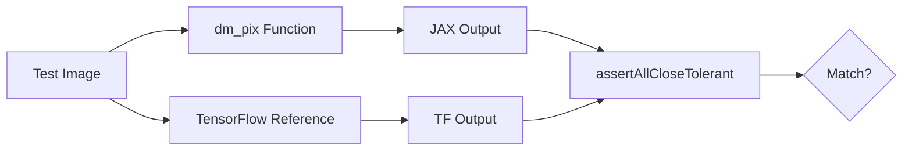
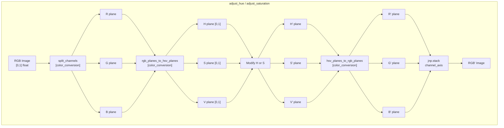

<!-- source: DeepWiki mcp.deepwiki.com · repo google-deepmind/dm_pix · page 2.1 Color Adjustments · fetched 2026-10-26 -->

# Color Adjustments

<details>
<summary>Relevant source files</summary>

The following files were used as context for generating this wiki page:

- [dm_pix/_src/augment.py](dm_pix/_src/augment.py)
- [dm_pix/_src/augment_test.py](dm_pix/_src/augment_test.py)

</details>


This page documents the color adjustment functions in the augmentation module, which provide 10 functions (5 deterministic and 5 random variants) for modifying color properties of images. These functions operate on RGB images and support brightness, contrast, gamma, hue, and saturation adjustments. All functions are JAX-compatible and can be used with `jit`, `vmap`, and `pmap` transformations.

For geometric transformations such as rotation and flipping, see [Geometric Transformations](#2.2). For other effects like blur and solarization, see [Filters and Effects](#2.3). For the design pattern of random augmentation wrappers, see [Random Augmentation Pattern](#2.4).

## Overview

The color adjustment subsystem consists of paired deterministic and stochastic functions. Each deterministic function applies a specific transformation with user-provided parameters, while its random counterpart samples parameters from a specified range using JAX PRNG keys.

**Sources:** [dm_pix/_src/augment.py:14-20](), [dm_pix/_src/augment.py:34-885]()

## Function Categories

The color adjustment functions are organized into three operational categories based on the color space and mathematical operations they employ:

| Function Pair | Color Space | Operation Type | Parameter Range | Lines |
|---------------|-------------|----------------|-----------------|-------|
| `adjust_brightness` / `random_brightness` | RGB | Additive shift | Any float | [34-48](), [815-824]() |
| `adjust_contrast` / `random_contrast` | RGB | Multiplicative around mean | Any float | [51-76](), [858-870]() |
| `adjust_gamma` / `random_gamma` | RGB | Power function | Positive float | [79-107](), [827-841]() |
| `adjust_hue` / `random_hue` | HSV | Hue rotation | [-1.0, 1.0] | [110-136](), [844-855]() |
| `adjust_saturation` / `random_saturation` | HSV | Saturation scaling | [0.0, ∞) | [139-164](), [873-885]() |

**Sources:** [dm_pix/_src/augment.py:34-885]()

## Architecture and Dependencies



**Sources:** [dm_pix/_src/augment.py:26-27](), [dm_pix/_src/augment.py:110-164]()

## Deterministic Color Adjustment Functions

### adjust_brightness

Applies an additive shift to all RGB channels equally. This function is equivalent to `tf.image.adjust_brightness`.

**Function Signature:**
```python
def adjust_brightness(image: chex.Array, delta: chex.Numeric) -> chex.Array
```

**Mathematical Operation:**
```
output[i,j,c] = image[i,j,c] + delta
```

**Parameters:**
- `image`: RGB image as float tensor in [0, 1]
- `delta`: Additive shift value (any float)

**Returns:** Brightness-adjusted image (may be outside [0, 1] range)

**Implementation:** The function performs a simple element-wise addition after converting `delta` to the image's dtype. No clipping is applied to allow chaining transformations without information loss.

**Sources:** [dm_pix/_src/augment.py:34-48]()

### adjust_contrast

Adjusts contrast by scaling pixel deviations from the spatial mean. Equivalent to `tf.image.adjust_contrast`.

**Function Signature:**
```python
def adjust_contrast(
    image: chex.Array,
    factor: chex.Numeric,
    *,
    channel_axis: int = -1,
) -> chex.Array
```

**Mathematical Operation:**
```
mean = spatial_mean(image)
output = factor * (image - mean) + mean
```

**Parameters:**
- `image`: RGB image as float tensor in [0, 1]
- `factor`: Multiplicative contrast factor (any float)
- `channel_axis`: Index of channel axis (default: -1)

**Implementation Details:**
- Computes spatial mean over height and width dimensions ([augment.py:71-76]())
- Handles both channels-last (HWC) and channels-first (CHW) formats
- Preserves mean intensity while scaling deviations

**Sources:** [dm_pix/_src/augment.py:51-76]()

### adjust_gamma

Applies gamma correction using the formula `gain * image^gamma`. Equivalent to `tf.image.adjust_gamma`.

**Function Signature:**
```python
def adjust_gamma(
    image: chex.Array,
    gamma: chex.Numeric,
    *,
    gain: chex.Numeric = 1.,
    assume_in_bounds: bool = False,
) -> chex.Array
```

**Mathematical Operation:**
```
output = gain * image^gamma
```

**Parameters:**
- `image`: RGB image as float tensor in [0, 1]
- `gamma`: Exponent for power function (positive float)
- `gain`: Multiplicative gain factor (default: 1.0)
- `assume_in_bounds`: Skip input clipping if True (default: False)

**Safety Mechanism:** By default, inputs are clipped to [0, 1] to prevent NaN values from negative bases with non-integer exponents ([augment.py:104-105]()).

**Sources:** [dm_pix/_src/augment.py:79-107]()

### adjust_hue

Adjusts hue by rotating colors in HSV space. Equivalent to `tf.image.adjust_hue` on GPU (CPU behavior differs outside [0,1] range).

**Function Signature:**
```python
def adjust_hue(
    image: chex.Array,
    delta: chex.Numeric,
    *,
    channel_axis: int = -1,
) -> chex.Array
```

**Mathematical Operation:**
```
RGB → HSV
H' = (H + delta) mod 1.0
HSV' → RGB'
```

**Parameters:**
- `image`: RGB image as float tensor in [0, 1]
- `delta`: Additive hue shift in [0, 1] range (wraps around)
- `channel_axis`: Index of channel axis (default: -1)

**Implementation Flow:**



**Sources:** [dm_pix/_src/augment.py:110-136](), [dm_pix/_src/color_conversion.py]()

### adjust_saturation

Adjusts saturation by scaling the S component in HSV space. Equivalent to `tf.image.adjust_saturation`.

**Function Signature:**
```python
def adjust_saturation(
    image: chex.Array,
    factor: chex.Numeric,
    *,
    channel_axis: int = -1,
) -> chex.Array
```

**Mathematical Operation:**
```
RGB → HSV
S' = clip(S * factor, 0.0, 1.0)
HSV' → RGB'
```

**Parameters:**
- `image`: RGB image as float tensor in [0, 1]
- `factor`: Multiplicative saturation factor (any float)
- `channel_axis`: Index of channel axis (default: -1)

**Implementation Notes:**
- Saturation is explicitly clipped to [0, 1] after scaling ([augment.py:163]())
- Uses same color space conversion pipeline as `adjust_hue`
- Preserves hue and value components

**Sources:** [dm_pix/_src/augment.py:139-164]()

## Random Augmentation Wrappers

All random variants follow a consistent pattern: they accept a JAX PRNG key, sample parameters from specified ranges, and delegate to their deterministic counterparts. This design enables composable stochastic augmentation pipelines.



**Sources:** [dm_pix/_src/augment.py:815-885]()

### Parameter Sampling Ranges

| Function | Parameter Sampled | Sampling Range | Usage |
|----------|------------------|----------------|-------|
| `random_brightness` | `delta` | `[-max_delta, max_delta)` | [815-824]() |
| `random_contrast` | `factor` | `[lower, upper)` | [858-870]() |
| `random_gamma` | `gamma` | `[min_gamma, max_gamma)` | [827-841]() |
| `random_hue` | `delta` | `[-max_delta, max_delta)` | [844-855]() |
| `random_saturation` | `factor` | `[lower, upper)` | [873-885]() |

**Sources:** [dm_pix/_src/augment.py:815-885]()

### Example: random_brightness Implementation

```python
def random_brightness(
    key: chex.PRNGKey,
    image: chex.Array,
    max_delta: chex.Numeric,
) -> chex.Array:
  delta = jax.random.uniform(key, (), minval=-max_delta, maxval=max_delta)
  return adjust_brightness(image, delta)
```

This minimal wrapper pattern is repeated across all five random variants, ensuring consistent API design and behavior.

**Sources:** [dm_pix/_src/augment.py:815-824]()

## Input and Output Specifications

### Image Format Requirements

All color adjustment functions expect and return images in the following format:

**Input:**
- Type: `chex.Array` (JAX array)
- Data type: Float (typically `float32`)
- Value range: [0, 1] (RGB color space)
- Shape: `(..., H, W, C)` for channels-last or `(..., C, H, W)` for channels-first
- Channels: C=3 (RGB)

**Output:**
- Same type and shape as input
- Value range: **Not clipped** - may extend outside [0, 1]
- Rationale: Allows chaining transformations without information loss ([augment.py:16-19]())

**Sources:** [dm_pix/_src/augment.py:14-20]()

### Channel Axis Handling

Functions that require spatial operations (`adjust_contrast`, `adjust_hue`, `adjust_saturation`) accept a `channel_axis` parameter:

```python
channel_axis: int = -1  # Default: channels-last format
```

The internal helper `_channels_last()` determines the axis layout and adjusts operations accordingly:



**Sources:** [dm_pix/_src/augment.py:931-935]()

## JAX Integration and Performance

### Transformation Compatibility

All color adjustment functions are designed to work seamlessly with JAX transformations:

**JIT Compilation:** All functions are jit-compatible with no restrictions:
```python
adjust_brightness_jit = jax.jit(dm_pix.adjust_brightness)
result = adjust_brightness_jit(image, delta=0.2)
```

**Vectorization:** Functions automatically vectorize over batch dimensions:
```python
adjust_brightness_batched = jax.vmap(dm_pix.adjust_brightness)
batch_results = adjust_brightness_batched(image_batch, deltas)
```

**Parallelization:** Compatible with `pmap` for multi-device execution.

**Sources:** [dm_pix/_src/augment_test.py:456-509]()

### Performance Characteristics

**RGB-space operations** (`adjust_brightness`, `adjust_contrast`, `adjust_gamma`):
- Direct array operations on RGB values
- No color space conversions required
- Minimal computational overhead
- Optimal for accelerator execution

**HSV-space operations** (`adjust_hue`, `adjust_saturation`):
- Require RGB↔HSV conversions ([augment.py:132-136](), [159-164]())
- More computationally intensive
- Depend on `color_conversion` module
- See [RGB-HSV Conversions](#4.1) for conversion details

**Sources:** [dm_pix/_src/augment.py:110-164]()

## Testing and Validation

### Reference Implementation Comparison

The color adjustment functions are validated against TensorFlow reference implementations to ensure correctness:



**Test Coverage:**

| Function | Reference | Test Lines | In-Range Tests | Out-of-Range Tests |
|----------|-----------|------------|----------------|-------------------|
| `adjust_brightness` | `tf.image.adjust_brightness` | [51-66]() | ✓ | ✓ |
| `adjust_contrast` | `tf.image.adjust_contrast` | [67-81]() | ✓ | ✓ |
| `adjust_gamma` | `tf.image.adjust_gamma` | [83-96]() | ✓ | ✗ |
| `adjust_hue` | `tf.image.adjust_hue` | [127-141]() | ✓ | ✗* |
| `adjust_saturation` | `tf.image.adjust_saturation` | [97-124]() | ✓ | ✓** |

\* CPU TensorFlow uses different hue adjustment outside [0,1]  
\** Requires perturbation to avoid TensorFlow rounding bug

**Sources:** [dm_pix/_src/augment_test.py:51-141]()

### Test Strategy

The test suite employs three validation approaches:

1. **Reference Matching:** Compares output against TensorFlow/SciPy ([augment_test.py:428-454]())
2. **JAX Transformation Testing:** Validates jit and vmap compatibility ([augment_test.py:456-509]())
3. **Edge Case Testing:** Tests boundary conditions and parameter ranges

**Test Data:**
- `_RAND_FLOATS_IN_RANGE`: 10 images with values in [0, 1]
- `_RAND_FLOATS_OUT_OF_RANGE`: 10 images with values in [-0.5, 1.5]
- Image shape: (131, 111, 3)

**Sources:** [dm_pix/_src/augment_test.py:27-32]()

## Usage Examples

### Basic Color Adjustments

```python
import dm_pix as pix
import jax.numpy as jnp

# Load or create an RGB image in [0, 1] range
image = jnp.array(..., dtype=jnp.float32)

# Brighten image by adding 0.2
brighter = pix.adjust_brightness(image, delta=0.2)

# Increase contrast by 50%
higher_contrast = pix.adjust_contrast(image, factor=1.5)

# Apply gamma correction
gamma_corrected = pix.adjust_gamma(image, gamma=2.2)

# Shift hue by 0.5 (180 degrees)
hue_shifted = pix.adjust_hue(image, delta=0.5)

# Increase saturation by 30%
more_saturated = pix.adjust_saturation(image, factor=1.3)
```

### Stochastic Augmentation Pipeline

```python
import jax

# Initialize PRNG key
key = jax.random.PRNGKey(42)

# Split keys for multiple random operations
k1, k2, k3, k4, k5 = jax.random.split(key, 5)

# Apply random augmentations
augmented = image
augmented = pix.random_brightness(k1, augmented, max_delta=0.2)
augmented = pix.random_contrast(k2, augmented, lower=0.8, upper=1.2)
augmented = pix.random_gamma(k3, augmented, min_gamma=0.8, max_gamma=1.2)
augmented = pix.random_hue(k4, augmented, max_delta=0.1)
augmented = pix.random_saturation(k5, augmented, lower=0.9, upper=1.1)
```

### Batch Processing with vmap

```python
# Process batch of images with same parameters
adjust_fn = lambda img: pix.adjust_brightness(img, delta=0.3)
batched_adjust = jax.vmap(adjust_fn)
batch_results = batched_adjust(image_batch)

# Process batch with different parameters per image
def adjust_with_params(img, delta):
    return pix.adjust_brightness(img, delta)

batched_adjust_params = jax.vmap(adjust_with_params)
batch_results = batched_adjust_params(image_batch, deltas_array)
```

**Sources:** [dm_pix/_src/augment.py:34-885](), [dm_pix/_src/augment_test.py:456-486]()

## Color Space Dependencies

The hue and saturation adjustments require conversions between RGB and HSV color spaces, implemented in the `color_conversion` module:



For detailed information on color space conversion algorithms, see:
- [RGB-HSV Conversions](#4.1) - Mathematical operations for RGB↔HSV transforms
- [RGB-HSL Conversions](#4.2) - Alternative HSL color space
- [Color Space Conversions](#4) - Overview of all conversion functions

**Sources:** [dm_pix/_src/augment.py:132-136](), [dm_pix/_src/augment.py:159-164](), [dm_pix/_src/color_conversion.py]()

## Compatibility Notes

### TensorFlow Equivalence

The functions maintain behavioral equivalence with TensorFlow image operations:

- `adjust_brightness` ≡ `tf.image.adjust_brightness`
- `adjust_contrast` ≡ `tf.image.adjust_contrast`
- `adjust_gamma` ≡ `tf.image.adjust_gamma`
- `adjust_hue` ≡ `tf.image.adjust_hue` (GPU mode)
- `adjust_saturation` ≡ `tf.image.adjust_saturation`

**Known Differences:**

1. **Hue adjustment out-of-range:** CPU TensorFlow uses a different method when all RGB values are outside [0,1] ([augment.py:118-120]())

2. **No automatic clipping:** Unlike TensorFlow, dm_pix functions do not clip outputs to [0,1] to enable lossless chaining ([augment.py:16-19]())

3. **Saturation TensorFlow bug:** TensorFlow has a rounding error when green and blue channels are very close but differ from red ([augment_test.py:100-106]())

**Sources:** [dm_pix/_src/augment.py:37](), [dm_pix/_src/augment.py:59](), [dm_pix/_src/augment.py:88](), [dm_pix/_src/augment.py:117](), [dm_pix/_src/augment.py:147](), [dm_pix/_src/augment_test.py:100-110]()

### Type Safety

All functions use `chex` type annotations for validation:
- `chex.Array` for image inputs/outputs
- `chex.Numeric` for scalar parameters (int or float)
- `chex.PRNGKey` for random functions

This enables runtime type checking when chex assertions are enabled.

**Sources:** [dm_pix/_src/augment.py:25]()

---

