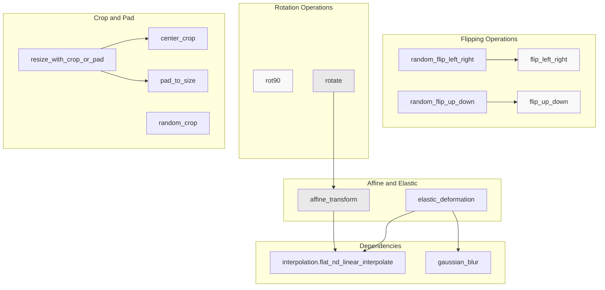
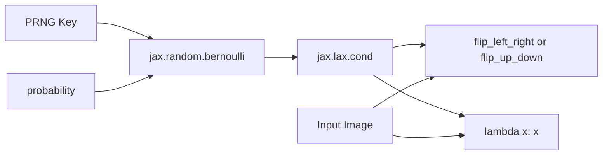
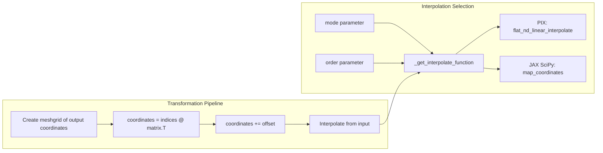
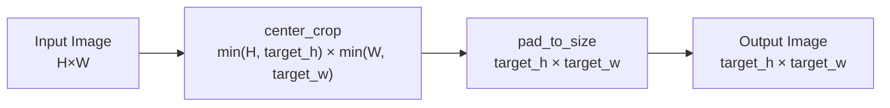
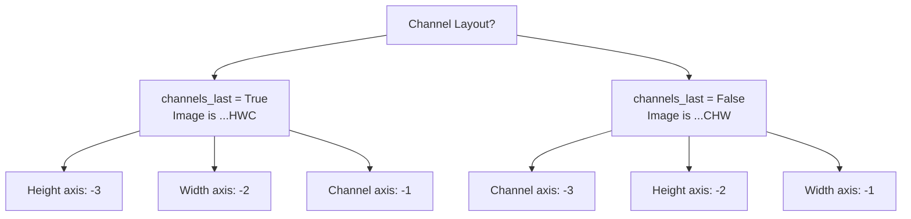
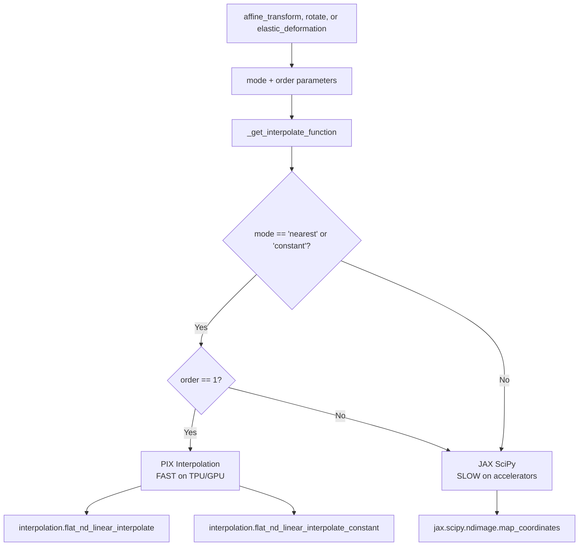
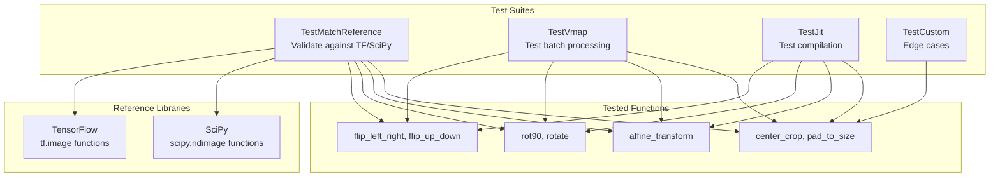

<!-- source: DeepWiki mcp.deepwiki.com · repo google-deepmind/dm_pix · page 2.2 Geometric Transformations · fetched 2026-10-26 -->

# Geometric Transformations

<details>
<summary>Relevant source files</summary>

The following files were used as context for generating this wiki page:

- [dm_pix/_src/augment.py](dm_pix/_src/augment.py)
- [dm_pix/_src/augment_test.py](dm_pix/_src/augment_test.py)

</details>


## Purpose and Scope

This document covers the geometric transformation functions in the `dm_pix` augmentation module. Geometric transformations modify the spatial arrangement of pixels without changing their color values, including flipping, rotation, affine transforms, elastic deformation, and crop/pad operations.

For color-based augmentation functions (brightness, contrast, hue, saturation, gamma), see [Color Adjustments](#2.1). For image filtering operations (blur, solarization), see [Filters and Effects](#2.3).

All geometric transformation functions in this module:
- Support both HWC (channels-last) and CHW (channels-first) layouts via the `channel_axis` parameter
- Accept float-encoded images with values in [0, 1]
- Are compatible with JAX transformations (`jit`, `vmap`, `pmap`)
- Provide deterministic and stochastic (random) variants where applicable

**Sources:** [dm_pix/_src/augment.py:14-20](), [dm_pix/_src/augment.py:415-928]()

---

## Function Organization

The geometric transformation module contains 12 functions organized into four categories: flipping, rotation, affine/elastic transformations, and cropping/padding operations.



**Sources:** [dm_pix/_src/augment.py:415-928]()

---

## Flipping Operations

Flipping operations reverse the pixel order along the horizontal or vertical axis. These are the simplest geometric transformations, implemented using `jnp.flip`.

### flip_left_right

```python
flip_left_right(image: chex.Array, *, channel_axis: int = -1) -> chex.Array
```

Flips an image horizontally (along the width axis). For HWC images, this flips axis -2; for CHW images, axis -1.

| Parameter | Type | Description |
|-----------|------|-------------|
| `image` | `chex.Array` | Input image (HWC or CHW format) |
| `channel_axis` | `int` | Index of the channel axis (default: -1) |

**Implementation:** The function determines the correct axis based on channel layout and applies `jnp.flip` [dm_pix/_src/augment.py:415-438](). For channels-last layout (HWC), the width axis is -2; for channels-first (CHW), it is -1.

**Sources:** [dm_pix/_src/augment.py:415-438]()

### flip_up_down

```python
flip_up_down(image: chex.Array, *, channel_axis: int = -1) -> chex.Array
```

Flips an image vertically (along the height axis). For HWC images, this flips axis -3; for CHW images, axis -2.

| Parameter | Type | Description |
|-----------|------|-------------|
| `image` | `chex.Array` | Input image (HWC or CHW format) |
| `channel_axis` | `int` | Index of the channel axis (default: -1) |

**Sources:** [dm_pix/_src/augment.py:441-464]()

### Random Flip Variants

Both `random_flip_left_right` and `random_flip_up_down` accept a JAX PRNG key and a probability parameter (default 0.5). They use `jax.random.bernoulli` to decide whether to apply the flip, then use `jax.lax.cond` for conditional execution compatible with JIT compilation.



**Sources:** [dm_pix/_src/augment.py:767-812]()

---

## Rotation Operations

### rot90

```python
rot90(image: chex.Array, k: int = 1, *, channel_axis: int = -1) -> chex.Array
```

Rotates an image counter-clockwise by 90-degree increments. This is a fast, exact operation that transposes and flips axes without interpolation.

| Parameter | Type | Description |
|-----------|------|-------------|
| `image` | `chex.Array` | Input image (HWC or CHW format) |
| `k` | `int` | Number of 90-degree rotations (default: 1) |
| `channel_axis` | `int` | Index of the channel axis (default: -1) |

The function delegates to `jnp.rot90` with the appropriate spatial axes: (-3, -2) for HWC images, (-2, -1) for CHW images [dm_pix/_src/augment.py:527-552]().

**TensorFlow Equivalence:** This function is equivalent to `tf.image.rot90`.

**Sources:** [dm_pix/_src/augment.py:527-552]()

### rotate

```python
rotate(image: chex.Array, angle: float, *, order: int = 1, mode: str = "nearest", cval: float = 0.0) -> chex.Array
```

Rotates an image around its center by an arbitrary angle (in radians) using interpolation. This is a wrapper around `affine_transform` that constructs the appropriate rotation matrix and offset.

| Parameter | Type | Description |
|-----------|------|-------------|
| `image` | `chex.Array` | Input image (HWC or CHW format) |
| `angle` | `float` | Counter-clockwise rotation angle in radians |
| `order` | `int` | Interpolation order (0 or 1, default: 1) |
| `mode` | `str` | Boundary mode ("nearest", "constant", etc., default: "nearest") |
| `cval` | `float` | Fill value for "constant" mode (default: 0.0) |

**Implementation Details:**

1. Constructs an inverse rotation matrix [dm_pix/_src/augment.py:755-757]():
   ```python
   matrix = jnp.array([[cos(angle), sin(angle), 0], 
                       [-sin(angle), cos(angle), 0], 
                       [0, 0, 1]])
   ```

2. Calculates offset to rotate around image center [dm_pix/_src/augment.py:760-761]():
   ```python
   image_center = (jnp.asarray(image.shape) - 1.) / 2.
   offset = image_center - matrix @ image_center
   ```

3. Delegates to `affine_transform` with the computed matrix and offset.

**Sources:** [dm_pix/_src/augment.py:728-764]()

---

## Affine Transformations

### affine_transform

```python
affine_transform(image: chex.Array, matrix: chex.Array, *, offset: Union[chex.Array, chex.Numeric] = 0., 
                 order: int = 1, mode: str = "nearest", cval: float = 0.0) -> chex.Array
```

Applies a general affine transformation to an image. This is the most flexible geometric transformation function, supporting rotation, translation, scaling, shearing, and reflection.

| Parameter | Type | Description |
|-----------|------|-------------|
| `image` | `chex.Array` | Input image (must be rank 3: HWC or CHW) |
| `matrix` | `chex.Array` | Inverse transformation matrix (see below) |
| `offset` | `Union[chex.Array, chex.Numeric]` | Offset applied after transformation (default: 0) |
| `order` | `int` | Interpolation order (0 or 1, default: 1) |
| `mode` | `str` | Boundary mode (default: "nearest") |
| `cval` | `float` | Fill value for "constant" mode (default: 0.0) |

**Matrix Format:** The function accepts four matrix shapes [dm_pix/_src/augment.py:597-607]():

| Shape | Description |
|-------|-------------|
| `(ndim, ndim)` | Linear transformation matrix |
| `(ndim,)` | Diagonal matrix (specified as vector) |
| `(ndim + 1, ndim + 1)` | Homogeneous transformation matrix |
| `(ndim, ndim + 1)` | Homogeneous matrix without bottom row |

**Transformation Model:** The function performs "pull" (backward) resampling. For output pixel `o`, the value is sampled from input position `matrix @ o + offset` [dm_pix/_src/augment.py:583-584]().



**Example Transformations:**

The function documentation provides detailed examples for common transformations [dm_pix/_src/augment.py:627-686]():

- **Rotation:** Use rotation matrix with sine/cosine components
- **Translation:** Encode in matrix or use offset parameter
- **Reflection:** Diagonal matrix with -1 for reflected axes
- **Scale:** Diagonal matrix with scale factors
- **Shear:** Off-diagonal elements in transformation matrix

**Sources:** [dm_pix/_src/augment.py:572-726]()

### elastic_deformation

```python
elastic_deformation(key: chex.PRNGKey, image: chex.Array, alpha: chex.Numeric, sigma: chex.Numeric, *,
                    order: int = 1, mode: str = "nearest", cval: float = 0., channel_axis: int = -1) -> chex.Array
```

Applies elastic deformation to an image by generating random displacement fields and smoothing them with Gaussian blur. This technique was introduced by Simard (2003) and popularized by Ronneberger (2015) for data augmentation in image segmentation.

| Parameter | Type | Description |
|-----------|------|-------------|
| `key` | `chex.PRNGKey` | JAX PRNG key for random displacement generation |
| `image` | `chex.Array` | Input image (must be rank 3) |
| `alpha` | `chex.Numeric` | Distortion strength (pixel displacement magnitude) |
| `sigma` | `chex.Numeric` | Gaussian smoothing standard deviation |
| `order` | `int` | Interpolation order (0 or 1, default: 1) |
| `mode` | `str` | Boundary mode (default: "nearest") |
| `cval` | `float` | Fill value for "constant" mode (default: 0.0) |
| `channel_axis` | `int` | Index of the channel axis (default: -1) |

**Algorithm:**

1. Generate random noise fields for each spatial dimension [dm_pix/_src/augment.py:217-219]():
   ```python
   noise_i = jax.random.uniform(key_i, shape=single_channel_shape) * 2 - 1
   noise_j = jax.random.uniform(key_j, shape=single_channel_shape) * 2 - 1
   ```

2. Smooth noise with Gaussian blur to create displacement fields [dm_pix/_src/augment.py:225-232]():
   ```python
   shift_map_i = gaussian_blur(noise_i, sigma=sigma, kernel_size=kernel_size) * alpha
   shift_map_j = gaussian_blur(noise_j, sigma=sigma, kernel_size=kernel_size) * alpha
   ```

3. Add displacements to coordinate meshgrid [dm_pix/_src/augment.py:234-238]().

4. Interpolate image values at displaced coordinates for each channel [dm_pix/_src/augment.py:245-249]().

**Parameter Guidelines:** The documentation recommends alpha values 5-10 times larger than sigma for sensible results. Small sigma values (< 1) produce pixelated deformations, while larger values create smooth, water-like effects [dm_pix/_src/augment.py:183-185]().

**Sources:** [dm_pix/_src/augment.py:167-254]()

---

## Crop and Pad Operations

These operations modify image dimensions by removing or adding pixels, keeping the original image centered.

### Function Comparison Table

| Function | Behavior | Use Case |
|----------|----------|----------|
| `center_crop` | Extracts center region, no-op if target > current | Reduce image size |
| `pad_to_size` | Adds padding around edges, no-op if target < current | Increase image size |
| `resize_with_crop_or_pad` | Crops then pads to exact size | Ensure fixed dimensions |
| `random_crop` | Extracts random region (any offset) | Stochastic augmentation |

### center_crop

```python
center_crop(image: chex.Array, height: chex.Numeric, width: chex.Numeric, *, channel_axis: int = -1) -> chex.Array
```

Extracts a centered region from an image. If the target dimension is larger than the current size, that dimension is unchanged (no-op).

**Implementation:** Uses `jax.lax.slice` with computed start/limit indices [dm_pix/_src/augment.py:257-308]().

**Odd Size Handling:** When cropping by an odd number of pixels, the bottom/right side gets the extra pixel [dm_pix/_src/augment.py:270]().

**Sources:** [dm_pix/_src/augment.py:257-308]()

### pad_to_size

```python
pad_to_size(image: chex.Array, target_height: int, target_width: int, *, mode: str = "constant",
            pad_kwargs: Optional[Any] = None, channel_axis: int = -1) -> chex.Array
```

Pads an image to the specified size, centering the original content. If the target dimension is smaller than the current size, that dimension is unchanged.

**Padding Modes:** Delegates to `jnp.pad`, supporting all JAX padding modes:
- `"constant"`: Fill with constant value (default 0)
- `"edge"`: Extend edge values
- `"reflect"`: Mirror reflection
- `"symmetric"`: Symmetric reflection
- `"wrap"`: Periodic wrapping

**Additional Parameters:** The `pad_kwargs` parameter accepts keyword arguments for `jnp.pad`, such as `constant_values` for constant mode [dm_pix/_src/augment.py:338-339]().

**Sources:** [dm_pix/_src/augment.py:311-365]()

### resize_with_crop_or_pad

```python
resize_with_crop_or_pad(image: chex.Array, target_height: chex.Numeric, target_width: chex.Numeric, *,
                         pad_mode: str = "constant", pad_kwargs: Optional[Any] = None, 
                         channel_axis: int = -1) -> chex.Array
```

Combines `center_crop` and `pad_to_size` to resize an image to exact dimensions. First crops if the image is too large, then pads if it's too small [dm_pix/_src/augment.py:399-412]().

**TensorFlow Equivalence:** Provides the same functionality as `tf.image.resize_with_crop_or_pad` but with additional padding mode options [dm_pix/_src/augment.py:379-380]().



**Sources:** [dm_pix/_src/augment.py:368-412]()

### random_crop

```python
random_crop(key: chex.PRNGKey, image: chex.Array, crop_sizes: Sequence[int]) -> chex.Array
```

Extracts a randomly positioned region from an image. Unlike `center_crop`, this function can crop from any position, making it useful for stochastic data augmentation.

**Implementation:** 
1. Generates random offsets for each dimension using `jax.random.randint` [dm_pix/_src/augment.py:922-925]()
2. Uses `jax.lax.dynamic_slice` to extract the region [dm_pix/_src/augment.py:926]()

**Constraints:** Crop sizes must not exceed image dimensions in any axis [dm_pix/_src/augment.py:917-919]().

**Sources:** [dm_pix/_src/augment.py:888-928]()

---

## Channel Axis Handling

All geometric transformation functions support both channels-last (HWC) and channels-first (CHW) layouts through the `channel_axis` parameter.

### _channels_last Helper

The internal helper function `_channels_last` determines the image layout [dm_pix/_src/augment.py:931-935]():

```python
def _channels_last(image: chex.Array, channel_axis: int):
    last = channel_axis == -1 or channel_axis == (image.ndim - 1)
    if not last:
        assert channel_axis == -3 or channel_axis == range(image.ndim)[-3]
    return last
```

### Axis Selection Pattern

Functions use conditional logic to select the correct axes based on layout:



**Example:** In `flip_left_right` [dm_pix/_src/augment.py:434-437]():
```python
if _channels_last(image, channel_axis):
    flip_axis = -2  # Image is ...HWC, flip width
else:
    flip_axis = -1  # Image is ...CHW, flip width
```

**Sources:** [dm_pix/_src/augment.py:931-935](), [dm_pix/_src/augment.py:434-437]()

---

## Interpolation Modes and Performance

Functions that require resampling (`affine_transform`, `rotate`, `elastic_deformation`) support multiple interpolation methods with significant performance implications.

### Interpolation Function Selection

The `_get_interpolate_function` helper selects the appropriate interpolation backend based on `mode` and `order` parameters [dm_pix/_src/augment.py:972-1006]():

| Mode | Order | Backend | Performance |
|------|-------|---------|-------------|
| `"nearest"` | 1 | `interpolation.flat_nd_linear_interpolate` | Fast (PIX) |
| `"constant"` | 1 | `interpolation.flat_nd_linear_interpolate_constant` | Fast (PIX) |
| `"wrap"` | any | `jax.scipy.ndimage.map_coordinates` | Slow on accelerators |
| `"mirror"` | any | `jax.scipy.ndimage.map_coordinates` | Slow on accelerators |
| `"reflect"` | any | `jax.scipy.ndimage.map_coordinates` | Slow on accelerators |
| any | 0 | `jax.scipy.ndimage.map_coordinates` | Slow on accelerators |

**Performance Recommendation:** The PIX interpolation functions (`flat_nd_linear_interpolate` and its constant variant) are optimized for accelerators, especially TPUs. The documentation explicitly warns that `jax.scipy.ndimage.map_coordinates` is slow on accelerators and should be used with care [dm_pix/_src/augment.py:987-989]().



**Sources:** [dm_pix/_src/augment.py:972-1006](), [dm_pix/_src/augment.py:198-203]()

---

## Batch and Dimension Handling

### Supported Ranks

Most geometric transformation functions support both single images (rank 3) and batches (rank 4):

- **Rank 3:** `(H, W, C)` or `(C, H, W)` - single image
- **Rank 4:** `(B, H, W, C)` or `(B, C, H, W)` - batch of images

Functions like `center_crop`, `pad_to_size`, and `resize_with_crop_or_pad` explicitly check for rank 3 or 4 using `chex.assert_rank(image, {3, 4})` [dm_pix/_src/augment.py:284]().

### _get_dimension_values Helper

The internal helper `_get_dimension_values` extracts shape information in BHWC order regardless of layout [dm_pix/_src/augment.py:1009-1039]():

```python
def _get_dimension_values(image: chex.Array, channel_axis: int) -> Tuple[Optional[int], int, int, int]:
    """Gets shape values in BHWC order. If single image is given B is None."""
    chex.assert_rank(image, {3, 4})
    if image.ndim == 4:
        if _channels_last(image=image, channel_axis=channel_axis):
            batch, height, width, channel = image.shape
        else:
            batch, channel, height, width = image.shape
    else:
        if _channels_last(image=image, channel_axis=channel_axis):
            batch, (height, width, channel) = None, image.shape
        else:
            batch, (channel, height, width) = None, image.shape
    return batch, height, width, channel
```

This utility is used by `center_crop`, `pad_to_size`, and `resize_with_crop_or_pad` to compute padding and cropping indices that work for both single images and batches.

**Sources:** [dm_pix/_src/augment.py:1009-1039](), [dm_pix/_src/augment.py:284-287]()

---

## Testing and Validation

The geometric transformation functions are extensively tested against reference implementations and for JAX compatibility.

### Test Categories



### Reference Validation Examples

**Rotation:** Tests validate against `scipy.ndimage.rotate` with degree-to-radian conversion [dm_pix/_src/augment_test.py:283-301]():
```python
jax_fn=functools.partial(augment.rotate, angle=angle, mode=mode, order=order, cval=cval)
reference_fn=functools.partial(scipy.ndimage.rotate, angle=angle * 180 / np.pi, ...)
```

**Affine Transform:** Tests validate multiple matrix formats against `scipy.ndimage.affine_transform` [dm_pix/_src/augment_test.py:202-267]():
- `(ndim, ndim)` matrix with offset
- `(ndim + 1, ndim + 1)` homogeneous matrix
- `(ndim, ndim + 1)` homogeneous matrix without bottom row
- `(ndim,)` diagonal matrix as vector

**Flipping:** Tests validate against `tf.image.flip_left_right` and `tf.image.flip_up_down` [dm_pix/_src/augment_test.py:162-170]().

### JAX Transformation Tests

The `TestVmap` and `TestJit` suites ensure all functions work correctly with `jax.vmap` and `jax.jit`:

- **Vmap tests:** Stack multiple images and parameters, apply vmapped function, compare with individual function calls [dm_pix/_src/augment_test.py:456-485]()
- **Jit tests:** Compare jitted and non-jitted outputs for numerical equivalence [dm_pix/_src/augment_test.py:488-508]()

### Custom Edge Case Tests

The `TestCustom` suite validates special behaviors:

- **center_crop with oversized targets:** Ensures no-op when target dimensions exceed image size [dm_pix/_src/augment_test.py:521-536]()
- **pad_to_size with undersized targets:** Ensures no-op when target dimensions are smaller than image [dm_pix/_src/augment_test.py:545-560]()

**Sources:** [dm_pix/_src/augment_test.py:35-565](), [dm_pix/_src/augment_test.py:162-426]()

---

## Integration with Other Modules

### Dependencies on interpolation Module

Functions requiring resampling depend on the `interpolation` module for fast, accelerator-optimized interpolation:

| Function | Interpolation Usage |
|----------|-------------------|
| `affine_transform` | Uses `flat_nd_linear_interpolate` or `flat_nd_linear_interpolate_constant` |
| `rotate` | Delegates to `affine_transform` |
| `elastic_deformation` | Uses interpolation for displaced coordinate sampling |

The interpolation functions are selected through `_get_interpolate_function` based on mode and order parameters. See [ND Linear Interpolation](#5.2) for details on the interpolation module.

### Dependencies on Other Augmentation Functions

`elastic_deformation` uses `gaussian_blur` internally to smooth the random displacement fields [dm_pix/_src/augment.py:225-232](). The kernel size is computed from sigma using OpenCV's formula [dm_pix/_src/augment.py:224]():

```python
kernel_size = ((sigma - 0.8) / 0.3 + 1) / 0.5 + 1
```

### Usage in Random Augmentation Pattern

Random variants of geometric transformations follow the pattern described in [Random Augmentation Pattern](#2.4):

1. Accept a `jax.random.PRNGKey` as the first parameter
2. Use `jax.random.uniform` or `jax.random.bernoulli` to generate random parameters
3. Call the deterministic variant with the generated parameters
4. Use `jax.lax.cond` for conditional application (flip functions)

**Sources:** [dm_pix/_src/augment.py:167-254](), [dm_pix/_src/augment.py:767-812](), [dm_pix/_src/augment.py:888-928]()

---

