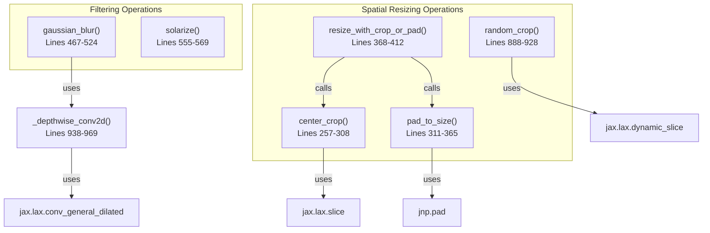
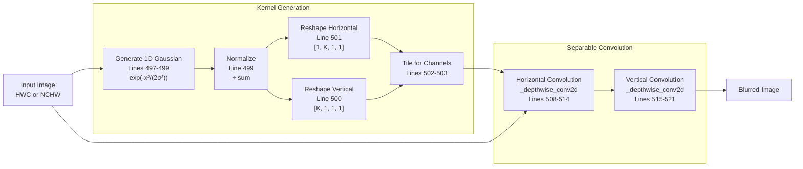
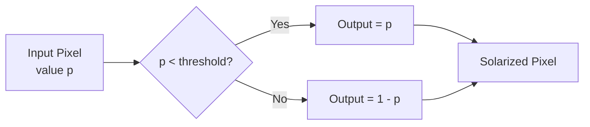
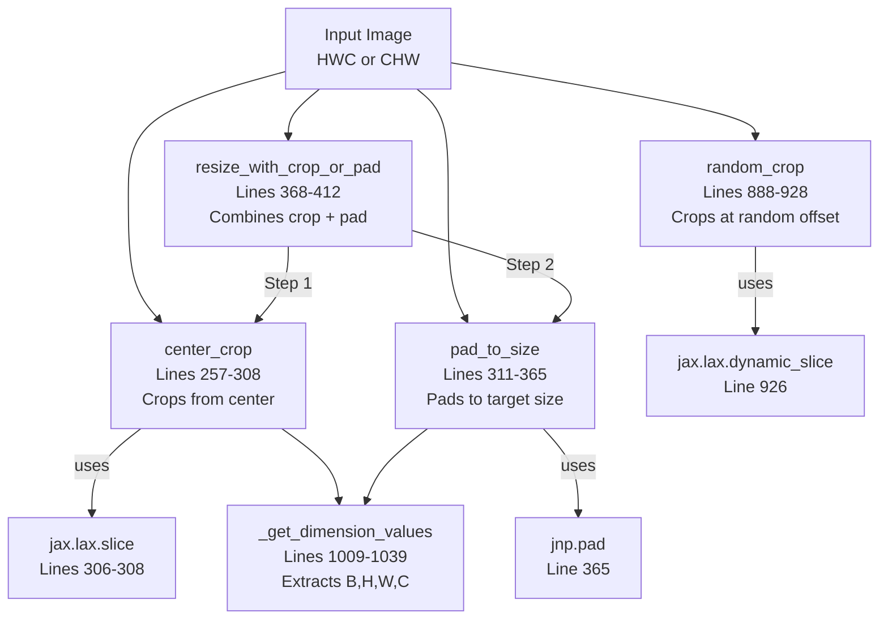
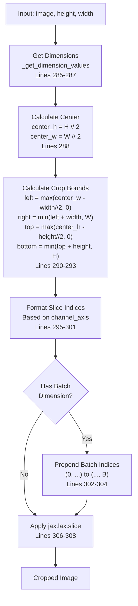
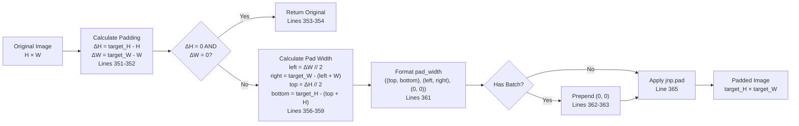
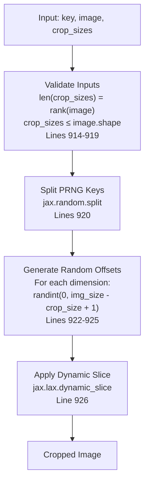
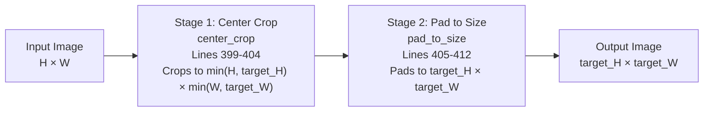

<!-- source: DeepWiki mcp.deepwiki.com · repo google-deepmind/dm_pix · page 2.3 Filters and Effects · fetched 2026-10-26 -->

# Filters and Effects

<details>
<summary>Relevant source files</summary>

The following files were used as context for generating this wiki page:

- [dm_pix/_src/augment.py](dm_pix/_src/augment.py)
- [dm_pix/_src/augment_test.py](dm_pix/_src/augment_test.py)

</details>


## Purpose and Scope

This page documents the filters and effects category of the augmentation module, which provides image filtering and spatial manipulation operations. This includes Gaussian blur for smoothing, solarization for threshold-based color inversion, and various cropping and padding utilities for spatial resizing. For color-based transformations, see [Color Adjustments](#2.1). For geometric transformations like rotation and affine transforms, see [Geometric Transformations](#2.2).

Sources: [dm_pix/_src/augment.py:1-1040]()

## Overview

The filters and effects category contains five primary functions organized into two groups: filtering operations and spatial resizing operations. All functions operate on float-encoded images with values in [0, 1] and support both HWC (channels-last) and CHW (channels-first) formats.



Sources: [dm_pix/_src/augment.py:467-928]()

## Gaussian Blur

### Function Signature and Parameters

The `gaussian_blur` function applies Gaussian blur through convolution with a Gaussian kernel. It is implemented using separable convolution (horizontal then vertical) for computational efficiency.

**Function:** `gaussian_blur(image, sigma, kernel_size, *, padding="SAME", channel_axis=-1)`

| Parameter | Type | Description |
|-----------|------|-------------|
| `image` | `chex.Array` | Input image as [0-1] float tensor, rank 3 or 4 with two spatial dimensions |
| `sigma` | `chex.Numeric` | Standard deviation in pixels of the Gaussian kernel |
| `kernel_size` | `float` | Size in pixels of the square Gaussian kernel (rounded to next odd integer) |
| `padding` | `str` | Either "SAME" or "VALID", passed to underlying convolution (default: "SAME") |
| `channel_axis` | `int` | Index of the channel axis (default: -1) |

Sources: [dm_pix/_src/augment.py:467-489]()

### Implementation Details

The function implements Gaussian blur through a two-stage separable convolution:

1. **Kernel Generation**: Creates a 1D Gaussian kernel using the formula `exp(-x²/(2σ²))` normalized to sum to 1
2. **Separable Convolution**: Applies horizontal then vertical convolution using `_depthwise_conv2d`
3. **Depthwise Operation**: Uses `jax.lax.conv_general_dilated` with `feature_group_count` equal to number of channels



**Kernel Size Calculation**: The kernel size is rounded to ensure odd dimensions: `kernel_size_ = 2 * radius + 1` where `radius = int(kernel_size / 2)`.

**Batch Handling**: If input is 3D (single image), a batch dimension is temporarily added before convolution and removed afterward (lines 505-523).

Sources: [dm_pix/_src/augment.py:467-524](), [dm_pix/_src/augment.py:938-969]()

### Usage in Elastic Deformation

The `gaussian_blur` function is internally used by `elastic_deformation` to smooth displacement fields. The kernel size is computed from sigma using the formula: `kernel_size = ((sigma - 0.8) / 0.3 + 1) / 0.5 + 1`, which ensures approximately 3σ coverage on each side (99.7% of probability mass).

Sources: [dm_pix/_src/augment.py:224-232]()

### Testing and Validation

Tests verify Gaussian blur across various sigma values and kernel sizes. The function is tested with both in-range [0,1] and out-of-range images.

```python
# From augment_test.py
blur_fn = functools.partial(augment.gaussian_blur, kernel_size=_KERNEL_SIZE)
self._test_fn_with_random_arg(
    images_list, jax_fn=blur_fn, reference_fn=None, sigma=(0.1, 2.0))
```

Tests also validate JAX transformation compatibility (jit, vmap).

Sources: [dm_pix/_src/augment_test.py:312-317]()

## Solarize

### Function Signature and Parameters

The `solarize` function inverts pixel values above a specified threshold, creating a photographic solarization effect.

**Function:** `solarize(image, threshold)`

| Parameter | Type | Description |
|-----------|------|-------------|
| `image` | `chex.Array` | RGB image as [0-1] float tensor |
| `threshold` | `chex.Numeric` | Threshold for inversion |

**Returns:** Image where pixels below threshold remain unchanged, and pixels above threshold are inverted as `1 - pixel_value`.

Sources: [dm_pix/_src/augment.py:555-569]()

### Implementation

The implementation is straightforward, using `jnp.where` for element-wise conditional operation:

```python
return jnp.where(image < threshold, image, 1. - image)
```

This creates a threshold-based effect where:
- **Below threshold**: Pixel value remains unchanged
- **At or above threshold**: Pixel value becomes `1 - pixel_value`



Sources: [dm_pix/_src/augment.py:555-569]()

### Testing

Solarization is tested with random threshold values between 0 and 1 for both in-range and out-of-range images. The function has no TensorFlow reference implementation, so tests only verify execution without NaN or gradient issues.

Sources: [dm_pix/_src/augment_test.py:305-310]()

## Spatial Resizing Operations

The augmentation module provides four interconnected functions for spatial resizing: cropping and padding operations that can be combined for flexible image size adjustment.

### Function Relationships



Sources: [dm_pix/_src/augment.py:257-412](), [dm_pix/_src/augment.py:888-928]()

## center_crop

### Function Signature and Parameters

The `center_crop` function crops an image to specified dimensions while maintaining the same center point.

**Function:** `center_crop(image, height, width, *, channel_axis=-1)`

| Parameter | Type | Description |
|-----------|------|-------------|
| `image` | `chex.Array` | Image as ...HWC or ...CHW, rank 3 or 4 |
| `height` | `chex.Numeric` | Target height to crop to |
| `width` | `chex.Numeric` | Target width to crop to |
| `channel_axis` | `int` | Index of channel axis (default: -1) |

**Behavior:**
- If target dimensions exceed current size, function is a no-op for that dimension
- For odd-sized differences, bottom/right side gets the extra pixel
- Supports batched images (rank 4) and single images (rank 3)

Sources: [dm_pix/_src/augment.py:257-308]()

### Implementation Algorithm



**Key Implementation Details:**
1. Uses `_get_dimension_values` helper to extract dimensions in BHWC order
2. Computes center point of current image
3. Calculates crop boundaries using `max` and `min` to handle oversized targets
4. Formats indices based on `channel_axis` (channels-last vs channels-first)
5. Uses `jax.lax.slice` for efficient slicing

Sources: [dm_pix/_src/augment.py:257-308](), [dm_pix/_src/augment.py:1009-1039]()

### Testing and Edge Cases

The function has special test cases for when target size exceeds original size:

| Scenario | Input Size | Target Size | Expected Output |
|----------|------------|-------------|-----------------|
| Smaller target | 131×111 | 100×100 | 100×100 (cropped) |
| Larger target | 131×111 | 200×200 | 131×111 (no-op) |
| Mixed dimensions | 131×111 | 200×100 | 131×100 (H no-op, W cropped) |

Sources: [dm_pix/_src/augment_test.py:363-377](), [dm_pix/_src/augment_test.py:521-536]()

## pad_to_size

### Function Signature and Parameters

The `pad_to_size` function pads an image to specified dimensions, centering the original image within the padded result.

**Function:** `pad_to_size(image, target_height, target_width, *, mode="constant", pad_kwargs=None, channel_axis=-1)`

| Parameter | Type | Description |
|-----------|------|-------------|
| `image` | `chex.Array` | Image as ...HWC or ...CHW, rank 3 or 4 |
| `target_height` | `int` | Target height to pad to |
| `target_width` | `int` | Target width to pad to |
| `mode` | `str` | Padding mode for `jnp.pad` (default: "constant") |
| `pad_kwargs` | `Optional[Any]` | Additional kwargs for `jnp.pad` |
| `channel_axis` | `int` | Index of channel axis (default: -1) |

**Behavior:**
- If target dimensions are smaller than current size, function is a no-op for that dimension
- For odd-sized padding, bottom/right side gets the extra pixel
- Supports all `jnp.pad` modes: constant, edge, reflect, symmetric, wrap

Sources: [dm_pix/_src/augment.py:311-365]()

### Implementation Algorithm

The function calculates symmetric padding around the original image:

```python
delta_width = max(target_width - width, 0)
delta_height = max(target_height - height, 0)

left = delta_width // 2
right = max(target_width - (left + width), 0)
top = delta_height // 2
bottom = max(target_height - (top + height), 0)
```

**Padding Width Construction:**


**Early Exit Optimization:** If both `delta_width` and `delta_height` are zero, the function immediately returns the original image without calling `jnp.pad`.

Sources: [dm_pix/_src/augment.py:311-365]()

### Padding Modes

The function delegates to `jnp.pad`, supporting all its modes:

| Mode | Description | Use Case |
|------|-------------|----------|
| `constant` | Pads with constant value (default: 0) | Most common, zero-padding |
| `edge` | Pads with edge values | Extends image borders naturally |
| `reflect` | Reflects values at boundaries | Creates mirror effect |
| `symmetric` | Symmetric padding including edge | Similar to reflect |
| `wrap` | Wraps values around | Tiling effect |

Custom padding values can be specified via `pad_kwargs`, e.g., `pad_kwargs={"constant_values": 0.5}`.

Sources: [dm_pix/_src/augment.py:322-339]()

### Testing

The function is tested with various target sizes relative to the input image (131×111):

| Target Size | Behavior | Expected Result |
|-------------|----------|-----------------|
| 156×156 | Larger than input | Pads both dimensions |
| 131×111 | Same as input | No-op (early exit) |
| 200×251 | Much larger | Significant padding |
| 84×84 | Smaller than input | No-op (early exit) |

Sources: [dm_pix/_src/augment_test.py:379-400](), [dm_pix/_src/augment_test.py:545-560]()

## random_crop

### Function Signature and Parameters

The `random_crop` function crops images to specified sizes with randomly selected offsets.

**Function:** `random_crop(key, image, crop_sizes)`

| Parameter | Type | Description |
|-----------|------|-------------|
| `key` | `chex.PRNGKey` | JAX PRNG key for random number generation |
| `image` | `chex.Array` | JAX array representing an image |
| `crop_sizes` | `Sequence[int]` | Crop size for each dimension, must match image rank |

**Requirements:**
- Length of `crop_sizes` must equal rank of `image`
- Each crop size must not exceed corresponding image dimension

Sources: [dm_pix/_src/augment.py:888-928]()

### Implementation Algorithm

The function uses `jax.random.randint` to generate random offsets for each dimension, then applies `jax.lax.dynamic_slice`:



**Key Implementation Details:**
1. Splits PRNG key into multiple keys (one per dimension)
2. Generates random start indices ensuring crop stays within bounds
3. Uses `jax.lax.dynamic_slice` which supports traced execution (unlike regular slicing)

**Offset Range:** For each dimension with size `img_size` and crop size `crop_size`, the random offset is sampled from `[0, img_size - crop_size + 1)`, ensuring the crop stays within image bounds.

Sources: [dm_pix/_src/augment.py:888-928]()

### Comparison with Deterministic Cropping

For deterministic cropping with explicit offsets, use `jax.lax.dynamic_slice` directly:

```python
# Random cropping
cropped = dm_pix.random_crop(key, image, crop_sizes=(100, 100, 3))

# Deterministic cropping (alternative)
cropped = jax.lax.dynamic_slice(image, start_indices=(15, 20, 0), 
                                 slice_sizes=(100, 100, 3))
```

Sources: [dm_pix/_src/augment.py:896-898]()

### Testing

Tests validate random crop with various crop sizes on images of shape (131, 111, 3):

```python
key = jax.random.PRNGKey(43)
crop_fn = lambda img: augment.random_crop(key, img, (100, 100, 3))
```

The function is tested for correctness and JAX transformation compatibility (jit, vmap).

Sources: [dm_pix/_src/augment_test.py:319-324]()

## resize_with_crop_or_pad

### Function Signature and Parameters

The `resize_with_crop_or_pad` function is a composite operation that resizes images by combining center cropping and padding to reach exact target dimensions. This is equivalent to TensorFlow's `tf.image.resize_with_crop_or_pad`.

**Function:** `resize_with_crop_or_pad(image, target_height, target_width, *, pad_mode="constant", pad_kwargs=None, channel_axis=-1)`

| Parameter | Type | Description |
|-----------|------|-------------|
| `image` | `chex.Array` | Image as ...HWC or ...CHW, rank 3 or 4 |
| `target_height` | `chex.Numeric` | Target height |
| `target_width` | `chex.Numeric` | Target width |
| `pad_mode` | `str` | Mode for padding (default: "constant") |
| `pad_kwargs` | `Optional[Any]` | Additional kwargs for padding |
| `channel_axis` | `int` | Index of channel axis (default: -1) |

Sources: [dm_pix/_src/augment.py:368-412]()

### Two-Stage Algorithm

The function applies two sequential operations:



**Behavior by Scenario:**

| Input vs Target | Operation Applied | Result |
|-----------------|-------------------|--------|
| H > target_H, W > target_W | Crop only | Center-cropped to target size |
| H < target_H, W < target_W | Pad only | Center-padded to target size |
| H > target_H, W < target_W | Crop H, pad W | Cropped height, padded width |
| H < target_H, W > target_W | Pad H, crop W | Padded height, cropped width |

**Implementation:** The function simply chains `center_crop` followed by `pad_to_size`:

```python
image = center_crop(image, height=target_height, width=target_width, 
                    channel_axis=channel_axis)
return pad_to_size(image, target_height=target_height, 
                   target_width=target_width, channel_axis=channel_axis,
                   mode=pad_mode, pad_kwargs=pad_kwargs)
```

Sources: [dm_pix/_src/augment.py:368-412]()

### Testing and TensorFlow Equivalence

The function is tested for equivalence with TensorFlow's reference implementation:

```python
resize_crop_or_pad = functools.partial(
    augment.resize_with_crop_or_pad,
    target_height=target_height,
    target_width=target_width,
    pad_mode="constant",
    pad_kwargs={"constant_values": 0},
)
reference_fn = functools.partial(
    tf.image.resize_with_crop_or_pad,
    target_height=target_height,
    target_width=target_width,
)
```

Tests validate correctness across multiple target sizes (156, 138, 200, 251) with both in-range and out-of-range input images.

Sources: [dm_pix/_src/augment_test.py:402-425]()

## JAX Integration

All filters and effects functions are designed for full compatibility with JAX transformations.

### JIT Compilation

All functions support `jax.jit` compilation for performance optimization:

```python
gaussian_blur_jit = jax.jit(dm_pix.gaussian_blur)
blurred = gaussian_blur_jit(image, sigma=2.0, kernel_size=11)

solarize_jit = jax.jit(dm_pix.solarize)
solarized = solarize_jit(image, threshold=0.5)
```

**Note for Gaussian Blur:** The kernel size is derived from sigma, so sigma must be constant for JIT compilation unless kernel size is pre-computed.

Sources: [dm_pix/_src/augment_test.py:488-508]()

### Vectorization with vmap

All functions support automatic vectorization across batch dimensions:

```python
# Process batch of images
images_batch = jnp.stack([image1, image2, image3])
blur_vmap = jax.vmap(lambda img: dm_pix.gaussian_blur(img, sigma=1.5, kernel_size=7))
blurred_batch = blur_vmap(images_batch)

# Vectorize with different thresholds per image
thresholds = jnp.array([0.3, 0.5, 0.7])
solarize_vmap = jax.vmap(dm_pix.solarize)
solarized_batch = solarize_vmap(images_batch, thresholds)
```

Sources: [dm_pix/_src/augment_test.py:456-485]()

### Random Operations and PRNG Keys

The `random_crop` function requires careful key management when used with JAX transformations:

```python
# Generate unique keys for batch
key = jax.random.PRNGKey(42)
keys = jax.random.split(key, num_images)

# Vectorize random crop with different keys
random_crop_vmap = jax.vmap(
    lambda k, img: dm_pix.random_crop(k, img, crop_sizes=(100, 100, 3))
)
cropped_batch = random_crop_vmap(keys, images_batch)
```

Sources: [dm_pix/_src/augment.py:888-928]()

## Performance Considerations

### Gaussian Blur Optimization

The Gaussian blur implementation uses **separable convolution** (horizontal then vertical) rather than 2D convolution, reducing computational complexity from O(K²) to O(2K) where K is kernel size. This is particularly efficient on accelerators.

The function uses **depthwise convolution** via `jax.lax.conv_general_dilated` with `feature_group_count=num_channels`, which processes each channel independently and is highly optimized on TPUs and GPUs.

Sources: [dm_pix/_src/augment.py:467-524](), [dm_pix/_src/augment.py:938-969]()

### Cropping and Padding Efficiency

- `center_crop` uses `jax.lax.slice` for zero-copy slicing when possible
- `pad_to_size` includes early-exit optimization when no padding is needed
- `random_crop` uses `jax.lax.dynamic_slice` which is trace-compatible and efficient

All spatial operations avoid data copies when dimensions don't require modification.

Sources: [dm_pix/_src/augment.py:257-365](), [dm_pix/_src/augment.py:888-928]()

---

