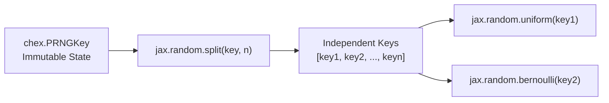
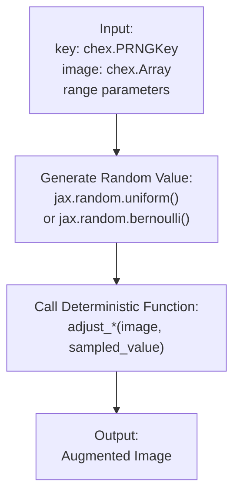
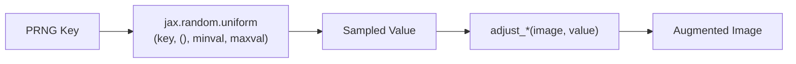
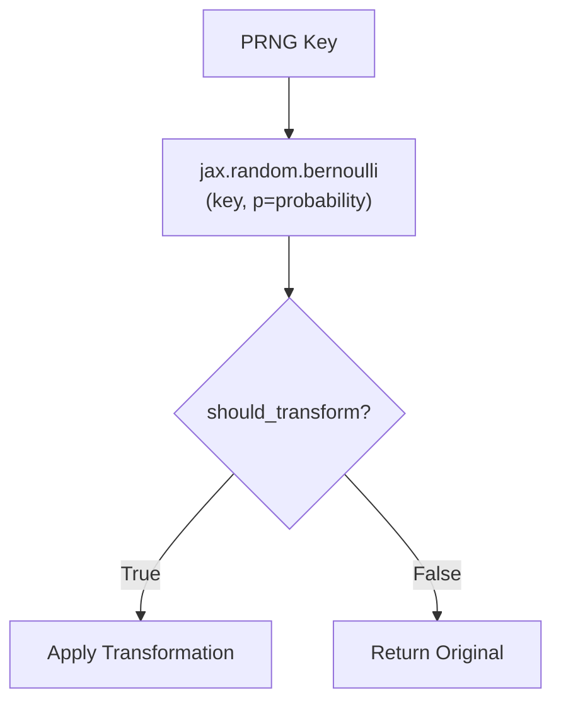
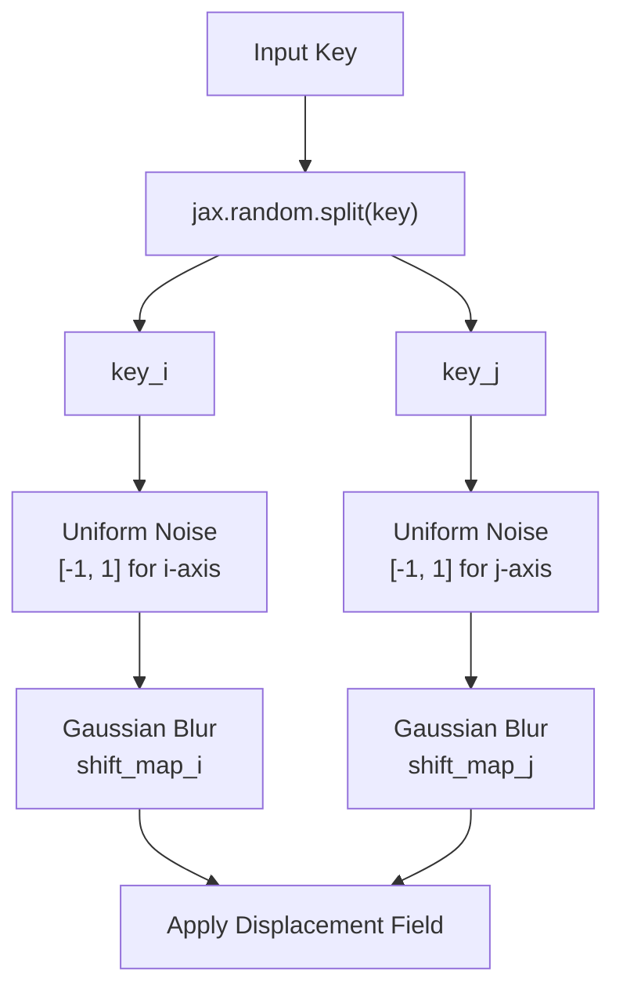
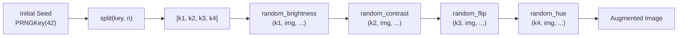
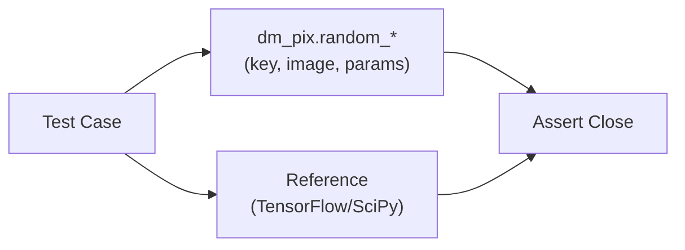

<!-- source: DeepWiki mcp.deepwiki.com · repo google-deepmind/dm_pix · page 2.4 Random Augmentation Pattern · fetched 2026-10-26 -->

# Random Augmentation Pattern

<details>
<summary>Relevant source files</summary>

The following files were used as context for generating this wiki page:

- [dm_pix/_src/augment.py](dm_pix/_src/augment.py)
- [dm_pix/_src/augment_test.py](dm_pix/_src/augment_test.py)

</details>


This page documents the design pattern used for stochastic image augmentation in dm_pix. It explains how `random_*` wrapper functions use JAX's pseudo-random number generation (PRNG) system to add controlled randomness to deterministic augmentation operations. This pattern enables composable, reproducible, and JAX-transformation-compatible data augmentation pipelines.

For documentation on the underlying deterministic augmentation operations, see [Color Adjustments](#2.1), [Geometric Transformations](#2.2), and [Filters and Effects](#2.3).

## Overview of Random Augmentation Functions

The augmentation module provides eight `random_*` functions that wrap deterministic augmentation operations with stochastic behavior. Each function accepts a `chex.PRNGKey` as its first argument and uses JAX's random number generation to produce randomized transformations.

| Random Function | Deterministic Base | Randomization Type | Lines |
|----------------|-------------------|-------------------|-------|
| `random_brightness` | `adjust_brightness` | Uniform delta in range | [815-824](dm_pix/_src/augment.py:815-824) |
| `random_gamma` | `adjust_gamma` | Uniform gamma in range | [827-841](dm_pix/_src/augment.py:827-841) |
| `random_hue` | `adjust_hue` | Uniform delta in range | [844-855](dm_pix/_src/augment.py:844-855) |
| `random_contrast` | `adjust_contrast` | Uniform factor in range | [858-870](dm_pix/_src/augment.py:858-870) |
| `random_saturation` | `adjust_saturation` | Uniform factor in range | [873-885](dm_pix/_src/augment.py:873-885) |
| `random_flip_left_right` | `flip_left_right` | Bernoulli (apply/skip) | [767-788](dm_pix/_src/augment.py:767-788) |
| `random_flip_up_down` | `flip_up_down` | Bernoulli (apply/skip) | [791-812](dm_pix/_src/augment.py:791-812) |
| `random_crop` | `jax.lax.dynamic_slice` | Uniform crop offsets | [888-928](dm_pix/_src/augment.py:888-928) |

Additionally, `elastic_deformation` [167-254](dm_pix/_src/augment.py:167-254) accepts a PRNG key to generate random displacement fields, though it does not follow the `random_*` naming convention.

**Sources:** [dm_pix/_src/augment.py:767-928](dm_pix/_src/augment.py:767-928)

## JAX PRNG Key System

JAX uses an explicit, functional approach to pseudo-random number generation that differs from stateful random number generators. Each random operation requires a PRNG key, and keys must be explicitly split to produce independent random values.

### PRNG Key Properties



Key characteristics:
- **Immutable**: PRNG keys are not modified by random operations
- **Deterministic**: Same key produces same random values
- **Splittable**: Keys can be split into independent sub-keys
- **Reproducible**: Enables exact reproduction of random behavior

**Sources:** [dm_pix/_src/augment.py:167-254](dm_pix/_src/augment.py:167-254), [dm_pix/_src/augment.py:920-928](dm_pix/_src/augment.py:920-928)

## Random Wrapper Function Pattern

### Pattern Structure

All `random_*` functions follow a consistent three-step pattern:



**Sources:** [dm_pix/_src/augment.py:815-885](dm_pix/_src/augment.py:815-885)

### Example: random_brightness

The implementation of `random_brightness` demonstrates this pattern:

```python
def random_brightness(
    key: chex.PRNGKey,
    image: chex.Array,
    max_delta: chex.Numeric,
) -> chex.Array:
  """`adjust_brightness(...)` with random delta in `[-max_delta, max_delta)`."""
  delta = jax.random.uniform(key, (), minval=-max_delta, maxval=max_delta)
  return adjust_brightness(image, delta)
```

**Pattern breakdown:**
1. **Accept key**: First parameter is `chex.PRNGKey`
2. **Sample random value**: Use `jax.random.uniform` to generate `delta` in `[-max_delta, max_delta)`
3. **Call deterministic function**: Pass sampled value to `adjust_brightness`

**Sources:** [dm_pix/_src/augment.py:815-824](dm_pix/_src/augment.py:815-824)

### Example: random_flip_left_right

The flip functions use a different randomization approach with conditional application:

```python
def random_flip_left_right(
    key: chex.PRNGKey,
    image: chex.Array,
    *,
    probability: chex.Numeric = 0.5,
) -> chex.Array:
  """Applies `flip_left_right` with a given probability."""
  should_transform = jax.random.bernoulli(key=key, p=probability)
  return jax.lax.cond(should_transform, flip_left_right, lambda x: x, image)
```

**Pattern variation:**
1. **Accept key and probability**: First parameter is key, optional `probability` parameter
2. **Sample binary decision**: Use `jax.random.bernoulli` to decide whether to apply
3. **Conditional execution**: Use `jax.lax.cond` to apply transformation or return original image

**Sources:** [dm_pix/_src/augment.py:767-788](dm_pix/_src/augment.py:767-788)

## Randomization Strategies

### Uniform Sampling for Continuous Parameters

Functions that adjust continuous properties (brightness, contrast, hue, saturation, gamma) use `jax.random.uniform` to sample values from a specified range.



**Functions using uniform sampling:**
- `random_brightness`: delta in `[-max_delta, max_delta)`
- `random_gamma`: gamma in `[min_gamma, max_gamma)`
- `random_hue`: delta in `[-max_delta, max_delta)`
- `random_contrast`: factor in `[lower, upper)`
- `random_saturation`: factor in `[lower, upper)`

**Sources:** [dm_pix/_src/augment.py:815-885](dm_pix/_src/augment.py:815-885)

### Bernoulli Sampling for Binary Decisions

Functions that conditionally apply transformations use `jax.random.bernoulli` to make binary decisions based on a probability parameter.



**Functions using bernoulli sampling:**
- `random_flip_left_right`: applies flip with probability (default 0.5)
- `random_flip_up_down`: applies flip with probability (default 0.5)

**Sources:** [dm_pix/_src/augment.py:767-812](dm_pix/_src/augment.py:767-812)

### Multi-Dimensional Sampling for Spatial Operations

The `random_crop` function uses per-dimension random sampling to determine crop offsets:

```python
random_keys = jax.random.split(key, len(crop_sizes))

slice_starts = [
    jax.random.randint(k, (), 0, img_size - crop_size + 1)
    for k, img_size, crop_size in zip(random_keys, image_shape, crop_sizes)
]
```

This demonstrates **key splitting** to generate independent random values for each dimension.

**Sources:** [dm_pix/_src/augment.py:920-925](dm_pix/_src/augment.py:920-925)

## Key Splitting in Complex Operations

The `elastic_deformation` function demonstrates key splitting for generating multiple independent random fields:



Implementation:

```python
key_i, key_j = jax.random.split(key)
noise_i = jax.random.uniform(key_i, shape=single_channel_shape) * 2 - 1
noise_j = jax.random.uniform(key_j, shape=single_channel_shape) * 2 - 1
```

This ensures that the displacement fields in different dimensions are statistically independent.

**Sources:** [dm_pix/_src/augment.py:217-219](dm_pix/_src/augment.py:217-219)

## Composing Random Augmentations

### Sequential Key Splitting

To apply multiple random augmentations to the same image, split the key before each operation:

```python
key = jax.random.PRNGKey(42)

# Split key for independent augmentations
k1, k2, k3, k4 = jax.random.split(key, 4)

# Apply augmentations with independent randomness
image = dm_pix.random_brightness(k1, image, max_delta=0.2)
image = dm_pix.random_contrast(k2, image, lower=0.8, upper=1.2)
image = dm_pix.random_flip_left_right(k3, image)
image = dm_pix.random_hue(k4, image, max_delta=0.1)
```

**Key principle**: Each augmentation receives an independent key to ensure uncorrelated randomness.

**Sources:** Implicit from JAX PRNG design, demonstrated in test patterns [dm_pix/_src/augment_test.py:60-65](dm_pix/_src/augment_test.py:60-65)

### Pipeline Pattern



### Batch Processing with vmap

Random augmentation functions are compatible with `jax.vmap` for efficient batch processing:

```python
# Apply random brightness to batch of images
keys = jax.random.split(key, batch_size)
batched_fn = jax.vmap(dm_pix.random_brightness, in_axes=(0, 0, None))
augmented_batch = batched_fn(keys, image_batch, max_delta)
```

**In-axes specification:**
- `in_axes=(0, 0, None)`: vmap over keys (axis 0), images (axis 0), but not max_delta

**Sources:** Test validation in [dm_pix/_src/augment_test.py:456-486](dm_pix/_src/augment_test.py:456-486)

## JAX Transformation Compatibility

All random augmentation functions are designed to work correctly with JAX transformations:

### JIT Compilation

Random functions can be JIT-compiled for performance:

```python
jitted_aug = jax.jit(dm_pix.random_brightness)
augmented = jitted_aug(key, image, max_delta=0.3)
```

**Constraint**: Random parameters (like `max_delta`) should be static or traceable values.

**Sources:** Test validation in [dm_pix/_src/augment_test.py:488-509](dm_pix/_src/augment_test.py:488-509)

### Gradient Computation

Random augmentations maintain differentiability through the deterministic operations:

```python
def loss_fn(image, key):
    augmented = dm_pix.random_brightness(key, image, max_delta=0.2)
    return jnp.sum(augmented ** 2)

grad_fn = jax.grad(loss_fn)
gradient = grad_fn(image, key)
```

**Note**: Gradients flow through the sampled random value as a constant.

### Conditional Application Pattern

The use of `jax.lax.cond` in flip functions ensures proper behavior under JAX transformations:

```python
return jax.lax.cond(should_transform, flip_left_right, lambda x: x, image)
```

**Why `jax.lax.cond`**: Ensures both branches are compiled and the condition is traced correctly in JIT.

**Sources:** [dm_pix/_src/augment.py:788](dm_pix/_src/augment.py:788), [dm_pix/_src/augment.py:812](dm_pix/_src/augment.py:812)

## Testing Strategy

### Reference Implementation Validation

Tests compare random augmentation outputs against reference implementations where available:



**Sources:** [dm_pix/_src/augment_test.py:53-65](dm_pix/_src/augment_test.py:53-65), [dm_pix/_src/augment_test.py:428-454](dm_pix/_src/augment_test.py:428-454)

### Transformation Validation

Tests verify that random functions work correctly with `jax.vmap` and `jax.jit`:

**Vmap Test Pattern:**
```python
fn_vmap = jax.vmap(jax_fn)
outputs_vmaped = fn_vmap(np.stack(images_list), np.stack(arguments))
```

Validates that vmapped execution produces same results as sequential execution.

**JIT Test Pattern:**
```python
jax_fn_jitted = jax.jit(jax_fn)
adjusted_jax = jax_fn(image, argument)
adjusted_jit = jax_fn_jitted(image, argument)
```

Validates that JIT compilation preserves numerical behavior.

**Sources:** [dm_pix/_src/augment_test.py:456-509](dm_pix/_src/augment_test.py:456-509)

### Parameterized Testing

Tests use parameterized testing to validate behavior across:
- Image value ranges (in-range [0,1], out-of-range)
- Different parameter values
- Multiple transformation modes

Example parameterization:
```python
@parameterized.named_parameters(
    ("in_range", _RAND_FLOATS_IN_RANGE),
    ("out_of_range", _RAND_FLOATS_OUT_OF_RANGE))
def test_adjust_brightness(self, images_list):
    self._test_fn_with_random_arg(
        images_list,
        jax_fn=augment.adjust_brightness,
        reference_fn=tf.image.adjust_brightness,
        delta=(-0.5, 0.5))
```

**Sources:** [dm_pix/_src/augment_test.py:51-65](dm_pix/_src/augment_test.py:51-65)

## Design Principles

### Functional Purity

All random augmentation functions are pure functions:
- **No side effects**: Functions do not modify input arrays or global state
- **Explicit randomness**: All randomness comes from the input key
- **Referential transparency**: Same inputs always produce same outputs

### Composability

The design enables flexible composition:
- **Independent operations**: Each augmentation can be applied independently
- **Sequential application**: Multiple augmentations can be chained
- **Batch processing**: Compatible with `vmap` for efficient batching

### Reproducibility

Explicit key passing ensures reproducible augmentation:
- **Deterministic from seed**: Same initial seed produces same augmentation sequence
- **Debuggable**: Can reproduce exact augmentation behavior by saving keys
- **Testable**: Enables unit testing with fixed random seeds

**Sources:** JAX design philosophy, pattern implementation in [dm_pix/_src/augment.py:767-928](dm_pix/_src/augment.py:767-928)

---

