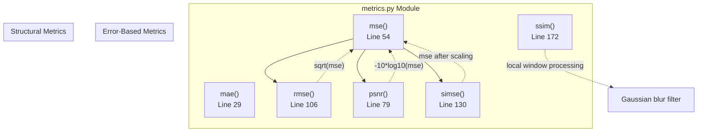
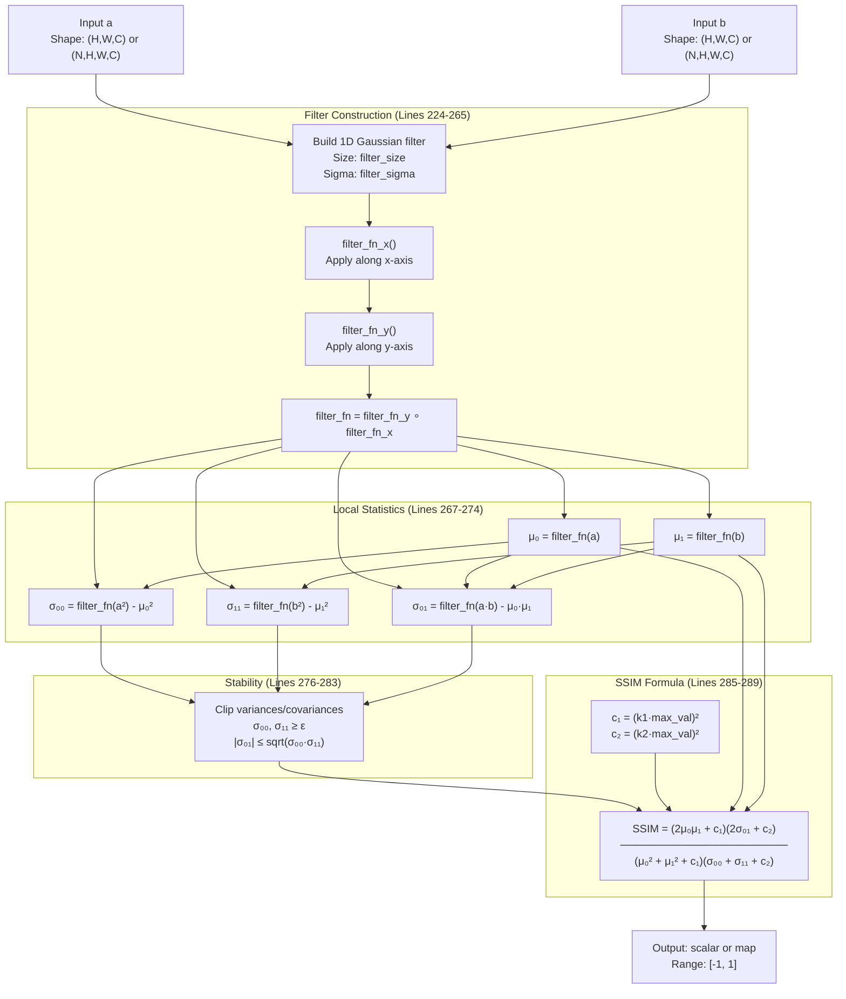
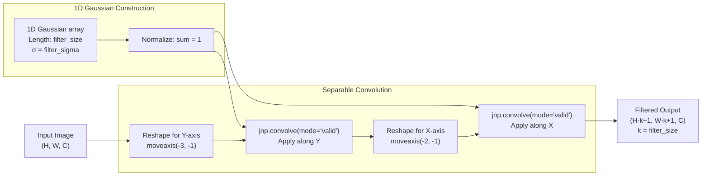
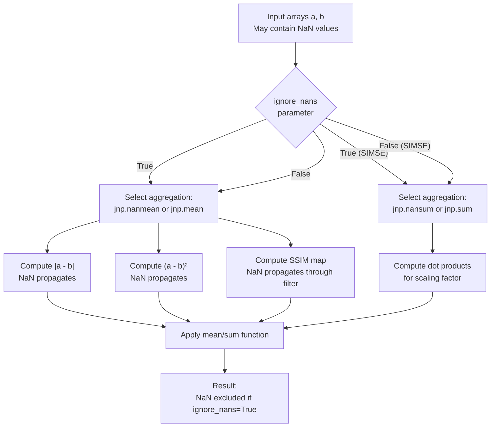

<!-- source: DeepWiki mcp.deepwiki.com · repo google-deepmind/dm_pix · page 3 Image Quality Metrics · fetched 2026-10-26 -->

# Image Quality Metrics

<details>
<summary>Relevant source files</summary>

The following files were used as context for generating this wiki page:

- [dm_pix/_src/metrics.py](dm_pix/_src/metrics.py)
- [dm_pix/_src/metrics_test.py](dm_pix/_src/metrics_test.py)

</details>


## Purpose and Scope

This document covers the image quality metrics module ([dm_pix/_src/metrics.py]()), which provides six functions for evaluating image quality and comparing image pairs. All metrics are designed to work with JAX arrays and support both single images and batches.

For color space manipulation operations used in augmentation, see [Color Space Conversions](#4). For augmentation functions that modify images, see [Image Augmentation Module](#2).

## Module Overview

The metrics module provides quantitative measures to compare image pairs. It implements two categories of metrics:

1. **Error-based metrics**: Direct pixel-wise comparison (MAE, MSE, RMSE, PSNR)
2. **Structural similarity metrics**: Perceptual quality measures (SSIM, SIMSE)

All metrics in this module share common design principles:
- Accept float-encoded images with values in [0, 1]
- Support both rank-3 (HWC) and rank-4 (NHWC) inputs
- Return scalar values per image pair
- Provide optional `ignore_nans` parameter for handling missing data
- Are fully compatible with JAX transformations (jit, vmap, pmap)

**Sources:** [dm_pix/_src/metrics.py:1-27]()

## Common Input Specifications

### Input Format Requirements

All metric functions enforce consistent input requirements through `chex` assertions:

| Requirement | Specification | Enforced By |
|-------------|---------------|-------------|
| Array rank | 3 (HWC) or 4 (NHWC) | `chex.assert_rank([a, b], {3, 4})` |
| Data type | Float (any precision) | `chex.assert_type([a, b], float)` |
| Shape matching | Arrays `a` and `b` must have identical shapes | `chex.assert_equal_shape([a, b])` |
| Value range | [0, 1] (not enforced, but assumed) | Documentation requirement |

### Return Values

- **Rank-3 inputs (HWC)**: Returns a single scalar value
- **Rank-4 inputs (NHWC)**: Returns a 1D array with one scalar per image in the batch

All reductions occur over the spatial and channel dimensions (axes -3, -2, -1), preserving the batch dimension when present.

**Sources:** [dm_pix/_src/metrics.py:29-51](), [dm_pix/_src/metrics.py:54-76]()

## Metric Categories and Relationships



**Diagram: Metric Function Dependencies and Categories**

This diagram shows how the six metric functions are organized and their internal dependencies. The `mse()` function serves as a building block for `rmse()`, `psnr()`, and `simse()`, while `ssim()` is independent and uses local window processing.

**Sources:** [dm_pix/_src/metrics.py:29-293]()

## Metric Selection Guide

Different metrics serve different purposes in image quality assessment:

| Metric | Best For | Range | Interpretation |
|--------|----------|-------|----------------|
| MAE | Simple pixel differences, robust to outliers | [0, ∞) | Lower is better; average absolute difference |
| MSE | Penalizing large errors, optimization objectives | [0, ∞) | Lower is better; squared differences |
| RMSE | Same scale as input values | [0, ∞) | Lower is better; same units as pixels |
| PSNR | Signal quality in decibels, common benchmark | (-∞, ∞) | Higher is better; typically 20-50 dB |
| SSIM | Perceptual similarity, structural comparison | [-1, 1] | Higher is better; 1 = identical |
| SIMSE | Scale-invariant comparison, illumination-robust | [0, ∞) | Lower is better; invariant to scaling |

**Sources:** [dm_pix/_src/metrics.py:14-18](), [dm_pix/_src/metrics_test.py:24-81]()

## Error-Based Metrics

See [Error-Based Metrics](#3.1) for detailed documentation of MAE, MSE, RMSE, and PSNR.

## Structural Similarity Metrics

See [Structural Similarity Metrics](#3.2) for detailed documentation of SSIM and SIMSE.

## Function Signatures and Parameters

### Mean Absolute Error (MAE)

```python
def mae(a: chex.Array, b: chex.Array, *, ignore_nans: bool = False) -> chex.Numeric
```

Computes the mean absolute error: `mean(|a - b|)` over spatial and channel dimensions.

**Parameters:**
- `a`: First image or batch of images
- `b`: Second image or batch of images  
- `ignore_nans`: If True, uses `jnp.nanmean` to exclude NaN values from computation

**Implementation:** [dm_pix/_src/metrics.py:29-51]()

### Mean Squared Error (MSE)

```python
def mse(a: chex.Array, b: chex.Array, *, ignore_nans: bool = False) -> chex.Numeric
```

Computes the mean squared error: `mean((a - b)²)` over spatial and channel dimensions. This function serves as the foundation for RMSE, PSNR, and SIMSE.

**Parameters:**
- `a`: First image or batch of images
- `b`: Second image or batch of images
- `ignore_nans`: If True, uses `jnp.nanmean` to exclude NaN values from computation

**Implementation:** [dm_pix/_src/metrics.py:54-76]()

### Root Mean Squared Error (RMSE)

```python
def rmse(a: chex.Array, b: chex.Array, *, ignore_nans: bool = False) -> chex.Array
```

Computes the square root of MSE: `sqrt(mse(a, b))`. This metric is in the same units as the input pixels, making it more interpretable than MSE.

**Parameters:**
- `a`: First image or batch of images
- `b`: Second image or batch of images
- `ignore_nans`: If True, propagates through to `mse()` call

**Implementation:** [dm_pix/_src/metrics.py:106-127]()

### Peak Signal-to-Noise Ratio (PSNR)

```python
def psnr(a: chex.Array, b: chex.Array, *, ignore_nans: bool = False) -> chex.Numeric
```

Computes PSNR in decibels: `-10 * log₁₀(mse(a, b))`. Assumes a dynamic range of 1.0 (since inputs are in [0, 1]).

**Parameters:**
- `a`: First image or batch of images
- `b`: Second image or batch of images
- `ignore_nans`: If True, propagates through to `mse()` call

**Returns:** PSNR value in decibels (dB). Higher values indicate better quality. Typical range: 20-50 dB.

**Implementation:** [dm_pix/_src/metrics.py:79-103]()

**Sources:** [dm_pix/_src/metrics.py:29-127]()

### Scale-Invariant Mean Squared Error (SIMSE)

```python
def simse(a: chex.Array, b: chex.Array, *, ignore_nans: bool = False) -> chex.Numeric
```

Computes a scale-invariant MSE by finding an optimal scaling factor α for `b` that minimizes `||a - α·b||₂²`, then computing `mse(a, α·b)`.

**Mathematical Formulation:**

The scaling factor α is computed as:
```
α = (a · b) / (b · b)
```
where the dot product is computed over all spatial and channel dimensions.

**Properties:**
- Scale-invariant: `simse(x, y) == simse(x, k·y)` for any constant k
- Useful for comparing images that may differ in overall brightness/intensity
- Returns 0 when images are identical up to a scaling factor

**Parameters:**
- `a`: First image or batch of images (reference)
- `b`: Second image or batch of images (to be scaled)
- `ignore_nans`: If True, uses `jnp.nansum` and propagates through `mse()` call

**Reference:** Barron and Malik, "Shape, Illumination, and Reflectance from Shading", TPAMI 2015.

**Implementation:** [dm_pix/_src/metrics.py:130-169]()

**Sources:** [dm_pix/_src/metrics.py:130-169](), [dm_pix/_src/metrics_test.py:64-69]()

### Structural Similarity Index (SSIM)

```python
def ssim(
    a: chex.Array,
    b: chex.Array,
    *,
    max_val: float = 1.0,
    filter_size: int = 11,
    filter_sigma: float = 1.5,
    k1: float = 0.01,
    k2: float = 0.03,
    return_map: bool = False,
    precision=jax.lax.Precision.HIGHEST,
    filter_fn: Optional[Callable[[chex.Array], chex.Array]] = None,
    ignore_nans: bool = False,
) -> chex.Numeric
```

Computes the structural similarity index, a perceptual metric that considers luminance, contrast, and structure. This implementation follows the standard SSIM definition and matches `tf.image.ssim` output.

**Parameters:**
- `a`: First image or batch of images
- `b`: Second image or batch of images
- `max_val`: Maximum magnitude that inputs can have (default: 1.0)
- `filter_size`: Window size for local statistics (must be >= 1)
- `filter_sigma`: Standard deviation of Gaussian filter (must be > 0)
- `k1`, `k2`: SSIM dampening parameters to avoid division by zero (must be > 0)
- `return_map`: If True, returns per-pixel SSIM map instead of mean value
- `precision`: JAX precision for convolution operations
- `filter_fn`: Optional custom filter function to replace default Gaussian blur
- `ignore_nans`: If True, uses `jnp.nanmean` for final averaging

**Returns:** 
- If `return_map=False`: Mean SSIM value per image, range [-1, 1]
- If `return_map=True`: Per-pixel SSIM map with same spatial dimensions as input

**Important Notes:**
- True SSIM is defined only for grayscale images; for color images, computes average SSIM across channels
- Values range from -1 (completely anti-correlated) to 1 (identical)
- Typical values for similar images are 0.9-0.99

**Implementation:** [dm_pix/_src/metrics.py:172-292]()

**Reference:** Wang et al., "Image quality assessment: from error visibility to structural similarity", IEEE Transactions on Image Processing, 2004.

**Sources:** [dm_pix/_src/metrics.py:172-292](), [dm_pix/_src/metrics_test.py:83-206]()

## SSIM Implementation Details



**Diagram: SSIM Computation Pipeline**

This diagram shows the three-phase computation in the `ssim()` function: filter construction, local statistics computation, and SSIM formula application with stability guarantees.

**Sources:** [dm_pix/_src/metrics.py:224-292]()

## SSIM Filter Implementation

The SSIM implementation uses a separable 2D Gaussian filter for efficiency:



**Diagram: SSIM Separable Filter Application**

The filter is applied as two sequential 1D convolutions (Y-axis then X-axis) rather than a single 2D convolution, reducing computational complexity from O(k²) to O(2k) per pixel.

**Sources:** [dm_pix/_src/metrics.py:224-265]()

## NaN Handling

All metrics support the `ignore_nans` parameter for robust computation in the presence of missing data:



**Diagram: NaN Handling Strategy**

When `ignore_nans=True`, the metrics use `jnp.nanmean` or `jnp.nansum` which exclude NaN values from aggregation. NaN values still propagate through intermediate computations (e.g., squared differences), but are excluded during final averaging.

**Sources:** [dm_pix/_src/metrics.py:29-292](), [dm_pix/_src/metrics_test.py:53-61](), [dm_pix/_src/metrics_test.py:72-80](), [dm_pix/_src/metrics_test.py:179-205]()

## Testing and Validation

The metrics module is validated through comprehensive tests in [dm_pix/_src/metrics_test.py]():

| Test Suite | Purpose | Reference Implementation |
|------------|---------|-------------------------|
| `MSETest.test_psnr_match` | Validates PSNR against TensorFlow | `tf.image.psnr` |
| `MSETest.test_psnr_ignore_nans` | Tests NaN handling for PSNR | Custom validation |
| `MSETest.test_simse_invariance` | Validates scale invariance property | Compares `simse(x, x)` vs `simse(x, 2x)` |
| `MSETest.test_simse_ignore_nans` | Tests NaN handling for SIMSE | Custom validation |
| `SSIMTests.test_ssim_golden` | Validates SSIM against TensorFlow | `tf.image.ssim` |
| `SSIMTests.test_ssim_lowerbound` | Tests SSIM = -1 edge case | Anti-correlated synthetic images |
| `SSIMTests.test_ssim_finite_grad` | Ensures finite gradients on flat regions | `jax.grad(metrics.ssim)` |
| `SSIMTests.test_ssim_ignore_nans` | Tests NaN handling for SSIM | Custom validation |

All tests use `chex.all_variants` to verify compatibility with `jax.jit`, `jax.vmap`, and `jax.pmap`.

**Sources:** [dm_pix/_src/metrics_test.py:24-209]()

## JAX Transformation Compatibility

All metric functions are designed to work seamlessly with JAX transformations:

### JIT Compilation

```python
import jax
from dm_pix import ssim

# Compile metric function for faster execution
ssim_jit = jax.jit(ssim)
similarity = ssim_jit(image1, image2)
```

### Vectorization with vmap

```python
import jax
from dm_pix import mse

# Compute MSE for all pairs in two batches
# images1: (B, H, W, C), images2: (B, H, W, C)
mse_vmap = jax.vmap(mse)
errors = mse_vmap(images1, images2)  # Returns (B,) array
```

### Gradient Computation

All metrics support automatic differentiation:

```python
import jax
from dm_pix import psnr

# Compute gradient of PSNR with respect to first image
grad_fn = jax.grad(psnr)
gradient = grad_fn(image1, image2)
```

The SSIM implementation includes special handling to ensure finite gradients on flat image regions ([dm_pix/_src/metrics.py:276-283]()), preventing numerical instabilities during optimization.

**Sources:** [dm_pix/_src/metrics.py:1-293](), [dm_pix/_src/metrics_test.py:43-50](), [dm_pix/_src/metrics_test.py:170-176]()

## Performance Considerations

### Computational Complexity

| Metric | Time Complexity | Notes |
|--------|----------------|-------|
| MAE | O(HWC) | Single pass, element-wise operation |
| MSE | O(HWC) | Single pass, element-wise operation |
| RMSE | O(HWC) | Calls MSE + sqrt |
| PSNR | O(HWC) | Calls MSE + log |
| SIMSE | O(HWC) | Two passes: compute α, then MSE |
| SSIM | O(HWCk) | Local window processing with separable filter, k=filter_size |

### Memory Usage

- **Error-based metrics**: Minimal intermediate storage, O(1) beyond input size
- **SIMSE**: Additional O(N) for scaling factors (N = batch size)
- **SSIM**: O(HWC) for local statistics maps (μ, σ) plus filtered outputs

### Optimization Recommendations

1. **Use JIT compilation** for repeated metric evaluations on fixed-size inputs
2. **Batch processing** with `vmap` is more efficient than loops for multiple image pairs
3. **SSIM filter customization**: Provide custom `filter_fn` to reuse filters across multiple calls
4. **Precision control**: SSIM accepts `precision` parameter; use lower precision for faster computation if acceptable

**Sources:** [dm_pix/_src/metrics.py:172-292]()

## Common Usage Patterns

### Comparing a Batch of Predictions to Ground Truth

```python
from dm_pix import psnr, ssim
import jax.numpy as jnp

# predictions: (N, H, W, C), ground_truth: (N, H, W, C)
psnr_values = psnr(predictions, ground_truth)  # Returns (N,) array
ssim_values = ssim(predictions, ground_truth)  # Returns (N,) array

# Compute mean quality across batch
mean_psnr = jnp.mean(psnr_values)
mean_ssim = jnp.mean(ssim_values)
```

### Computing Multiple Metrics

```python
from dm_pix import mae, mse, psnr, ssim

def evaluate_quality(pred, target):
    return {
        'mae': mae(pred, target),
        'mse': mse(pred, target),
        'psnr': psnr(pred, target),
        'ssim': ssim(pred, target),
    }

metrics = evaluate_quality(prediction, ground_truth)
```

### Scale-Invariant Comparison

```python
from dm_pix import simse

# Useful when comparing images that may have different brightness
# Example: comparing depth maps or images under different lighting
error = simse(image1, image2)
# Result is invariant to: simse(image1, k * image2) for any k
```

### Per-Pixel SSIM Analysis

```python
from dm_pix import ssim
import jax.numpy as jnp

# Get per-pixel SSIM map for visualization
ssim_map = ssim(image1, image2, return_map=True)

# Identify regions with low similarity
low_quality_mask = ssim_map < 0.8
problem_regions = jnp.where(low_quality_mask)
```

**Sources:** [dm_pix/_src/metrics.py:14-18](), [dm_pix/_src/metrics.py:172-292]()

---

