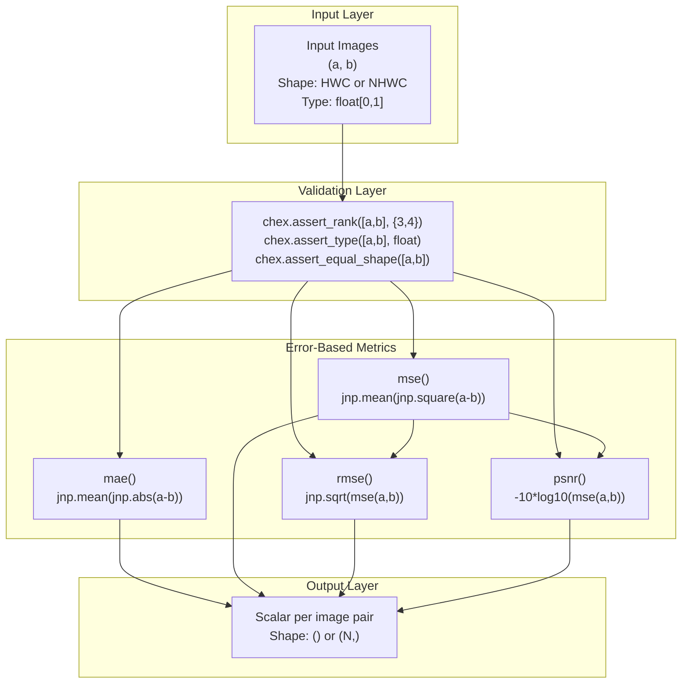
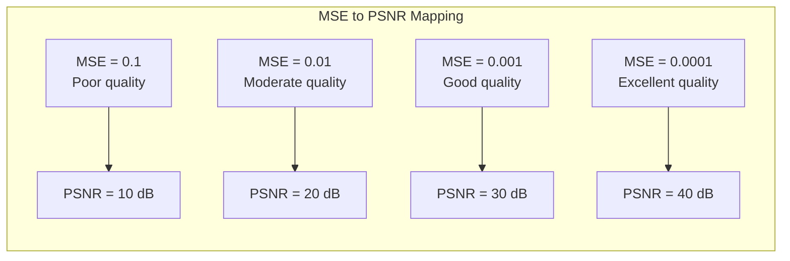
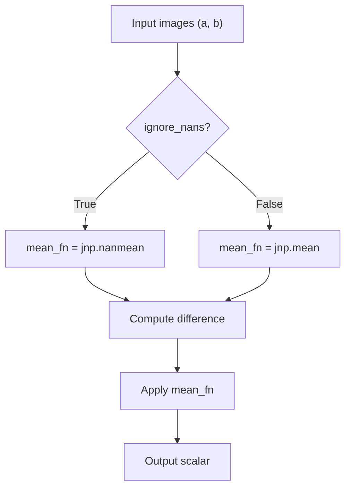
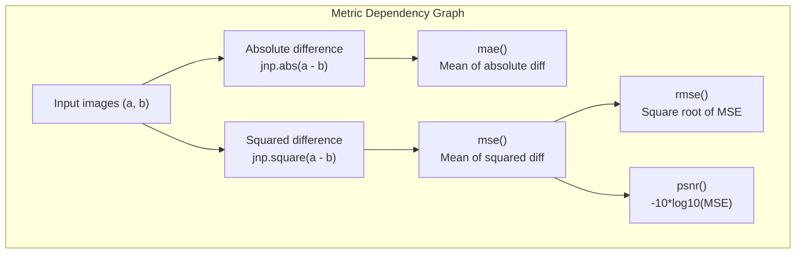
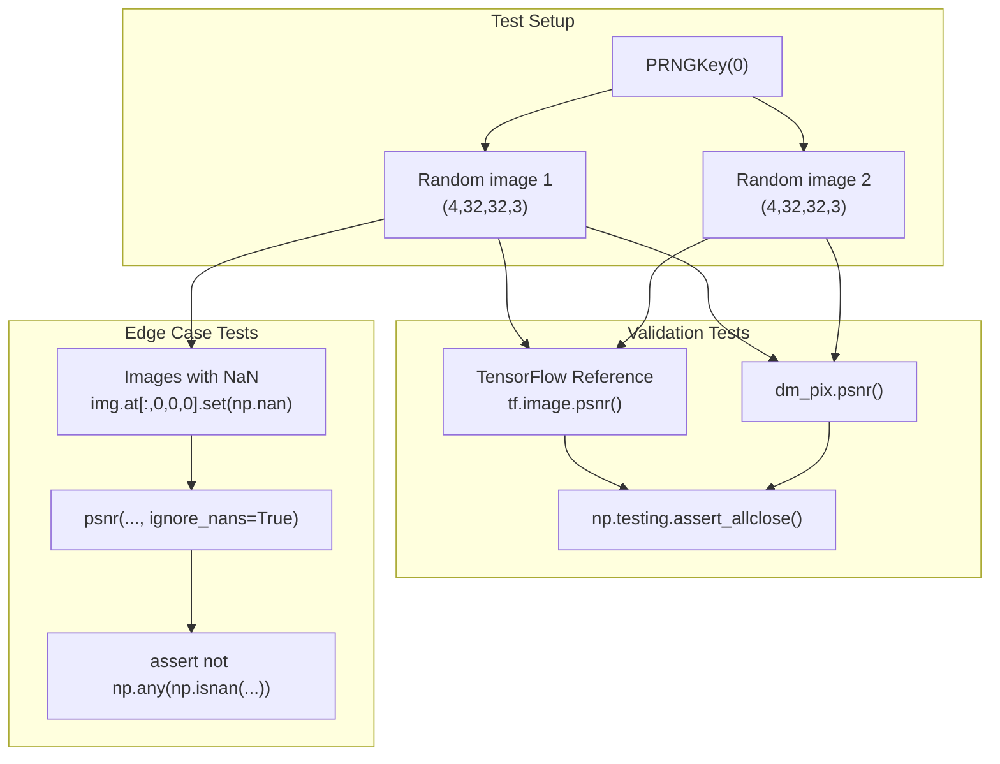

<!-- source: DeepWiki mcp.deepwiki.com · repo google-deepmind/dm_pix · page 3.1 Error-Based Metrics · fetched 2026-10-26 -->

# Error-Based Metrics

<details>
<summary>Relevant source files</summary>

The following files were used as context for generating this wiki page:

- [dm_pix/_src/metrics.py](dm_pix/_src/metrics.py)
- [dm_pix/_src/metrics_test.py](dm_pix/_src/metrics_test.py)

</details>


This page documents the error-based image quality metrics in dm_pix, which provide pixel-wise comparison measures between image pairs. These metrics compute differences between corresponding pixels in two images to quantify dissimilarity. For structural similarity metrics that consider local image structure, see [Structural Similarity Metrics](#3.2).

## Overview

The error-based metrics module provides four fundamental functions for comparing images through pixel-wise error computation:

| Metric | Function | Output Range | Unit |
|--------|----------|--------------|------|
| Mean Absolute Error | `mae()` | [0, ∞) | Pixel intensity |
| Mean Squared Error | `mse()` | [0, ∞) | Pixel intensity² |
| Root Mean Squared Error | `rmse()` | [0, ∞) | Pixel intensity |
| Peak Signal-to-Noise Ratio | `psnr()` | (-∞, ∞) | Decibels (dB) |

All functions are located in [dm_pix/_src/metrics.py]() and share common characteristics: they accept float-encoded images with values in [0, 1], support both single images (HWC) and batched images (NHWC), and return scalar values per image pair.

Sources: [dm_pix/_src/metrics.py:1-293]()

## Metric Function Architecture



**Metric Function Architecture**: This diagram shows the common processing pipeline for all error-based metrics. Input images flow through a validation layer that enforces rank (3 or 4), type (float), and shape constraints. The four metric functions then compute their respective error measures, with `rmse()` and `psnr()` building on top of `mse()`. All metrics reduce spatial dimensions to return scalars.

Sources: [dm_pix/_src/metrics.py:29-127]()

## Mean Absolute Error (MAE)

The `mae()` function computes the Mean Absolute Error, measuring the average absolute difference between corresponding pixels.

### Function Signature

```python
def mae(
    a: chex.Array,
    b: chex.Array,
    *,
    ignore_nans: bool = False,
) -> chex.Numeric
```

### Implementation Details

The MAE computation follows these steps:
1. **Validation**: [dm_pix/_src/metrics.py:47-49]() validates input rank (3 or 4), type (float), and shape equality
2. **Difference**: Computes absolute pixel-wise differences `jnp.abs(a - b)`
3. **Reduction**: Averages over spatial and channel dimensions `axis=(-3, -2, -1)` corresponding to (H, W, C)

The function selects `jnp.nanmean` or `jnp.mean` based on the `ignore_nans` parameter [dm_pix/_src/metrics.py:50-51]().

### Mathematical Definition

For images **a** and **b** of shape (H, W, C):

```
MAE = (1 / (H × W × C)) × Σ |a[i,j,k] - b[i,j,k]|
```

Where the sum is over all pixels i ∈ [0, H), j ∈ [0, W), k ∈ [0, C).

Sources: [dm_pix/_src/metrics.py:29-51]()

## Mean Squared Error (MSE)

The `mse()` function computes the Mean Squared Error, measuring the average squared difference between corresponding pixels. This metric penalizes larger errors more heavily than MAE.

### Function Signature

```python
def mse(
    a: chex.Array,
    b: chex.Array,
    *,
    ignore_nans: bool = False,
) -> chex.Numeric
```

### Implementation Details

The MSE computation is structurally identical to MAE but uses squared differences:
1. **Validation**: [dm_pix/_src/metrics.py:72-74]() enforces the same constraints as MAE
2. **Difference**: Computes squared pixel-wise differences `jnp.square(a - b)`
3. **Reduction**: Averages over spatial and channel dimensions [dm_pix/_src/metrics.py:76]()

### Mathematical Definition

For images **a** and **b** of shape (H, W, C):

```
MSE = (1 / (H × W × C)) × Σ (a[i,j,k] - b[i,j,k])²
```

MSE serves as the foundation for both `rmse()` and `psnr()` computations.

Sources: [dm_pix/_src/metrics.py:54-76]()

## Root Mean Squared Error (RMSE)

The `rmse()` function returns the square root of MSE, providing an error metric in the same units as the original pixel intensities.

### Function Signature

```python
def rmse(
    a: chex.Array,
    b: chex.Array,
    *,
    ignore_nans: bool = False,
) -> chex.Array
```

### Implementation Details

RMSE is implemented as a simple transformation of MSE [dm_pix/_src/metrics.py:127]():

```python
return jnp.sqrt(mse(a, b, ignore_nans=ignore_nans))
```

The validation is delegated to the `mse()` function call, though redundant checks exist at [dm_pix/_src/metrics.py:124-126]() for consistency.

### Mathematical Definition

```
RMSE = √MSE
```

RMSE provides an error measure that is more interpretable than MSE since it's in the same scale as the input pixels (e.g., if pixels are in [0, 1], RMSE is also roughly in that range).

Sources: [dm_pix/_src/metrics.py:106-127]()

## Peak Signal-to-Noise Ratio (PSNR)

The `psnr()` function computes the Peak Signal-to-Noise Ratio, expressing image quality in decibels (dB). Higher PSNR values indicate better quality (less error).

### Function Signature

```python
def psnr(
    a: chex.Array,
    b: chex.Array,
    *,
    ignore_nans: bool = False,
) -> chex.Numeric
```

### Implementation Details

PSNR is computed from MSE using a logarithmic transformation [dm_pix/_src/metrics.py:103]():

```python
return -10.0 * jnp.log(mse(a, b, ignore_nans=ignore_nans)) / jnp.log(10.0)
```

The function assumes a dynamic range of 1.0 (the difference between maximum and minimum allowed values) as stated in [dm_pix/_src/metrics.py:87-88](). This is appropriate since dm_pix expects images in [0, 1] range.

### Mathematical Definition

```
PSNR = -10 × log₁₀(MSE)
     = 10 × log₁₀(1 / MSE)
```

For a dynamic range of 1.0. When images are identical, MSE → 0 and PSNR → ∞. When images differ maximally, PSNR becomes negative.

### Logarithmic Scale Properties



**PSNR Interpretation**: This diagram illustrates how MSE values map to PSNR in decibels. Each 10 dB increase in PSNR corresponds to a 10× decrease in MSE. PSNR is widely used in image compression and quality assessment because the logarithmic scale better matches human perception of quality.

Sources: [dm_pix/_src/metrics.py:79-103]()

## Common Parameters and Behavior

### Input Requirements

All error-based metrics enforce identical requirements [dm_pix/_src/metrics.py:14-18]():

| Requirement | Specification | Validation |
|------------|---------------|------------|
| Encoding | Float values | `chex.assert_type([a, b], float)` |
| Value range | [0, 1] | Assumed, not enforced |
| Shape format | HWC or NHWC | `chex.assert_rank([a, b], {3, 4})` |
| Shape matching | `a.shape == b.shape` | `chex.assert_equal_shape([a, b])` |

### NaN Handling

The `ignore_nans` parameter controls how NaN values are treated:



**NaN Handling Strategy**: When `ignore_nans=True`, the functions use `jnp.nanmean` which excludes NaN values from the mean computation. When `False`, standard `jnp.mean` is used, and any NaN in the input will propagate to the output. This is implemented consistently across all metrics at [dm_pix/_src/metrics.py:50](), [dm_pix/_src/metrics.py:75]().

Sources: [dm_pix/_src/metrics.py:33-51](), [dm_pix/_src/metrics.py:56-76]()

### Dimension Reduction

All metrics reduce over the last three dimensions corresponding to (height, width, channels):

```python
axis=(-3, -2, -1)  # Reduces over H, W, C
```

For batched inputs (NHWC), this produces one scalar per image in the batch. For single images (HWC), it produces a single scalar.

| Input Shape | Output Shape | Interpretation |
|-------------|--------------|----------------|
| (H, W, C) | () | Single scalar for the image pair |
| (N, H, W, C) | (N,) | N scalars, one per image pair |

Sources: [dm_pix/_src/metrics.py:51](), [dm_pix/_src/metrics.py:76]()

## Relationship Between Metrics



**Metric Interdependencies**: This diagram shows how the metrics relate to each other. MAE and MSE are independent base metrics. RMSE depends on MSE via square root. PSNR depends on MSE via logarithmic transformation. This structure allows for efficient computation when multiple metrics are needed, as MSE can be computed once and reused.

Sources: [dm_pix/_src/metrics.py:29-127]()

## Testing and Validation

### Test Coverage

The error-based metrics are tested in [dm_pix/_src/metrics_test.py]() with focus on:

1. **Reference Implementation Matching**: [dm_pix/_src/metrics_test.py:44-50]() validates PSNR against TensorFlow's `tf.image.psnr()` implementation
2. **NaN Handling**: [dm_pix/_src/metrics_test.py:53-61]() verifies that `ignore_nans=True` produces finite outputs even with NaN inputs
3. **JAX Transformation Compatibility**: Tests use `chex.all_variants` decorator to ensure compatibility with `jax.jit`, `jax.vmap`, and `jax.pmap`

### Test Architecture



**Testing Strategy**: The test suite validates correctness through reference comparison with TensorFlow's implementation and verifies robustness through edge case testing. All tests use `chex.all_variants` to automatically test with JAX transformations (jit, vmap, pmap).

Sources: [dm_pix/_src/metrics_test.py:24-81]()

## Usage Examples

### Basic Single Image Comparison

```python
import dm_pix as pix
import jax.numpy as jnp

# Two images in HWC format
original = jnp.array(...)  # shape: (256, 256, 3)
compressed = jnp.array(...)  # shape: (256, 256, 3)

# Compute error metrics
mae_value = pix.mae(original, compressed)
mse_value = pix.mse(original, compressed)
rmse_value = pix.rmse(original, compressed)
psnr_value = pix.psnr(original, compressed)
```

### Batch Processing

```python
# Batch of images in NHWC format
batch_original = jnp.array(...)  # shape: (32, 256, 256, 3)
batch_compressed = jnp.array(...)  # shape: (32, 256, 256, 3)

# Returns array of shape (32,) with one value per image pair
psnr_values = pix.psnr(batch_original, batch_compressed)
```

### Handling Images with NaN

```python
# Image with some NaN values
noisy_image = jnp.array(...)  # contains NaN values
reference = jnp.array(...)

# Ignore NaN values in computation
mae_value = pix.mae(noisy_image, reference, ignore_nans=True)
```

### JAX Transformation Compatibility

```python
import jax

# JIT compilation
psnr_jit = jax.jit(pix.psnr)
result = psnr_jit(img1, img2)

# Vectorization over an extra dimension
psnr_vmap = jax.vmap(pix.psnr, in_axes=(0, None))
results = psnr_vmap(batch_variations, reference_image)
```

Sources: [dm_pix/_src/metrics.py:14-127](), documentation in README

## Implementation Notes

### Performance Characteristics

1. **Memory Efficiency**: Metrics compute differences in-place and reduce immediately, avoiding intermediate storage of full difference arrays
2. **Numerical Precision**: All computations use JAX's default float32 precision unless inputs are explicitly float64
3. **Gradient Compatibility**: All metrics are differentiable and can be used in loss functions for optimization

### Design Decisions

1. **Axis Reduction**: The choice of `axis=(-3, -2, -1)` [dm_pix/_src/metrics.py:51]() ensures consistent behavior whether inputs are rank-3 (HWC) or rank-4 (NHWC)
2. **Dynamic Range Assumption**: PSNR assumes dynamic range of 1.0, matching the [0, 1] encoding convention stated in [dm_pix/_src/metrics.py:14-18]()
3. **Chex Validation**: Explicit validation with chex assertions provides clear error messages and documents expected input formats

### Relationship to Other Modules

Error-based metrics are independent of other dm_pix modules. They do not depend on:
- Color conversion operations (unlike hue/saturation adjustments)
- Interpolation functions (unlike geometric transforms)
- Filter operations (unlike SSIM which uses Gaussian blur)

This independence makes them lightweight and suitable for use in tight training loops or large-scale evaluation pipelines.

Sources: [dm_pix/_src/metrics.py:1-127]()

---

