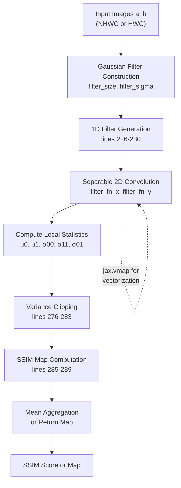
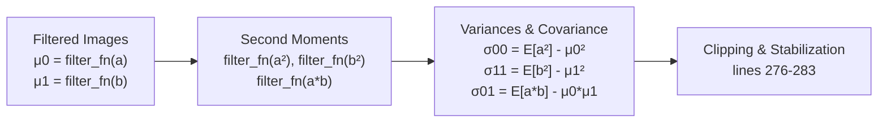
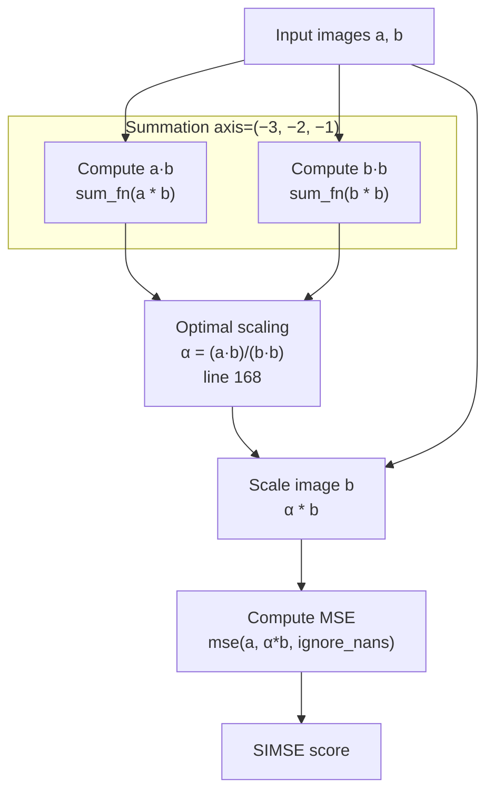

<!-- source: DeepWiki mcp.deepwiki.com · repo google-deepmind/dm_pix · page 3.2 Structural Similarity Metrics · fetched 2026-10-26 -->

# Structural Similarity Metrics

<details>
<summary>Relevant source files</summary>

The following files were used as context for generating this wiki page:

- [dm_pix/_src/metrics.py](dm_pix/_src/metrics.py)
- [dm_pix/_src/metrics_test.py](dm_pix/_src/metrics_test.py)

</details>


## Purpose and Scope

This document describes the structural similarity metrics in dm_pix, specifically the `ssim()` and `simse()` functions. These metrics evaluate image quality based on perceptual and structural properties rather than pixel-wise differences. For pixel-wise error metrics (MAE, MSE, RMSE, PSNR), see [Error-Based Metrics](#3.1).

Both functions are implemented in [dm_pix/_src/metrics.py]() and accept float-encoded images with values in [0, 1] in either HWC or NHWC format, returning scalar scores per image pair.

**Sources:** [dm_pix/_src/metrics.py:1-293]()

## Metric Comparison

The two structural similarity metrics serve different purposes:

| Metric | Property | Use Case | Output Range |
|--------|----------|----------|--------------|
| `ssim()` | Perceptual similarity | General image quality assessment | [-1, 1] (typically [0, 1]) |
| `simse()` | Scale invariance | Shape/structure comparison independent of intensity scaling | [0, ∞) |

**Sources:** [dm_pix/_src/metrics.py:172-292](), [dm_pix/_src/metrics.py:130-169]()

## SSIM Implementation

### Mathematical Foundation

The `ssim()` function implements the Structural Similarity Index from Wang et al. (2004). The algorithm compares local patterns of pixel intensities through three components: luminance, contrast, and structure. The SSIM formula for each local window is:

```
SSIM(x, y) = (2*μ_x*μ_y + c1) * (2*σ_xy + c2) / ((μ_x² + μ_y² + c1) * (σ_x² + σ_y² + c2))
```

Where:
- `μ_x`, `μ_y` are local means
- `σ_x²`, `σ_y²` are local variances  
- `σ_xy` is the local covariance
- `c1`, `c2` are stability constants

**Sources:** [dm_pix/_src/metrics.py:172-217]()

### Filter Construction and Processing Pipeline



**Diagram:** SSIM processing pipeline showing filter construction, local statistics computation, and score aggregation

**Sources:** [dm_pix/_src/metrics.py:224-265](), [dm_pix/_src/metrics.py:267-292]()

### Separable 2D Gaussian Filtering

The implementation uses a separable filtering approach for efficiency. A 1D Gaussian filter is constructed and applied sequentially along each spatial dimension:

**1D Gaussian Construction** [dm_pix/_src/metrics.py:226-230]():
- Window size: `filter_size // 2` on each side
- Gaussian kernel: `exp(-0.5 * ((i - hw + shift) / filter_sigma)²)`
- Normalized to sum to 1

**Separable Application** [dm_pix/_src/metrics.py:232-265]():
- `filter_fn_1`: 1D convolution using `jnp.convolve` with `mode="valid"`
- `filter_fn_vmap`: Vectorized 1D filter using `jax.vmap`
- `filter_fn_y`: Apply along height dimension
- `filter_fn_x`: Apply along width dimension
- `filter_fn`: Combined function `filter_fn_y(filter_fn_x(z))`

The vectorized approach efficiently processes all channels and batch elements simultaneously through axis manipulation with `jnp.moveaxis`.

**Sources:** [dm_pix/_src/metrics.py:224-265]()

### Local Statistics Computation

After filtering, the algorithm computes local statistics for each spatial location:



**Diagram:** Local statistics computation showing mean filtering, variance/covariance calculation, and stabilization

**Sources:** [dm_pix/_src/metrics.py:267-283]()

### Gradient Stability Mechanisms

The implementation includes two critical stability features:

**Variance Clipping** [dm_pix/_src/metrics.py:276-280]():
```python
epsilon = jnp.finfo(jnp.float32).eps ** 2
sigma00 = jnp.maximum(epsilon, sigma00)
sigma11 = jnp.maximum(epsilon, sigma11)
```
Ensures non-negative variances to prevent numerical issues.

**Covariance Bounding** [dm_pix/_src/metrics.py:281-283]():
```python
sigma01 = jnp.sign(sigma01) * jnp.minimum(
    jnp.sqrt(sigma00 * sigma11), jnp.abs(sigma01)
)
```
Ensures the covariance satisfies the Cauchy-Schwarz inequality, preventing invalid correlation values that could cause undefined gradients on flat regions.

These mechanisms are tested in [dm_pix/_src/metrics_test.py:170-176]() which verifies that SSIM produces finite gradients on large flat regions (all zeros), a scenario that historically caused issues in naive implementations.

**Sources:** [dm_pix/_src/metrics.py:276-283](), [dm_pix/_src/metrics_test.py:170-176]()

### SSIM Parameters

| Parameter | Type | Default | Description |
|-----------|------|---------|-------------|
| `max_val` | float | 1.0 | Maximum magnitude that input images can have |
| `filter_size` | int | 11 | Gaussian window size; image dimensions must be ≥ filter_size |
| `filter_sigma` | float | 1.5 | Gaussian bandwidth for filtering (must be > 0) |
| `k1` | float | 0.01 | SSIM stability constant for luminance comparison |
| `k2` | float | 0.03 | SSIM stability constant for contrast comparison |
| `return_map` | bool | False | If True, returns per-pixel SSIM map instead of mean |
| `precision` | Precision | HIGHEST | JAX numerical precision for convolution operations |
| `filter_fn` | Optional[Callable] | None | Custom filter function (overrides Gaussian) |
| `ignore_nans` | bool | False | If True, uses `jnp.nanmean` for aggregation |

The stability constants `c1` and `c2` are computed as:
- `c1 = (k1 * max_val)²`
- `c2 = (k2 * max_val)²`

These constants prevent division by zero when comparing uniform regions.

**Sources:** [dm_pix/_src/metrics.py:172-217](), [dm_pix/_src/metrics.py:285-286]()

## SIMSE Implementation

### Scale Invariance Property

The `simse()` function computes Scale-Invariant Mean Squared Error, which measures similarity independent of intensity scaling. For each image pair, an optimal scaling factor `α` is computed by solving:

```
min_α ||vec(a) - α * vec(b)||₂²
```

The closed-form solution is:
```
α = (a · b) / (b · b)
```

where the dot product is taken over all pixels. The metric then returns `mse(a, α*b)`.

**Key property:** `simse(x, y) == simse(x, y*k)` for any positive scalar `k`.

This metric was introduced in Barron and Malik's "Shape, Illumination, and Reflectance from Shading" (TPAMI 2015) for comparing geometric structure independent of illumination intensity.

**Sources:** [dm_pix/_src/metrics.py:130-169]()

### Implementation Architecture



**Diagram:** SIMSE computation showing optimal scaling factor derivation and scaled MSE calculation

The summation is performed over spatial and channel dimensions (`axis=(-3, -2, -1)`) with `keepdims=True` to maintain broadcasting compatibility for the alpha computation.

**Sources:** [dm_pix/_src/metrics.py:165-169]()

### NaN Handling

Both `ssim()` and `simse()` support the `ignore_nans` parameter:

- **SIMSE**: Uses `jnp.nansum` for dot products [dm_pix/_src/metrics.py:165-168]()
- **SSIM**: Uses `jnp.nanmean` for final aggregation [dm_pix/_src/metrics.py:290-291]()

This allows computing metrics on images with invalid or missing pixels, which is tested in [dm_pix/_src/metrics_test.py:179-205]() and [dm_pix/_src/metrics_test.py:72-80]().

**Sources:** [dm_pix/_src/metrics.py:165-168](), [dm_pix/_src/metrics.py:290-291](), [dm_pix/_src/metrics_test.py:72-80](), [dm_pix/_src/metrics_test.py:179-205]()

## Validation and Testing

### Reference Implementation Comparison

The SSIM implementation is validated against TensorFlow's `tf.image.ssim` across multiple test scenarios:

**Test Coverage** [dm_pix/_src/metrics_test.py:86-146]():
- Multiple image shapes: (2, 12, 12, 3), (12, 12, 3), (2, 12, 15, 3), (17, 12, 3)
- Randomized parameters: `max_val`, `filter_size`, `filter_sigma`, `k1`, `k2`
- Both scalar output and per-pixel map (`return_map=True`)
- Tolerance: `atol=1e-5`, `rtol=1e-5`

**Edge Cases**:
- SSIM lower bound verification: Tests that `ssim(img, -img) ≈ -1` [dm_pix/_src/metrics_test.py:148-167]()
- Flat region gradients: Verifies finite gradients on uniform images [dm_pix/_src/metrics_test.py:170-176]()

**Sources:** [dm_pix/_src/metrics_test.py:86-146](), [dm_pix/_src/metrics_test.py:148-167](), [dm_pix/_src/metrics_test.py:170-176]()

### Scale Invariance Testing

SIMSE scale invariance is validated by verifying:
```
simse(img, img * 2.0) ≈ 0
```

This confirms that doubling all pixel values produces zero error when the metric accounts for optimal scaling.

**Sources:** [dm_pix/_src/metrics_test.py:64-69]()

### JAX Transformation Testing

Both metrics are tested with `@chex.all_variants` which automatically tests:
- JIT compilation: `jax.jit(ssim)(a, b)`
- Vectorization: `jax.vmap(ssim)(a, b)`
- Gradient computation: `jax.grad(ssim)(a, b)`

This ensures compatibility with all JAX transformations for performance and composability in ML pipelines.

**Sources:** [dm_pix/_src/metrics_test.py:43-50](), [dm_pix/_src/metrics_test.py:85-146]()

## Usage Patterns

### Basic SSIM Computation

```python
import dm_pix as pix

# Single image pair (HWC)
score = pix.ssim(image_a, image_b)

# Batch of images (NHWC)
scores = pix.ssim(batch_a, batch_b)  # Returns score per image

# With custom parameters
score = pix.ssim(
    image_a, image_b,
    max_val=255.0,  # For uint8 images scaled to [0, 255]
    filter_size=7,
    filter_sigma=1.0
)
```

### Per-Pixel SSIM Map

```python
# Get spatial SSIM map for visualization
ssim_map = pix.ssim(image_a, image_b, return_map=True)
# Shape: same spatial dims as input, reduced by filter_size-1 per dimension
```

### Scale-Invariant Comparison

```python
# Compare structure independent of brightness/illumination
simse_score = pix.simse(structure_a, structure_b)

# Useful for depth maps, normal maps, or geometric comparisons
depth_error = pix.simse(predicted_depth, ground_truth_depth)
```

**Sources:** [dm_pix/_src/metrics.py:172-292](), [dm_pix/_src/metrics.py:130-169]()

## Implementation Notes

### Precision and Performance

The SSIM implementation uses `precision=jax.lax.Precision.HIGHEST` by default for convolution operations to ensure numerical accuracy. This can be overridden for performance:

```python
score = pix.ssim(a, b, precision=jax.lax.Precision.DEFAULT)
```

The separable filtering approach reduces computational complexity from O(N²) to O(2N) per spatial dimension for a filter of size N.

**Sources:** [dm_pix/_src/metrics.py:182](), [dm_pix/_src/metrics.py:234]()

### Input Validation

Both metrics enforce strict input requirements through `chex` assertions:
- Rank must be 3 (HWC) or 4 (NHWC)
- Data type must be float
- Both inputs must have identical shapes

**Sources:** [dm_pix/_src/metrics.py:220-222](), [dm_pix/_src/metrics.py:161-163]()

### Color Space Considerations

The SSIM implementation notes that true SSIM is defined only for grayscale images. When applied to color images, it computes the average SSIM across all channels. For proper perceptual color comparison, consider converting to grayscale first using `dm_pix.rgb_to_grayscale()` (see [Grayscale Conversion](#4.3)).

**Sources:** [dm_pix/_src/metrics.py:196-198]()

---

