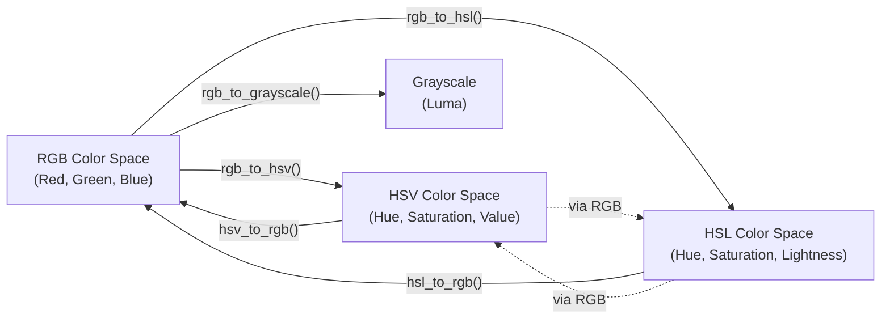
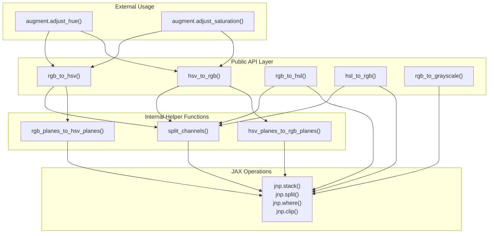
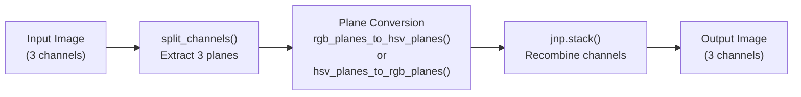
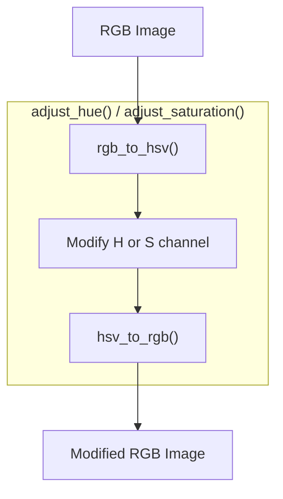
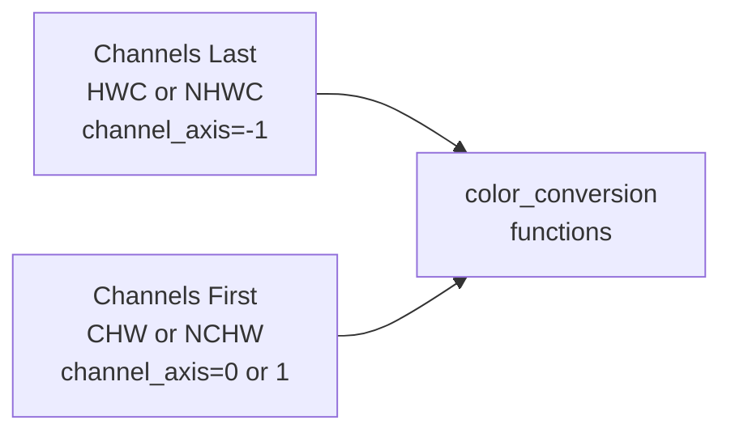

<!-- source: DeepWiki mcp.deepwiki.com · repo google-deepmind/dm_pix · page 4 Color Space Conversions · fetched 2026-10-26 -->

# Color Space Conversions

<details>
<summary>Relevant source files</summary>

The following files were used as context for generating this wiki page:

- [dm_pix/_src/color_conversion.py](dm_pix/_src/color_conversion.py)
- [dm_pix/_src/color_conversion_test.py](dm_pix/_src/color_conversion_test.py)

</details>


## Purpose and Scope

This document describes the color space conversion functions provided by dm_pix in the `color_conversion` module. These functions convert images between RGB, HSV, HSL, and grayscale color spaces. All conversions are implemented as pure JAX operations, making them compatible with `jax.jit`, `jax.vmap`, and `jax.grad` transformations.

For detailed information on specific conversion types:
- RGB-HSV conversions: see [RGB-HSV Conversions](#4.1)
- RGB-HSL conversions: see [RGB-HSL Conversions](#4.2)  
- Grayscale conversion: see [Grayscale Conversion](#4.3)

For usage of color conversions in augmentation operations (hue/saturation adjustments), see [Color Adjustments](#2.1).

**Sources:** [dm_pix/_src/color_conversion.py:1-295]()

## Module Overview

The `color_conversion` module provides five public conversion functions that operate on float-encoded images with values in the range [0, 1]. The module is located at [dm_pix/_src/color_conversion.py]() and is re-exported through the main `dm_pix` API.

| Function | Input Space | Output Space | Line Reference |
|----------|-------------|--------------|----------------|
| `rgb_to_hsv` | RGB | HSV | [49-71]() |
| `hsv_to_rgb` | HSV | RGB | [74-93]() |
| `rgb_to_hsl` | RGB | HSL | [175-215]() |
| `hsl_to_rgb` | HSL | RGB | [218-250]() |
| `rgb_to_grayscale` | RGB | Grayscale | [253-294]() |

**Sources:** [dm_pix/_src/color_conversion.py:1-295]()

## Color Space Conversion Graph

The following diagram shows the available conversion paths between color spaces:



**Sources:** [dm_pix/_src/color_conversion.py:49-294]()

## Function Architecture and Dependencies

The module uses a layered architecture with plane-based operations as the foundation:



**Sources:** [dm_pix/_src/color_conversion.py:27-294](), [dm_pix/_src/augment.py]()

## Input Format and Constraints

All color conversion functions expect images with specific format requirements:

### Image Format Requirements

- **Data Type:** Float arrays (`chex.Array`)
- **Value Range:** [0, 1] (behavior outside this range is not guaranteed)
- **Channel Dimension:** 3 channels along the specified `channel_axis`
- **Channel Axis:** Configurable via `channel_axis` parameter (default: -1, last axis)
- **Shape:** Any shape with 3 channels at `channel_axis` (e.g., HWC, NHWC, CHW)

### Example Valid Shapes

| Format | Shape | Channel Axis | Description |
|--------|-------|--------------|-------------|
| HWC | `(height, width, 3)` | -1 | Single image, channels last |
| NHWC | `(batch, height, width, 3)` | -1 | Batch of images, channels last |
| CHW | `(3, height, width)` | 0 | Single image, channels first |
| NCHW | `(batch, 3, height, width)` | 1 | Batch of images, channels first |

**Sources:** [dm_pix/_src/color_conversion.py:34-36](), [dm_pix/_src/color_conversion_test.py:71-86]()

## Design Patterns

### Split-Convert-Stack Pattern

The RGB-HSV and HSV-RGB conversions follow a consistent pattern:



This pattern is implemented in:
- [dm_pix/_src/color_conversion.py:49-71]() (`rgb_to_hsv`)
- [dm_pix/_src/color_conversion.py:74-93]() (`hsv_to_rgb`)

**Sources:** [dm_pix/_src/color_conversion.py:49-93]()

### Gradient-Safe Division

All conversion functions use careful handling of division operations to avoid NaN gradients. The pattern involves:

1. Creating "safe" values for division operations: [dm_pix/_src/color_conversion.py:125-126]()
2. Using `jnp.where()` to mask results: [dm_pix/_src/color_conversion.py:128-135]()
3. Filtering out subnormal floating points: [dm_pix/_src/color_conversion.py:67-68]()

This design ensures that:
- Forward pass produces correct results
- Backward pass (gradients) never contains NaN values
- Works correctly with JAX transformations

**Sources:** [dm_pix/_src/color_conversion.py:122-135](), [dm_pix/_src/color_conversion_test.py:88-93](), [dm_pix/_src/color_conversion_test.py:129-139]()

## Plane-Based Operations

The HSV conversions use separate plane-based helper functions that operate on individual color channels:

### RGB Planes to HSV Planes

The `rgb_planes_to_hsv_planes()` function [dm_pix/_src/color_conversion.py:96-137]() converts three separate color planes (red, green, blue) to HSV planes (hue, saturation, value). This function:

- Computes the maximum and minimum values across RGB channels to determine value and range
- Calculates saturation as the ratio of range to value
- Determines hue based on which RGB channel is maximum
- Uses gradient-safe division with safe values and masking

### HSV Planes to RGB Planes

The `hsv_planes_to_rgb_planes()` function [dm_pix/_src/color_conversion.py:140-172]() converts HSV planes back to RGB. This function:

- Wraps hue values to handle cyclic nature (hue >= 360°)
- Computes intermediate values (dr, dg, db) based on hue
- Applies saturation and value scaling to generate RGB channels

**Sources:** [dm_pix/_src/color_conversion.py:96-172]()

## JAX Integration

All color conversion functions are pure JAX operations that support:

### JIT Compilation

All functions work with `jax.jit`:
```python
rgb_init = jnp.array([...])  # shape (H, W, 3)
hsv = jax.jit(color_conversion.rgb_to_hsv)(rgb_init)
rgb_final = jax.jit(color_conversion.hsv_to_rgb)(hsv)
```

Tested in: [dm_pix/_src/color_conversion_test.py:151-156]()

### Vectorization

Functions support `jax.vmap` for batch processing:
```python
rgb_batch = jnp.array([...])  # shape (N, H, W, 3)
hsv_batch = jax.vmap(color_conversion.rgb_to_hsv)(rgb_batch)
```

Tested in: [dm_pix/_src/color_conversion_test.py:142-149]()

### Gradient Computation

All functions produce valid gradients without NaN values:
```python
jacobian = jax.jacrev(color_conversion.rgb_to_hsv)(image)
# jacobian contains no NaN values
```

Tested in: [dm_pix/_src/color_conversion_test.py:88-93](), [dm_pix/_src/color_conversion_test.py:119-127]()

**Sources:** [dm_pix/_src/color_conversion_test.py:88-156]()

## Usage in Augmentation Module

Color conversions are used internally by the augmentation module for hue and saturation adjustments:



These augmentation functions rely on the color conversions to:
1. Convert RGB to HSV
2. Modify the hue or saturation channel
3. Convert back to RGB

This demonstrates the composability of color conversion functions within the dm_pix pipeline.

**Sources:** [dm_pix/_src/augment.py](), Diagram 4 from context

## Validation and Testing

The color conversion functions are validated against reference implementations:

### Reference Implementations

| Function | Reference | Test Location |
|----------|-----------|---------------|
| `rgb_to_hsv` | TensorFlow's `tf.image.rgb_to_hsv` | [color_conversion_test.py:105-127]() |
| `hsv_to_rgb` | TensorFlow's `tf.image.hsv_to_rgb` | [color_conversion_test.py:73-93]() |
| `rgb_to_hsl` | Python's `colorsys.rgb_to_hls` | [color_conversion_test.py:164-190]() |
| `hsl_to_rgb` | Python's `colorsys.hls_to_rgb` | [color_conversion_test.py:214-235]() |
| `rgb_to_grayscale` | TensorFlow's `tf.image.rgb_to_grayscale` | [color_conversion_test.py:264-284]() |

### Test Coverage

Tests validate:
- Correctness against reference implementations
- Gradient stability (no NaN values)
- Roundtrip conversions (RGB→HSV→RGB, RGB→HSL→RGB)
- Edge cases (all zeros, all ones, out-of-range values)
- Different channel axis configurations (channels first/last)
- JAX transformations (jit, vmap)

**Sources:** [dm_pix/_src/color_conversion_test.py:1-289]()

## Channel Axis Configuration

All functions (except `rgb_to_grayscale`) use a `channel_axis` parameter with default value -1 (last axis):



The `split_channels()` helper function [dm_pix/_src/color_conversion.py:27-46]() handles channel splitting and squeezing for any axis configuration, enabling flexible input formats.

**Sources:** [dm_pix/_src/color_conversion.py:27-46](), [dm_pix/_src/color_conversion_test.py:71-86]()

---

