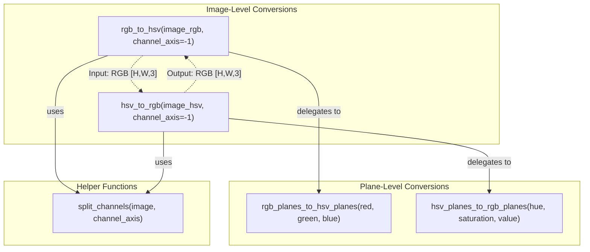
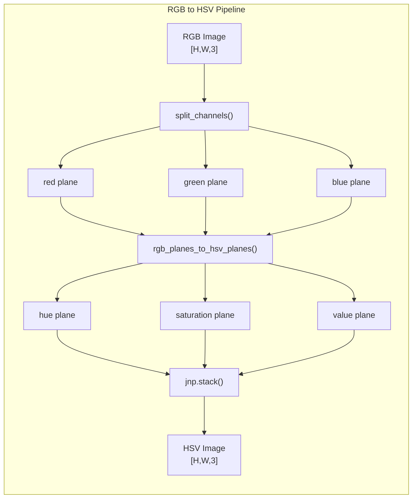
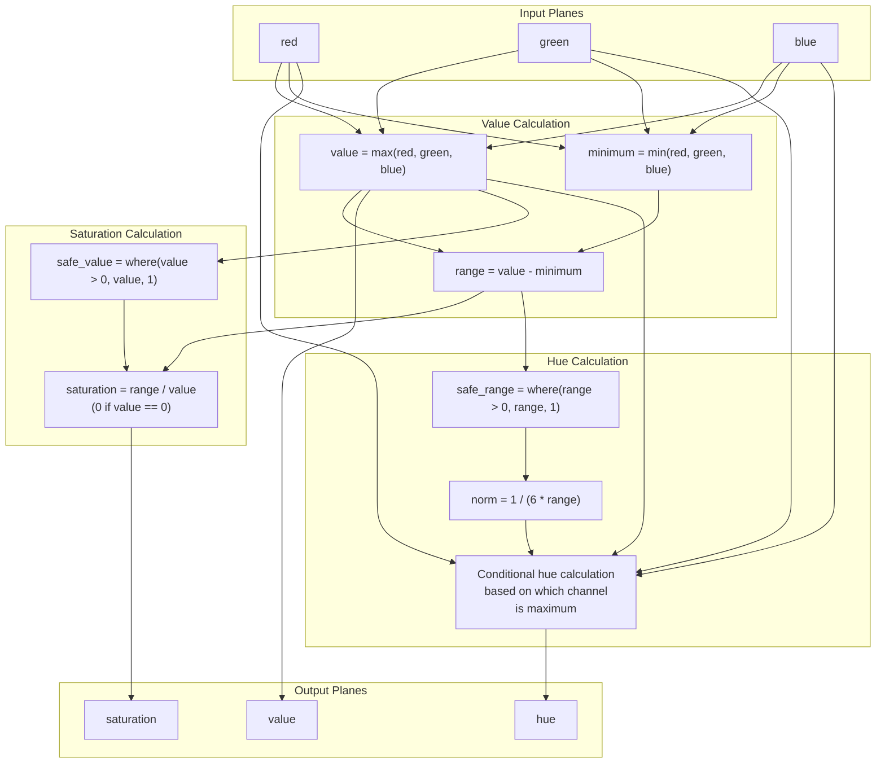
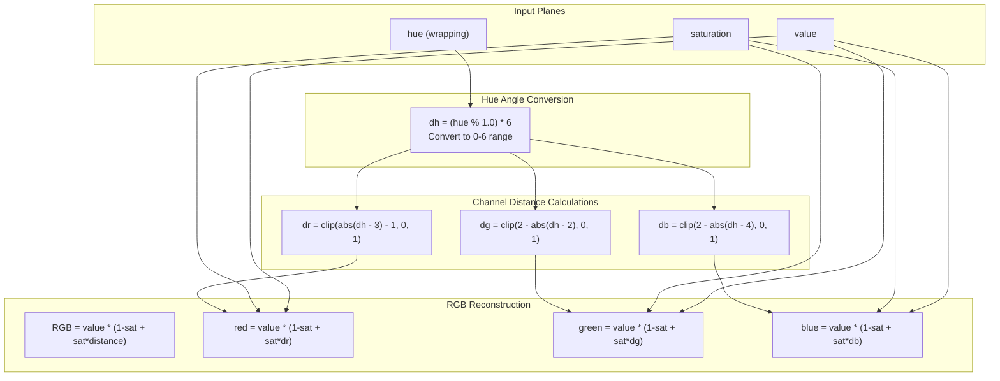
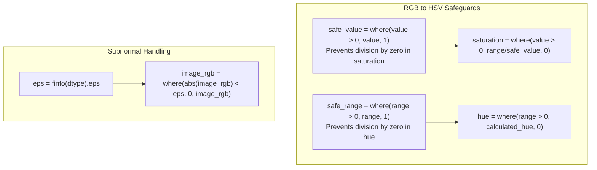
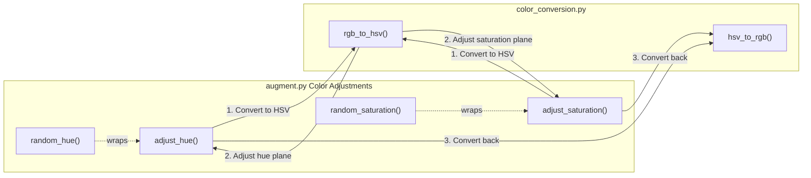
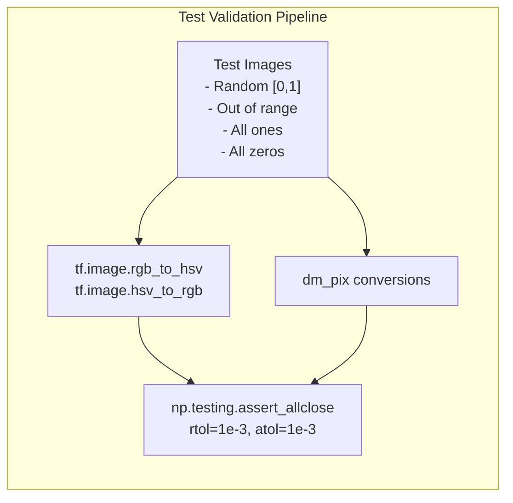

<!-- source: DeepWiki mcp.deepwiki.com · repo google-deepmind/dm_pix · page 4.1 RGB-HSV Conversions · fetched 2026-10-26 -->

# RGB-HSV Conversions

<details>
<summary>Relevant source files</summary>

The following files were used as context for generating this wiki page:

- [dm_pix/_src/color_conversion.py](dm_pix/_src/color_conversion.py)
- [dm_pix/_src/color_conversion_test.py](dm_pix/_src/color_conversion_test.py)

</details>


## Purpose and Scope

This page documents the RGB-HSV color space conversion functions in dm_pix. These functions enable bidirectional conversion between RGB (Red, Green, Blue) and HSV (Hue, Saturation, Value) color spaces, supporting both full image conversion and individual color plane operations. The conversions are implemented with gradient stability for use in differentiable augmentation pipelines.

For RGB-HSL conversions, see [RGB-HSL Conversions](#4.2). For grayscale conversion, see [Grayscale Conversion](#4.3). For usage in color adjustments, see [Color Adjustments](#2.1).

Sources: [dm_pix/_src/color_conversion.py:1-295]()

## HSV Color Space

HSV represents colors using three components:

| Component | Range | Interpretation |
|-----------|-------|----------------|
| **Hue** | [0, 1] | Color angle on color wheel (wraps at 1.0 = 360°) |
| **Saturation** | [0, 1] | Color purity (0 = grayscale, 1 = pure color) |
| **Value** | [0, 1] | Brightness (0 = black, 1 = maximum brightness) |

HSV is particularly useful for color-based augmentations because:
- **Hue** can be adjusted independently to shift colors
- **Saturation** controls color intensity without affecting brightness
- **Value** provides perceptual brightness control

Sources: [dm_pix/_src/color_conversion.py:49-94]()

## Public API Functions

### Core Conversion Functions



Sources: [dm_pix/_src/color_conversion.py:27-172]()

### Function Signatures

**`rgb_to_hsv(image_rgb: chex.Array, *, channel_axis: int = -1) -> chex.Array`**

Converts an RGB image to HSV color space.

| Parameter | Type | Description |
|-----------|------|-------------|
| `image_rgb` | `chex.Array` | RGB image with float values in [0, 1] |
| `channel_axis` | `int` | Axis containing RGB channels (default: -1) |
| **Returns** | `chex.Array` | HSV image with float values in [0, 1] |

Sources: [dm_pix/_src/color_conversion.py:49-72]()

**`hsv_to_rgb(image_hsv: chex.Array, *, channel_axis: int = -1) -> chex.Array`**

Converts an HSV image to RGB color space.

| Parameter | Type | Description |
|-----------|------|-------------|
| `image_hsv` | `chex.Array` | HSV image with float values in [0, 1] |
| `channel_axis` | `int` | Axis containing HSV channels (default: -1) |
| **Returns** | `chex.Array` | RGB image with float values in [0, 1] |

Sources: [dm_pix/_src/color_conversion.py:74-94]()

**`rgb_planes_to_hsv_planes(red, green, blue) -> Tuple[hue, saturation, value]`**

Converts individual RGB color planes to HSV planes. All planes must have the same shape.

Sources: [dm_pix/_src/color_conversion.py:96-137]()

**`hsv_planes_to_rgb_planes(hue, saturation, value) -> Tuple[red, green, blue]`**

Converts individual HSV planes to RGB color planes. All planes must have the same shape.

Sources: [dm_pix/_src/color_conversion.py:140-172]()

## Implementation Architecture

### Data Flow Through Conversions



Sources: [dm_pix/_src/color_conversion.py:49-72]()

### RGB to HSV Mathematical Implementation

The `rgb_planes_to_hsv_planes` function implements the standard RGB to HSV conversion algorithm:



Sources: [dm_pix/_src/color_conversion.py:96-137]()

#### Key Implementation Details

**Value Component** [dm_pix/_src/color_conversion.py:118-120]()
```python
value = jnp.maximum(jnp.maximum(red, green), blue)
minimum = jnp.minimum(jnp.minimum(red, green), blue)
range_ = value - minimum
```

**Saturation Component** [dm_pix/_src/color_conversion.py:125-128]()
```python
safe_value = jnp.where(value > 0, value, 1.)
saturation = jnp.where(value > 0, range_ / safe_value, 0.)
```
Uses `safe_value` to avoid division by zero while maintaining gradient stability.

**Hue Component** [dm_pix/_src/color_conversion.py:129-135]()
```python
safe_range = jnp.where(range_ > 0, range_, 1.)
norm = 1. / (6. * safe_range)

hue = jnp.where(value == green,
                norm * (blue - red) + 2. / 6.,
                norm * (red - green) + 4. / 6.)
hue = jnp.where(value == red, norm * (green - blue), hue)
hue = jnp.where(range_ > 0, hue, 0.) + (hue < 0.)
```
Calculates hue based on which RGB component is maximum, with wrapping for negative values.

Sources: [dm_pix/_src/color_conversion.py:96-137]()

### HSV to RGB Mathematical Implementation

The `hsv_planes_to_rgb_planes` function uses a geometric approach based on the HSV color cylinder:



Sources: [dm_pix/_src/color_conversion.py:140-172]()

#### Implementation Code Structure

**Hue Wrapping and Scaling** [dm_pix/_src/color_conversion.py:162]()
```python
dh = (hue % 1.0) * 6.  # Wrap when hue >= 360°.
```

**Distance Calculations** [dm_pix/_src/color_conversion.py:163-165]()
```python
dr = jnp.clip(jnp.abs(dh - 3.) - 1., 0., 1.)
dg = jnp.clip(2. - jnp.abs(dh - 2.), 0., 1.)
db = jnp.clip(2. - jnp.abs(dh - 4.), 0., 1.)
```
These represent the distance of each RGB channel from its peak in the color wheel.

**RGB Reconstruction** [dm_pix/_src/color_conversion.py:166-170]()
```python
one_minus_s = 1. - saturation
red = value * (one_minus_s + saturation * dr)
green = value * (one_minus_s + saturation * dg)
blue = value * (one_minus_s + saturation * db)
```

Sources: [dm_pix/_src/color_conversion.py:140-172]()

## Gradient Stability and NaN Prevention

The implementations include several safeguards to prevent NaN values in gradients, which is critical for differentiable augmentation pipelines.

### Division by Zero Protection



Sources: [dm_pix/_src/color_conversion.py:122-135](), [dm_pix/_src/color_conversion.py:67-68]()

### Subnormal Float Handling

The `rgb_to_hsv` function includes special handling for subnormal floating-point values [dm_pix/_src/color_conversion.py:67-68]():

```python
eps = jnp.finfo(image_rgb.dtype).eps
image_rgb = jnp.where(jnp.abs(image_rgb) < eps, 0., image_rgb)
```

This clamps values smaller than machine epsilon to zero, preventing gradient issues when processing blurred images or other operations that produce very small values.

**Gradient Testing** [dm_pix/_src/color_conversion_test.py:129-139]():
```python
def test_rgb_to_hsv_subnormals(self):
    img = jnp.zeros((5, 5, 3))
    img = img.at[2, 2, 1].set(1)
    blurred_img = augment.gaussian_blur(img, sigma=0.08, kernel_size=5.)
    fun = lambda x: color_conversion.rgb_to_hsv(x).sum()
    grad_fun = jax.grad(fun)
    
    grad = grad_fun(blurred_img)
    self.assertFalse(jnp.isnan(grad).any())
```

Sources: [dm_pix/_src/color_conversion.py:67-68](), [dm_pix/_src/color_conversion_test.py:129-139]()

## Channel Axis Flexibility

Both `rgb_to_hsv` and `hsv_to_rgb` support flexible channel axis positioning through the `channel_axis` parameter:

| Layout | `channel_axis` | Shape Example |
|--------|---------------|---------------|
| **Channel-last** (default) | `-1` | `[H, W, 3]` |
| **Channel-first** | `-3` or `0` (batched: `1`) | `[3, H, W]` or `[N, 3, H, W]` |

The `split_channels` helper function [dm_pix/_src/color_conversion.py:27-46]() handles splitting and squeezing along any axis:

```python
def split_channels(image: chex.Array, channel_axis: int):
    chex.assert_axis_dimension(image, axis=channel_axis, expected=3)
    split_axes = jnp.split(image, 3, axis=channel_axis)
    return tuple(map(lambda x: jnp.squeeze(x, axis=channel_axis), split_axes))
```

Sources: [dm_pix/_src/color_conversion.py:27-46](), [dm_pix/_src/color_conversion.py:49-94]()

## Usage in Color Adjustments

The HSV conversion functions are used internally by hue and saturation adjustment functions in the augmentation module:



For detailed documentation of these augmentation functions, see [Color Adjustments](#2.1).

Sources: [dm_pix/_src/color_conversion.py:49-94]()

## JAX Transformation Compatibility

All conversion functions are pure functions compatible with JAX transformations:

### JIT Compilation

```python
import jax
from dm_pix._src import color_conversion

# JIT compile the conversion
rgb_to_hsv_jit = jax.jit(color_conversion.rgb_to_hsv)
hsv_to_rgb_jit = jax.jit(color_conversion.hsv_to_rgb)

# Use on images
hsv = rgb_to_hsv_jit(rgb_image)
rgb = hsv_to_rgb_jit(hsv_image)
```

Sources: [dm_pix/_src/color_conversion_test.py:151-156]()

### Vectorization with vmap

```python
# Batch process multiple images
rgb_batch = jnp.stack([img1, img2, img3])  # [N, H, W, 3]

rgb_to_hsv_batch = jax.vmap(color_conversion.rgb_to_hsv)
hsv_batch = rgb_to_hsv_batch(rgb_batch)
```

Sources: [dm_pix/_src/color_conversion_test.py:142-149]()

### Roundtrip Conversion

HSV conversions are designed to be numerically stable for roundtrip operations:

```python
rgb_init = jax.random.uniform(key, (16, 16, 3))
hsv = color_conversion.rgb_to_hsv(rgb_init)
rgb_final = color_conversion.hsv_to_rgb(hsv)
# rgb_init ≈ rgb_final within 1e-3 tolerance
```

Sources: [dm_pix/_src/color_conversion_test.py:142-156]()

## Validation and Testing

### Reference Implementation Comparison

The implementation is validated against TensorFlow's reference implementation:



Sources: [dm_pix/_src/color_conversion_test.py:63-128]()

### Test Coverage

The test suite validates:

| Test Category | Coverage |
|--------------|----------|
| **Reference comparison** | TensorFlow `tf.image` functions [dm_pix/_src/color_conversion_test.py:73-86, 105-117]() |
| **Gradient stability** | No NaNs with `jax.jacrev` [dm_pix/_src/color_conversion_test.py:92-93, 126-127]() |
| **Subnormal handling** | Blurred images with tiny values [dm_pix/_src/color_conversion_test.py:129-139]() |
| **Roundtrip accuracy** | RGB → HSV → RGB within tolerance [dm_pix/_src/color_conversion_test.py:142-156]() |
| **Channel axis variants** | Both channel-last and channel-first [dm_pix/_src/color_conversion_test.py:71-86]() |
| **JAX transformations** | `jit`, `vmap` compatibility [dm_pix/_src/color_conversion_test.py:142-156]() |
| **Edge cases** | All zeros, all ones, out-of-range values [dm_pix/_src/color_conversion_test.py:64-70]() |

Sources: [dm_pix/_src/color_conversion_test.py:58-289]()

### Test Execution

Tests use `chex.all_variants` to automatically test all JAX transformation contexts:

```python
@chex.all_variants
def test_rgb_to_hsv(self):
    rgb_to_hsv = self.variant(color_conversion.rgb_to_hsv)
    # Tests run with: no transform, jit, vmap, etc.
```

Sources: [dm_pix/_src/color_conversion_test.py:95-128]()

## Performance Considerations

1. **Plane-based operations**: Direct use of `rgb_planes_to_hsv_planes` and `hsv_planes_to_rgb_planes` avoids channel splitting/stacking overhead when working with separated planes.

2. **JIT compilation**: Recommended for repeated conversions to amortize compilation cost.

3. **Vectorization**: Use `jax.vmap` for batch processing multiple images rather than looping.

4. **Channel layout**: Choose channel layout that matches your pipeline to minimize transposes.

Sources: [dm_pix/_src/color_conversion.py:49-172]()

---

