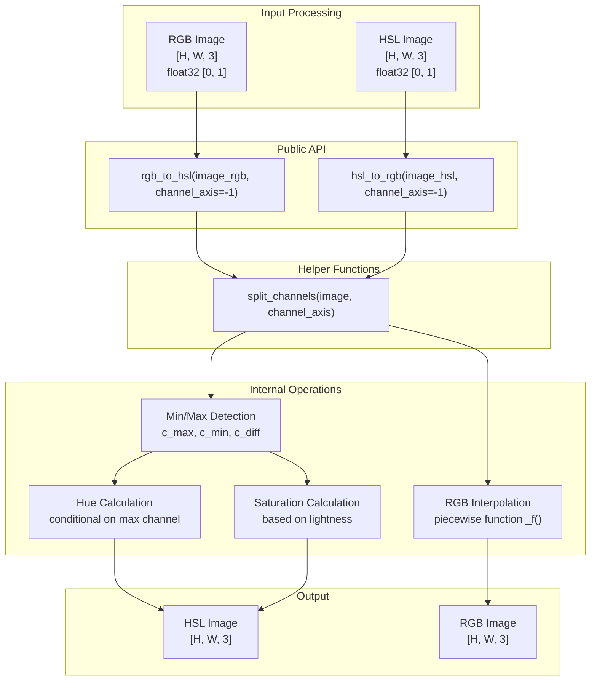
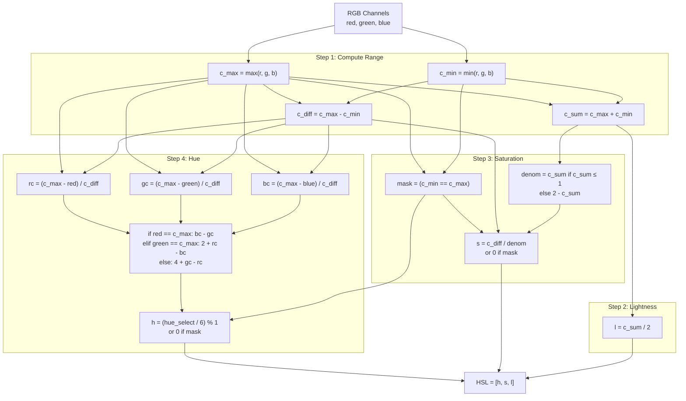
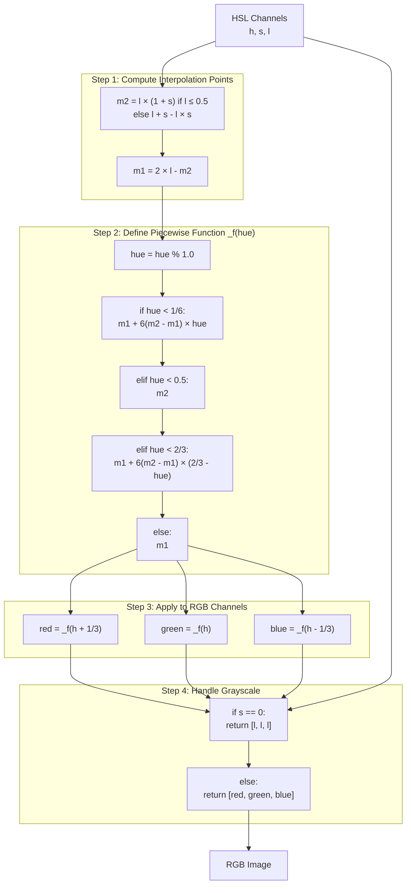
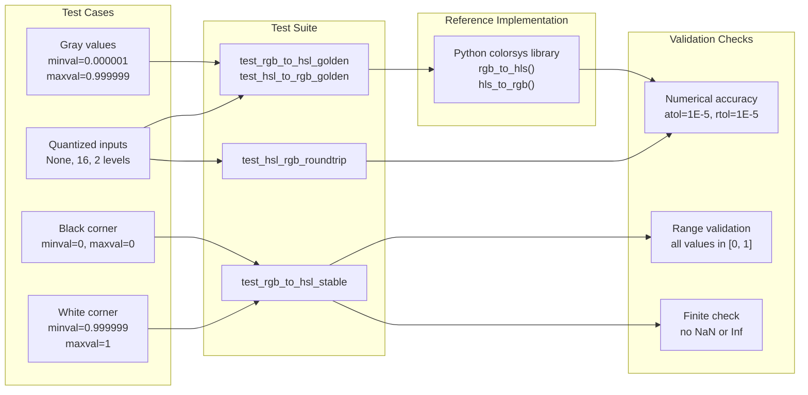

<!-- source: DeepWiki mcp.deepwiki.com · repo google-deepmind/dm_pix · page 4.2 RGB-HSL Conversions · fetched 2026-10-26 -->

# RGB-HSL Conversions

<details>
<summary>Relevant source files</summary>

The following files were used as context for generating this wiki page:

- [dm_pix/_src/color_conversion.py](dm_pix/_src/color_conversion.py)
- [dm_pix/_src/color_conversion_test.py](dm_pix/_src/color_conversion_test.py)

</details>


## Purpose and Scope

This page documents the RGB to HSL (Hue, Saturation, Lightness) and HSL to RGB color space conversion functions in dm_pix. These conversions are provided as alternatives to the RGB-HSV conversions documented in [RGB-HSV Conversions](#4.1). While both HSL and HSV represent colors using cylindrical coordinates, they differ in how they define saturation and the third component (Lightness vs Value).

The primary functions covered are `rgb_to_hsl()` and `hsl_to_rgb()`, located in [dm_pix/_src/color_conversion.py]().

For grayscale conversion from RGB, see [Grayscale Conversion](#4.3).

---

## HSL Color Space Overview

HSL represents colors using three components arranged in a cylindrical coordinate system:

| Component | Range | Description |
|-----------|-------|-------------|
| **Hue (H)** | [0, 1] | Color type, wrapping around the color wheel (0 = red, 1/3 = green, 2/3 = blue) |
| **Saturation (S)** | [0, 1] | Color intensity relative to lightness (0 = gray, 1 = pure color) |
| **Lightness (L)** | [0, 1] | Brightness level (0 = black, 0.5 = pure color, 1 = white) |

### Key Difference from HSV

The critical distinction between HSL and HSV lies in their third component:
- **HSV Value**: Pure colors occur at V=1, independent of saturation
- **HSL Lightness**: Pure colors occur at L=0.5, with L=0 being black and L=1 being white

This makes HSL more intuitive for certain applications where brightness control around a midpoint is desired.

**Sources:** [dm_pix/_src/color_conversion.py:175-251]()

---

## Function Architecture



**Sources:** [dm_pix/_src/color_conversion.py:27-47](), [dm_pix/_src/color_conversion.py:175-251]()

---

## RGB to HSL Conversion

### Function Signature

```python
rgb_to_hsl(image_rgb: chex.Array, *, channel_axis: int = -1) -> chex.Array
```

**Location:** [dm_pix/_src/color_conversion.py:175-216]()

### Parameters

| Parameter | Type | Description |
|-----------|------|-------------|
| `image_rgb` | `chex.Array` | RGB image with float values in [0, 1]. Behavior outside this range is not guaranteed. |
| `channel_axis` | `int` | The axis containing the 3 color channels (default: -1 for last axis) |

### Returns

An HSL image with float values in [0, 1], stacked along `channel_axis`.

### Algorithm Implementation

The conversion algorithm computes HSL components as follows:



**Key Implementation Details:**

1. **Epsilon Handling**: The implementation adds `eps = jnp.finfo(jnp.float32).eps` to denominators to prevent division by zero [dm_pix/_src/color_conversion.py:206-212]()

2. **Masking for Gray Colors**: When `c_min == c_max` (grayscale), both hue and saturation are set to 0 [dm_pix/_src/color_conversion.py:200]()

3. **Hue Calculation**: Hue is computed based on which RGB channel is maximum, then normalized to [0, 1] with modulo wrapping [dm_pix/_src/color_conversion.py:207-210]()

4. **Saturation Adaptation**: Saturation calculation adapts based on lightness level, using different denominators for light vs. dark colors [dm_pix/_src/color_conversion.py:211-212]()

**Sources:** [dm_pix/_src/color_conversion.py:175-216]()

---

## HSL to RGB Conversion

### Function Signature

```python
hsl_to_rgb(image_hsl: chex.Array, *, channel_axis: int = -1) -> chex.Array
```

**Location:** [dm_pix/_src/color_conversion.py:218-251]()

### Parameters

| Parameter | Type | Description |
|-----------|------|-------------|
| `image_hsl` | `chex.Array` | HSL image with float values in [0, 1]. Behavior outside this range is not guaranteed. |
| `channel_axis` | `int` | The axis containing the 3 color channels (default: -1 for last axis) |

### Returns

An RGB image with float values in [0, 1], stacked along `channel_axis`.

### Algorithm Implementation

The inverse conversion uses a piecewise interpolation function:



**Implementation Details:**

1. **Interpolation Points**: Two temporary values `m1` and `m2` are computed based on lightness and saturation [dm_pix/_src/color_conversion.py:238-239]()

2. **Piecewise Function**: The internal `_f(hue)` function applies a piecewise linear interpolation with 4 regions [dm_pix/_src/color_conversion.py:241-247]()

3. **Hue Wrapping**: Hue wraps with modulo 1.0 to handle values outside [0, 1] [dm_pix/_src/color_conversion.py:242]()

4. **Grayscale Special Case**: When saturation is 0, all RGB channels are set to lightness value [dm_pix/_src/color_conversion.py:250]()

5. **Channel Offsets**: Red, green, and blue are computed by calling `_f()` with hue offsets of +1/3, 0, and -1/3 respectively [dm_pix/_src/color_conversion.py:249]()

**Sources:** [dm_pix/_src/color_conversion.py:218-251]()

---

## Testing and Validation

The HSL conversion functions are validated using multiple strategies:

### Validation Methods

| Method | Description | Test Location |
|--------|-------------|---------------|
| **Golden Reference** | Compare against Python's `colorsys.rgb_to_hls` and `colorsys.hls_to_rgb` | [dm_pix/_src/color_conversion_test.py:164-191](), [214-235]() |
| **Roundtrip Testing** | Verify RGB → HSL → RGB produces original values | [dm_pix/_src/color_conversion_test.py:238-251]() |
| **Stability Testing** | Ensure output remains in [0, 1] near black/white corners | [dm_pix/_src/color_conversion_test.py:197-211]() |
| **Quantization Testing** | Test with quantized inputs (16 levels, 2 levels) to probe color cube corners | [dm_pix/_src/color_conversion_test.py:167-179]() |
| **JAX Transformations** | Verify compatibility with `jax.jit`, `jax.vmap`, `chex.all_variants` | [dm_pix/_src/color_conversion_test.py:63-94]() |

### Test Coverage



**Notable Test Characteristics:**

1. **Parameterized Testing**: Tests run with `chex.all_variants` to verify JIT, vmap, and pmap compatibility [dm_pix/_src/color_conversion_test.py:63]()

2. **Edge Case Focus**: Special attention to black and white corners where numerical instability can occur [dm_pix/_src/color_conversion_test.py:193-211]()

3. **Tight Tolerance**: Both absolute and relative tolerances set to 1E-5 [dm_pix/_src/color_conversion_test.py:190]()

4. **Flat Image Reshaping**: Tests use flattened images `(_IMG_SHAPE[0] * _IMG_SHAPE[1], 3)` for pixel-wise comparison with reference [dm_pix/_src/color_conversion_test.py:32]()

**Sources:** [dm_pix/_src/color_conversion_test.py:164-251]()

---

## Usage Considerations

### Channel Axis Configuration

Both functions support flexible channel axis specification:

```python
# Standard last-axis channels (HWC format)
hsl = rgb_to_hsl(rgb_image, channel_axis=-1)

# First-axis channels (CHW format) 
hsl = rgb_to_hsl(rgb_image, channel_axis=0)

# Batch with channels last (NHWC)
hsl = jax.vmap(rgb_to_hsl)(rgb_batch)  # Automatically handles batch dimension
```

### Gradient Stability

The implementations are designed for gradient stability:

1. **Division by Zero Protection**: Epsilon values prevent division by zero in saturation calculation [dm_pix/_src/color_conversion.py:206]()

2. **Masking Strategy**: Conditional operations use `jnp.where` to avoid gradient discontinuities [dm_pix/_src/color_conversion.py:211]()

3. **Finite Gradients**: Tests verify that gradients remain finite even at color space boundaries [dm_pix/_src/color_conversion_test.py:209]()

### Input Requirements

| Requirement | Description |
|-------------|-------------|
| **Data Type** | Float32 recommended (eps handling assumes float32) |
| **Value Range** | [0, 1] required; behavior outside this range is not guaranteed |
| **Channel Count** | Exactly 3 channels required along `channel_axis` |
| **Array Backend** | JAX arrays (NumPy arrays automatically converted) |

### Relationship to HSV

When choosing between HSL and HSV conversions:

| Use HSL When... | Use HSV When... |
|-----------------|-----------------|
| Lightness control around 50% gray is needed | Maximum brightness is the primary concern |
| Perceptual brightness consistency matters | Matching traditional HSV tools (Photoshop, GIMP) |
| Color picking with symmetric black/white | Working with existing HSV color specifications |

For HSV conversions, see [RGB-HSV Conversions](#4.1).

**Sources:** [dm_pix/_src/color_conversion.py:175-251](), [dm_pix/_src/color_conversion_test.py:164-251]()

---

## Integration with JAX Ecosystem

Both HSL conversion functions are fully compatible with JAX transformations:

### JIT Compilation

```python
# Single image
hsl_jitted = jax.jit(rgb_to_hsl)(rgb_image)
rgb_jitted = jax.jit(hsl_to_rgb)(hsl_image)
```

### Vectorization

```python
# Batch processing with vmap
batch_rgb_to_hsl = jax.vmap(rgb_to_hsl)
hsl_batch = batch_rgb_to_hsl(rgb_batch)
```

### Gradient Computation

```python
# Compute gradients through color conversion
loss_fn = lambda rgb: jnp.sum(rgb_to_hsl(rgb))
grad = jax.grad(loss_fn)(rgb_image)
```

For detailed JAX integration patterns, see [JAX Integration](#6).

**Sources:** [dm_pix/_src/color_conversion.py:175-251](), [dm_pix/_src/color_conversion_test.py:238-251]()

---

