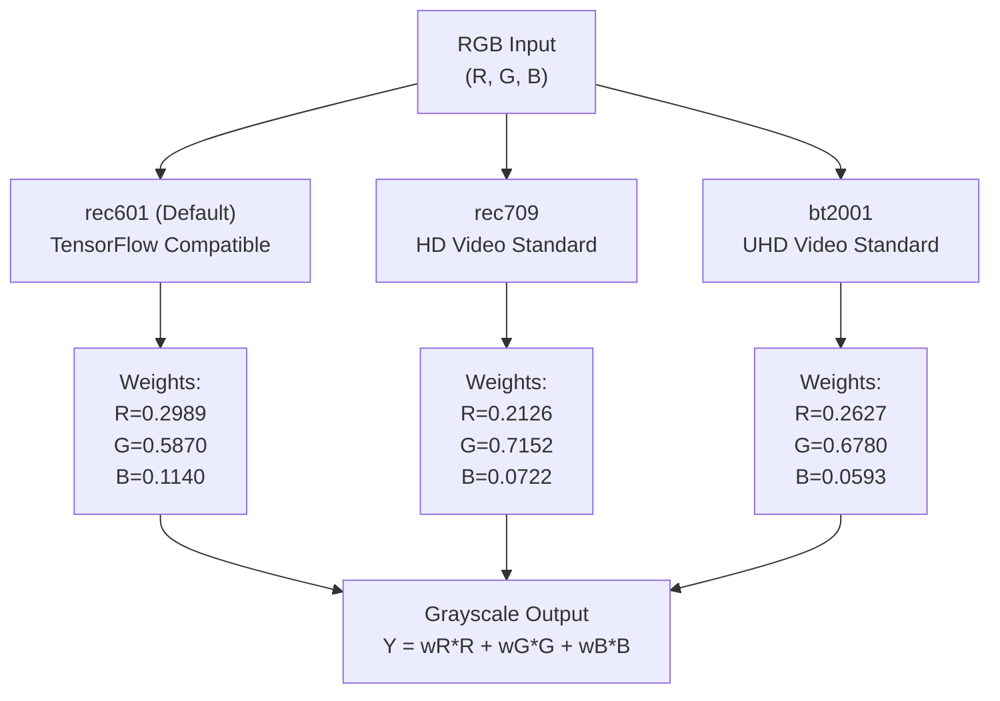
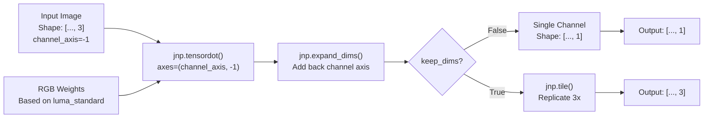
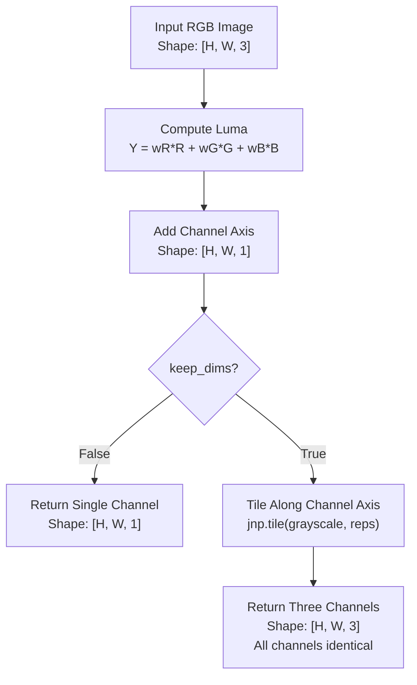
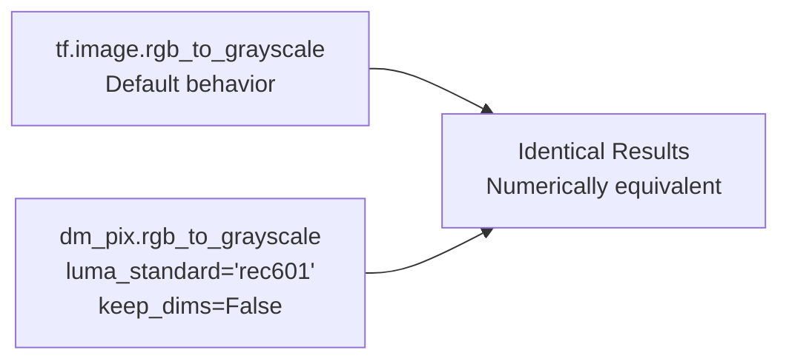
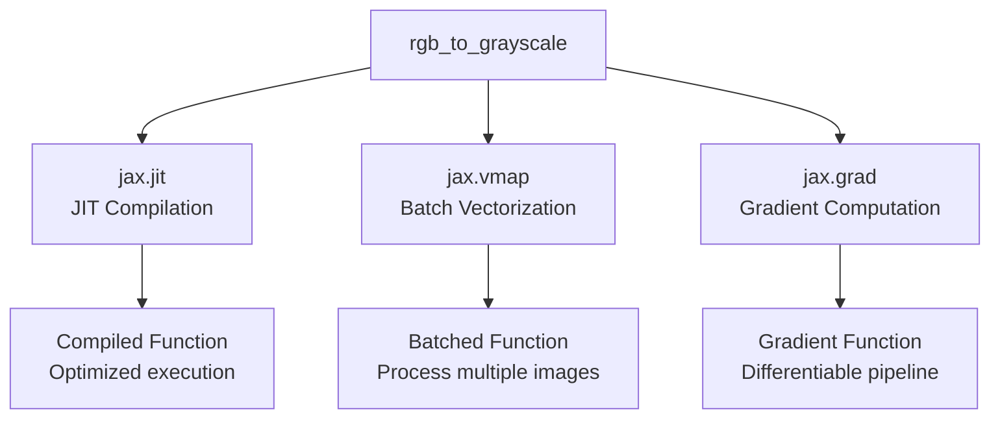
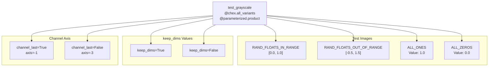
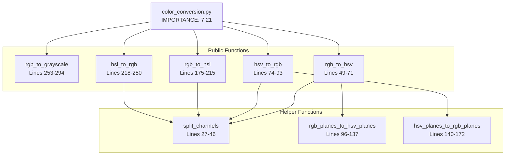

<!-- source: DeepWiki mcp.deepwiki.com · repo google-deepmind/dm_pix · page 4.3 Grayscale Conversion · fetched 2026-10-26 -->

# Grayscale Conversion

<details>
<summary>Relevant source files</summary>

The following files were used as context for generating this wiki page:

- [dm_pix/_src/color_conversion.py](dm_pix/_src/color_conversion.py)
- [dm_pix/_src/color_conversion_test.py](dm_pix/_src/color_conversion_test.py)

</details>


This document describes the grayscale conversion functionality in dm_pix, specifically the `rgb_to_grayscale` function that converts RGB color images to grayscale using industry-standard luma calculations. For information about other color space conversions, see [RGB-HSV Conversions](#4.1) and [RGB-HSL Conversions](#4.2).

The implementation provides compatibility with TensorFlow's `tf.image.rgb_to_grayscale` while offering additional flexibility through multiple luma standards and dimension handling options. All operations are fully compatible with JAX transformations (`jit`, `vmap`, `pmap`).

**Sources:** [dm_pix/_src/color_conversion.py:253-294]()

## Function Interface

The `rgb_to_grayscale` function is defined in [dm_pix/_src/color_conversion.py:253-294]() with the following signature:

```python
def rgb_to_grayscale(
    image: chex.Array,
    *,
    keep_dims: bool = False,
    luma_standard="rec601",
    channel_axis: int = -1,
) -> chex.Array
```

### Parameters

| Parameter | Type | Default | Description |
|-----------|------|---------|-------------|
| `image` | `chex.Array` | Required | RGB image as float tensor in [0, 1] range |
| `keep_dims` | `bool` | `False` | If `True`, output has 3 channels; if `False`, single channel |
| `luma_standard` | `str` | `"rec601"` | Luma calculation standard: `"rec601"`, `"rec709"`, or `"bt2001"` |
| `channel_axis` | `int` | `-1` | Index of the channel axis in the input tensor |

### Returns

A grayscale image as a float tensor. If `keep_dims=False`, the output has a single channel along `channel_axis`. If `keep_dims=True`, the grayscale value is tiled across 3 channels.

**Sources:** [dm_pix/_src/color_conversion.py:253-274]()

## Luma Standards

The function supports three industry-standard luma calculation methods, each defining different weights for the RGB channels. The choice of standard affects how perceived brightness is calculated.



### Weight Definitions

The weights are defined in [dm_pix/_src/color_conversion.py:277-284]():

- **rec601** (default): `[0.2989, 0.5870, 0.1140]` - Matches TensorFlow's `tf.image.rgb_to_grayscale`
- **rec709**: `[0.2126, 0.7152, 0.0722]` - ITU-R BT.709 standard for HD video
- **bt2001**: `[0.2627, 0.6780, 0.0593]` - ITU-R BT.2001 standard for UHD video

All three standards assign the highest weight to the green channel, reflecting human visual perception's greater sensitivity to green wavelengths.

**Sources:** [dm_pix/_src/color_conversion.py:277-284]()

## Implementation Details

The grayscale conversion is implemented using a weighted sum of RGB channels via tensor dot product:



### Core Calculation

The grayscale value is computed using `jnp.tensordot` at [dm_pix/_src/color_conversion.py:285]():

```python
grayscale = jnp.tensordot(image, rgb_weights, axes=(channel_axis, -1))
```

This operation performs a weighted sum: `Y = wR * R + wG * G + wB * B` for each pixel, where `(wR, wG, wB)` are the RGB weights determined by the `luma_standard`.

### Dimension Handling

After the tensor dot product removes the channel dimension, it is restored at [dm_pix/_src/color_conversion.py:287]():

```python
grayscale = jnp.expand_dims(grayscale, axis=channel_axis)
```

**Sources:** [dm_pix/_src/color_conversion.py:285-287]()

## keep_dims Parameter Behavior

The `keep_dims` parameter controls whether the output maintains three channels or collapses to a single channel:



### Tiling Implementation

When `keep_dims=True`, the implementation at [dm_pix/_src/color_conversion.py:288-292]() tiles the grayscale value across 3 channels:

```python
if keep_dims:
    if channel_axis < 0:
        channel_axis += image.ndim
    reps = [(1 if axis != channel_axis else 3) for axis in range(image.ndim)]
    return jnp.tile(grayscale, reps)
```

The `reps` list specifies repetition counts: `1` for all dimensions except `channel_axis`, which gets `3` to replicate the grayscale value across three channels.

**Sources:** [dm_pix/_src/color_conversion.py:288-294]()

## Channel Axis Flexibility

The function supports arbitrary channel axis placement through the `channel_axis` parameter:

| Format | `channel_axis` | Input Shape | Output Shape (keep_dims=False) |
|--------|---------------|-------------|--------------------------------|
| HWC | `-1` or `2` | `[H, W, 3]` | `[H, W, 1]` |
| CHW | `-3` or `0` | `[3, H, W]` | `[1, H, W]` |
| NHWC | `-1` or `3` | `[N, H, W, 3]` | `[N, H, W, 1]` |
| NCHW | `-3` or `1` | `[N, 3, H, W]` | `[N, 1, H, W]` |

The tests at [dm_pix/_src/color_conversion_test.py:264-284]() verify both channel-last (`channel_axis=-1`) and channel-first (`channel_axis=-3`) formats using the `channel_last` parameter.

**Sources:** [dm_pix/_src/color_conversion.py:258-270](), [dm_pix/_src/color_conversion_test.py:264-284]()

## TensorFlow Compatibility

The function is explicitly designed to be compatible with TensorFlow's `tf.image.rgb_to_grayscale` when using default parameters:



The documentation at [dm_pix/_src/color_conversion.py:262]() states: "This is equivalent to `tf.image.rgb_to_grayscale` (when keep_channels=False)."

The test suite validates this compatibility at [dm_pix/_src/color_conversion_test.py:272-284]() by comparing outputs:

```python
grayscale_tf = tf.image.rgb_to_grayscale(rgb).numpy()
# ... process with dm_pix ...
np.testing.assert_allclose(grayscale_jax, grayscale_tf, atol=1E-5, rtol=1E-5)
```

**Sources:** [dm_pix/_src/color_conversion.py:262](), [dm_pix/_src/color_conversion_test.py:272-284]()

## JAX Transformation Compatibility

The function is designed to work seamlessly with JAX transformations:



### Tested Transformations

The test suite at [dm_pix/_src/color_conversion_test.py:264-284]() uses `@chex.all_variants` decorator to automatically test the function with:

- **JIT compilation**: All tests run with `self.variant()` which applies `jax.jit`
- **Batched processing**: Tests verify shape handling across different batch dimensions
- **Gradient stability**: No special gradient tests for grayscale (unlike HSV/HSL), as the operation is inherently stable

The function's use of pure JAX operations (`jnp.tensordot`, `jnp.expand_dims`, `jnp.tile`) ensures full compatibility with all JAX transformations without requiring special handling.

**Sources:** [dm_pix/_src/color_conversion_test.py:264-284]()

## Test Coverage

The grayscale conversion is tested across multiple scenarios:

### Test Parameters



### Validation Strategy

The test at [dm_pix/_src/color_conversion_test.py:264-284]() validates:

1. **TensorFlow Reference**: Compares against `tf.image.rgb_to_grayscale` with tolerance `atol=1E-5, rtol=1E-5`
2. **Channel Swapping**: Tests both channel-last and channel-first formats by swapping axes
3. **Dimension Preservation**: When `keep_dims=True`, verifies all three output channels are identical
4. **Edge Cases**: Tests with all-zeros, all-ones, and out-of-range values

The test generates 100 random images per test case using `generate_test_images` at [dm_pix/_src/color_conversion_test.py:45-55]().

**Sources:** [dm_pix/_src/color_conversion_test.py:264-284](), [dm_pix/_src/color_conversion_test.py:45-55]()

## Integration with Color Conversion Module

The `rgb_to_grayscale` function is part of the broader color conversion module:



The grayscale conversion is independent of other color space operations and does not use the helper functions. It's exposed through the public API at `dm_pix.rgb_to_grayscale` via the facade pattern described in [Public API Organization](#1.1).

**Sources:** [dm_pix/_src/color_conversion.py:1-295]()

## Usage Examples

### Basic Grayscale Conversion

```python
import dm_pix as pix
import jax.numpy as jnp

# RGB image in [0, 1] range
rgb_image = jnp.array([[[0.8, 0.2, 0.1]]])  # Shape: [1, 1, 3]

# Convert to grayscale (single channel)
gray = pix.rgb_to_grayscale(rgb_image)
# Output shape: [1, 1, 1]
```

### Using Different Luma Standards

```python
# Default rec601 (TensorFlow compatible)
gray_rec601 = pix.rgb_to_grayscale(rgb_image, luma_standard="rec601")

# HD video standard
gray_rec709 = pix.rgb_to_grayscale(rgb_image, luma_standard="rec709")

# UHD video standard
gray_bt2001 = pix.rgb_to_grayscale(rgb_image, luma_standard="bt2001")
```

### Maintaining Three Channels

```python
# Keep three identical channels (useful for certain pipelines)
gray_3ch = pix.rgb_to_grayscale(rgb_image, keep_dims=True)
# Output shape: [1, 1, 3] - all channels have same grayscale value
```

### Channel-First Format

```python
# NCHW format (batch, channels, height, width)
rgb_nchw = jnp.ones((4, 3, 32, 32))  # Batch of 4 images

gray_nchw = pix.rgb_to_grayscale(rgb_nchw, channel_axis=1)
# Output shape: [4, 1, 32, 32]
```

### Batched Processing with vmap

```python
import jax

# Batch of images
rgb_batch = jnp.ones((10, 32, 32, 3))

# Vectorize for efficient batch processing
grayscale_fn = jax.vmap(pix.rgb_to_grayscale)
gray_batch = grayscale_fn(rgb_batch)
# Output shape: [10, 32, 32, 1]
```

**Sources:** [dm_pix/_src/color_conversion.py:253-294]()

---

