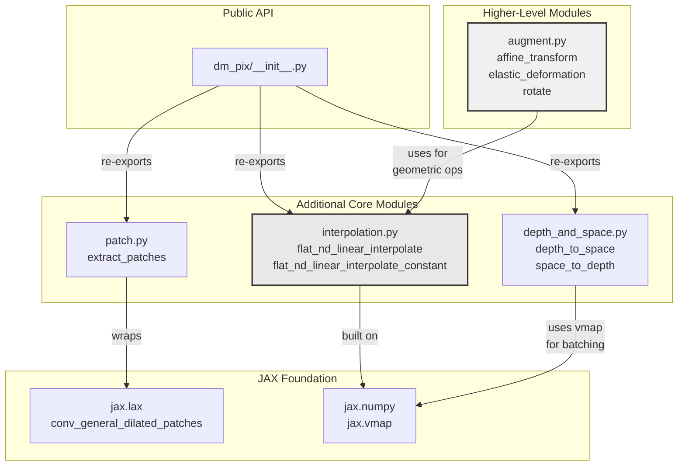
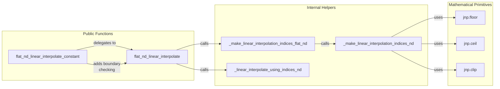
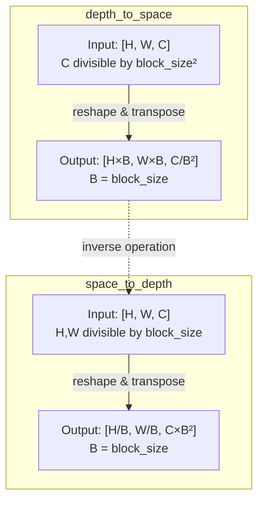
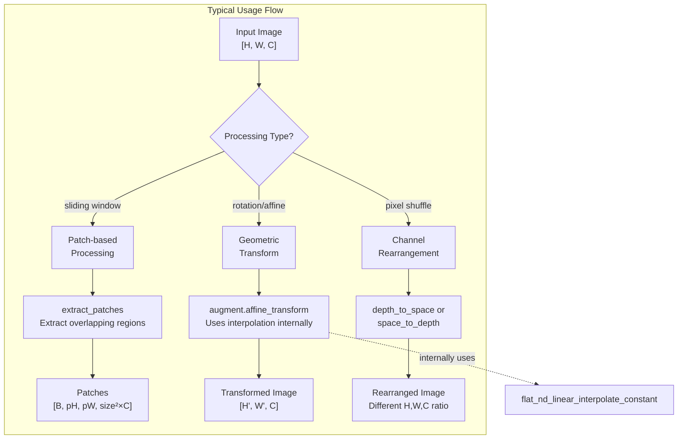

<!-- source: DeepWiki mcp.deepwiki.com · repo google-deepmind/dm_pix · page 5 Additional Core Modules · fetched 2026-10-26 -->

# Additional Core Modules

<details>
<summary>Relevant source files</summary>

The following files were used as context for generating this wiki page:

- [dm_pix/_src/depth_and_space.py](dm_pix/_src/depth_and_space.py)
- [dm_pix/_src/interpolation.py](dm_pix/_src/interpolation.py)
- [dm_pix/_src/patch.py](dm_pix/_src/patch.py)
- [dm_pix/_src/patch_test.py](dm_pix/_src/patch_test.py)

</details>


This page documents the utility modules in dm_pix that provide specialized image processing operations beyond the main augmentation, metrics, and color conversion functionality. These modules include patch extraction ([patch.py:1-96]()), N-dimensional linear interpolation ([interpolation.py:1-217]()), and depth/space channel rearrangement ([depth_and_space.py:1-93]()).

For image augmentation operations, see [Image Augmentation Module](#2). For image quality evaluation, see [Image Quality Metrics](#3). For color space transformations, see [Color Space Conversions](#4).

## Overview

The additional core modules provide three distinct categories of functionality:

| Module | Primary Functions | Importance Score | Primary Use Case |
|--------|------------------|------------------|------------------|
| `patch.py` | `extract_patches` | 5.34 | Extracting sliding window patches from images |
| `interpolation.py` | `flat_nd_linear_interpolate`, `flat_nd_linear_interpolate_constant` | 2.83 | Resampling for geometric transformations |
| `depth_and_space.py` | `depth_to_space`, `space_to_depth` | 3.24 | Channel-spatial dimension rearrangement |

These modules serve as building blocks for more complex operations. The interpolation module is used internally by the augmentation module for geometric transforms like `affine_transform` and `rotate` ([augment.py:1-800]()). The patch extraction module provides TensorFlow-compatible functionality for sliding window operations. The depth/space transforms enable efficient pixel shuffling operations common in super-resolution and image compression tasks.

**Sources:** [dm_pix/_src/patch.py:1-96](), [dm_pix/_src/interpolation.py:1-217](), [dm_pix/_src/depth_and_space.py:1-93]()

## Module Architecture



**Sources:** [dm_pix/_src/patch.py:25-95](), [dm_pix/_src/interpolation.py:136-217](), [dm_pix/_src/depth_and_space.py:23-93](), [dm_pix/_src/augment.py:1-800]()

## Patch Extraction Module

The `patch.py` module provides the `extract_patches` function, which extracts sliding window patches from N-dimensional images. This function wraps `jax.lax.conv_general_dilated_patches` to provide an interface compatible with TensorFlow's `tf.image.extract_patches`, but with support for arbitrary-dimensional inputs ([patch.py:25-39]()).

### Function Signature

```python
def extract_patches(
    images: chex.Array,
    sizes: Sequence[int],
    strides: Sequence[int],
    rates: Sequence[int],
    *,
    padding: str = "VALID",
) -> jnp.ndarray
```

The function extracts patches of shape `sizes` from `images` using a stride of `strides` and dilation rates of `rates`. The patches are stacked in the channel dimension, similar to how a convolution operation processes input with a kernel ([patch.py:40-43]()).

### Key Features

- **Arbitrary Dimensionality**: Unlike TensorFlow's implementation (limited to 4D), this function supports N-dimensional images ([patch.py:37-38]())
- **TensorFlow Compatibility**: Interface matches `tf.image.extract_patches` for easy migration
- **Dilated Sampling**: Supports `rates` parameter for dilated (atrous) patch extraction ([patch.py:51-56]())
- **Padding Schemes**: Supports both "VALID" and "SAME" padding modes ([patch.py:57]())

### Implementation Details

The function performs several validations to ensure parameters are properly formatted ([patch.py:65-75]()):
- All parameter sequences must have length equal to `images.ndim`
- First and last elements of `sizes`, `strides`, and `rates` must be 1
- This maintains the batch and channel dimensions unchanged

The core operation delegates to `jax.lax.conv_general_dilated_patches` ([patch.py:80-88]()), then rearranges the output to match TensorFlow's channel ordering ([patch.py:90-95]()).

**Sources:** [dm_pix/_src/patch.py:25-96](), [dm_pix/_src/patch_test.py:31-202]()

## N-Dimensional Linear Interpolation Module

The `interpolation.py` module provides functions for linear interpolation in N-dimensional space, primarily used for geometric image transformations. The module expects float-encoded images with values in [0, 1] ([interpolation.py:14-17]()).

### Core Interpolation Functions



**Sources:** [dm_pix/_src/interpolation.py:33-217]()

### flat_nd_linear_interpolate

The primary interpolation function maps an N-dimensional volume to specified coordinates using linear interpolation ([interpolation.py:136-167]()):

```python
def flat_nd_linear_interpolate(
    volume: chex.Array,
    coordinates: chex.Array,
    *,
    unflattened_vol_shape: Optional[Sequence[int]] = None,
) -> chex.Array
```

**Key Parameters:**
- `volume`: Input volume (optionally pre-flattened for efficiency)
- `coordinates`: Array of shape `(N, M_coordinates)` specifying query locations
- `unflattened_vol_shape`: Original shape if `volume` is pre-flattened

The function performs multi-linear interpolation by:
1. Computing lower/upper indices and interpolation weights ([interpolation.py:46-57]())
2. Converting N-dimensional indices to flat indices using stride calculations ([interpolation.py:84-108]())
3. Sampling at 2^N corner points and computing weighted average ([interpolation.py:110-121]())

### flat_nd_linear_interpolate_constant

This variant extends the base interpolation with boundary handling ([interpolation.py:170-216]()):

```python
def flat_nd_linear_interpolate_constant(
    volume: chex.Array,
    coordinates: chex.Array,
    *,
    cval: Optional[float] = 0.,
    unflattened_vol_shape: Optional[Sequence[int]] = None,
) -> chex.Array
```

The function returns a constant value `cval` (default 0.0) for coordinates falling outside the volume boundaries ([interpolation.py:189-190]()). This is essential for geometric transformations where rotations or affine transforms may map output pixels to locations outside the input image.

### Usage in Augmentation

The interpolation module is used internally by geometric transformation functions in the augmentation module:
- `affine_transform` uses interpolation to sample the transformed image
- `elastic_deformation` applies local warping using interpolated displacement fields
- `rotate` delegates to `affine_transform`, which uses interpolation

**Sources:** [dm_pix/_src/interpolation.py:136-217](), [dm_pix/_src/augment.py:1-800]()

## Depth and Space Transforms Module

The `depth_and_space.py` module provides functions for rearranging data between channel (depth) and spatial dimensions ([depth_and_space.py:1-93]()). These operations are useful for pixel shuffle operations in super-resolution networks and efficient spatial-to-channel transforms.

### Function Signatures

```python
def depth_to_space(inputs: chex.Array, block_size: int) -> chex.Array
def space_to_depth(inputs: chex.Array, block_size: int) -> chex.Array
```

### Transformation Diagram



**Sources:** [dm_pix/_src/depth_and_space.py:23-93]()

### depth_to_space

Rearranges data from depth (channels) into blocks of spatial data ([depth_and_space.py:23-54]()):

**Input Requirements:**
- Shape: `[H, W, C]` or `[N, H, W, C]` (batched)
- Constraint: `C % (block_size ** 2) == 0` ([depth_and_space.py:43-47]())

**Transformation Process:**
1. Reshape input to `[H, W, block_size, block_size, new_depth]` ([depth_and_space.py:49-50]())
2. Transpose to `[H, block_size, W, block_size, new_depth]` ([depth_and_space.py:51]())
3. Reshape to final `[H * block_size, W * block_size, new_depth]` ([depth_and_space.py:52-53]())

**Batching Support:**
The function automatically handles batched inputs using `jax.vmap` ([depth_and_space.py:39-40]()):
```python
if inputs.ndim == 4:  # Batched case.
    return jax.vmap(depth_to_space, in_axes=(0, None))(inputs, block_size)
```

### space_to_depth

The inverse operation, rearranging spatial blocks into depth ([depth_and_space.py:57-92]()):

**Input Requirements:**
- Shape: `[H, W, C]` or `[N, H, W, C]` (batched)
- Constraints: `H % block_size == 0` and `W % block_size == 0` ([depth_and_space.py:79-84]())

**Transformation Process:**
1. Reshape input to `[new_height, block_size, new_width, block_size, depth]` ([depth_and_space.py:88-89]())
2. Transpose to `[new_height, new_width, block_size, block_size, depth]` ([depth_and_space.py:90]())
3. Reshape to final `[new_height, new_width, new_depth]` ([depth_and_space.py:91]())

**Common Use Cases:**
- Pixel shuffle operations in super-resolution networks
- Efficient downsampling by moving spatial information to channels
- Preprocessing for certain network architectures that expect specific channel configurations

**Sources:** [dm_pix/_src/depth_and_space.py:23-93]()

## Module Interaction Patterns



**Sources:** [dm_pix/_src/patch.py:25-95](), [dm_pix/_src/interpolation.py:170-217](), [dm_pix/_src/depth_and_space.py:23-93](), [dm_pix/_src/augment.py:1-800]()

## JAX Integration

All three modules are designed to work seamlessly with JAX transformations:

| Module | JIT-Compatible | vmap-Compatible | pmap-Compatible | Notes |
|--------|---------------|-----------------|-----------------|-------|
| `patch.py` | ✓ | ✓ | ✓ | Static arguments: `sizes`, `strides`, `rates` |
| `interpolation.py` | ✓ | ✓ | ✓ | Pre-flatten volume for efficiency |
| `depth_and_space.py` | ✓ | ✓ | ✓ | Built-in vmap for batched inputs |

### Static Arguments

When using `jax.jit` with `extract_patches`, the structural parameters must be marked as static ([patch_test.py:46-48]()):

```python
extract_patches_jit = jax.jit(
    functools.partial(patch.extract_patches, padding='VALID'),
    static_argnums=(1, 2, 3)  # sizes, strides, rates
)
```

### Automatic Batching

The `depth_to_space` and `space_to_depth` functions automatically handle batched inputs using `jax.vmap` internally ([depth_and_space.py:39-40](), [depth_and_space.py:75-76]()), so explicit vmapping is not required for batch processing.

**Sources:** [dm_pix/_src/patch_test.py:46-54](), [dm_pix/_src/depth_and_space.py:23-93]()

## Testing and Validation

The testing strategy for these modules emphasizes:

1. **Reference Implementation Comparison**: Tests validate against TensorFlow implementations where available ([patch_test.py:55-62]())
2. **Multi-Dimensional Support**: Tests verify functionality across 0D, 1D, 2D, and 3D cases ([patch_test.py:69-149]())
3. **JAX Transformation Compatibility**: Tests use `chex.all_variants` to verify compatibility with `jit`, `vmap`, and `pmap` ([patch_test.py:33-34]())
4. **Edge Case Validation**: Tests cover boundary conditions, invalid parameters, and reconstruction correctness ([patch_test.py:188-201]())

For detailed information on the testing infrastructure, see [Test Architecture](#7.1).

**Sources:** [dm_pix/_src/patch_test.py:31-202]()

---

