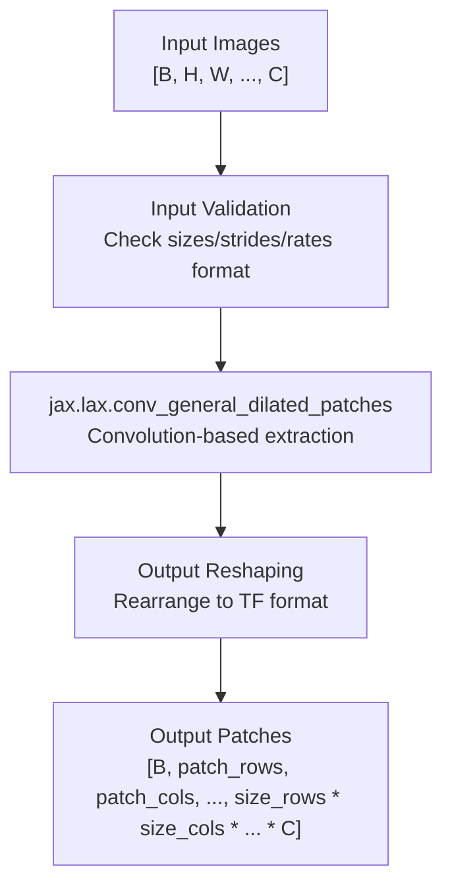
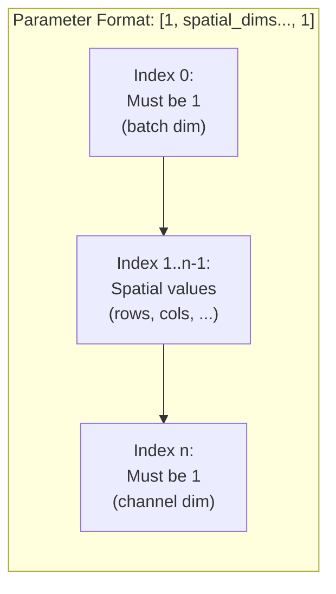
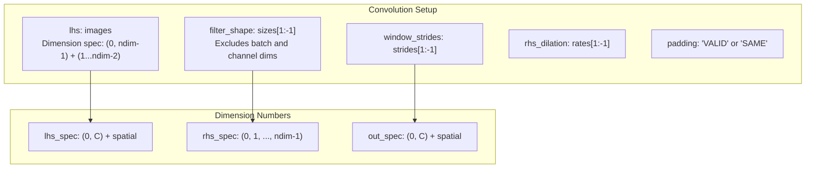
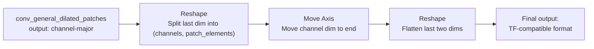
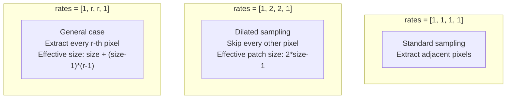
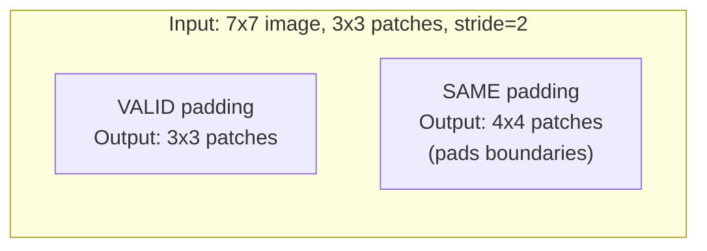
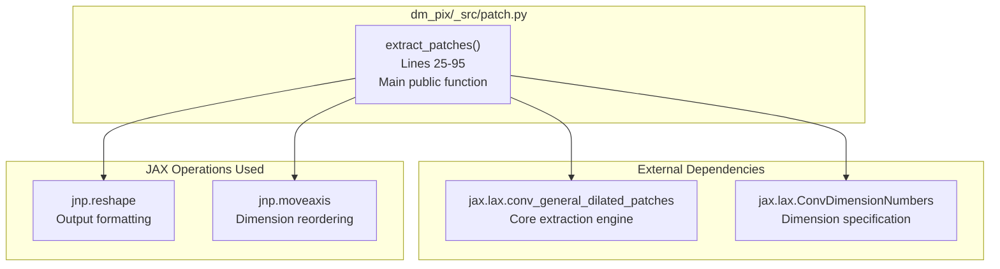
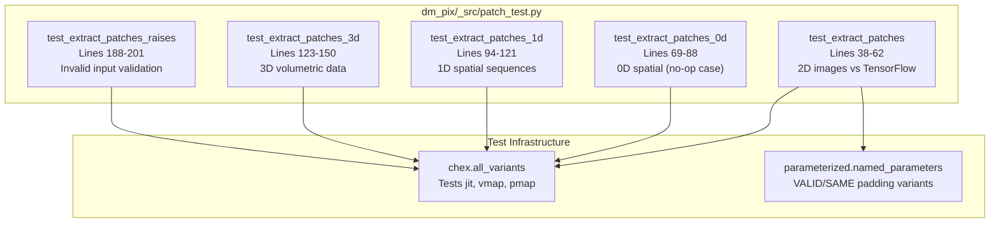
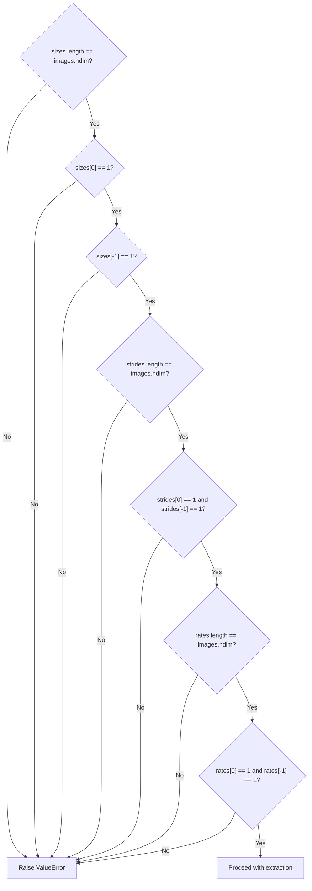

<!-- source: DeepWiki mcp.deepwiki.com · repo google-deepmind/dm_pix · page 5.1 Patch Extraction · fetched 2026-10-26 -->

# Patch Extraction

<details>
<summary>Relevant source files</summary>

The following files were used as context for generating this wiki page:

- [dm_pix/_src/patch.py](dm_pix/_src/patch.py)
- [dm_pix/_src/patch_test.py](dm_pix/_src/patch_test.py)

</details>


## Purpose and Scope

This document describes the patch extraction functionality provided by the `patch` module in dm_pix. The module contains a single public function, `extract_patches`, which extracts fixed-size patches from multi-dimensional arrays (typically images) in a manner compatible with TensorFlow's `tf.image.extract_patches`, while supporting arbitrary dimensions beyond the standard 4D image tensors.

For geometric transformations that manipulate entire images, see [Geometric Transformations](#2.2). For spatial dimension rearrangement operations, see [Depth and Space Transforms](#5.3).

**Sources:** [dm_pix/_src/patch.py:1-96]()

---

## Function Overview

The `extract_patches` function is a JAX-native wrapper around `jax.lax.conv_general_dilated_patches` that provides a TensorFlow-compatible interface for extracting image patches. The function extracts patches of a specified size from input arrays using a sliding window approach, similar to a convolution operation with a kernel of the patch size.



**Sources:** [dm_pix/_src/patch.py:25-95]()

---

## Function Signature and Parameters

### Function Definition

```python
def extract_patches(
    images: chex.Array,
    sizes: Sequence[int],
    strides: Sequence[int],
    rates: Sequence[int],
    *,
    padding: str = "VALID",
) -> jnp.ndarray
```

### Parameters

| Parameter | Type | Description |
|-----------|------|-------------|
| `images` | `chex.Array` | Input batch of images with shape `[B, H, W, ..., C]` where B is batch size, H/W/... are spatial dimensions, and C is channels |
| `sizes` | `Sequence[int]` | Size of extracted patches. Must be `[1, size_rows, size_cols, ..., 1]` |
| `strides` | `Sequence[int]` | Stride for patch centers. Must be `[1, stride_rows, stride_cols, ..., 1]` |
| `rates` | `Sequence[int]` | Sampling rate (dilation). Must be `[1, rate_rows, rate_cols, ..., 1]` |
| `padding` | `str` | Padding algorithm: `"VALID"` or `"SAME"` (default: `"VALID"`) |

### Returns

Returns a `jnp.ndarray` with shape `[B, patch_rows, patch_cols, ..., size_rows * size_cols * ... * C]`, where the patch dimensions depend on the input size, patch size, stride, and padding mode.

**Sources:** [dm_pix/_src/patch.py:25-62]()

---

## Parameter Format Requirements

All three spatial parameter sequences (`sizes`, `strides`, `rates`) must follow a specific format convention to maintain compatibility with the TensorFlow interface:



### Format Validation

The function performs strict validation on all three parameters:

- **Length Check**: Each parameter must have the same length as `images.ndim`
- **First Element**: Must equal 1 (corresponds to batch dimension)
- **Last Element**: Must equal 1 (corresponds to channel dimension)
- **Middle Elements**: Spatial dimension values (e.g., patch height, width, depth)

Invalid inputs raise a `ValueError` with a descriptive message indicating which parameter failed validation and what the expected format should be.

**Sources:** [dm_pix/_src/patch.py:65-75]()

---

## Implementation Details

### Convolution-Based Extraction

The core extraction mechanism uses `jax.lax.conv_general_dilated_patches`, which treats patch extraction as a special case of convolution where the "filter" slides over the input array:



The dimension number specification tells JAX how to interpret each axis:
- **lhs_spec**: Specifies batch (0), channel (ndim-1), then spatial dimensions
- **rhs_spec**: Standard sequential ordering for the filter
- **out_spec**: Same as lhs_spec to maintain batch-channel-spatial ordering

**Sources:** [dm_pix/_src/patch.py:77-88]()

### Output Reshaping

After extraction, `jax.lax.conv_general_dilated_patches` returns patches in channel-major order, which differs from TensorFlow's format. The function performs a series of reshaping operations to match the expected output format:



The three-step reshaping process:

1. **Reshape**: Separates the flattened output into original channels and patch elements
2. **Move Axis**: Repositions the channel dimension from position -2 to -1
3. **Reshape**: Flattens the final two dimensions into a single dimension

**Sources:** [dm_pix/_src/patch.py:90-95]()

---

## Supported Dimensionalities

Unlike TensorFlow's `tf.image.extract_patches`, which only supports 4D tensors (batch, height, width, channels), dm_pix's `extract_patches` supports arbitrary-dimensional inputs.

### Dimensionality Support Matrix

| Dimensionality | Input Shape | Example Use Case | Test Coverage |
|----------------|-------------|------------------|---------------|
| 2D (0D spatial) | `[B, C]` | Feature vectors | ✓ [test_extract_patches_0d]() |
| 3D (1D spatial) | `[B, W, C]` | Time series, audio | ✓ [test_extract_patches_1d]() |
| 4D (2D spatial) | `[B, H, W, C]` | Standard images | ✓ [test_extract_patches]() |
| 5D (3D spatial) | `[B, D, H, W, C]` | Volumetric data, video | ✓ [test_extract_patches_3d]() |
| 6D+ | `[B, D1, D2, ..., C]` | Higher-dimensional data | ✓ (implicit support) |

### Example: 2D Image Patches

For a standard 2D image with shape `[batch, height, width, channels]`:

```python
images = jnp.array([...])  # shape: [2, 28, 28, 3]
sizes = [1, 7, 7, 1]       # Extract 7x7 patches
strides = [1, 7, 7, 1]     # Non-overlapping patches
rates = [1, 1, 1, 1]       # No dilation
padding = "VALID"

patches = extract_patches(images, sizes, strides, rates, padding=padding)
# Output shape: [2, 4, 4, 147]  (4x4 grid of patches, 7*7*3=147 elements each)
```

### Example: 3D Volumetric Patches

For volumetric data with shape `[batch, depth, height, width, channels]`:

```python
volumes = jnp.array([...])  # shape: [2, 16, 32, 32, 3]
sizes = [1, 4, 8, 8, 1]     # Extract 4x8x8 patches
strides = [1, 4, 8, 8, 1]   # Non-overlapping patches
rates = [1, 1, 1, 1, 1]     # No dilation
padding = "VALID"

patches = extract_patches(volumes, sizes, strides, rates, padding=padding)
# Output shape: [2, 4, 4, 4, 768]  (4x4x4 grid of patches, 4*8*8*3=768 elements each)
```

**Sources:** [dm_pix/_src/patch_test.py:38-62](), [dm_pix/_src/patch_test.py:69-88](), [dm_pix/_src/patch_test.py:94-121](), [dm_pix/_src/patch_test.py:123-150]()

---

## Dilation (Rates) Parameter

The `rates` parameter implements dilated (atrous) patch extraction, which is equivalent to sampling patches at a lower resolution from the input. This is analogous to dilated convolutions.



**Effective Patch Size Formula:**

For a patch with nominal size `s` and dilation rate `r`:
```
effective_size = s + (s - 1) * (r - 1)
```

This means:
- `rates = [1, 1, 1, 1]`: Extract dense patches
- `rates = [1, 2, 1, 1]`: Sample every 2nd row, creating larger effective patches
- `rates = [1, 2, 2, 1]`: Sample every 2nd pixel in both dimensions

**Sources:** [dm_pix/_src/patch.py:51-56](), [dm_pix/_src/patch_test.py:38-62]()

---

## Padding Modes

The function supports two padding modes that determine how patches are extracted near image boundaries:

### VALID Padding

- **Behavior**: Only extract patches that fit entirely within the input
- **Output Size**: Smaller than input, depends on patch size and stride
- **Use Case**: When you need complete patches without boundary effects

### SAME Padding

- **Behavior**: Pad input to ensure output spatial dimensions match input spatial dimensions (when stride=1)
- **Output Size**: Can be equal to input size (stride-dependent)
- **Use Case**: When you need to preserve spatial dimensions through patch extraction



**Sources:** [dm_pix/_src/patch.py:57](), [dm_pix/_src/patch_test.py:35-37]()

---

## TensorFlow Compatibility

The function is designed to be a drop-in replacement for `tf.image.extract_patches` with extended dimensionality support:

### Compatibility Guarantees

| Aspect | TensorFlow | dm_pix |
|--------|------------|--------|
| **Parameter names** | Identical | Identical |
| **Parameter formats** | `[1, spatial..., 1]` | `[1, spatial..., 1]` |
| **Output format** | `[B, rows, cols, size*C]` | `[B, rows, cols, ..., size*C]` |
| **Padding modes** | VALID, SAME | VALID, SAME |
| **Dimensionality** | 4D only | Arbitrary dimensions |
| **Dilation (rates)** | Supported | Supported |

### Test Validation

The test suite validates compatibility by comparing outputs directly against TensorFlow:

```python
# From patch_test.py
jax_patches = extract_patches(images, sizes, strides, rates, padding=padding)
tf_patches = tf.image.extract_patches(images, sizes, strides, rates, padding)
np.testing.assert_array_equal(jax_patches, tf_patches.numpy())
```

All standard 2D image patch extraction operations produce identical outputs to TensorFlow's implementation.

**Sources:** [dm_pix/_src/patch.py:36-38](), [dm_pix/_src/patch_test.py:55-62]()

---

## Code Entity Reference

### Main Module Components



### Test Coverage



**Sources:** [dm_pix/_src/patch_test.py:1-206]()

---

## Usage Patterns

### Basic 2D Image Patch Extraction

```python
import dm_pix as pix
import jax.numpy as jnp

# Load or create image: [batch, height, width, channels]
images = jnp.array([...])  # shape: [1, 224, 224, 3]

# Extract 32x32 patches with stride 32 (non-overlapping)
patches = pix.extract_patches(
    images=images,
    sizes=[1, 32, 32, 1],
    strides=[1, 32, 32, 1],
    rates=[1, 1, 1, 1],
    padding='VALID'
)
# Output shape: [1, 7, 7, 3072]  (7x7 grid of 32x32x3 patches)
```

### Overlapping Patches

```python
# Extract overlapping 16x16 patches with stride 8
patches = pix.extract_patches(
    images=images,
    sizes=[1, 16, 16, 1],
    strides=[1, 8, 8, 1],
    rates=[1, 1, 1, 1],
    padding='VALID'
)
# Patches overlap by 50% in each dimension
```

### Dilated Patch Extraction

```python
# Extract dilated patches (sample every 2nd pixel)
# Effective patch size: 16 + (16-1)*(2-1) = 31x31
patches = pix.extract_patches(
    images=images,
    sizes=[1, 16, 16, 1],
    strides=[1, 16, 16, 1],
    rates=[1, 2, 2, 1],  # Dilation rate of 2
    padding='VALID'
)
```

### 3D Video Patch Extraction

```python
# Video data: [batch, time, height, width, channels]
video = jnp.array([...])  # shape: [1, 30, 224, 224, 3]

# Extract 10-frame, 32x32 spatial patches
patches = pix.extract_patches(
    images=video,
    sizes=[1, 10, 32, 32, 1],
    strides=[1, 5, 32, 32, 1],  # 50% temporal overlap
    rates=[1, 1, 1, 1, 1],
    padding='VALID'
)
# Output shape: [1, 5, 7, 7, 30720]  (5 temporal x 7x7 spatial patches)
```

**Sources:** [dm_pix/_src/patch.py:25-95](), [dm_pix/_src/patch_test.py:38-150]()

---

## Performance Considerations

### JAX Transformation Compatibility

The `extract_patches` function is fully compatible with JAX transformations:

| Transformation | Support | Notes |
|----------------|---------|-------|
| `jax.jit` | ✓ Full | Compile for faster execution; use `static_argnums=(1,2,3)` for sizes/strides/rates |
| `jax.vmap` | ✓ Full | Batch over additional dimensions automatically |
| `jax.pmap` | ✓ Full | Parallelize across devices |
| `jax.grad` | ✓ Full | Differentiable (though rarely needed for patch extraction) |

### JIT Compilation Example

```python
import jax
import dm_pix as pix

# Compile with static arguments for sizes, strides, rates
extract_patches_jit = jax.jit(
    pix.extract_patches,
    static_argnums=(1, 2, 3)  # sizes, strides, rates are static
)

patches = extract_patches_jit(
    images, 
    sizes=[1, 32, 32, 1],
    strides=[1, 16, 16, 1],
    rates=[1, 1, 1, 1]
)
```

### Memory Considerations

Patch extraction can significantly increase memory usage. For an input of shape `[B, H, W, C]` with patch size `[1, Ph, Pw, 1]` and stride `[1, Sh, Sw, 1]`:

- **Number of patches**: `((H - Ph) / Sh + 1) * ((W - Pw) / Sw + 1)`
- **Elements per patch**: `Ph * Pw * C`
- **Total output size**: `B * num_patches * patch_elements`

For overlapping patches (stride < patch size), memory usage can grow substantially compared to the input.

**Sources:** [dm_pix/_src/patch_test.py:33-62]()

---

## Error Handling

The function performs comprehensive input validation and raises `ValueError` for invalid inputs:

### Common Error Cases



### Error Messages

The function provides detailed error messages indicating:
- Which parameter failed validation (`sizes`, `strides`, or `rates`)
- The expected format: `[1, size_rows, size_cols, ..., 1]`
- The actual input dimensions (`images.ndim`)
- The actual value provided

**Sources:** [dm_pix/_src/patch.py:67-75](), [dm_pix/_src/patch_test.py:152-201]()

---

## Integration with dm_pix

The `extract_patches` function is exported through the main dm_pix API:

```python
# Import directly from dm_pix
import dm_pix as pix
patches = pix.extract_patches(...)

# Or import the function directly
from dm_pix import extract_patches
patches = extract_patches(...)
```

The function is located in `dm_pix/_src/patch.py` but re-exported through `dm_pix/__init__.py` for public access.

**Sources:** [dm_pix/_src/patch.py:1-96]()

---

