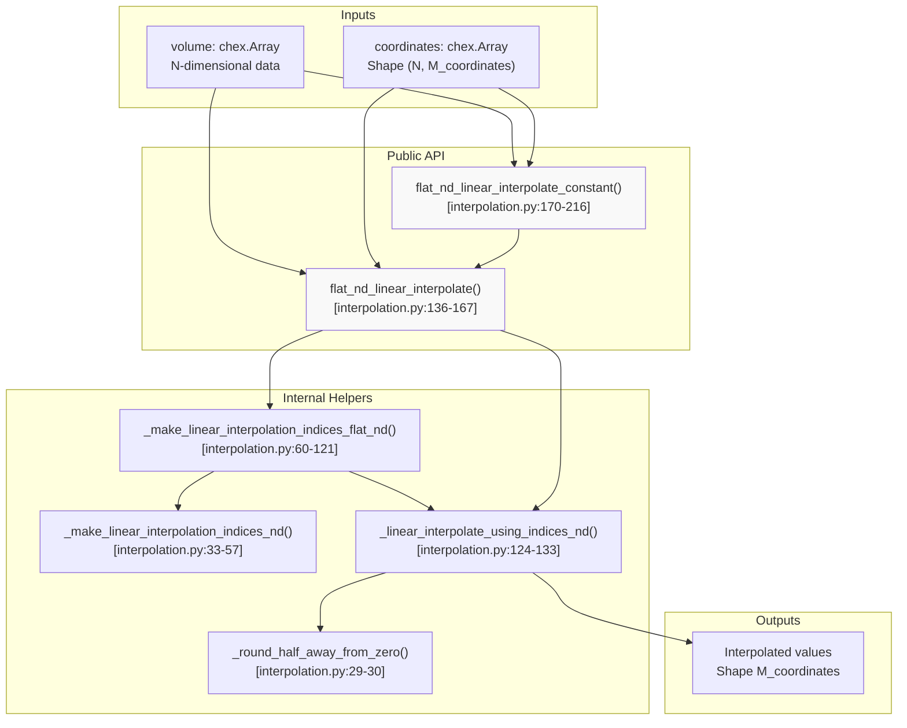
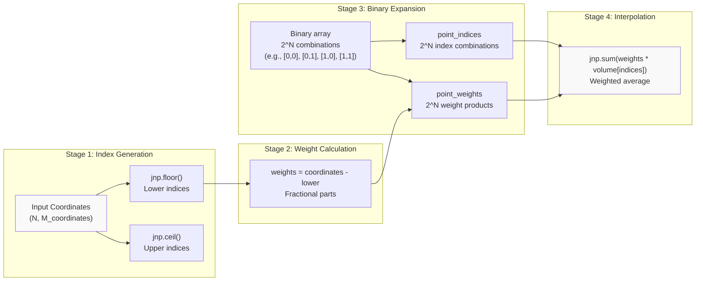
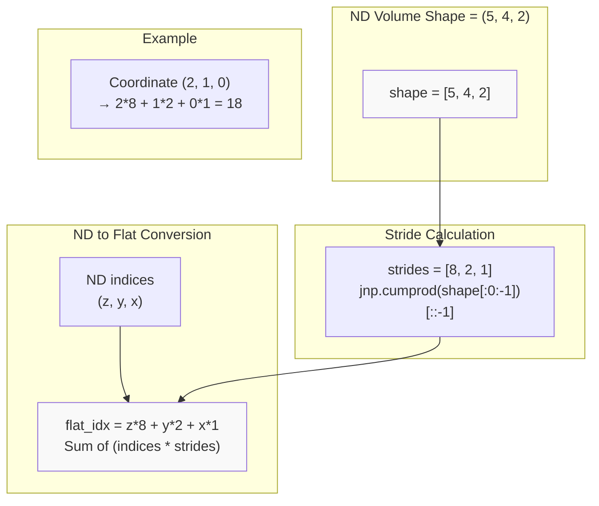
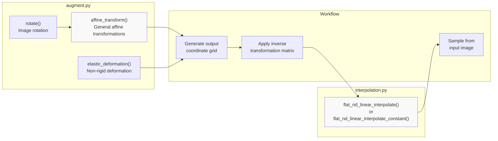

<!-- source: DeepWiki mcp.deepwiki.com · repo google-deepmind/dm_pix · page 5.2 ND Linear Interpolation · fetched 2026-10-26 -->

# ND Linear Interpolation

<details>
<summary>Relevant source files</summary>

The following files were used as context for generating this wiki page:

- [dm_pix/_src/interpolation.py](dm_pix/_src/interpolation.py)
- [dm_pix/_src/interpolation_test.py](dm_pix/_src/interpolation_test.py)

</details>


This page documents the N-dimensional linear interpolation module in dm_pix, which provides functions for mapping N-dimensional volumes to arbitrary coordinates using linear interpolation. This functionality is primarily used internally by geometric transformation functions in the augmentation module (see [Image Augmentation Module](#2)) to resample images during operations like rotation and affine transformations.

The module provides two main public functions:
- `flat_nd_linear_interpolate` - Standard linear interpolation with boundary clamping
- `flat_nd_linear_interpolate_constant` - Linear interpolation that returns a constant value for out-of-bounds coordinates

**Sources**: [dm_pix/_src/interpolation.py:14-17]()

## Core Functions Overview

The interpolation module exposes two primary functions with distinct boundary handling behaviors.



**Function Signatures**

| Function | Parameters | Boundary Behavior |
|----------|-----------|-------------------|
| `flat_nd_linear_interpolate` | `volume`, `coordinates`, `unflattened_vol_shape=None` | Clamps coordinates to volume boundaries |
| `flat_nd_linear_interpolate_constant` | `volume`, `coordinates`, `cval=0.0`, `unflattened_vol_shape=None` | Returns `cval` for out-of-bounds coordinates |

**Sources**: [dm_pix/_src/interpolation.py:136-216]()

## Interpolation Algorithm

The linear interpolation algorithm operates in three stages: index computation, weight calculation, and weighted summation.



### Index and Weight Generation

The `_make_linear_interpolation_indices_nd` function computes floor and ceiling indices along with interpolation weights:

```python
# From interpolation.py:46-48
lower = jnp.floor(coordinates).astype(jnp.int32)
upper = jnp.ceil(coordinates).astype(jnp.int32)
weights = coordinates - lower
```

Indices are clipped to volume boundaries to handle edge cases:

```python
# From interpolation.py:54-55
lower = jnp.clip(lower, 0, shape - 1)
upper = jnp.clip(upper, 0, shape - 1)
```

**Sources**: [dm_pix/_src/interpolation.py:33-57]()

### Binary Expansion for N-Dimensional Interpolation

For N-dimensional interpolation, the algorithm generates 2^N corner points. Each corner is defined by a binary vector indicating whether to use the lower (0) or upper (1) index for each dimension:

```python
# From interpolation.py:97-98
binary_array = jnp.array(
    list(itertools.product([0, 1], repeat=shape.shape[0])))
```

**Example**: For 2D interpolation (N=2), binary_array = [[0,0], [0,1], [1,0], [1,1]]

| Binary Vector | Interpretation (y, x) |
|---------------|----------------------|
| [0, 0] | (lower_y, lower_x) |
| [0, 1] | (lower_y, upper_x) |
| [1, 0] | (upper_y, lower_x) |
| [1, 1] | (upper_y, upper_x) |

**Sources**: [dm_pix/_src/interpolation.py:96-121]()

## Flat Indexing Strategy

The module uses a flattened indexing approach for efficiency, converting N-dimensional indices to 1D indices using strides.



**Stride Calculation**

The stride for each dimension represents how many elements must be skipped to move to the next position along that axis:

```python
# From interpolation.py:94
strides = jnp.concatenate([jnp.cumprod(shape[:0:-1])[::-1], jnp.array([1])])
```

For a shape `(5, 4, 2)`:
- Stride for axis 0: `4 * 2 = 8`
- Stride for axis 1: `2`
- Stride for axis 2: `1`

**Flat Index Computation**

Each corner point's flat index is computed as:

```python
# From interpolation.py:118
point_indices.append(jnp.sum(upper_1d * r + lower_1d * (1 - r), axis=0))
```

Where `r` is a row from the binary array, and `upper_1d` and `lower_1d` are the ND indices multiplied by strides.

**Sources**: [dm_pix/_src/interpolation.py:84-121]()

## Boundary Handling

The two interpolation functions differ in their handling of coordinates that fall outside volume boundaries.

```mermaid
graph TB
    subgraph "flat_nd_linear_interpolate"
        CLIP_CHECK["Coordinates outside bounds?"]
        CLIP_ACTION["Clip to [0, shape-1]<br/>jnp.clip(lower/upper, 0, shape-1)"]
        CLIP_RESULT["Sample from boundary pixels"]
        CLIP_CHECK -->|"Yes"| CLIP_ACTION
        CLIP_ACTION --> CLIP_RESULT
    end
    
    subgraph "flat_nd_linear_interpolate_constant"
        CONST_CHECK["Coordinates outside bounds?"]
        CONST_BOUNDS["is_in_bounds mask<br/>Check: 0 <= coord <= dim_size-1"]
        CONST_BLEND["result * is_in_bounds +<br/>cval * (1 - is_in_bounds)"]
        CONST_RESULT["Return cval for out-of-bounds"]
        CONST_CHECK -->|"Yes"| CONST_BOUNDS
        CONST_BOUNDS --> CONST_BLEND
        CONST_BLEND --> CONST_RESULT
    end
    
    style CLIP_ACTION fill:#f9f9f9
    style CONST_BLEND fill:#f9f9f9
```



### Clipping Strategy (Standard Function)

The standard `flat_nd_linear_interpolate` clamps all indices to valid ranges:

```python
# From interpolation.py:54-55
lower = jnp.clip(lower, 0, shape - 1)
upper = jnp.clip(upper, 0, shape - 1)
```

This causes out-of-bounds coordinates to sample from the nearest edge pixels.

### Constant Value Strategy

The `flat_nd_linear_interpolate_constant` function computes a boundary mask and blends results:

```python
# From interpolation.py:206-216
is_in_bounds = jnp.full(coordinates.shape[1:], True)
for dim, dim_size in enumerate(volume_shape):
    is_in_bounds = jnp.logical_and(is_in_bounds, coordinates[dim] >= 0)
    is_in_bounds = jnp.logical_and(is_in_bounds,
                                   coordinates[dim] <= dim_size - 1)

return flat_nd_linear_interpolate(
    volume,
    coordinates,
    unflattened_vol_shape=unflattened_vol_shape
) * is_in_bounds + (1. - is_in_bounds) * cval
```

**Sources**: [dm_pix/_src/interpolation.py:54-55](), [dm_pix/_src/interpolation.py:204-216]()

## Flattened Volume Support

Both functions support pre-flattened volumes for performance optimization. The `unflattened_vol_shape` parameter allows the function to interpret the shape of a 1D array.

| Parameter State | Volume Format | Shape Information |
|----------------|---------------|-------------------|
| `unflattened_vol_shape=None` | N-dimensional | Derived from `volume.shape`, then flattened internally |
| `unflattened_vol_shape` provided | Pre-flattened (1D) | Uses provided shape for stride calculation |

**Usage Pattern**

```python
# Standard usage - volume not pre-flattened
result = flat_nd_linear_interpolate(volume_nd, coordinates)

# Optimized usage - volume pre-flattened
volume_flat = volume_nd.flatten()
result = flat_nd_linear_interpolate(
    volume_flat, 
    coordinates, 
    unflattened_vol_shape=volume_nd.shape
)
```

**Sources**: [dm_pix/_src/interpolation.py:160-162](), [dm_pix/_src/interpolation.py:200-202]()

## Integration with Augmentation Module

The interpolation functions are used internally by geometric transformation functions in the augmentation module.



The typical usage pattern in geometric transformations:

1. **Generate output grid**: Create a coordinate grid for the output image
2. **Apply inverse transform**: Map output coordinates to input space using the inverse transformation
3. **Interpolate**: Use `flat_nd_linear_interpolate` or `flat_nd_linear_interpolate_constant` to sample values from the input image at the transformed coordinates

**Sources**: [dm_pix/_src/interpolation.py:14-17](), Context from Diagram 4

## Coordinate Format

The `coordinates` parameter has a specific shape requirement:

**Shape**: `(N, M_coordinates)` where:
- `N`: Number of dimensions in the volume
- `M_coordinates`: Shape of the output (can be M-dimensional)

**Special Case**: If `M_coordinates == 1`, coordinates can be provided as shape `(N,)`

### Examples

| Volume Dimensions | Coordinate Shape | Interpretation |
|-------------------|------------------|----------------|
| 2D (H, W) | (2, 100, 100) | Query 100×100 grid of (y, x) coordinates |
| 3D (D, H, W) | (3, 50, 50) | Query 50×50 grid of (z, y, x) coordinates |
| 2D (H, W) | (2,) | Query single (y, x) coordinate |
| 3D (D, H, W) | (3, 10) | Query 10 (z, y, x) coordinates |

The output shape is `M_coordinates`, derived by dropping the first axis from the input coordinates.

**Sources**: [dm_pix/_src/interpolation.py:147-156]()

## Data Type Handling

The interpolation functions handle integer volumes specially to maintain data type integrity:

```python
# From interpolation.py:131-133
target = jnp.sum(weights * volume[indices], axis=0)
if jnp.issubdtype(volume.dtype, jnp.integer):
    target = _round_half_away_from_zero(target)
return target.astype(volume.dtype)
```

**Behavior**:
- **Float volumes**: Return interpolated float values directly
- **Integer volumes**: Round the interpolated result and cast back to integer type

The rounding function uses JAX's `lax.round`, which implements "round half away from zero" behavior.

**Sources**: [dm_pix/_src/interpolation.py:29-30](), [dm_pix/_src/interpolation.py:124-133]()

## JAX Transformation Compatibility

All interpolation functions are compatible with JAX transformations (`jit`, `vmap`, `pmap`), as verified by the test suite.

### Test Coverage

The test suite uses `chex.all_variants` to automatically test functions under different JAX transformation contexts:

```python
# From interpolation_test.py:151-167
@chex.all_variants
@parameterized.named_parameters([...])
def test_flat_nd_linear_interpolate(self, shape_coordinates):
    volume, coords = _prepare_inputs(shape_coordinates)
    expected = _prepare_expected(shape_coordinates)
    
    flat_nd_linear_interpolate = self.variant(
        interpolation.flat_nd_linear_interpolate)
    np.testing.assert_allclose(
        flat_nd_linear_interpolate(volume, coords), expected)
```

**Test Parameters**:
- Various coordinate shapes: `(1,1)`, `(1,3)`, `(3,2)`, `(4,4)`, `(4,1,4)`, `(4,2,2)`
- Constant values for boundary testing: `0.0`, `1.0`, `-2.0`
- Both flattened and non-flattened volume inputs

**Sources**: [dm_pix/_src/interpolation_test.py:26-27](), [dm_pix/_src/interpolation_test.py:149-189]()

## Performance Considerations

The flat indexing strategy and optional pre-flattening support enable several performance optimizations:

| Optimization | Benefit |
|--------------|---------|
| Pre-flatten volume | Avoids repeated flatten operations when interpolating multiple coordinate sets from the same volume |
| Flat indexing | Reduces gather operation complexity by using 1D indexing instead of N-dimensional tuple indexing |
| Vectorized operations | All computations use JAX array operations, enabling JIT compilation and GPU acceleration |
| Broadcasting | Efficient computation of 2^N corner weights using broadcasting instead of loops |

**Memory Trade-off**: Pre-flattening requires storing both the original and flattened volume, but can be beneficial when performing many interpolation operations on the same volume.

**Sources**: [dm_pix/_src/interpolation.py:84-94](), [dm_pix/_src/interpolation.py:160-167]()

---

