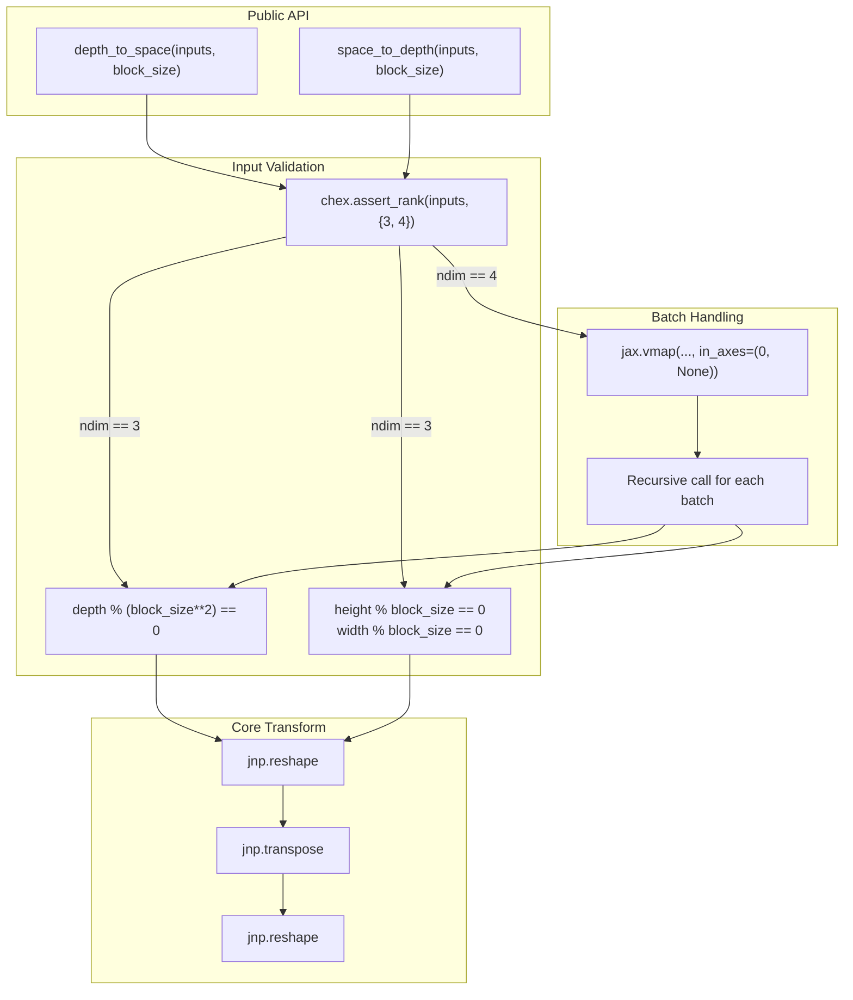
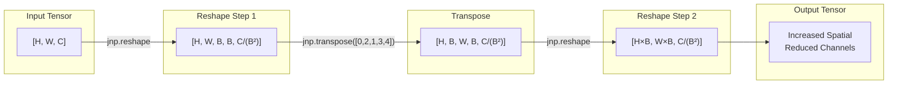
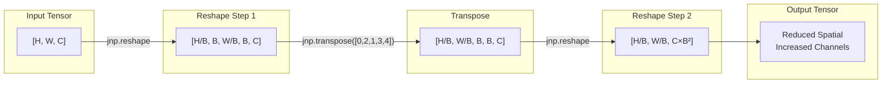
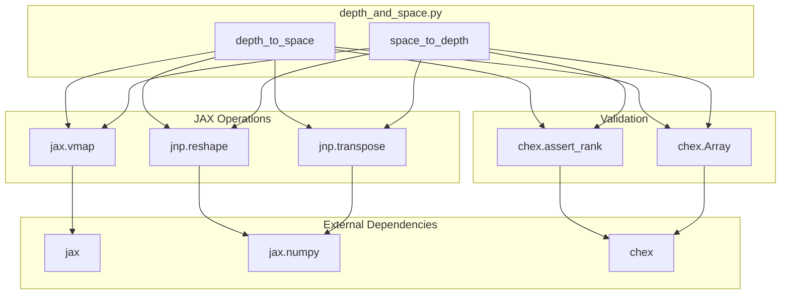

<!-- source: DeepWiki mcp.deepwiki.com · repo google-deepmind/dm_pix · page 5.3 Depth and Space Transforms · fetched 2026-10-26 -->

# Depth and Space Transforms

<details>
<summary>Relevant source files</summary>

The following files were used as context for generating this wiki page:

- [dm_pix/_src/depth_and_space.py](dm_pix/_src/depth_and_space.py)

</details>


## Purpose and Scope

This document covers the depth and space transformation utilities provided in `dm_pix._src.depth_and_space`. These functions rearrange image tensor dimensions by trading spatial resolution (height and width) for channel depth, and vice versa. This type of reorganization is commonly used in neural network architectures for super-resolution, sub-pixel convolution layers, and efficient data layout transformations.

For general information about other utility modules in dm_pix, see [Additional Core Modules](#5). For patch-based spatial operations, see [Patch Extraction](#5.1). For geometric transformations that modify spatial content, see [Geometric Transformations](#2.2).

**Sources:** [dm_pix/_src/depth_and_space.py:1-93]()

## Module Overview

The `depth_and_space` module provides two complementary functions that perform reversible tensor reorganizations:

| Function | Operation | Input Shape | Output Shape | Constraint |
|----------|-----------|-------------|--------------|------------|
| `depth_to_space` | Depth → Spatial | `[H, W, C]` | `[H×B, W×B, C÷B²]` | `C % B² == 0` |
| `space_to_depth` | Spatial → Depth | `[H, W, C]` | `[H÷B, W÷B, C×B²]` | `H % B == 0`, `W % B == 0` |

Where `B` is the `block_size` parameter (≥ 2).

Both functions support an optional leading batch dimension `[N, H, W, C]`, which is preserved in the output.

**Sources:** [dm_pix/_src/depth_and_space.py:23-92]()

## Function Architecture



**Diagram: Function Call Flow and Processing Pipeline**

The diagram shows how both functions follow the same structural pattern: validate input rank, handle batching via `jax.vmap`, check divisibility constraints, then apply a sequence of reshape-transpose-reshape operations.

**Sources:** [dm_pix/_src/depth_and_space.py:38-40](), [dm_pix/_src/depth_and_space.py:74-76]()

## depth_to_space Function

### Signature and Parameters

```python
depth_to_space(inputs: chex.Array, block_size: int) -> chex.Array
```

**Parameters:**
- `inputs`: Array of shape `[H, W, C]` or `[N, H, W, C]`
- `block_size`: Integer ≥ 2 specifying the spatial block size

**Returns:** Reshaped array with increased spatial dimensions and reduced channel depth.

**Sources:** [dm_pix/_src/depth_and_space.py:23-34]()

### Operation Details

The `depth_to_space` function rearranges channel data into spatial blocks. For each `block_size × block_size` group of channels, it creates a corresponding spatial block.

**Transform Sequence:**

1. **Validation** - Check that `depth % (block_size ** 2) == 0` [dm_pix/_src/depth_and_space.py:43-47]()
2. **Reshape to 5D** - `[H, W, C]` → `[H, W, block_size, block_size, new_depth]` where `new_depth = C / (block_size ** 2)` [dm_pix/_src/depth_and_space.py:48-50]()
3. **Transpose** - Rearrange axes from `[0, 1, 2, 3, 4]` to `[0, 2, 1, 3, 4]` [dm_pix/_src/depth_and_space.py:51]()
4. **Reshape to 3D** - `[H * block_size, W * block_size, new_depth]` [dm_pix/_src/depth_and_space.py:52-53]()



**Diagram: depth_to_space Transformation Steps**

**Sources:** [dm_pix/_src/depth_and_space.py:49-53]()

### Batch Processing

When the input has a batch dimension `[N, H, W, C]`, the function uses `jax.vmap` to apply the transformation to each batch element independently:

```python
if inputs.ndim == 4:  # Batched case.
    return jax.vmap(depth_to_space, in_axes=(0, None))(inputs, block_size)
```

The `in_axes=(0, None)` specification indicates that only the `inputs` argument is vectorized over axis 0, while `block_size` remains constant across the batch.

**Sources:** [dm_pix/_src/depth_and_space.py:39-40]()

## space_to_depth Function

### Signature and Parameters

```python
space_to_depth(inputs: chex.Array, block_size: int) -> chex.Array
```

**Parameters:**
- `inputs`: Array of shape `[H, W, C]` or `[N, H, W, C]`
- `block_size`: Integer ≥ 2 specifying the spatial block size

**Returns:** Reshaped array with reduced spatial dimensions and increased channel depth.

**Sources:** [dm_pix/_src/depth_and_space.py:57-71]()

### Operation Details

The `space_to_depth` function performs the inverse operation of `depth_to_space`, converting spatial blocks into additional channels.

**Transform Sequence:**

1. **Validation** - Check that `height % block_size == 0` and `width % block_size == 0` [dm_pix/_src/depth_and_space.py:79-84]()
2. **Reshape to 5D** - `[H, W, C]` → `[H/block_size, block_size, W/block_size, block_size, C]` [dm_pix/_src/depth_and_space.py:88-89]()
3. **Transpose** - Rearrange axes from `[0, 1, 2, 3, 4]` to `[0, 2, 1, 3, 4]` [dm_pix/_src/depth_and_space.py:90]()
4. **Reshape to 3D** - `[H/block_size, W/block_size, C * (block_size ** 2)]` [dm_pix/_src/depth_and_space.py:91]()



**Diagram: space_to_depth Transformation Steps**

**Sources:** [dm_pix/_src/depth_and_space.py:88-91]()

### Batch Processing

Like `depth_to_space`, the batched case is handled using `jax.vmap`:

```python
if inputs.ndim == 4:  # Batched case.
    return jax.vmap(space_to_depth, in_axes=(0, None))(inputs, block_size)
```

**Sources:** [dm_pix/_src/depth_and_space.py:75-76]()

## Reversibility Property

The two functions are exact inverses of each other, satisfying the following property:

```
space_to_depth(depth_to_space(x, B), B) == x  (when constraints are met)
depth_to_space(space_to_depth(x, B), B) == x  (when constraints are met)
```

### Constraint Compatibility

| Transform Sequence | Initial Shape | Intermediate Shape | Final Shape | Required Constraints |
|-------------------|---------------|-------------------|-------------|---------------------|
| `depth_to_space` → `space_to_depth` | `[H, W, C]` | `[H×B, W×B, C÷B²]` | `[H, W, C]` | `C % B² == 0` |
| `space_to_depth` → `depth_to_space` | `[H, W, C]` | `[H÷B, W÷B, C×B²]` | `[H, W, C]` | `H % B == 0`, `W % B == 0` |

**Sources:** [dm_pix/_src/depth_and_space.py:60]()

## Mathematical Interpretation

### depth_to_space: Channel Unpacking

Given an input tensor `I[h, w, c]` and block size `B`:

1. Group channels into `B × B` blocks: `c = (c' × B²) + offset` where `offset ∈ [0, B²)`
2. Map each offset to a 2D spatial offset: `offset = (Δh × B) + Δw` where `Δh, Δw ∈ [0, B)`
3. Output: `O[h×B + Δh, w×B + Δw, c'] = I[h, w, (c' × B²) + (Δh × B) + Δw]`

### space_to_depth: Spatial Packing

Given an input tensor `I[h, w, c]` and block size `B`:

1. Divide spatial dimensions into `B × B` blocks: `h = h' × B + Δh`, `w = w' × B + Δw`
2. Map each spatial offset to a channel offset: `offset = (Δh × B) + Δw`
3. Output: `O[h', w', (c × B²) + offset] = I[h' × B + Δh, w' × B + Δw, c]`

**Sources:** [dm_pix/_src/depth_and_space.py:24-34](), [dm_pix/_src/depth_and_space.py:58-71]()

## Common Use Cases

### Super-Resolution Networks

Sub-pixel convolution layers (also known as pixel shuffle) use `depth_to_space` to upscale feature maps:

```python
# Typical usage in super-resolution
features = conv_layer(low_res_input)  # [H, W, C * upscale_factor²]
high_res_output = depth_to_space(features, upscale_factor)  # [H * upscale_factor, W * upscale_factor, C]
```

### Efficient Convolution Layouts

`space_to_depth` can be used to reduce spatial dimensions before expensive convolutions:

```python
# Reduce spatial resolution, increase channels
compact = space_to_depth(high_res_input, 2)  # [H/2, W/2, C*4]
features = expensive_conv(compact)
restored = depth_to_space(features, 2)  # [H, W, C']
```

### Tensor Reorganization for Hardware Efficiency

Some hardware accelerators perform better with certain tensor shapes. These functions allow flexible reorganization without changing the total number of elements.

**Sources:** [dm_pix/_src/depth_and_space.py:14]()

## JAX Integration

### JIT Compilation

Both functions are fully compatible with `jax.jit`:

```python
import jax
import dm_pix

jit_depth_to_space = jax.jit(dm_pix.depth_to_space, static_argnums=1)
jit_space_to_depth = jax.jit(dm_pix.space_to_depth, static_argnums=1)
```

The `static_argnums=1` specification ensures `block_size` is treated as a compile-time constant, allowing better optimization.

### Automatic Vectorization

Since the functions already implement `vmap` internally for batched inputs, they can be further nested with additional `vmap` calls:

```python
# Apply to a dataset with shape [dataset_size, batch_size, H, W, C]
vmapped_d2s = jax.vmap(dm_pix.depth_to_space, in_axes=(0, None))
results = vmapped_d2s(dataset, block_size)
```

### Gradient Computation

Both transforms are fully differentiable and can be used in gradient-based optimization:

```python
def loss_fn(inputs):
    transformed = depth_to_space(inputs, block_size=2)
    return jnp.sum(transformed ** 2)

grad_fn = jax.grad(loss_fn)
gradients = grad_fn(inputs)
```

**Sources:** [dm_pix/_src/depth_and_space.py:17-18]()

## Implementation Dependencies



**Diagram: Module Dependencies and Core Operations**

The functions depend on three external libraries:
- **JAX**: Provides `vmap` for automatic vectorization
- **JAX NumPy**: Provides `reshape` and `transpose` array operations
- **Chex**: Provides type annotations (`Array`) and validation (`assert_rank`)

**Sources:** [dm_pix/_src/depth_and_space.py:16-18]()

## Error Handling

### depth_to_space Errors

| Error Condition | Exception | Message |
|----------------|-----------|---------|
| Input rank not 3 or 4 | `AssertionError` | Raised by `chex.assert_rank` |
| `depth % (block_size**2) != 0` | `ValueError` | "Number of channels {depth} must be divisible by block_size ** 2 {block_size**2}." |

**Sources:** [dm_pix/_src/depth_and_space.py:38](), [dm_pix/_src/depth_and_space.py:43-47]()

### space_to_depth Errors

| Error Condition | Exception | Message |
|----------------|-----------|---------|
| Input rank not 3 or 4 | `AssertionError` | Raised by `chex.assert_rank` |
| `height % block_size != 0` | `ValueError` | "Height {height} must be divisible by block size {block_size}." |
| `width % block_size != 0` | `ValueError` | "Width {width} must be divisible by block size {block_size}." |

**Sources:** [dm_pix/_src/depth_and_space.py:74](), [dm_pix/_src/depth_and_space.py:79-84]()

## Performance Considerations

### Memory Layout

Both functions perform in-place-like transformations using reshape and transpose operations. These are typically memory-efficient in JAX, though the transpose operation may require memory reallocation.

### Compile-Time Optimization

Since `block_size` affects the shape transformations, it should be passed as a static argument to `jit` when possible:

```python
# Good: block_size is static
jit_transform = jax.jit(depth_to_space, static_argnums=1)

# Less optimal: block_size is dynamic (requires recompilation)
jit_transform = jax.jit(depth_to_space)
```

### Batching Strategy

The internal use of `vmap` for batched inputs is efficient, but for very large batch sizes, consider splitting the batch to reduce peak memory usage:

```python
# Process large batches in chunks
batch_size = inputs.shape[0]
chunk_size = 32
results = []
for i in range(0, batch_size, chunk_size):
    chunk = inputs[i:i+chunk_size]
    results.append(depth_to_space(chunk, block_size))
result = jnp.concatenate(results, axis=0)
```

**Sources:** [dm_pix/_src/depth_and_space.py:39-40](), [dm_pix/_src/depth_and_space.py:75-76]()

---

