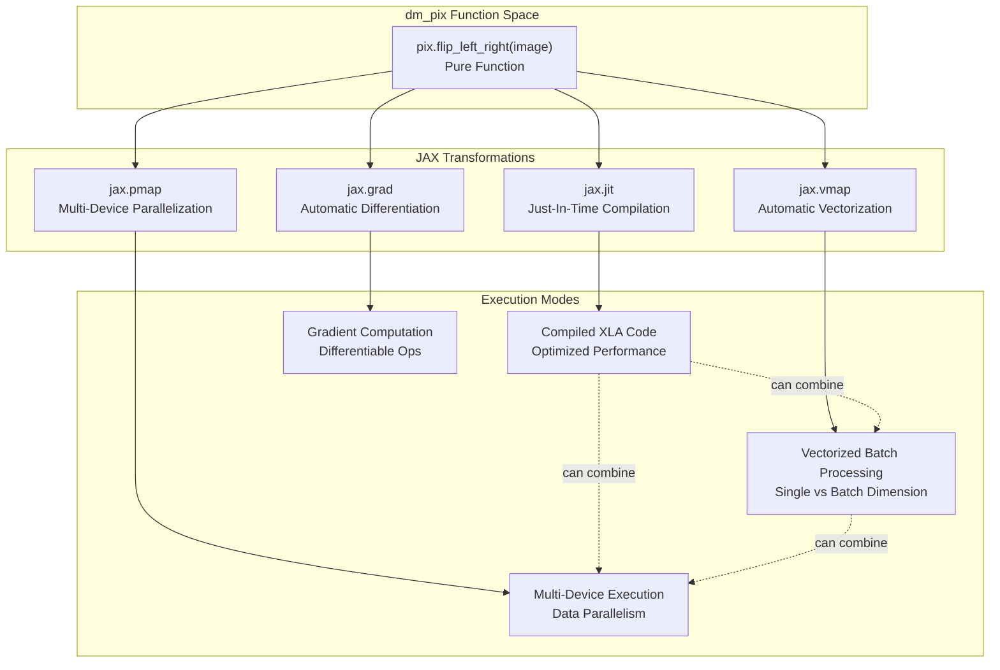
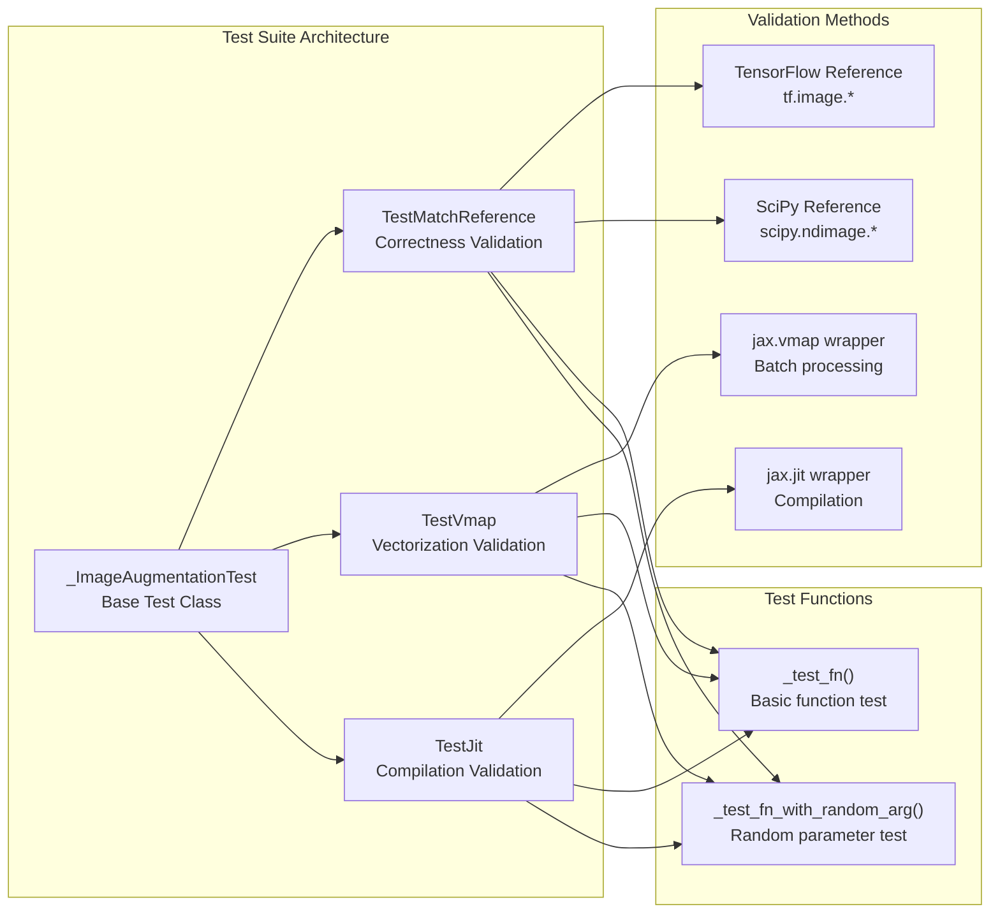
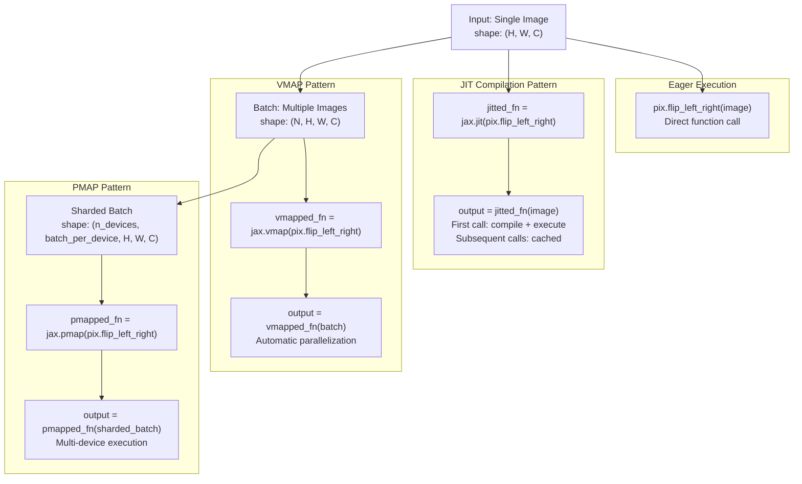
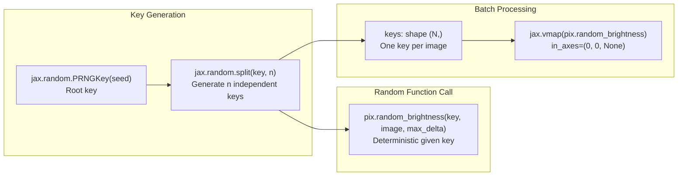

<!-- source: DeepWiki mcp.deepwiki.com · repo google-deepmind/dm_pix · page 6 JAX Integration · fetched 2026-10-26 -->

# JAX Integration

<details>
<summary>Relevant source files</summary>

The following files were used as context for generating this wiki page:

- [README.md](README.md)
- [dm_pix/_src/augment_test.py](dm_pix/_src/augment_test.py)
- [dm_pix/images/pix_logo.png](dm_pix/images/pix_logo.png)

</details>


This document explains how dm_pix integrates with JAX's core transformations (`jax.jit`, `jax.vmap`, and `jax.pmap`) and the design principles that enable functional compatibility. All dm_pix functions are designed to work seamlessly with JAX's functional programming model, allowing for compilation, automatic vectorization, and multi-device parallelization.

For specific details on individual augmentation functions, see [Image Augmentation Module](#2). For information on using random augmentation patterns with PRNG keys, see [Random Augmentation Pattern](#2.4).

**Scope**: This page covers the general integration patterns and compatibility guarantees. Subsections [6.1](#6.1), [6.2](#6.2), and [6.3](#6.3) provide specific usage patterns for each transformation type.

## Design Principles for JAX Compatibility

dm_pix adheres to JAX's functional programming requirements to ensure all transformations work correctly:

### Pure Functions

All dm_pix functions are pure: they produce the same output for the same input without side effects. This is fundamental to JAX's compilation and transformation model.

```python
# Pure function example - deterministic output
output = pix.adjust_brightness(image, delta=0.2)

# Pure function with explicit randomness via PRNG key
key = jax.random.PRNGKey(42)
output = pix.random_brightness(key, image, max_delta=0.5)
```

**Stateless Randomness**: Random augmentation functions accept `jax.random.PRNGKey` as an explicit parameter rather than relying on global random state. This enables reproducibility and proper function transformation.

### Static Shape Requirements

Most dm_pix functions work with dynamic shapes, but some operations require static shape information for JIT compilation:

| Function Category | Static Shape Requirement | Example |
|------------------|-------------------------|---------|
| Color adjustments | None | `adjust_brightness`, `adjust_contrast` |
| Flipping operations | None | `flip_left_right`, `flip_up_down` |
| Cropping with fixed size | Crop size must be static | `random_crop(key, image, (100, 100, 3))` |
| Gaussian blur | `kernel_size` derived from `sigma` must be static | `gaussian_blur(image, sigma=2.0)` |
| Elastic deformation | `sigma` must be static (determines kernel size) | `elastic_deformation(key, image, sigma=5.0)` |

### Array Type Compatibility

Functions accept and return JAX arrays (`jax.numpy.ndarray`) but are also compatible with NumPy arrays through implicit conversion:

```python
import numpy as np
import jax.numpy as jnp

# Both work identically
numpy_image = np.random.rand(100, 100, 3)
jax_image = jnp.array(numpy_image)

output_np = pix.flip_left_right(numpy_image)  # Works
output_jax = pix.flip_left_right(jax_image)   # Works
```

Sources: [README.md:13-19](), [README.md:63-91]()

## JAX Transformation Overview

The following diagram shows how dm_pix functions integrate with JAX's transformation ecosystem:



**Transformation Composition**: JAX transformations can be composed. For example, you can `jax.jit(jax.vmap(pix.adjust_brightness))` to get compiled, vectorized brightness adjustment.

Sources: [README.md:17-19](), [README.md:63-91]()

## Validation and Testing Strategy

dm_pix employs a comprehensive testing strategy to ensure JAX transformation compatibility. The test suite validates three key aspects:



### Test Class Hierarchy

The test suite defines three specialized test classes that inherit from a common base:

**`_ImageAugmentationTest`** [dm_pix/_src/augment_test.py:35-426](): Base class defining test interface with two abstract methods:
- `_test_fn(images_list, jax_fn, reference_fn)`: Tests functions without parameters
- `_test_fn_with_random_arg(images_list, jax_fn, reference_fn, **kw_range)`: Tests functions with varying parameters

**`TestMatchReference`** [dm_pix/_src/augment_test.py:428-454](): Validates correctness by comparing dm_pix output against TensorFlow and SciPy reference implementations:
```python
# Example from test
adjusted_jax = jax_fn(image_rgb, **{kw_name: argument})
adjusted_reference = reference_fn(image_rgb, argument)
self.assertAllCloseTolerant(adjusted_jax, adjusted_reference)
```

**`TestVmap`** [dm_pix/_src/augment_test.py:456-486](): Validates that vectorized execution produces identical results to sequential execution:
```python
# Vectorized execution
fn_vmap = jax.vmap(jax_fn)
outputs_vmaped = fn_vmap(np.stack(images_list, axis=0), ...)

# Compare each output with sequential execution
for image_rgb, adjusted_vmap in zip(images_list, outputs_vmaped):
    adjusted_jax = jax_fn(image_rgb, **kwargs)
    self.assertAllCloseTolerant(adjusted_jax, adjusted_vmap)
```

**`TestJit`** [dm_pix/_src/augment_test.py:488-509](): Validates that compiled execution produces identical results to eager execution:
```python
jax_fn_jitted = jax.jit(jax_fn)
adjusted_jax = jax_fn(image_rgb, **{kw_name: argument})
adjusted_jit = jax_fn_jitted(image_rgb, **{kw_name: argument})
self.assertAllCloseTolerant(adjusted_jax, adjusted_jit)
```

### Test Coverage Matrix

The following table shows which validation methods are applied to each function category:

| Function Category | Reference Match | vmap Test | jit Test | Reference Library |
|-------------------|----------------|-----------|----------|-------------------|
| `adjust_brightness` | ✓ | ✓ | ✓ | `tf.image.adjust_brightness` |
| `adjust_contrast` | ✓ | ✓ | ✓ | `tf.image.adjust_contrast` |
| `adjust_gamma` | ✓ | ✓ | ✓ | `tf.image.adjust_gamma` |
| `adjust_saturation` | ✓ | ✓ | ✓ | `tf.image.adjust_saturation` |
| `adjust_hue` | ✓ | ✓ | ✓ | `tf.image.adjust_hue` |
| `rot90` | ✓ | ✓ | ✓ | `tf.image.rot90` |
| `flip_left_right` | ✓ | ✓ | ✓ | `tf.image.flip_left_right` |
| `flip_up_down` | ✓ | ✓ | ✓ | `tf.image.flip_up_down` |
| `affine_transform` | ✓ | ✓ | ✓ | `scipy.ndimage.affine_transform` |
| `rotate` | ✓ | ✓ | ✓ | `scipy.ndimage.rotate` |
| `solarize` | - | ✓ | ✓ | No reference |
| `gaussian_blur` | - | ✓ | ✓ | No reference |
| `random_crop` | - | ✓ | ✓ | No reference |
| `elastic_deformation` | - | ✓ | ✓ | No reference |
| `center_crop` | ✓ | ✓ | ✓ | `tf.keras.layers.CenterCrop` |
| `pad_to_size` | ✓ | ✓ | ✓ | `tf.image.resize_with_crop_or_pad` |

Sources: [dm_pix/_src/augment_test.py:35-426](), [dm_pix/_src/augment_test.py:428-454](), [dm_pix/_src/augment_test.py:456-486](), [dm_pix/_src/augment_test.py:488-509]()

## Transformation-Specific Patterns

The following diagram illustrates how different transformation patterns are applied to dm_pix functions:



### Example: Composing Transformations

dm_pix functions support transformation composition for maximum performance:

```python
import jax
import dm_pix as pix

# Compile + vectorize for batch processing
batch_brightness = jax.jit(jax.vmap(pix.adjust_brightness))

# Use with batched images
batch = jnp.stack([image1, image2, image3])  # shape: (3, H, W, C)
deltas = jnp.array([0.1, 0.2, 0.3])  # Different delta per image

# First call compiles, subsequent calls use cached version
output = batch_brightness(batch, deltas)  # shape: (3, H, W, C)
```

**Performance Note**: The first call to a JIT-compiled function triggers compilation, which may take longer. Subsequent calls reuse the compiled code, providing significant speedup.

Sources: [README.md:74-91](), [dm_pix/_src/augment_test.py:466-476](), [dm_pix/_src/augment_test.py:495-500]()

## PRNG Key Management for Random Functions

Random augmentation functions require explicit PRNG key management for proper transformation compatibility:



**Key Splitting Pattern**: When processing multiple images with random augmentation, split the key to generate independent randomness for each image:

```python
# Single image
key = jax.random.PRNGKey(42)
output = pix.random_brightness(key, image, max_delta=0.5)

# Batch of images - split keys
key = jax.random.PRNGKey(42)
keys = jax.random.split(key, batch_size)  # shape: (batch_size, 2)

# Apply with vmap
random_brightness_batch = jax.vmap(
    pix.random_brightness, 
    in_axes=(0, 0, None)  # keys vary, images vary, max_delta is broadcast
)
outputs = random_brightness_batch(keys, images, max_delta=0.5)
```

Sources: [dm_pix/_src/augment_test.py:60-66](), [dm_pix/_src/augment_test.py:171-189]()

## Platform Compatibility

dm_pix functions work across all JAX-supported platforms:

| Platform | JIT Support | VMAP Support | PMAP Support | Notes |
|----------|-------------|--------------|--------------|-------|
| CPU | ✓ | ✓ | ✓ | Reference platform |
| GPU/CUDA | ✓ | ✓ | ✓ | XLA compilation required |
| TPU | ✓ | ✓ | ✓ | Lower floating point precision (see below) |

**TPU Precision**: Tests automatically adjust tolerance on TPU due to lower precision arithmetic:
```python
# From augment_test.py
tol = 1e-2 if jax.local_devices()[0].platform == "tpu" else 1e-4
np.testing.assert_allclose(x, y, rtol=tol, atol=tol)
```

**XLA Compilation Note**: All dm_pix functions are written to be XLA-compilable, meaning they will work efficiently on GPU and TPU through JAX's XLA backend.

Sources: [dm_pix/_src/augment_test.py:45-49]()

## Common Integration Patterns

The following table summarizes recommended patterns for different use cases:

| Use Case | Recommended Pattern | Example |
|----------|---------------------|---------|
| Single image processing | Direct call | `pix.adjust_brightness(image, delta=0.2)` |
| Repeated single image calls | JIT compilation | `jax.jit(pix.adjust_brightness)(image, delta=0.2)` |
| Batch processing (same augmentation) | vmap | `jax.vmap(pix.flip_left_right)(batch)` |
| Batch processing (different params) | vmap with in_axes | `jax.vmap(pix.adjust_brightness)(batch, deltas)` |
| Multi-GPU training | pmap | `jax.pmap(pix.random_crop)(sharded_batch, ...)` |
| Maximum performance | jit + vmap | `jax.jit(jax.vmap(pix.adjust_brightness))` |
| Random augmentation pipeline | vmap with split keys | See PRNG Key Management above |

**Gradient Computation**: While not extensively tested in the current test suite, dm_pix functions that are mathematically differentiable can be used with `jax.grad` for gradient-based optimization.

Sources: [README.md:63-96]()

## Limitations and Known Issues

### Static Shape Requirements

Some operations require static shape information for JIT compilation:

- **Elastic deformation**: `sigma` parameter must be static because it determines Gaussian kernel size [dm_pix/_src/augment_test.py:351]()
- **Random crop**: Target shape must be static for efficient compilation [dm_pix/_src/augment_test.py:323]()
- **Gaussian blur**: `kernel_size` derived from `sigma` must be static [dm_pix/_src/augment_test.py:315]()

### SciPy Mode Limitations

Not all `scipy.ndimage` modes are fully supported due to JAX/SciPy compatibility issues:

```python
# From test comments
# Due to a bug in scipy we cannot test all available modes
# https://github.com/jax-ml/jax/issues/11097
```

Tested modes for `affine_transform` and `rotate`:
- `mode="nearest"` with `order=0` and `order=1` ✓
- `mode="mirror"` with `order=1` ✓
- `mode="constant"` with `order=1` ✓

Sources: [dm_pix/_src/augment_test.py:191-201](), [dm_pix/_src/augment_test.py:269-302]()

## Next Steps

For detailed information on specific transformation types:
- **JIT Compilation**: See [JIT Compilation](#6.1) for performance optimization techniques
- **Vectorization**: See [Vectorization with vmap](#6.2) for batch processing patterns
- **Parallelization**: See [Parallelization with pmap](#6.3) for multi-device execution

For examples of JAX transformations in practice, see [Examples and Usage Patterns](#10).

---

